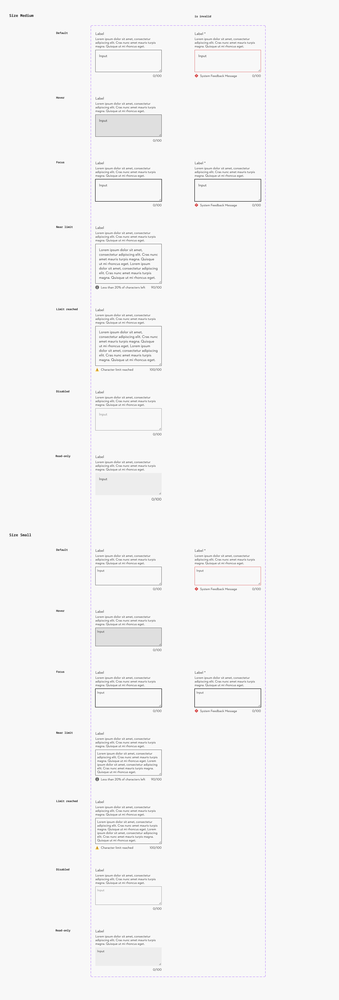
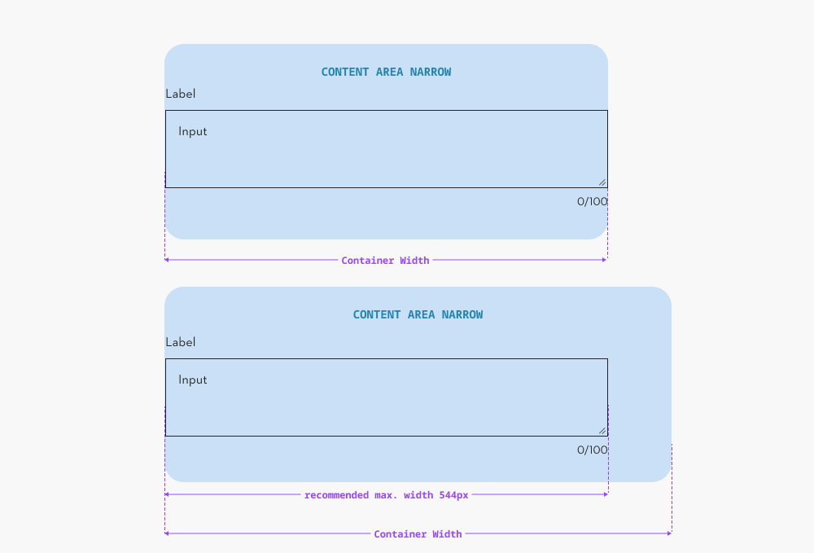
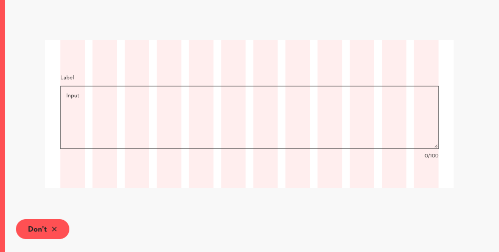
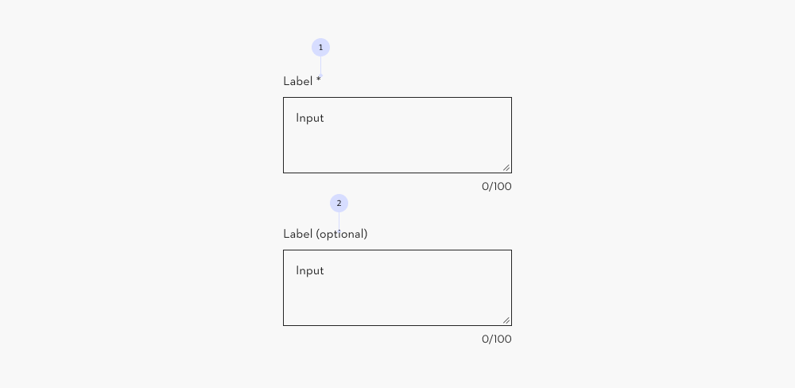
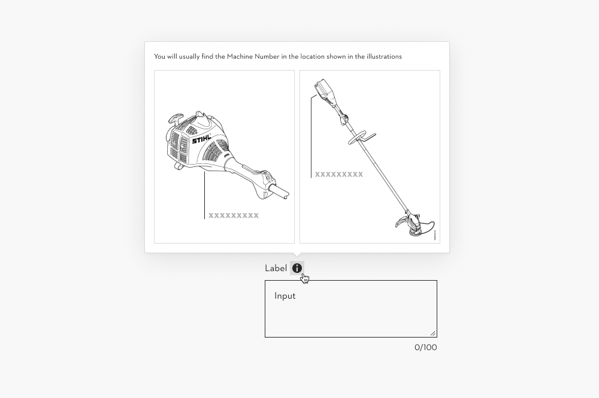
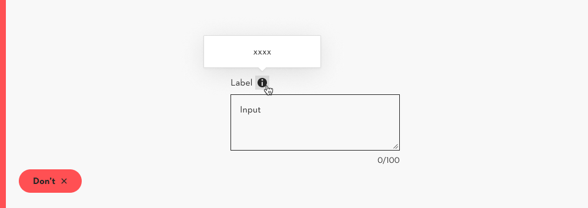
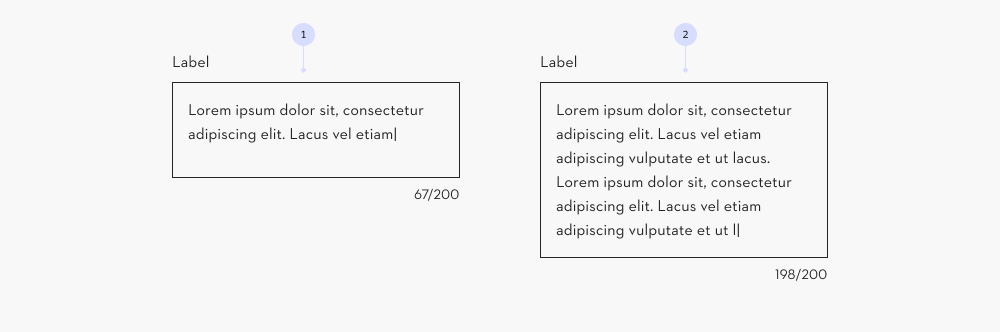
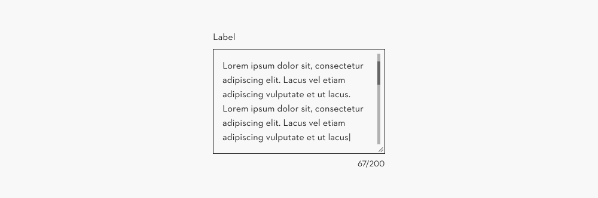

# Textarea

## Textarea

Overview:

- Use for multi-line text input, suitable for longer responses, comments, or descriptions.

_Figure: The Textarea component in a UI design system, showing its various states and sizes. It includes two sizes, "Size Medium" and "Size Small," and displays states such as "Default," "Hover," "Focus," "Near limit," "Limit reached," "Disabled," and "Read-only." The component features a label, an input field, and system feedback messages of types "error," "info," and "warning." The numbers indicate character counts, with "0/100," "90/100," and "100/100" representing the number of characters entered out of a 100-character limit. The "is invalid" text indicates an error state. The "Label \*" denotes a required field..._

### Further guidelines

[Storybook documentation](https://main--63440bbb95889041542a5ba3.chromatic.com/?path=/docs/components-textarea--documentation&globals=backgrounds.name:!undefined;backgrounds.value:!undefined)

### Related elements

[Input Text](https://www.figma.com/design/qXldpLO6gxHJNLdcXIPxYt?node-id=1591-2)

### Contribute

Contribute to improving this component by sharing your feedback, asking questions, or suggesting features [here](https://www.figma.com/design/lLmw7PfIdKjFG4uT3B2Hyj/Onboarding-%F0%9F%93%96?node-id=446-868&t=zKmRu4kAkxMeRDmK-4).

## Formatting and Construction

### Anatomy

1. **Label** Communicate to the user, what input is needed.
1. **Text area** The area where the user enters the input.
1. **User input text** Data, entered by the user
1. **Character count/limit (optional)** Counter that shows current character count and the character limit for the text area
1. **Hint (optional)** Short copy that provides guidance and context.
1. **Info Button (optional)** Can be used to trigger a popover with additional information
1. **System feedback** Messages that communicate the current input state. Info and warning messages apply only when a character limit is set. **a) Info (optional):** may appear when less than 20% of the character limit remains, before the limit is reached. **b)** **Warning:** always appears when the character limit is reached. **c)** **Error:** appears on submission if a required field is empty, with or without a character limit.

_Figure: The anatomy of a Textarea component in various states and configurations. The numbered callouts point to specific parts of the Textarea: 1 points to the Label, 3 points to the Text area where user input is entered, 2 points to the Character count/limit, 4 points to the Character count/limit in a different state, 5 points to the Hint text, and 6 points to the Info Button. The figure shows different states of the Textarea, including enabled, near limit, and limit reached, with corresponding messages and visual indicators. The character count/limit measurement indicates the number of characters entered by the user out of the allowed limit._

### Sizing

#### Minimum height and width

- Minimum height: 96px
- Minimum width: 288px

_Figure: Medium textarea with Label, "Input" text and "0/100" counter, with measurements showing the minimum height of 96px (vertical, at the right of the field) and the minimum width of 288px (horizontal, below the field)._

#### Maximum width

The width of a text area field is determined by the container it is placed in. This should ideally be the “[content area narrow](https://www.figma.com/design/HHM9B6UjMStGLxMf6loNLn/DS-945-Grid-Optimisations-%7C-Design?node-id=1-857&t=FFOFP94g90gl91Ko-4)” defined within the grid layout.

While the text area can adjust to fit its container, we recommend not exceeding a maximum width of 544px (matching the [maximum text width](https://www.figma.com/design/pQUiJaNuWrGzPaeMrEHf6N/DS-1117-Design-%7C-34em?node-id=2645-515)) for better scanability and readability. This width should be set on a [fieldset](https://www.figma.com/design/Ie2r0R9QwjEc7O3nrFbXhV/Web-Pattern-Library?node-id=8-154) or container itself.

In the Figma component, the maximum width is set to the recommended 544px. ([Link to calculation](https://www.figma.com/design/pQUiJaNuWrGzPaeMrEHf6N/DS-1117-Design-%7C-34em?node-id=2645-515))

_Figure: Two textareas (Label, "Input", "0/100") inside a "Content area Narrow" container. In the first the field fills the container width; in the second the container is wider than the field, and the field stays at the "recommended max. width 544px" while "Container Width" extends beyond it._

_Figure: A Textarea component with a Label above it, in a medium size, enabled state, and not invalid. The Textarea has a counter at the bottom right indicating "0/100", a resize handle, and is placed within a striped background. The board is marked as a "Don't" example, indicating that the Textarea should not be constrained to a maximum width, as it may affect usability and layout consistency._

## Content and Assets

### Required and optional indicators

In order to communicate which fields are required to the user an asterisk **(1)** is shown next to the label. When using the code component the asterisk will be shown automatically when input is set to required.

Optional areas are marked with the word “(optional)”, after the label **(2)**. In most cases, this has to be added manually in the Content Management System.

_Figure: Two medium textareas with "Input" and "0/100": the first with the label "Label \*", where callout 1 points at the asterisk marking a required field; the second with the label "Label (optional)", where callout 2 points at the word "(optional)" marking an optional field._

### Info Button

A button to trigger a popover can be placed next to input or select labels to provide **additional contextual information.**

Popover content should be **limited to supplementary, non-critical information** — for example, brief explanations, examples, or guidance that supports user understanding without being essential for task completion.

_Figure: Medium textarea with the label "Label", an info button next to it (hovered with a pointer cursor), the placeholder "Input", a resize handle and the counter "0/100". Above the info button an open white popover with the text "You will usually find the Machine Number in the location shown in the illustrations" shows two line drawings of a STIHL engine unit and a trimmer, each with a leader line to a placeholder machine number "xxxxxxxxx"._

**Don’t use the popover for critical or required information**, use the hint instead as critical information should net be hidden

For mor Guidance on this topic see the [Popover documentation](https://www.figma.com/design/qXldpLO6gxHJNLdcXIPxYt?node-id=35223-10505)

_Figure: Don't example: a medium textarea with the label "Label", an info button (hovered), the placeholder "Input", a resize handle and the counter "0/100", with a small white popover above the info button containing only the placeholder text "xxxx". This is wrong because the popover must not hold critical or required information; use the hint instead._

## Behavior

### Character count

Some text areas need a character limit. These indicators are displayed at the bottom right. When typing, the indicator counts the number of characters being used. **(1)**

When less than 20% of the character limit remains, an optional info message can be displayed. **(2)**

When reaching the maximum number of usable characters, a warning message about the character limit is shown, and it is not possible to enter any more characters. **(3)** If the text area is required and the user tries to submit the form without entering any text, the field becomes invalid and an error feedback message is displayed. **(4)**

_Figure: Four variants of a textarea component with different states and character count indicators. Each textarea has a label, an input field, a resize handle, and a character counter. Callout 1 points to a textarea with a character count of 57/100, callout 2 points to a textarea with a character count of 161/200 and an info message indicating less than 20% of characters left, callout 3 points to a textarea at the character limit of 100/100 with a warning message, and callout 4 points to an invalid textarea required field with a system feedback message and 0/100 character count. The character count measures the number of characters entered in the textarea._

### Scaling the area

The text area can have a fixed hight or can be used dynamically and scale with the content or user input.

1. **automatic**
1. **manual**

_Figure: Two variants of a text-area-medium component, both in an enabled and invalid state. The first variant has an info icon near the limit and a counter showing "0/100," indicating the character count. The second variant includes a resize handle, allowing manual scaling, along with an info icon near the limit and a counter showing "0/100." Callout 1 points to the info icon in the first variant, and callout 2 points to the resize handle in the second variant. Both text areas have a Label and an Input field._

**Automatic**

The text area grows automatically in height when entering the input. **(1)** If the area grows the initial state should be at least the minimum height. The text area should stop growing when reaching the maximum size. **(2)**

_Figure: A textarea component with a medium size, enabled state, and no validation errors. The component is labeled "Label" and includes a counter displaying the current character count out of the maximum allowed. Callout 1 points to the textarea in its initial state with minimal height, while callout 2 points to the textarea expanded to near its maximum height. The measurements 67/200 and 198/200 refer to the number of characters entered out of the maximum limit of 200 characters._

### Overflow

More characters than max height requires a (native) scroll bar to be shown in the text area

_Figure: A text-area-medium component with the label "Label" and a text input that has reached near its character limit, indicated by the counter showing "67/200". The text area includes a native scroll bar because the text exceeds the maximum height, and it is in an enabled state without any validation errors. The component also features a resize handle._
