# Toast

## Toast

Overview:

- Toast messages are not accessible, as the the close button cannot be focused.
- Screenreader software is able to read the content.
- Copy must be as concise as possible, use conversational language.
- Toasts disappear after 10 seconds, therefore a maximum of 15 words is recommended.
- Multiple toast messages appear one by one, first in first out, like a queue.
- The toast notification is triggered by a user and gives additional feedback about an action.

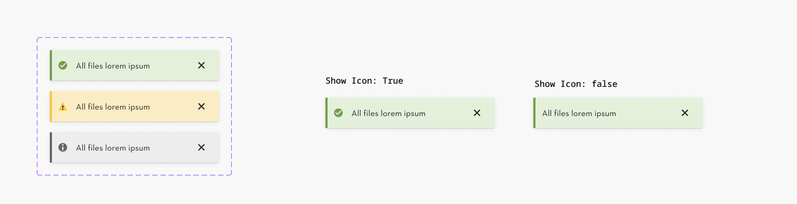

_Figure: Shows close-button (button text=Button, variant=ghost, state=enabled, size=small, icon position=none, hide label=on, flush alignment=off); toast (text=All files lorem ipsum, icon, type=success); toast (text=All files lorem ipsum, type=success). Text in the figure: "All files lorem ipsum", "Show Icon: True", "Show Icon: false"._

### Further guidelines

[Storybook documentation](https://main--63440bbb95889041542a5ba3.chromatic.com/?path=/docs/components-toast--documentation&globals=backgrounds.name:!undefined;backgrounds.value:!undefined)

Decision tree

### Similar components

**Component**

**Trigger**

**Placement**

**Content**

**Intention**

**Tooltip**

Hover or focus of an interactive element

In proximity to the triggering element, non-modal

Text only

Provide short, contextual information or clarify unlabeled controls

**Popover**

Click or tap of an interactive element

In proximity to the triggering button, non-modal

Text, icon, image and interactive elements

Provide additional information or quick actions without leaving the current context

**Dialog**

Triggered by the system in response to user interaction

Center of the screen, with backdrop, modal

Text, icon, image and interactive elements

Confirm important actions, guide users through complex tasks, or temporarily block interaction to focus attention

**Toast**

Triggered by the system in response to user interaction

Bottom of the screen, non-modal

Text, icon, and optional dismiss button

Provide brief, lightweight feedback on user actions such as error or success.

**Notification**

Triggered by the system in response to events or interactions

Within the content area of the page, in relation to relevant elements

Text, icon, links and buttons

Deliver important updates or status messages that may require user attention or follow-up

### Related elements

[Notification](https://www.figma.com/design/qXldpLO6gxHJNLdcXIPxYt?node-id=7251-8)

[Dialog](https://www.figma.com/design/qXldpLO6gxHJNLdcXIPxYt?node-id=14115-4051)

[Typography](https://www.figma.com/design/d9wrOp4aCplDsV9AVC87Xn/Typography-%F0%9F%85%B0%EF%B8%8F?m=auto&t=4yiq5f9rjU14BQYJ-6)

[Button](https://www.figma.com/design/qXldpLO6gxHJNLdcXIPxYt?node-id=162-126)

[System feedback](https://www.figma.com/design/qXldpLO6gxHJNLdcXIPxYt?node-id=101-127)

[Tooltip](https://www.figma.com/design/HovZmjHiwxguawTWTO6ibS/DS-1085-Design-%7C-Web-%7C-Tootlip?node-id=36194-1244)

[Popover](https://www.figma.com/design/qXldpLO6gxHJNLdcXIPxYt?node-id=26075-11456)

### Contribute

Contribute to improving this component by sharing your feedback, asking questions, or suggesting features [here](https://www.figma.com/design/lLmw7PfIdKjFG4uT3B2Hyj/Onboarding-%F0%9F%93%96?node-id=446-868&t=zKmRu4kAkxMeRDmK-4).

## Formatting and Construction

### Anatomy

1. **Icon (optional)** Additional visual indicator, what type of notification is used.
1. **Content** Information for the user triggered by an event.
1. **Close icon:** Button to close the toast manually (icon button cannot be focused by using the keyboard).

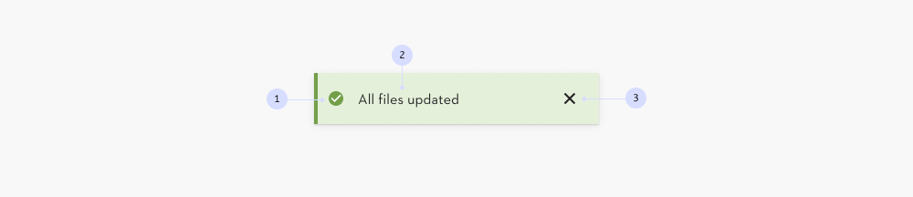

_Figure: Shows toast (text=All files updated, icon, type=success). Callouts 1, 2, 3. Text in the figure: "All files updated"._

#### Types

1. **Success** Inform the user that an action was completed.
1. **Warning** Alert about potential issues, preventing errors and enhancing safety.
1. **Info** Provide informational messages that do not require immediate action.

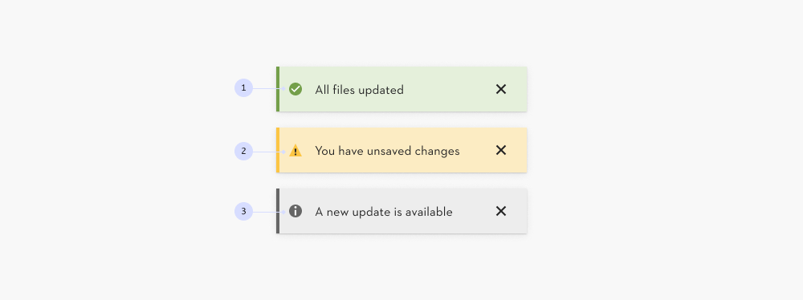

_Figure: Shows toast (text=All files updated, icon, type=success); toast (text=You have unsaved changes, icon, type=warning); toast (text=A new update is available, icon, type=info). Callouts 1, 2, 3. Text in the figure: "All files updated", "You have unsaved changes", "A new update is available"._

#### Width and height

- **The maximum width is 400px**, for all other cases.
- **The height is flexible**, based on the content container.

**Minimum space** between browser edge and toast **is 16px**.

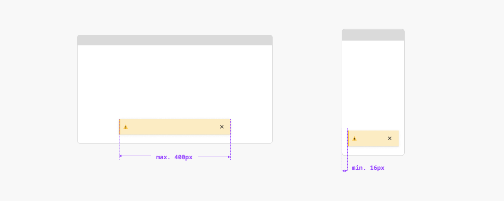

_Figure: Shows close-button (button text=Button, variant=ghost, state=enabled, size=small, icon position=none, hide label=on, flush alignment=off). Text in the figure: "It looks", "It looks like your network connection is", "max. 400px", "min. 16px"._

#### Enter animation

**Animation type:** move-in (bottom up) fade-in (opacity) **Duration:** 400ms **Easing:** motion-functional-ease-out (cubic-bezier (0, 0, 0.5, 1)

[Motion guidelines →](https://www.figma.com/design/UYHZEckQObDvLuuRoMP8ps/Styles-%F0%9F%AA%AD?node-id=1-148)

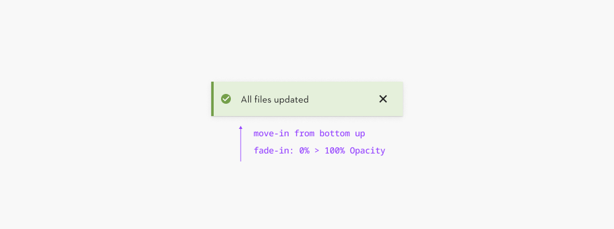

_Figure: Shows toast (text=All files updated, icon, type=success). Text in the figure: "All files updated", "move-in from bottom up", "fade-in: 0% \> 100% Opacity"._

#### Exit animation

**Animation type:** fade-out (opacity) **Duration:** 400ms **Easing**: motion-functional-ease-in (cubic-bezier (0.5, 0, 1, 1)

[Motion guidelines →](https://www.figma.com/design/UYHZEckQObDvLuuRoMP8ps/Styles-%F0%9F%AA%AD?node-id=1-148)

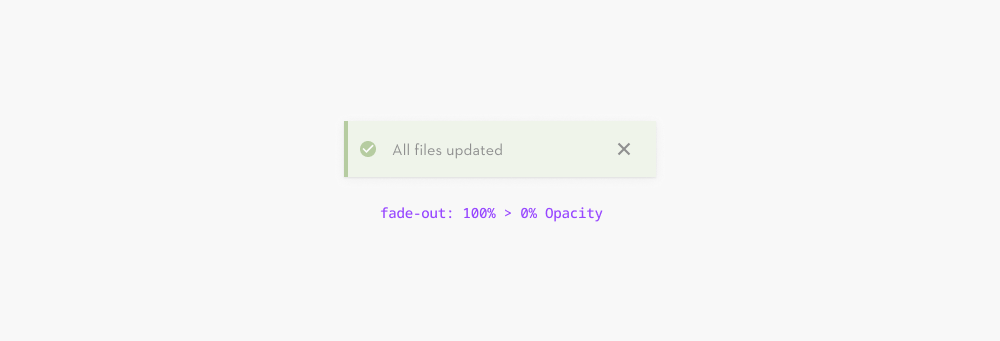

_Figure: Shows toast (text=All files updated, icon, type=success). Text in the figure: "All files updated", "fade-out: 100% \> 0% Opacity"._

#### Placement

The toast message appears from the bottom center of the viewport.

The default offset from the bottom edge is 64px.

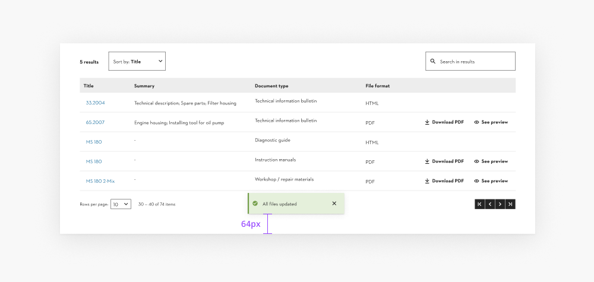

_Figure: Measurements: 64px._

#### Dismissible

Some toast messages have a close function and are dismissible by the user.

If the user does not interact with the toast, the notification disappears.

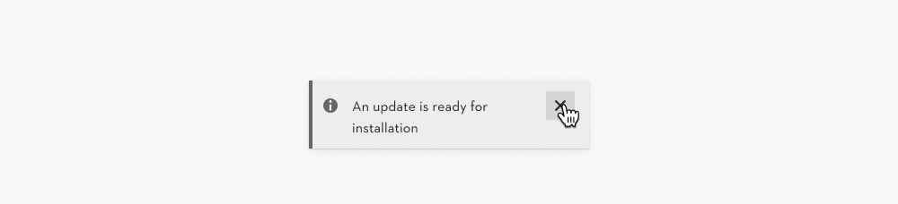

_Figure: Shows toast (text=An update is ready for installation, icon, type=info). Text in the figure: "An update is ready for installation"._

#### Limited time visible

Given the reading speed, it is recommended to display the notification for 10 seconds if it contains 15 words.

**Beware: a toast notification**, that is limited time visible and therefore **not accessible.**

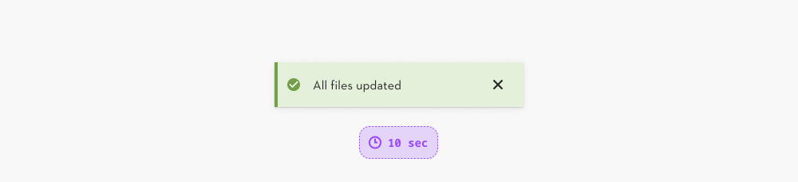

_Figure: Shows toast (text=All files updated, icon, type=success). Text in the figure: "All files updated", "10 sec"._

## Content and Assets

### ⚠️ Accessibility issue

**Do not use for important information, because...**

- toast messages disappear
- toast messages are not accessible, because they lay above the content
- the user cannot focus the button or link by keyboard

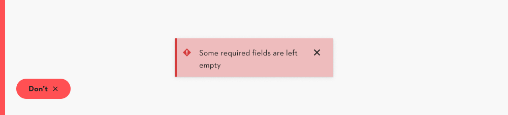

_Figure: Don't example. Shows toast (Copy=Some required fields are left empty, show icon, intention=error, show close=true, show action=false). Text in the figure: "Some required fields are left empty"._

### Conversational language

The copy presented by a digital product to a human is a dialogue, use conversational language.

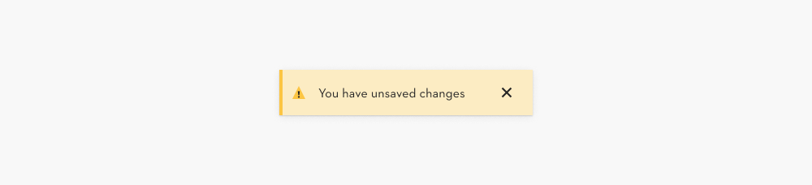

_Figure: Shows toast (text=You have unsaved changes, icon, type=warning). Text in the figure: "You have unsaved changes"._

### Copy must be as concise as possible

Toast messages are meant to be very short, because they disappear.

**Ideally the message is below 5 words**, definitely stay below 15 words.

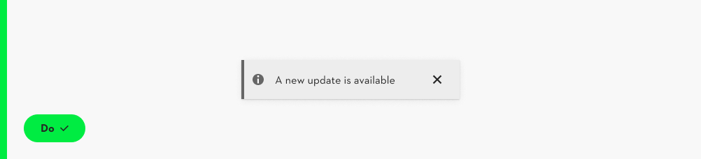

_Figure: Do example. Shows toast (text=A new update is available, icon, type=info). Text in the figure: "A new update is available"._

### Localization

Languages other than english are approximately 20% longer. Test your copy at all times.

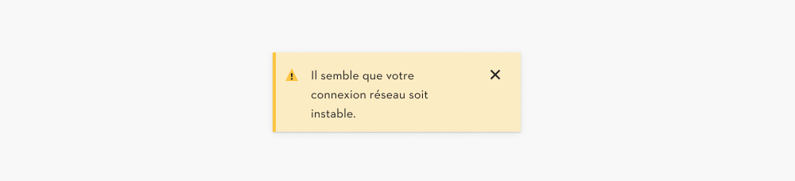

_Figure: Shows toast (text=Il semble que votre connexion réseau soit instable., icon, type=warning). Text in the figure: "Il semble que votre connexion réseau soit instable."._

### Use icons with purpose

Not every toast message needs an icon.

Remove the icon to reduce visual clutter and cognitive load.

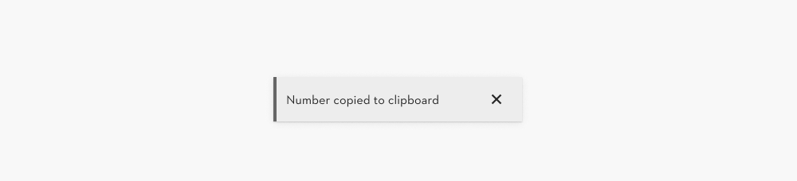

_Figure: Shows toast (text=Number copied to clipboard, type=info). Text in the figure: "Number copied to clipboard"._

### Images

Do not use images in toast notifications.

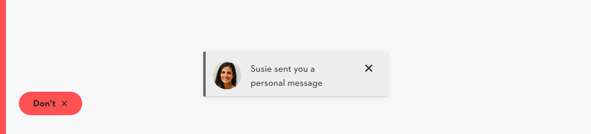

_Figure: Don't example. Shows close-button (button text=Button, variant=ghost, state=enabled, size=small, icon position=none, hide label=on, flush alignment=off). Text in the figure: "Susie sent you a personal message"._

## Behavior

### Trigger

The toast notification is triggered by the user handling the interface and gives an immediate feedback about an action.

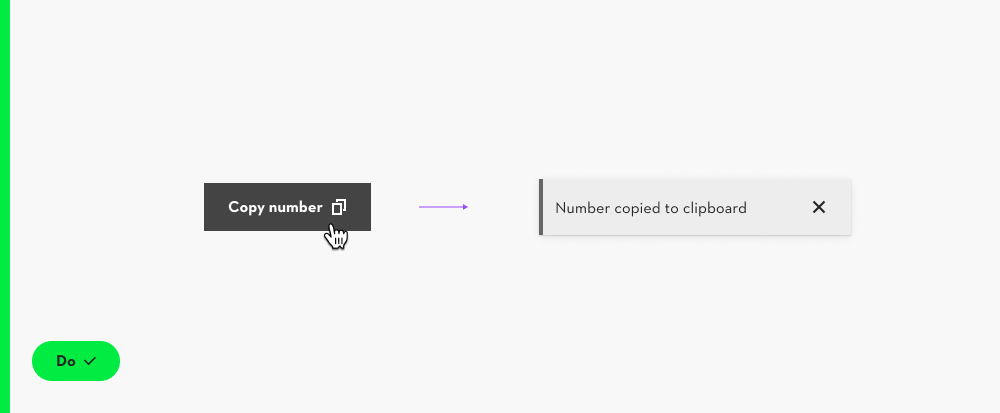

_Figure: Do example. Shows button (button text=Copy number, variant=filled, state=hover / pressed, size=medium, icon position=right, hide label=off, flush alignment=off); toast (text=Number copied to clipboard, type=info). Text in the figure: "Copy number", "Number copied to clipboard"._

### Dismissed by the user

In case the user closes the toast, the exit animation is triggered immediately.

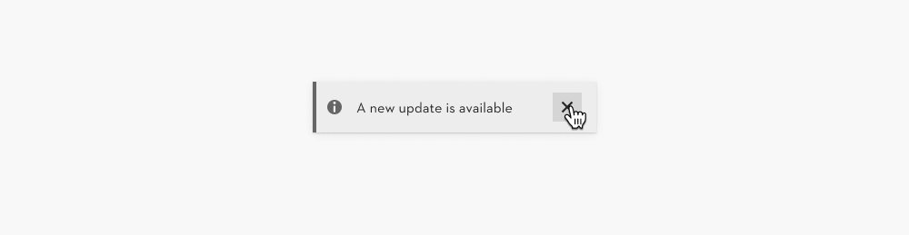

_Figure: Shows toast (text=A new update is available, icon, type=info). Text in the figure: "A new update is available"._

### Queue instead of stack

**Do:** If more than one toast is triggered simultaneously, they are queued.

After the first exit animation is finished, the second makes the entrance animation.

**Do not:** stack the messages on top of each other.

Alternative components are [notification](https://www.figma.com/design/qXldpLO6gxHJNLdcXIPxYt?node-id=7251-8) or [dialog](https://www.figma.com/design/qXldpLO6gxHJNLdcXIPxYt?node-id=14115-4051).

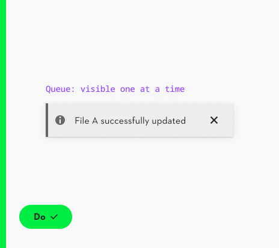

_Figure: Do example. Shows toast (text=File A successfully updated , icon, type=info). Text in the figure: "Queue: visible one at a time", "File A successfully updated"._

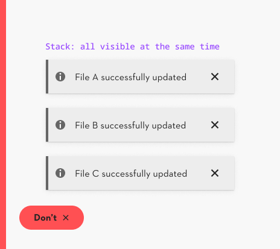

_Figure: Don't example. Shows toast (text=File A successfully updated , icon, type=info); toast (text=File B successfully updated , icon, type=info); toast (text=File C successfully updated , icon, type=info). Text in the figure: "Stack: all visible at the same time", "File A successfully updated", "File B successfully updated", "File C successfully updated"._

## Usage Guidelines

### Functionality & Priority

Components are chosen based on their level of urgency:

1. **Dialog** Highest urgency. Requires explicit user action before continuing. → [See Dialog](https://www.figma.com/design/qXldpLO6gxHJNLdcXIPxYt?node-id=14115-4051)

1. **Notification / Toast** Draws attention but does not block usage. Useful for immediate or transient feedback. → [See Notification](https://www.figma.com/design/qXldpLO6gxHJNLdcXIPxYt?node-id=7251-8) → [See Toast](https://www.figma.com/design/qXldpLO6gxHJNLdcXIPxYt?node-id=8844-4923)

1. **Banner** Persistent but non-blocking. Ideal for supporting information, promotions, or optional actions. → [See Banner](https://www.figma.com/design/Ie2r0R9QwjEc7O3nrFbXhV/Web-Pattern-Library?node-id=7171-9055)

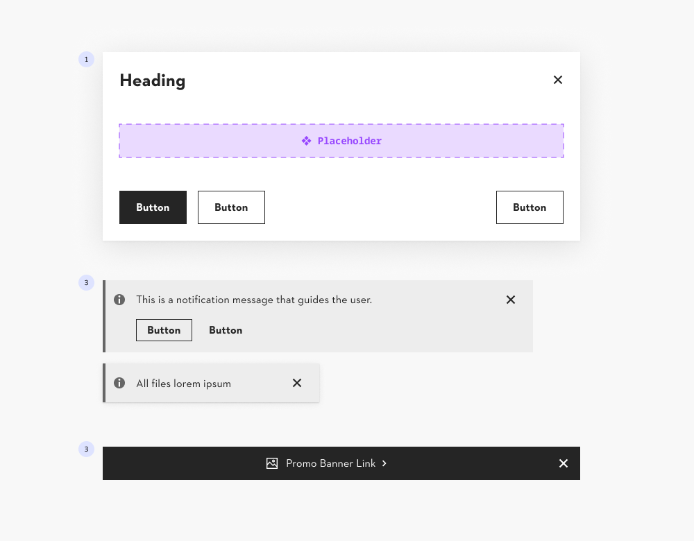

_Figure: Shows annotation-circle (number=1, type=center, color=blue); header-dialog (heading, close button, viewport=desktop); footer-dialog (first button, second button, third button, viewport=desktop, direction=horizontal, primary position=left); annotation-circle (number=3, type=center, color=blue); notification (action, close button, type=info, icon=True); toast (text=All files lorem ipsum, icon, type=info); banner (variant=default, viewport=m, content=promo, close-button=true). Callouts 1, 3. Text in the figure: "Heading", "❖ Placeholder", "Button", "This is a notification message that guides the user.", "All files lorem ipsum", "Promo Banner Link"._

### Use Cases

#### System / Mandatory

- **System feedback (success, error)** → Notification / Toast
- **Cookies / Privacy notices** → Banner (if navigation can continue without consent) → Dialog (if explicit consent is required before continuing)
- **Urgent notifications (downtime, outages, maintenance)** → Notification (when only informing) → Dialog (when user actions are blocked)
- **Critical announcements (recalls, legal or policy changes)** → Notification (when only informing) → Dialog (when user actions are blocked)

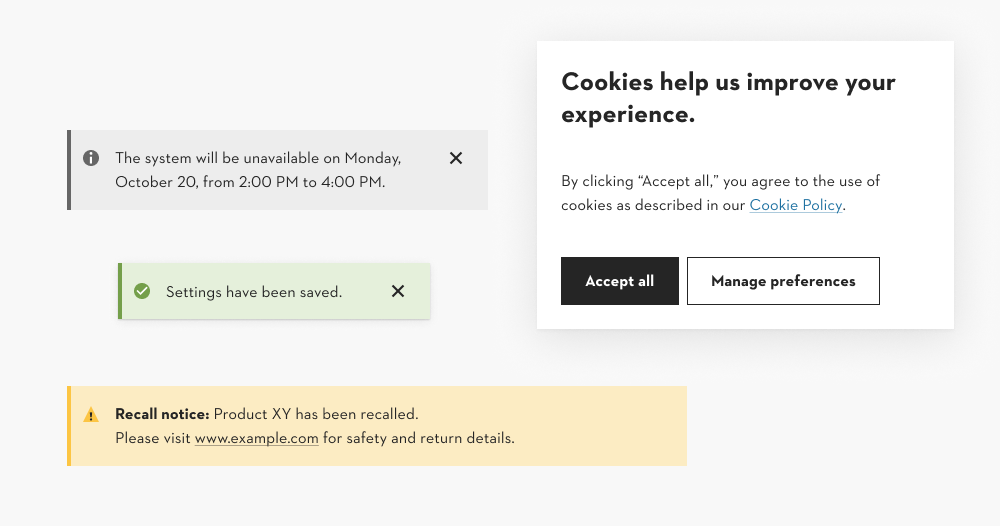

_Figure: Shows header-dialog (heading, viewport=desktop); placeholder: text + image; footer-dialog (first button, third button, viewport=desktop, direction=horizontal, primary position=left); notification (close button, type=info, icon=True); toast (text=Settings have been saved., icon, type=success); notification (type=warning, icon=True). Text in the figure: "Cookies help us improve your experience.", "By clicking “Accept all,” you agree to the use of cookies as described in our...", "Accept all", "Manage preferences", "The system will be unavailable on Monday, October 20, from 2:00 PM to 4:00 PM.", "Settings have been saved.", "Recall notice: Product XY has been recalled. Please visit www.example.com for..."._

#### Marketing / Engagement

- **Sales & promotions** → Banner
- **Seasonal campaigns** → Banner
- **USPs / Value propositions** → Banner (for general positioning) → Notification (when contextually relevant, e.g., delivery info next to cart price)
- **Newsletter sign-up / Loyalty programs / Referrals** → Banner

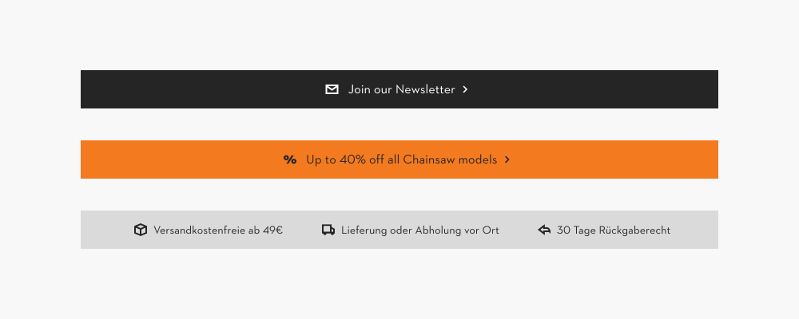

_Figure: Shows banner (variant=default, viewport=m, content=promo, close-button=false); banner (variant=highlight, viewport=m, content=promo, close-button=false). Text in the figure: "Join our Newsletter", "Up to 40% off all Chainsaw models", "Versandkostenfreie ab 49€", "Lieferung oder Abholung vor Ort", "30 Tage Rückgaberecht"._

#### Informational

- **Product / feature updates (non-critical)** → Banner
- **Tips, nudges, reminders** → Banner

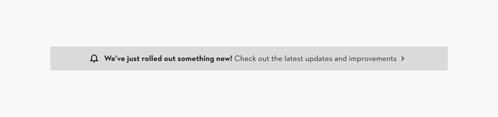

_Figure: Shows banner (variant=secondary, viewport=m, content=promo, close-button=false). Text in the figure: "We’ve just rolled out something new! Check out the latest updates and improve..."._

## Examples/Variants

### STIHL Service Communication Platform (SSC)

The user can copy the machine number with one click and the toast message appears.

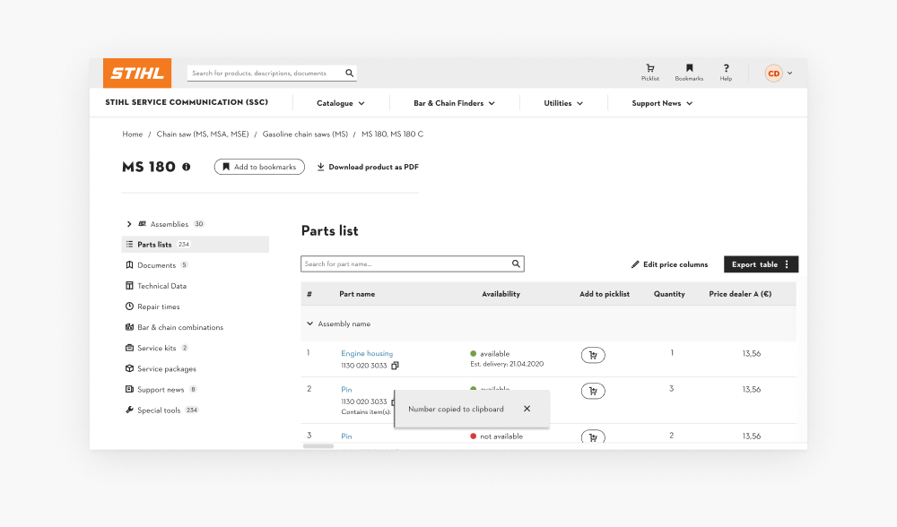

_Figure: Shows toast (text=Number copied to clipboard, type=info). Text in the figure: "Number copied to clipboard"._
