# Toast

## Toast

Overview:

- Toast messages are not accessible, as the the close button cannot be focused.
- Screenreader software is able to read the content.
- Copy must be as concise as possible, use conversational language.
- Toasts disappear after 10 seconds, therefore a maximum of 15 words is recommended.
- Multiple toast messages appear one by one, first in first out, like a queue.
- The toast notification is triggered by a user and gives additional feedback about an action.

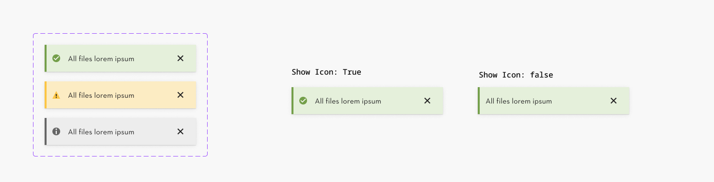

### Further guidelines

[Storybook documentation](https://main--63440bbb95889041542a5ba3.chromatic.com/?path=/docs/components-toast--documentation&globals=backgrounds.name:!undefined;backgrounds.value:!undefined)

Decision tree

### Similar components

**Component**

**Trigger**

**Placement**

**Content**

**Intention**

**Tooltip**

Hover or focus of an interactive element

In proximity to the triggering element, non-modal

Text only

Provide short, contextual information or clarify unlabeled controls

**Popover**

Click or tap of an interactive element

In proximity to the triggering button, non-modal

Text, icon, image and interactive elements

Provide additional information or quick actions without leaving the current context

**Dialog**

Triggered by the system in response to user interaction

Center of the screen, with backdrop, modal

Text, icon, image and interactive elements

Confirm important actions, guide users through complex tasks, or temporarily block interaction to focus attention

**Toast**

Triggered by the system in response to user interaction

Bottom of the screen, non-modal

Text, icon, and optional dismiss button

Provide brief, lightweight feedback on user actions such as error or success.

**Notification**

Triggered by the system in response to events or interactions

Within the content area of the page, in relation to relevant elements

Text, icon, links and buttons

Deliver important updates or status messages that may require user attention or follow-up

### Related elements

[Notification](https://www.figma.com/design/qXldpLO6gxHJNLdcXIPxYt?node-id=7251-8)

[Dialog](https://www.figma.com/design/qXldpLO6gxHJNLdcXIPxYt?node-id=14115-4051)

[Typography](https://www.figma.com/design/d9wrOp4aCplDsV9AVC87Xn/Typography-%F0%9F%85%B0%EF%B8%8F?m=auto&t=4yiq5f9rjU14BQYJ-6)

[Button](https://www.figma.com/design/qXldpLO6gxHJNLdcXIPxYt?node-id=162-126)

[System feedback](https://www.figma.com/design/qXldpLO6gxHJNLdcXIPxYt?node-id=101-127)

[Tooltip](https://www.figma.com/design/HovZmjHiwxguawTWTO6ibS/DS-1085-Design-%7C-Web-%7C-Tootlip?node-id=36194-1244)

[Popover](https://www.figma.com/design/qXldpLO6gxHJNLdcXIPxYt?node-id=26075-11456)

### Contribute

Contribute to improving this component by sharing your feedback, asking questions, or suggesting features [here](https://www.figma.com/design/lLmw7PfIdKjFG4uT3B2Hyj/Onboarding-%F0%9F%93%96?node-id=446-868&t=zKmRu4kAkxMeRDmK-4).

## Formatting and Construction

### Anatomy

1. **Icon (optional)** Additional visual indicator, what type of notification is used.
1. **Content** Information for the user triggered by an event.
1. **Close icon:** Button to close the toast manually (icon button cannot be focused by using the keyboard).

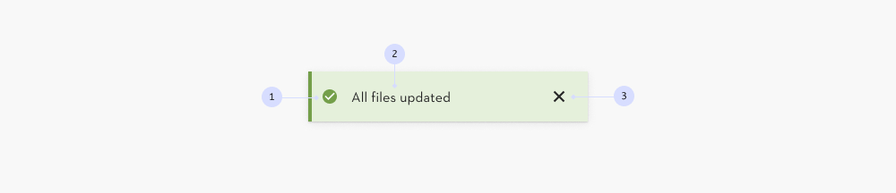

#### Types

1. **Success** Inform the user that an action was completed.
1. **Warning** Alert about potential issues, preventing errors and enhancing safety.
1. **Info** Provide informational messages that do not require immediate action.

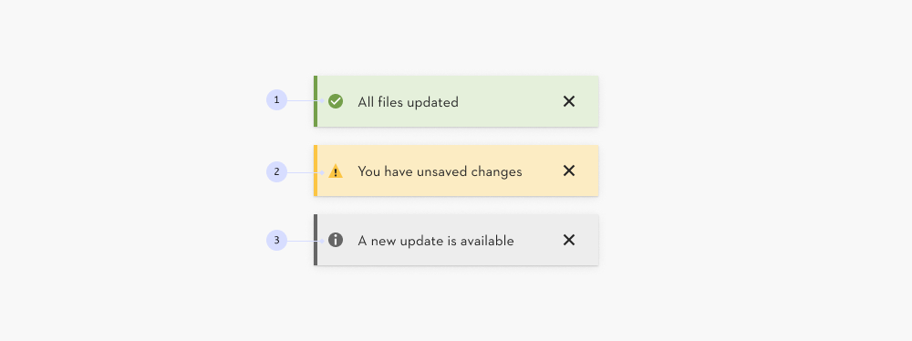

#### Width and height

- **The maximum width is 400px**, for all other cases.
- **The height is flexible**, based on the content container.

**Minimum space** between browser edge and toast **is 16px**.

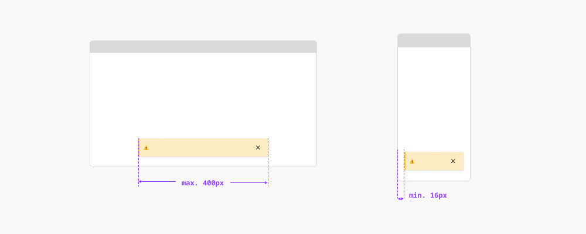

#### Enter animation

**Animation type:** move-in (bottom up) fade-in (opacity) **Duration:** 400ms **Easing:** motion-functional-ease-out (cubic-bezier (0, 0, 0.5, 1)

[Motion guidelines →](https://www.figma.com/design/UYHZEckQObDvLuuRoMP8ps/Styles-%F0%9F%AA%AD?node-id=1-148)

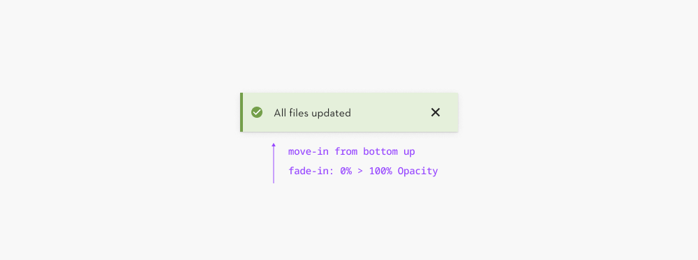

#### Exit animation

**Animation type:** fade-out (opacity) **Duration:** 400ms **Easing**: motion-functional-ease-in (cubic-bezier (0.5, 0, 1, 1)

[Motion guidelines →](https://www.figma.com/design/UYHZEckQObDvLuuRoMP8ps/Styles-%F0%9F%AA%AD?node-id=1-148)

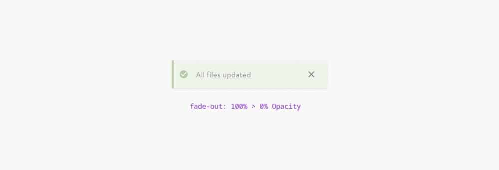

#### Placement

The toast message appears from the bottom center of the viewport.

The default offset from the bottom edge is 64px.

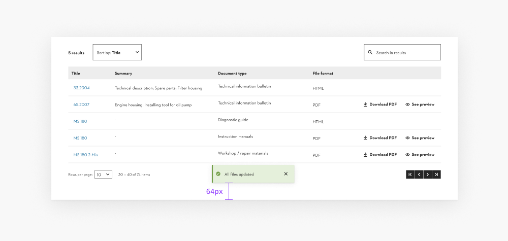

#### Dismissible

Some toast messages have a close function and are dismissible by the user.

If the user does not interact with the toast, the notification disappears.

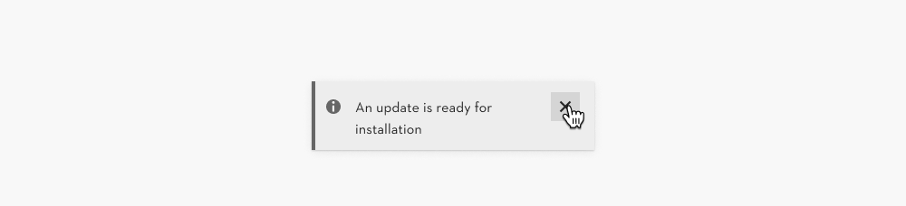

#### Limited time visible

Given the reading speed, it is recommended to display the notification for 10 seconds if it contains 15 words.

**Beware: a toast notification**, that is limited time visible and therefore **not accessible.**

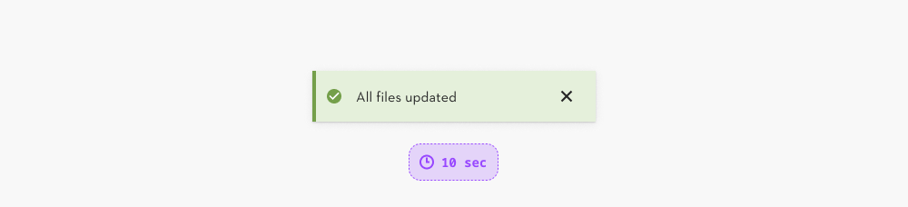

## Content and Assets

### ⚠️ Accessibility issue

**Do not use for important information, because...**

- toast messages disappear
- toast messages are not accessible, because they lay above the content
- the user cannot focus the button or link by keyboard

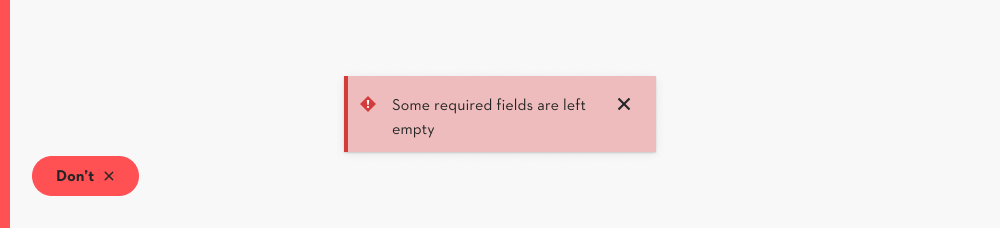

### Conversational language

The copy presented by a digital product to a human is a dialogue, use conversational language.

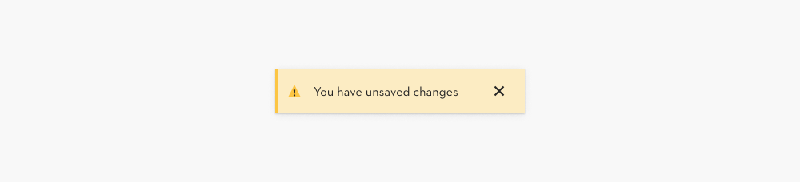

### Copy must be as concise as possible

Toast messages are meant to be very short, because they disappear.

**Ideally the message is below 5 words**, definitely stay below 15 words.

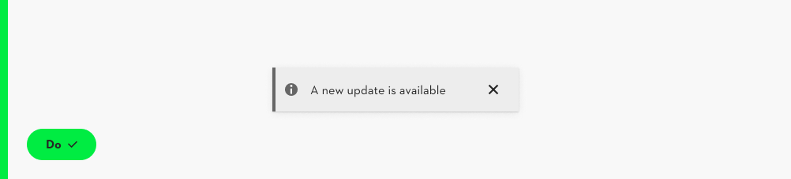

### Localization

Languages other than english are approximately 20% longer. Test your copy at all times.

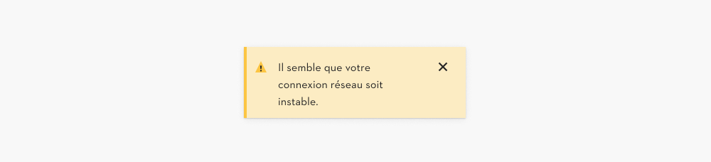

### Use icons with purpose

Not every toast message needs an icon.

Remove the icon to reduce visual clutter and cognitive load.

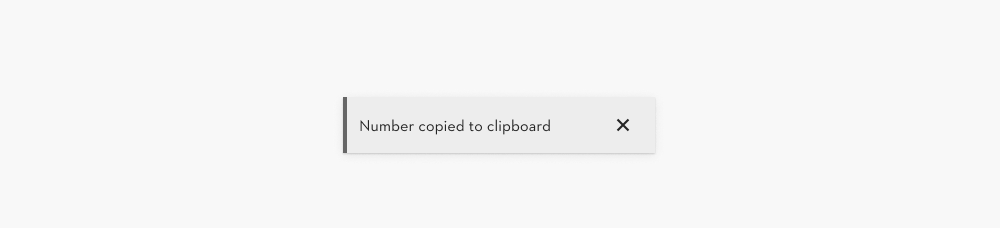

### Images

Do not use images in toast notifications.

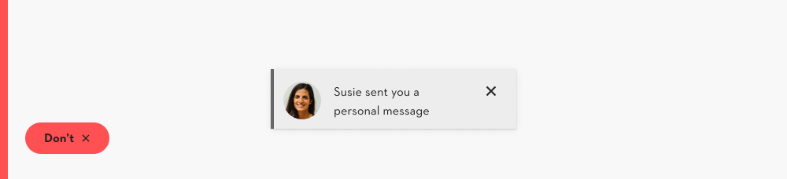

## Behavior

### Trigger

The toast notification is triggered by the user handling the interface and gives an immediate feedback about an action.

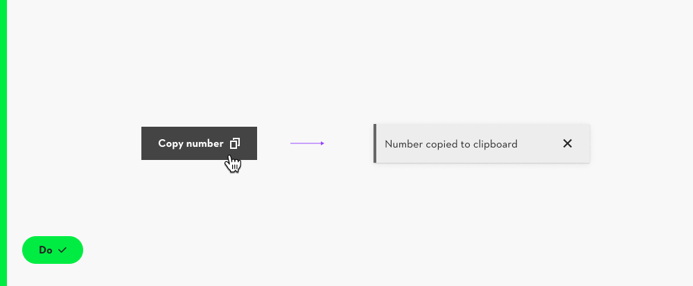

### Dismissed by the user

In case the user closes the toast, the exit animation is triggered immediately.

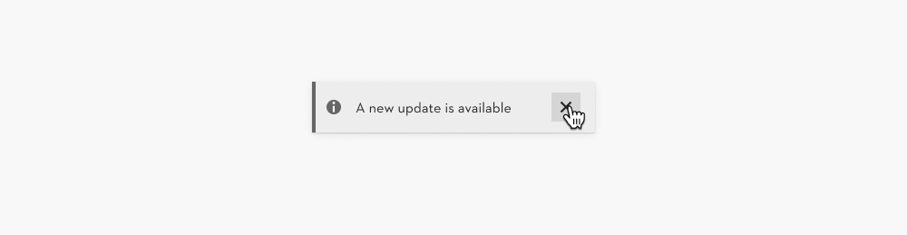

### Queue instead of stack

**Do:** If more than one toast is triggered simultaneously, they are queued.

After the first exit animation is finished, the second makes the entrance animation.

**Do not:** stack the messages on top of each other.

Alternative components are [notification](https://www.figma.com/design/qXldpLO6gxHJNLdcXIPxYt?node-id=7251-8) or [dialog](https://www.figma.com/design/qXldpLO6gxHJNLdcXIPxYt?node-id=14115-4051).

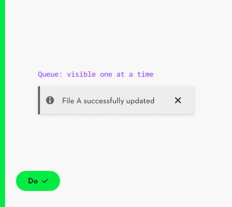

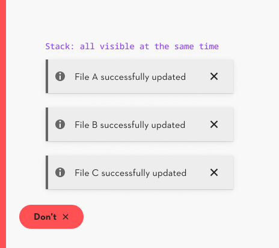

## Usage Guidelines

### Functionality & Priority

Components are chosen based on their level of urgency:

1. **Dialog** Highest urgency. Requires explicit user action before continuing. → [See Dialog](https://www.figma.com/design/qXldpLO6gxHJNLdcXIPxYt?node-id=14115-4051)

1. **Notification / Toast** Draws attention but does not block usage. Useful for immediate or transient feedback. → [See Notification](https://www.figma.com/design/qXldpLO6gxHJNLdcXIPxYt?node-id=7251-8) → [See Toast](https://www.figma.com/design/qXldpLO6gxHJNLdcXIPxYt?node-id=8844-4923)

1. **Banner** Persistent but non-blocking. Ideal for supporting information, promotions, or optional actions. → [See Banner](https://www.figma.com/design/Ie2r0R9QwjEc7O3nrFbXhV/Web-Pattern-Library?node-id=7171-9055)

### Use Cases

#### System / Mandatory

- **System feedback (success, error)** → Notification / Toast
- **Cookies / Privacy notices** → Banner (if navigation can continue without consent) → Dialog (if explicit consent is required before continuing)
- **Urgent notifications (downtime, outages, maintenance)** → Notification (when only informing) → Dialog (when user actions are blocked)
- **Critical announcements (recalls, legal or policy changes)** → Notification (when only informing) → Dialog (when user actions are blocked)

#### Marketing / Engagement

- **Sales & promotions** → Banner
- **Seasonal campaigns** → Banner
- **USPs / Value propositions** → Banner (for general positioning) → Notification (when contextually relevant, e.g., delivery info next to cart price)
- **Newsletter sign-up / Loyalty programs / Referrals** → Banner

#### Informational

- **Product / feature updates (non-critical)** → Banner
- **Tips, nudges, reminders** → Banner

## Examples/Variants

### STIHL Service Communication Platform (SSC)

The user can copy the machine number with one click and the toast message appears.

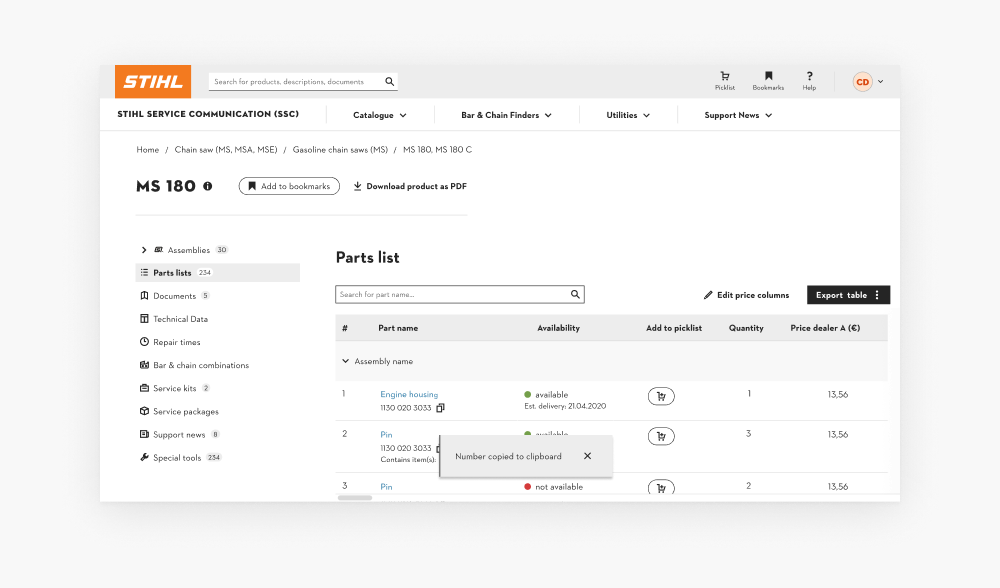
