# Tooltip

## Tooltip

- A Tooltip provides brief, contextual information when a user focuses on or hovers over an element.
- Offers additional context or short explanations for interactive elements.
- Displays the name or function of unlabeled controls, such as icon buttons.
- Triggered on hover and focus

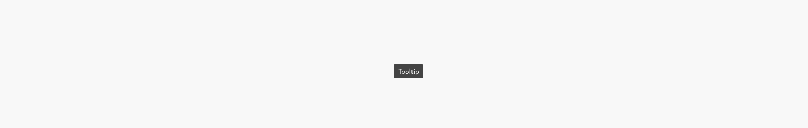

_Figure: A single Tooltip: a small dark grey rectangle with light text "Tooltip" on a light background._

### Further guidelines

[Storybook documentation](https://main--63440bbb95889041542a5ba3.chromatic.com/?path=/docs/components-notification--documentation&globals=backgrounds.name:!undefined;backgrounds.value:!undefined)

[Decision tree](https://www.figma.com/design/qXldpLO6gxHJNLdcXIPxYt?node-id=26738-47603)

### Similar components

**Component**

**Trigger**

**Placement**

**Content**

**Intention**

**Tooltip**

Hover or focus of an interactive element

In proximity to the triggering element, non-modal

Text only

Provide short, contextual information or clarify unlabeled controls

**Popover**

Click or tap of an interactive element

In proximity to the triggering button, non-modal

Text, icon, image and interactive elements

Provide additional information or quick actions without leaving the current context

**Dialog**

Triggered by the system in response to user interaction

Center of the screen, with backdrop, modal

Text, icon, image and interactive elements

Confirm important actions, guide users through complex tasks, or temporarily block interaction to focus attention

**Toast**

Triggered by the system in response to user interaction

Bottom of the screen, non-modal

Text, icon, and optional dismiss button

Provide brief, lightweight feedback on user actions such as error or success.

**Notification**

Triggered by the system in response to events or interactions

Within the content area of the page, in relation to relevant elements

Text, icon, links and buttons

Deliver important updates or status messages that may require user attention or follow-up

### Related elements

[Utility Menu](https://www.figma.com/design/Ie2r0R9QwjEc7O3nrFbXhV/Web-Pattern-Library?m=auto&node-id=7158-32869&t=JVVkPuiySoyYbdTa-1)

[Dropdown Menu](https://www.figma.com/design/Ie2r0R9QwjEc7O3nrFbXhV/Web-Pattern-Library?m=auto&node-id=6583-85690&t=JVVkPuiySoyYbdTa-1)

[Dialog](https://www.figma.com/design/qXldpLO6gxHJNLdcXIPxYt/Core-Components-%F0%9F%92%A0?node-id=14115-4051)

[Toast](https://www.figma.com/design/qXldpLO6gxHJNLdcXIPxYt/Core-Components-%F0%9F%92%A0?node-id=8844-4923)

[Notification](https://www.figma.com/design/qXldpLO6gxHJNLdcXIPxYt/Core-Components-%F0%9F%92%A0?node-id=7251-8)

[Popover](https://www.figma.com/design/ClsISQRlkGYYoFCtCtm9xD/DS-1061-Design-%7C-Global-%7C-Popover?node-id=35223-10505)

### Contribute

Contribute to improving this component by sharing your feedback, asking questions, or suggesting features [here](https://www.figma.com/design/lLmw7PfIdKjFG4uT3B2Hyj/Onboarding-%F0%9F%93%96?node-id=446-868&t=zKmRu4kAkxMeRDmK-4).

## Formatting and Construction

### Anatomy

1. **Container:** the Tooltip surface that holds the content.
1. **Text :** text-string with a description.

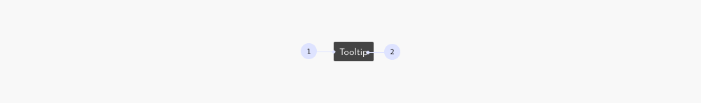

_Figure: Tooltip with two numbered callouts: 1 points at the left edge of the dark grey Tooltip surface (Container) and 2 points at the text "Tooltip" inside it (Text, the description string)._

### Sizing

#### Maximum width

Tooltips have a maximum width of 272 px. Content wraps automatically when it reaches the maximum width.

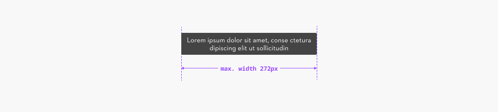

_Figure: Tooltip with two lines of centered text ("Lorem ipsum dolor sit amet, conse ctetura dipiscing elit ut sollicitudin") wrapped inside its container. A dimension line below spans the full container width and is labeled "max. width 272px"._

### Placement

#### Position

The Tooltip can be positioned relative to the triggering element in four directions:

- **above (default)**
- **below**
- **right**
- **left**

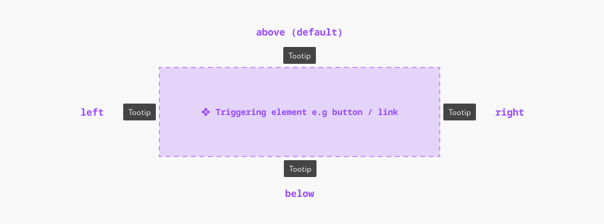

_Figure: Four Tooltip positions around a dashed purple box labeled "Triggering element e.g button / link": "above (default)" on top, "below" underneath, "left" at the left side and "right" at the right side, each Tooltip placed directly adjacent to the box._

#### Alignment

In addition to the position, the Tooltip can be aligned with the triggering element in three ways:

- **start**
- **center (default)**
- **end**

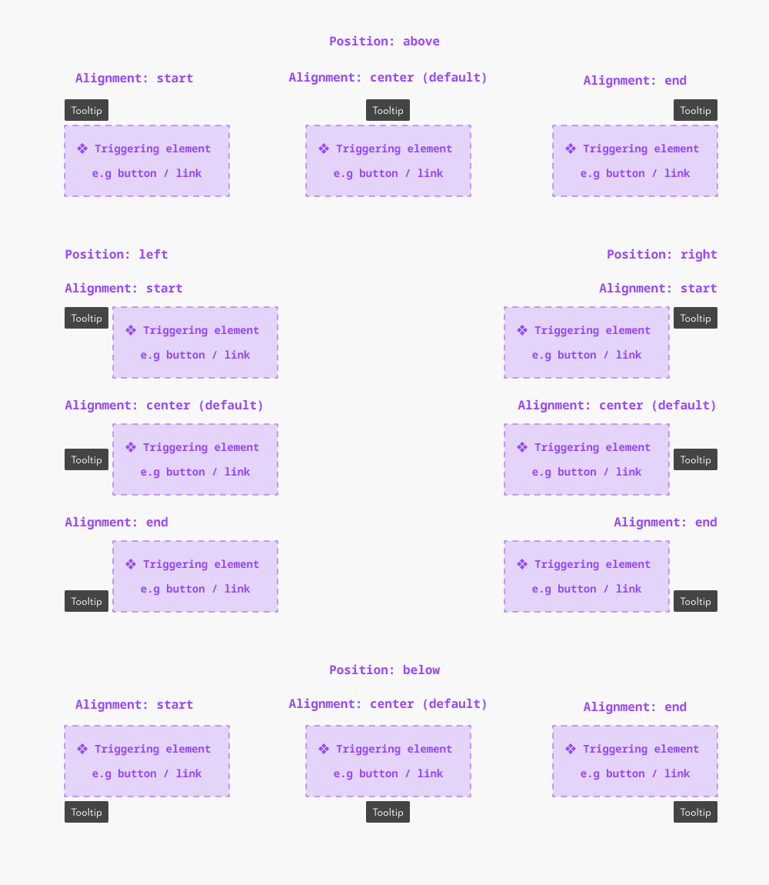

_Figure: Matrix of Tooltip positions (above, left, right, below) each shown with the three alignments "Alignment: start", "Alignment: center (default)" and "Alignment: end" relative to a dashed "Triggering element e.g button / link" box. For above and below the Tooltip sits at the left edge, middle or right edge of the box; for left and right it sits at the top edge, vertical middle or bottom edge._

#### Distance

The distance to the triggering element is 6px

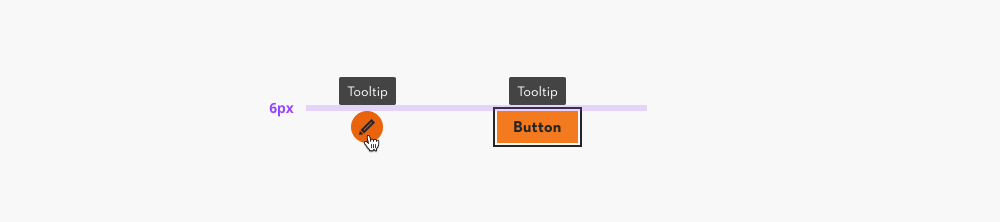

_Figure: Two Tooltips above triggering elements, a small round orange icon button with pointer cursor (hover / pressed) and an orange "Button" with focus outline. A purple band marked "6px" shows the gap between the bottom of each Tooltip and the top of its triggering element._

#### Edge cases:

If the preferred placement (e.g., top) would cause the Tooltip to appear outside the viewport, it should automatically reposition to fit within the visible area, while staying aligned with the triggering element.

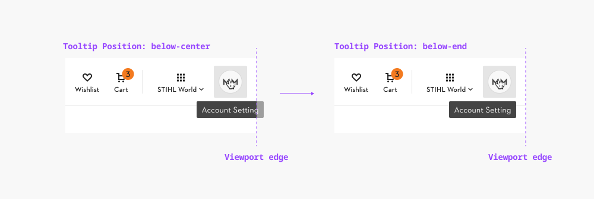

_Figure: Before and after comparison in the top bar, with Wishlist, Cart (badge 3), STIHL World and an account avatar at the right edge. On the left, the Tooltip "Account Setting" with Position: below-center is centered under the avatar and crosses the dashed "Viewport edge"; on the right, an arrow leads to Position: below-end where the Tooltip is aligned to the avatar's end and stays inside the viewport edge._

### Motion

#### Appear

**Animation type:** fade in **Delay:** 400ms **Duration:** 100ms **Easing:** motion-functional-ease-out

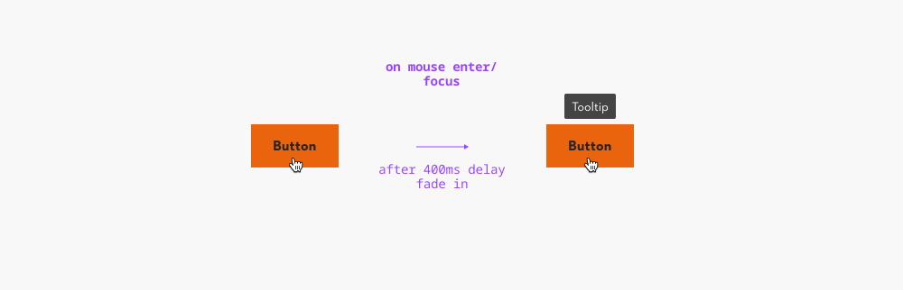

_Figure: Appear behavior: an orange "Button" without Tooltip on the left, an arrow labeled "on mouse enter/ focus" and "after 400ms delay fade in", and the same Button with a Tooltip appearing above it on the right._

#### Disappear

**Animation type:** fade out **Delay:** 0ms **Duration:** 100ms **Easing:** motion-functional-ease-in

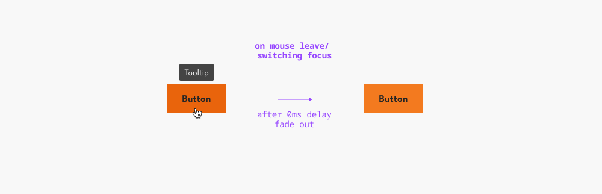

_Figure: Disappear behavior: a hovered orange "Button" with a Tooltip above it on the left, an arrow labeled "on mouse leave/ switching focus" and "after 0ms delay fade out", and the same Button without Tooltip on the right._

## Content and Assets

### Text only

Tooltips may only contain text. Keep the message short and focused.

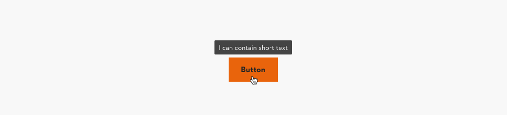

_Figure: A hovered orange "Button" with a Tooltip above it containing only the short text "I can contain short text", showing that Tooltips hold plain text only._

### Maximum length and overflow

Maximum length: up to 2 lines of text, apr. 60 characters

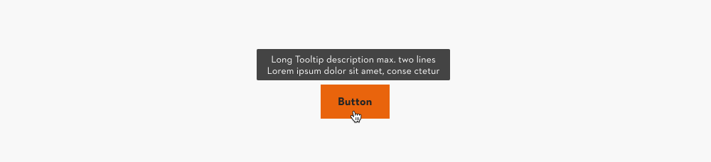

_Figure: A dark grey tooltip with two lines of text ("Long Tooltip description max. two lines" and "Lorem ipsum dolor sit amet, conse ctetur") sits above an orange highlight button labeled "Button" in hover state with a pointer cursor on it. It illustrates the maximum tooltip length of two lines, about 60 characters._

## Behavior and Usage

### Interactive elements only

Tooltips must only be attached to interactive components (such as buttons or links).

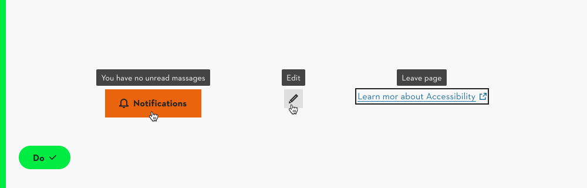

_Figure: Do example: tooltips are attached only to interactive elements. An orange highlight button "Notifications" with a bell icon shows the tooltip "You have no unread massages", a small ghost icon-only pencil button shows "Edit", and a focused external link "Learn mor about Accessibility" shows "Leave page"._

Applying Tooltips to non-interactive elements (e.g., div, span, or p) makes them inaccessible to keyboard and screen reader users.

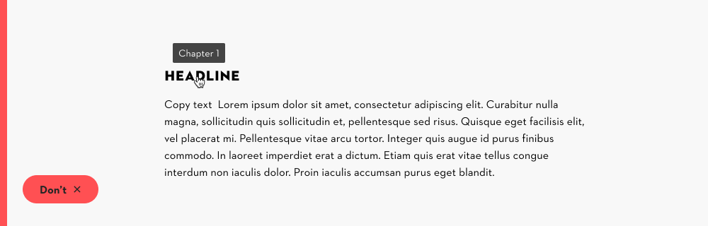

_Figure: Don't example: a tooltip "Chapter 1" appears over the non-interactive heading "HEADLINE" above a paragraph of body copy ("Copy text Lorem ipsum dolor sit amet..."). Tooltips on non-interactive elements such as headings or text are inaccessible to keyboard and screen reader users._

### Triggers and dismissal

**Triggers** A tooltip appears when the trigger element is:

- Hovered with a mouse
- Focused with the keyboard
- Long-pressed on touch devices

**Dismissal** A tooltip is dismissed when:

- The trigger loses hover or focus
- The user taps outside the element on touch devices

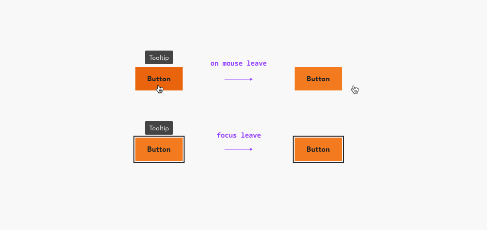

_Figure: Two rows show when a tooltip is dismissed. In the top row an orange highlight button "Button" is hovered with the pointer and shows a "Tooltip"; an arrow labeled "on mouse leave" leads to the same button in enabled state without a tooltip. In the bottom row the focused button (with focus ring) shows a "Tooltip"; an arrow labeled "focus leave" leads to the button still focus-ringed but with no tooltip._

### Usecases

#### Tooltip as label

Icon button labels are hidden by default. Use a Tooltip to show the label and clarify the icon’s purpose.

> Tooltips are not always accessible. If the action can’t be understood without a label, use a visible label instead of relying on a Tooltip.

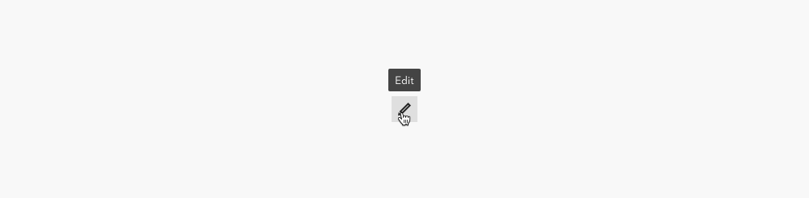

_Figure: A small ghost icon-only button with a pencil icon, hovered with a pointer cursor, shows the tooltip "Edit" above it. The tooltip supplies the label that the icon button hides._

#### Tooltip as description

For buttons and other interactive elements with visible labels, use Tooltips only to add context or clarification.

Tooltips should supplement the label, not replace it, and include only supporting information that helps users better understand the action.

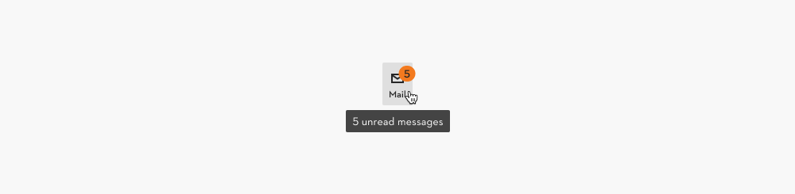

_Figure: A hovered action item with a mail icon, a number indicator "5" and the label "Mail" shows the tooltip "5 unread messages" below it. The tooltip adds context to the visible label instead of replacing it._

#### Don’t duplicate content

Avoid repeating the visible label in a Tooltip. If the label alone makes the purpose of a button or link clear, a Tooltip is unnecessary.

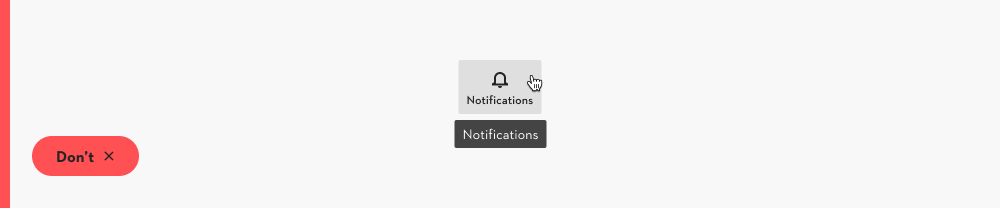

_Figure: Don't example: a hovered action item with a bell icon and the visible label "Notifications" shows a tooltip that repeats the same text "Notifications". Repeating the visible label adds no information, so the tooltip is unnecessary._

## Accessiblity

> **Usage Warning** Tooltips should be a last resort. They’re hidden by default and often lack a clear indicator. Prefer visible elements — like labels or helper text — for essential information. Use Tooltips only for supplementary, non-critical details.

### General

Ensure that Tooltip content is announced by screen readers and implemented with the correct semantic markup and ARIA attributes. Tooltips should always supplement the interface, not serve as the only way to access essential information.

### Alternatives for Tooltips

Since Tooltips are not always accessible, ask yourself before adding one:

- Is the information essential?
- Can the interface be clearer without a Tooltip?
- Could the information be shown directly on the page instead?

**More accessible alternatives include:**

#### Persistent Content

Don’t use Tooltips in forms for essential instructions since they only appear on hover or focus.

Instead, show important details persistently, such as input field hints.

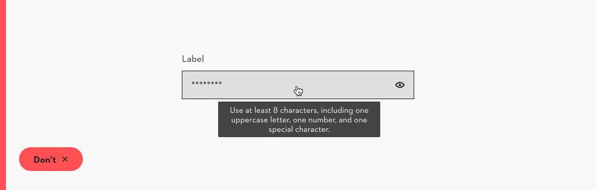

_Figure: Don't example: a hovered password input with the label "Label", masked value "\*\*\*\*\*\*\*\*" and a show-password eye icon displays a tooltip below it reading "Use at least 8 characters, including one uppercase letter, one number, and one special character." Essential form instructions must not be hidden in a tooltip that only appears on hover or focus._

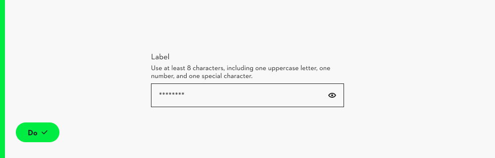

_Figure: Do example: a password input in enabled state with the label "Label", a persistent hint under the label reading "Use at least 8 characters, including one uppercase letter, one number, and one special character.", the masked value "\*\*\*\*\*\*\*\*" and an eye icon. Important instructions are shown permanently as a hint instead of in a tooltip._

#### Popover

Tooltips must not contain interactive elements. When you need to present actions, links, or structured content, use a popover. Further Guidance when to use tooltips and when to use other components can be found here in the [decision tree section](https://www.figma.com/design/qXldpLO6gxHJNLdcXIPxYt?node-id=24972-2154)

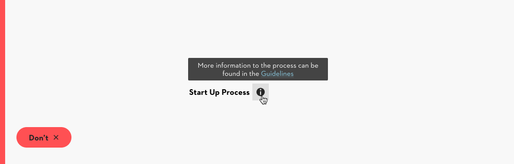

_Figure: Don't example: next to the text "Start Up Process" a hovered ghost info icon button shows a tooltip reading "More information to the process can be found in the Guidelines" with "Guidelines" as a link. Tooltips must not contain interactive elements such as links, so a popover should be used instead._

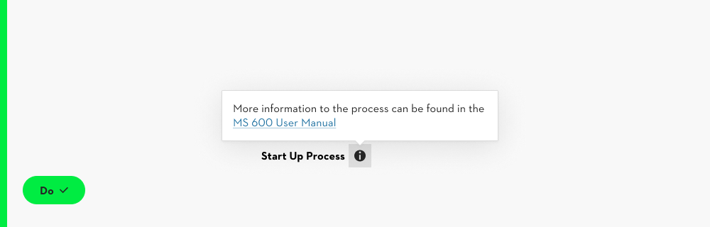

_Figure: Do example: next to the bold heading "Start Up Process" an info icon button (ghost, small, hover / pressed) opens a white popover with a centered arrow below pointing at the button, containing the text "More information to the process can be found in the MS 600 User Manual" with "MS 600 User Manual" as a link. Rich content such as a link belongs in a popover, not in a Tooltip._

#### Expandable sections and accordions

When additional information is tied to a specific item (e.g., extra details in a list), do not hide it inside a Tooltip.

Instead, use expandable sections or accordions, which keep the information discoverable and accessible.

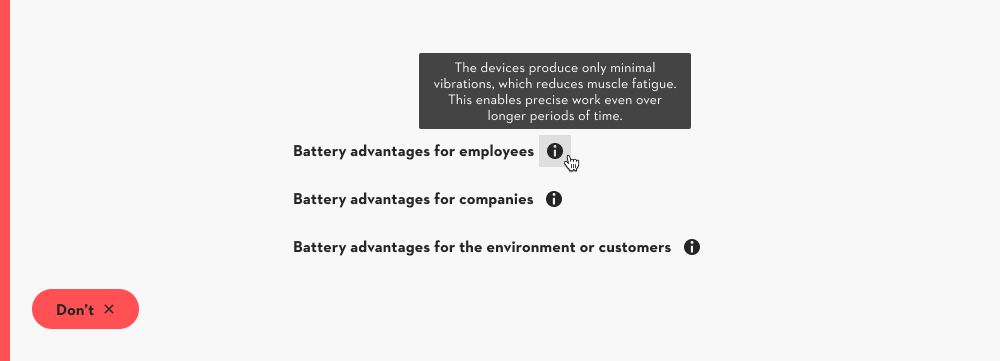

_Figure: Don't example: three headings "Battery advantages for employees", "Battery advantages for companies" and "Battery advantages for the environment or customers" each have an info icon button; the pointer hovers the first one and a dark Tooltip shows the long text "The devices produce only minimal vibrations, which reduces muscle fatigue. This enables precise work even over longer periods of time." Item-specific additional information is wrongly hidden in a Tooltip instead of being kept discoverable._

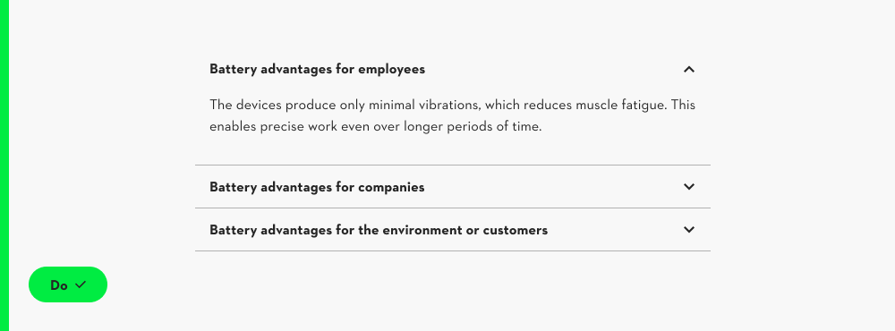

_Figure: Do example: an accordion group in which the first item "Battery advantages for employees" is expanded (up chevron) and shows the text "The devices produce only minimal vibrations, which reduces muscle fatigue. This enables precise work even over longer periods of time." Two collapsed items follow, "Battery advantages for companies" and "Battery advantages for the environment or customers", each with a down chevron and divider lines between the items._

## Examples

### Avatar

If the avatar in the top bar has no visible label, a Tooltip can provide the missing information, such as the user’s name.

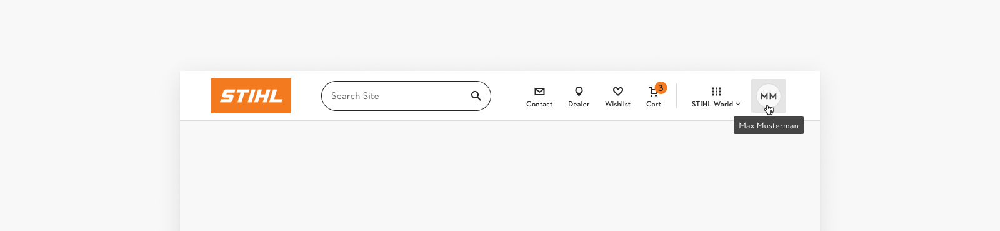

_Figure: Top bar (grid variant main, breakpoint l, no brand add-on, two number areas) with STIHL logo, "Search Site" field and the items "Contact", "Dealer", "Wishlist", "Cart" (badge "3"), "STIHL World" and an avatar with initials "MM". The pointer hovers the avatar, which shows a dark Tooltip below it with the user name "Max Musterman"._

### Notification

In the top bar, additional details for notifications can be displayed using a Tooltip.

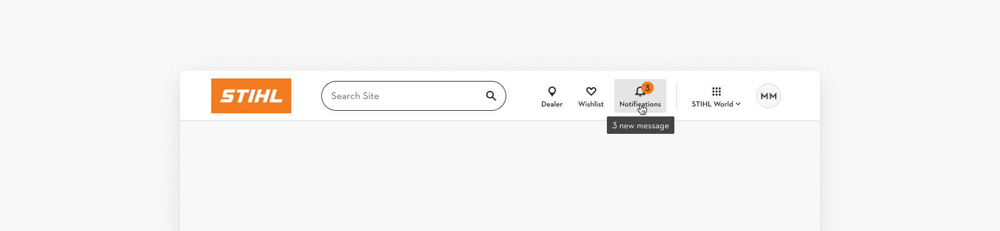

_Figure: Top bar (grid variant main, breakpoint l, no brand add-on, two number areas) with STIHL logo, "Search Site" field and the items "Dealer", "Wishlist", "Notifications" (badge "3"), "STIHL World" and an avatar "MM". The pointer hovers "Notifications", which shows a dark Tooltip below it with the text "3 new message"._

### Toggle button / Segmented controls

When buttons switch views without a visible label, Tooltips help to clarify their function. Example: SSC

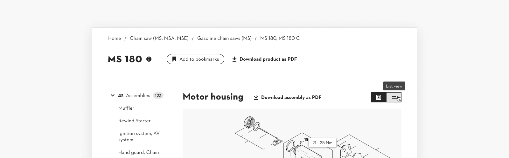

_Figure: Product page for "MS 180" with the section "Motor housing" and a segmented control of two icon-only buttons at the top right, a selected grid view and a list view button. The pointer hovers the list view button, which shows a dark Tooltip above it with the text "List view"._

### Pagination

Arrow buttons in a pagination component can include Tooltips to explain their action. Example: SSC

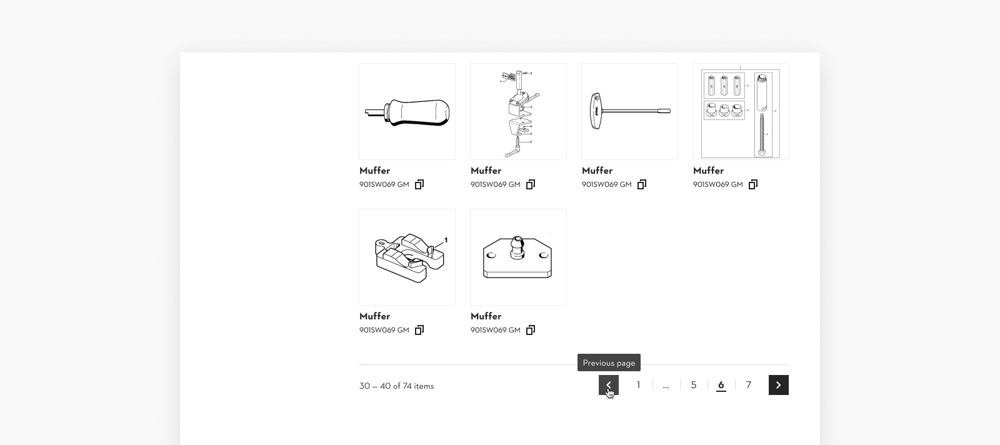

_Figure: Grid of six "Muffer" part cards (code "901SW069 GM" with copy icon) above a pagination bar showing "30 – 40 of 74 items" and pages 1, ..., 5, 6 (current), 7 with arrow buttons. The pointer hovers the left arrow button, which shows a dark Tooltip above it with the text "Previous page"._

### Copy function

Tooltips can explain icon buttons in tables, such as copying a serial number. Example: SSC

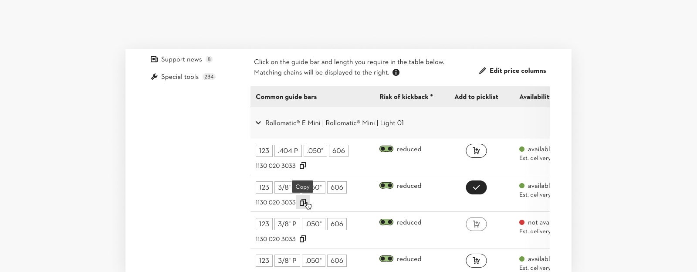

_Figure: Table of common guide bars with columns "Common guide bars", "Risk of kickback \*", "Add to picklist" and "Availability", where each row has a part number such as "1130 020 3033" followed by a copy icon button. The pointer hovers the copy icon in the second row, which shows a dark Tooltip above it with the text "Copy"._
