# Tooltip

## Tooltip

- A Tooltip provides brief, contextual information when a user focuses on or hovers over an element.
- Offers additional context or short explanations for interactive elements.
- Displays the name or function of unlabeled controls, such as icon buttons.
- Triggered on hover and focus

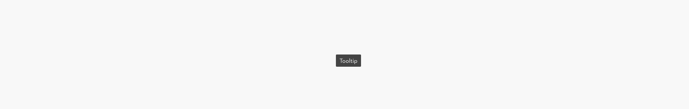

### Further guidelines

[Storybook documentation](https://main--63440bbb95889041542a5ba3.chromatic.com/?path=/docs/components-notification--documentation&globals=backgrounds.name:!undefined;backgrounds.value:!undefined)

[Decision tree](https://www.figma.com/design/qXldpLO6gxHJNLdcXIPxYt?node-id=26738-47603)

### Similar components

**Component**

**Trigger**

**Placement**

**Content**

**Intention**

**Tooltip**

Hover or focus of an interactive element

In proximity to the triggering element, non-modal

Text only

Provide short, contextual information or clarify unlabeled controls

**Popover**

Click or tap of an interactive element

In proximity to the triggering button, non-modal

Text, icon, image and interactive elements

Provide additional information or quick actions without leaving the current context

**Dialog**

Triggered by the system in response to user interaction

Center of the screen, with backdrop, modal

Text, icon, image and interactive elements

Confirm important actions, guide users through complex tasks, or temporarily block interaction to focus attention

**Toast**

Triggered by the system in response to user interaction

Bottom of the screen, non-modal

Text, icon, and optional dismiss button

Provide brief, lightweight feedback on user actions such as error or success.

**Notification**

Triggered by the system in response to events or interactions

Within the content area of the page, in relation to relevant elements

Text, icon, links and buttons

Deliver important updates or status messages that may require user attention or follow-up

### Related elements

[Utility Menu](https://www.figma.com/design/Ie2r0R9QwjEc7O3nrFbXhV/Web-Pattern-Library?m=auto&node-id=7158-32869&t=JVVkPuiySoyYbdTa-1)

[Dropdown Menu](https://www.figma.com/design/Ie2r0R9QwjEc7O3nrFbXhV/Web-Pattern-Library?m=auto&node-id=6583-85690&t=JVVkPuiySoyYbdTa-1)

[Dialog](https://www.figma.com/design/qXldpLO6gxHJNLdcXIPxYt/Core-Components-%F0%9F%92%A0?node-id=14115-4051)

[Toast](https://www.figma.com/design/qXldpLO6gxHJNLdcXIPxYt/Core-Components-%F0%9F%92%A0?node-id=8844-4923)

[Notification](https://www.figma.com/design/qXldpLO6gxHJNLdcXIPxYt/Core-Components-%F0%9F%92%A0?node-id=7251-8)

[Popover](https://www.figma.com/design/ClsISQRlkGYYoFCtCtm9xD/DS-1061-Design-%7C-Global-%7C-Popover?node-id=35223-10505)

### Contribute

Contribute to improving this component by sharing your feedback, asking questions, or suggesting features [here](https://www.figma.com/design/lLmw7PfIdKjFG4uT3B2Hyj/Onboarding-%F0%9F%93%96?node-id=446-868&t=zKmRu4kAkxMeRDmK-4).

## Formatting and Construction

### Anatomy

1. **Container:** the Tooltip surface that holds the content.
1. **Text :** text-string with a description.

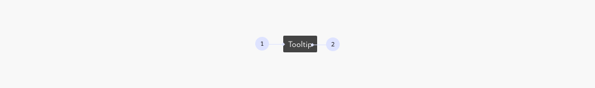

### Sizing

#### Maximum width

Tooltips have a maximum width of 272 px. Content wraps automatically when it reaches the maximum width.

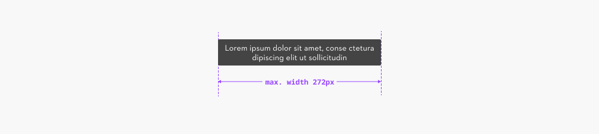

### Placement

#### Position

The Tooltip can be positioned relative to the triggering element in four directions:

- **above (default)**
- **below**
- **right**
- **left**

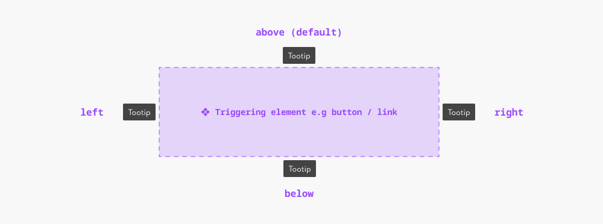

#### Alignment

In addition to the position, the Tooltip can be aligned with the triggering element in three ways:

- **start**
- **center (default)**
- **end**

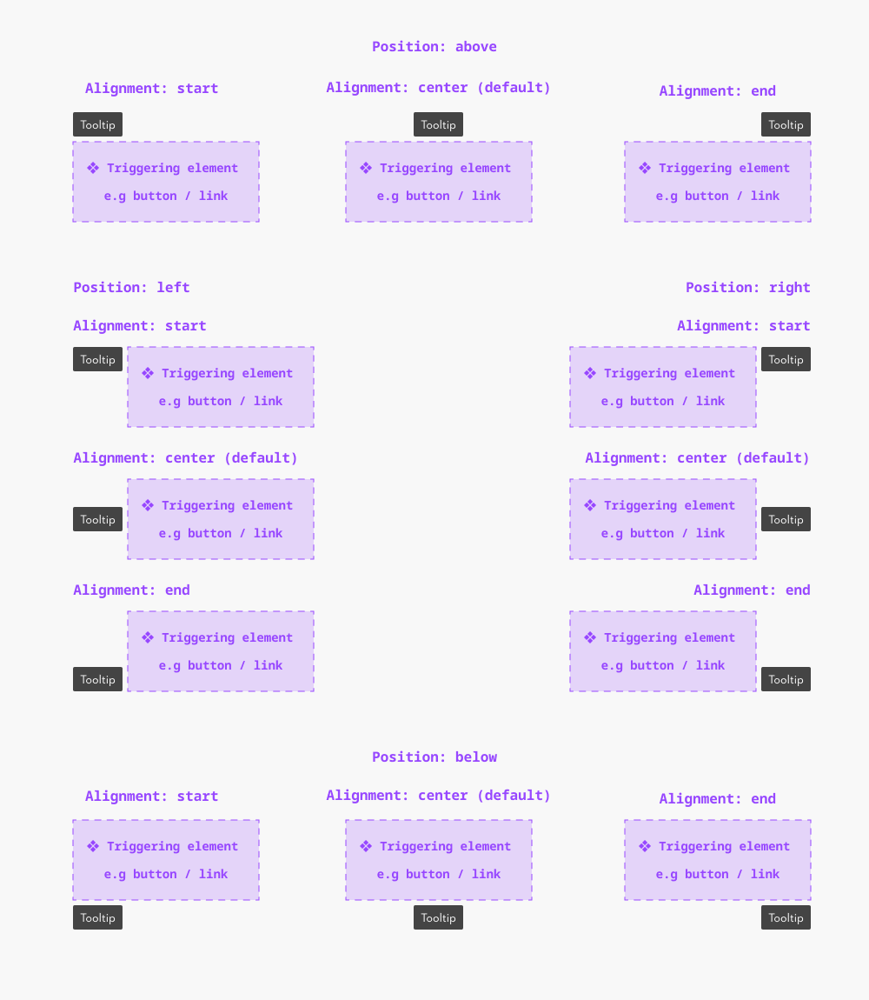

#### Distance

The distance to the triggering element is 6px

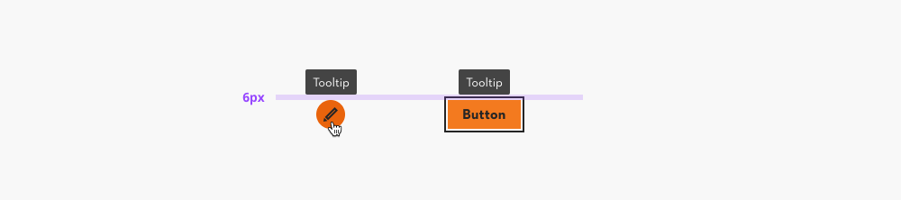

#### Edge cases:

If the preferred placement (e.g., top) would cause the Tooltip to appear outside the viewport, it should automatically reposition to fit within the visible area, while staying aligned with the triggering element.

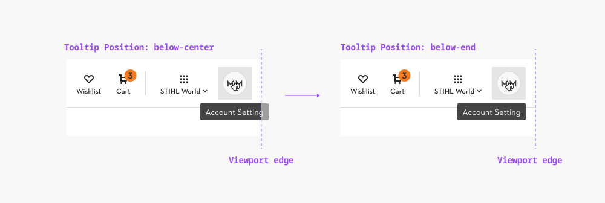

### Motion

#### Appear

**Animation type:** fade in **Delay:** 400ms **Duration:** 100ms **Easing:** motion-functional-ease-out

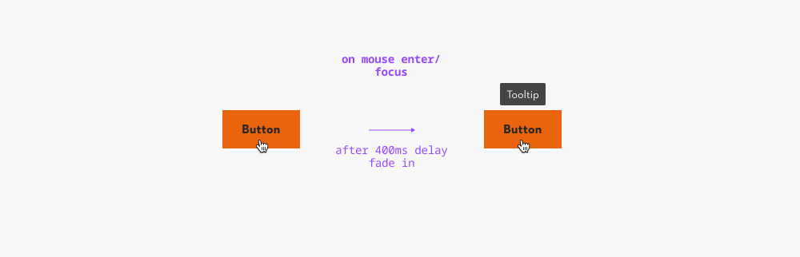

#### Disappear

**Animation type:** fade out **Delay:** 0ms **Duration:** 100ms **Easing:** motion-functional-ease-in

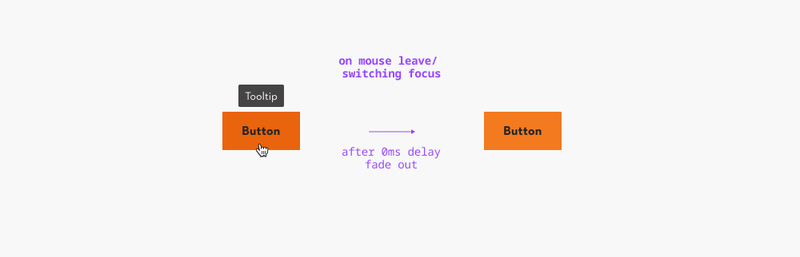

## Content and Assets

### Text only

Tooltips may only contain text. Keep the message short and focused.

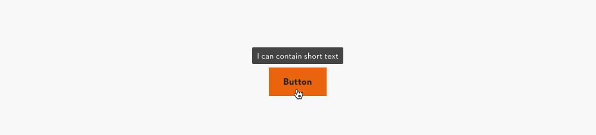

### Maximum length and overflow

Maximum length: up to 2 lines of text, apr. 60 characters

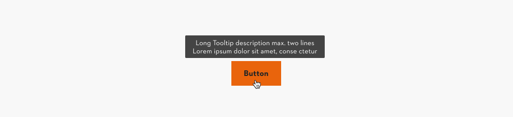

## Behavior and Usage

### Interactive elements only

Tooltips must only be attached to interactive components (such as buttons or links).

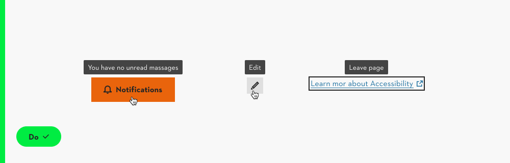

Applying Tooltips to non-interactive elements (e.g., div, span, or p) makes them inaccessible to keyboard and screen reader users.

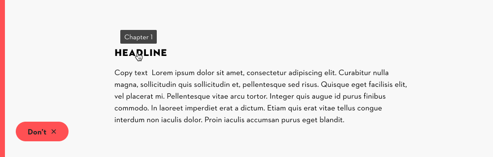

### Triggers and dismissal

**Triggers** A tooltip appears when the trigger element is:

- Hovered with a mouse
- Focused with the keyboard
- Long-pressed on touch devices

**Dismissal** A tooltip is dismissed when:

- The trigger loses hover or focus
- The user taps outside the element on touch devices

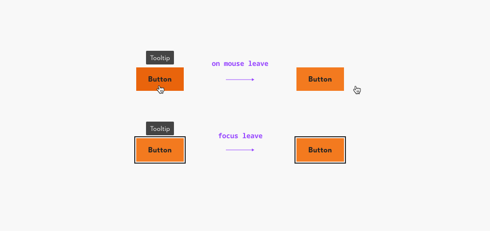

### Usecases

#### Tooltip as label

Icon button labels are hidden by default. Use a Tooltip to show the label and clarify the icon’s purpose.

> Tooltips are not always accessible. If the action can’t be understood without a label, use a visible label instead of relying on a Tooltip.

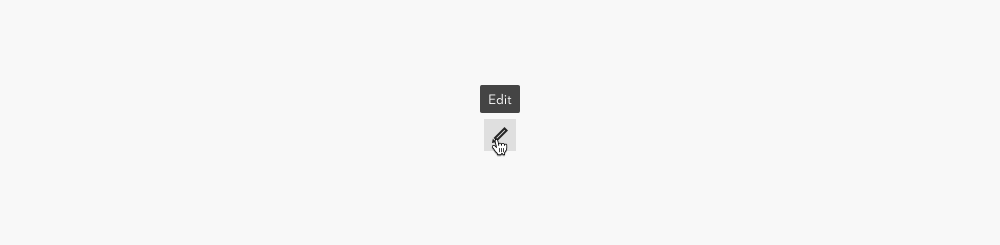

#### Tooltip as description

For buttons and other interactive elements with visible labels, use Tooltips only to add context or clarification.

Tooltips should supplement the label, not replace it, and include only supporting information that helps users better understand the action.

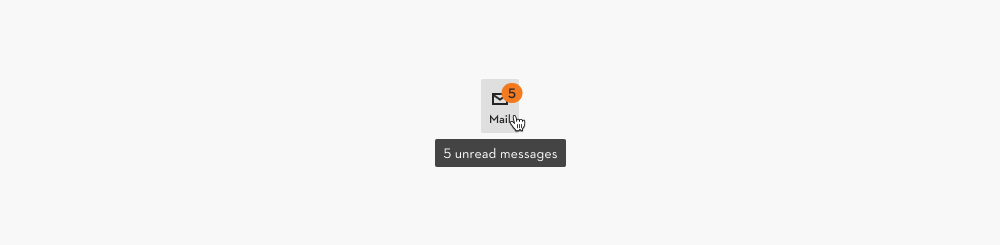

#### Don’t duplicate content

Avoid repeating the visible label in a Tooltip. If the label alone makes the purpose of a button or link clear, a Tooltip is unnecessary.

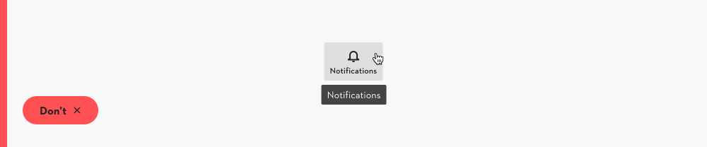

## Accessiblity

> **Usage Warning** Tooltips should be a last resort. They’re hidden by default and often lack a clear indicator. Prefer visible elements — like labels or helper text — for essential information. Use Tooltips only for supplementary, non-critical details.

### General

Ensure that Tooltip content is announced by screen readers and implemented with the correct semantic markup and ARIA attributes. Tooltips should always supplement the interface, not serve as the only way to access essential information.

### Alternatives for Tooltips

Since Tooltips are not always accessible, ask yourself before adding one:

- Is the information essential?
- Can the interface be clearer without a Tooltip?
- Could the information be shown directly on the page instead?

**More accessible alternatives include:**

#### Persistent Content

Don’t use Tooltips in forms for essential instructions since they only appear on hover or focus.

Instead, show important details persistently, such as input field hints.

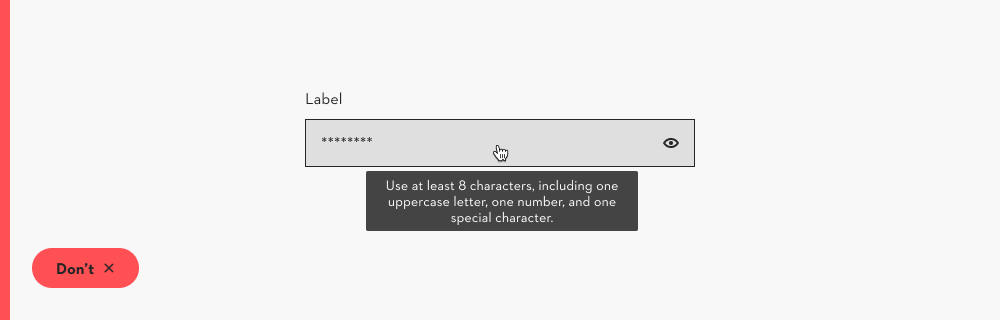

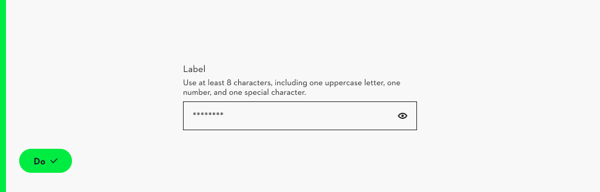

#### Popover

Tooltips must not contain interactive elements. When you need to present actions, links, or structured content, use a popover. Further Guidance when to use tooltips and when to use other components can be found here in the [decision tree section](https://www.figma.com/design/qXldpLO6gxHJNLdcXIPxYt?node-id=24972-2154)

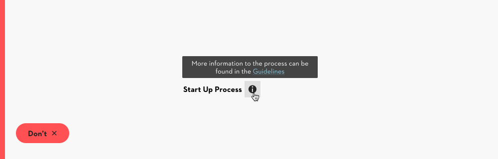

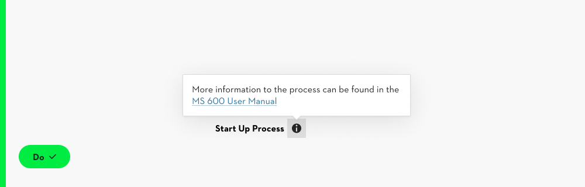

#### Expandable sections and accordions

When additional information is tied to a specific item (e.g., extra details in a list), do not hide it inside a Tooltip.

Instead, use expandable sections or accordions, which keep the information discoverable and accessible.

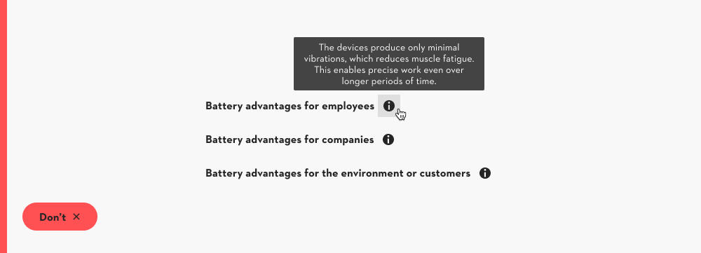

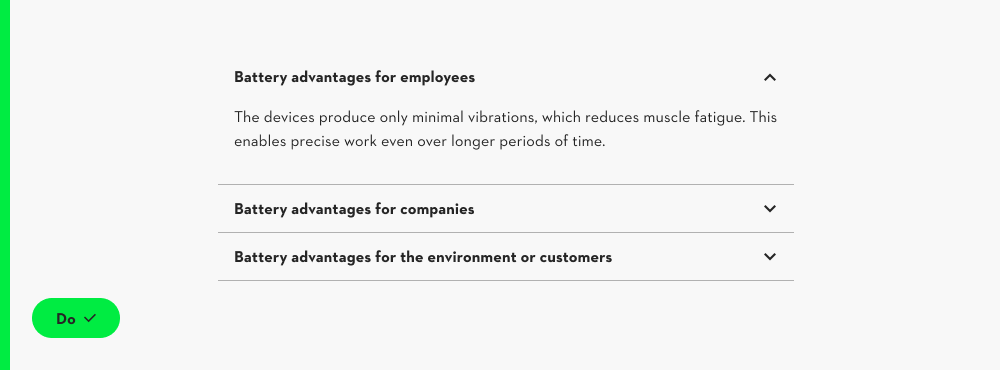

## Examples

### Avatar

If the avatar in the top bar has no visible label, a Tooltip can provide the missing information, such as the user’s name.

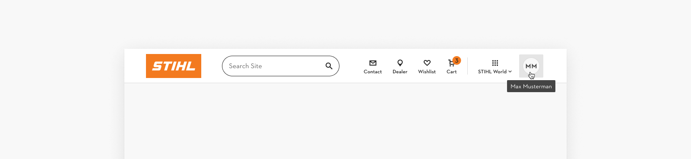

### Notification

In the top bar, additional details for notifications can be displayed using a Tooltip.

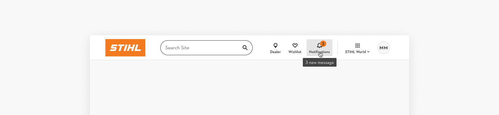

### Toggle button / Segmented controls

When buttons switch views without a visible label, Tooltips help to clarify their function. Example: SSC

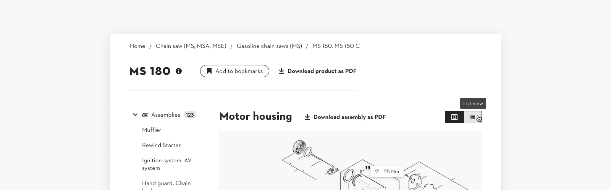

### Pagination

Arrow buttons in a pagination component can include Tooltips to explain their action. Example: SSC

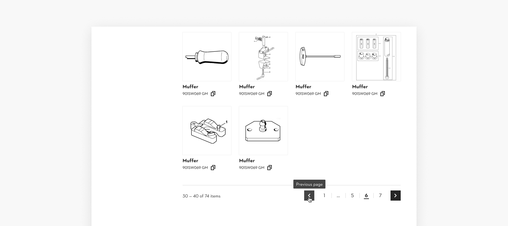

### Copy function

Tooltips can explain icon buttons in tables, such as copying a serial number. Example: SSC

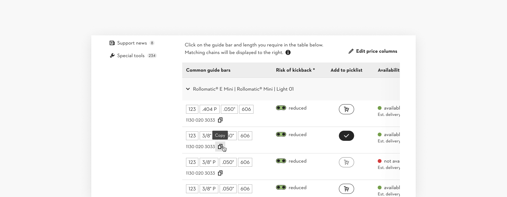
