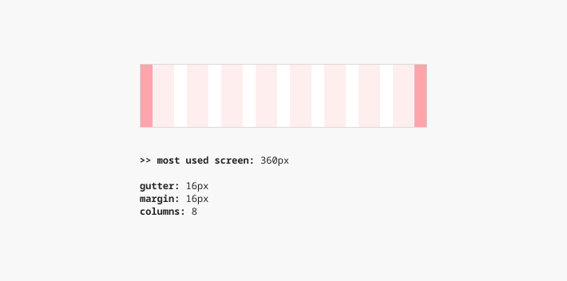
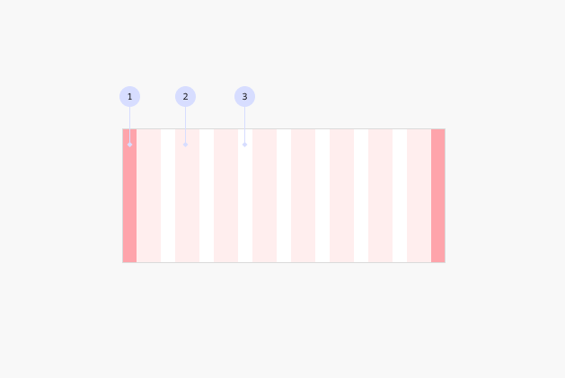
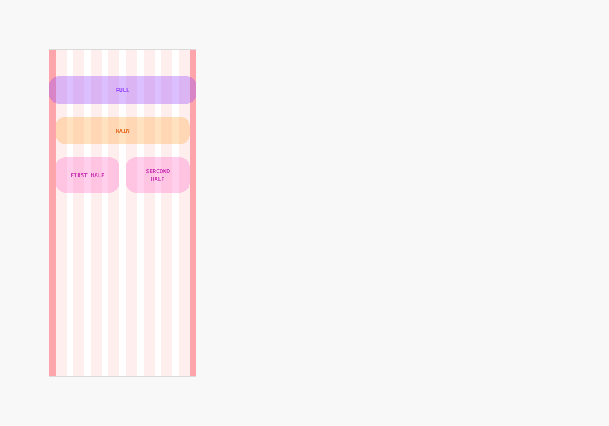
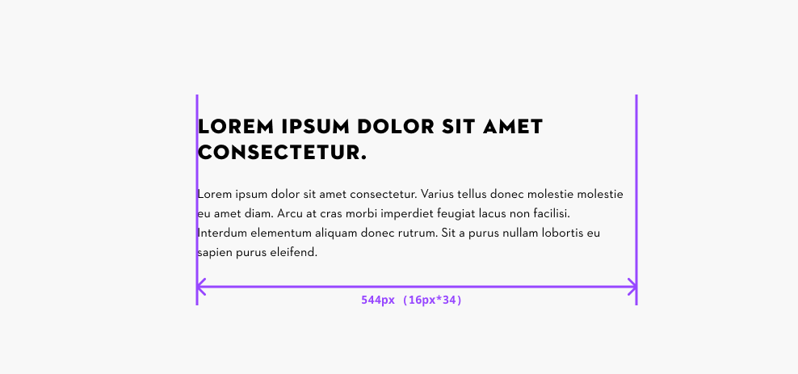

# Grid Styles: App

## Grid App

Overview:

- The grid width always grows with the respective viewport size
- The content areas define how content and modules can be placed within the grid.
- The max. text width must be defined within each module.

### Contribute

Contribute to improving these styles by sharing your feedback, asking questions, or suggesting features [here](https://www.figma.com/design/lLmw7PfIdKjFG4uT3B2Hyj/Onboarding-%F0%9F%93%96?node-id=446-868&t=zKmRu4kAkxMeRDmK-4).

## Formatting and Construction

### Anatomy

1. **Margins** Margins separate the grid from the left and right edges. Their widths change depending on the viewport.
1. **Columns** Columns define the areas where the content will be placed. The column widths change with the size of the grid.
1. **Gutters** Gutters are fixed spaces between columns which help to separate the content. Their widths are fixed.

## Content placement (Grid App)

### Content areas

These areas define how content and modules can be placed within the grid:

1. **Full** Spans the entire screen width. Commonly used for top bars, footers, or full-bleed sections.
1. **Main** Aligns with the central grid columns, excluding outer margins. Used for most contents.
1. **Halves** Divides the grid into two proportional segments, allowing for flexible layouts of content like teasers.

### Text width for body text

To maintain optimal readability, body text should not exceed 80 characters per line. It is recommended to set **the maximum text width to 34em**, which corresponds to 34 times the base font size.

For example, with the Text M size of 16px, this results in a maximum width of 544px (16px × 34 = 544px).

This maximum width should be defined within each module. Headlines should inherit the same width as the body text to ensure visual consistency.

[Further reading on Baymard Insitute →](https://baymard.com/blog/line-length-readability)

