# Grid Styles: Web

## Grid Web

Overview

- There are two grid types:
   - A center-aligned grid (without Sidebar Menu)
   - A grid with Sidebar Menu (see below)
- The grid expands with the viewport and stops growing beyond 1536px.
- Content areas define where modules and content can be placed within the grid.
- Each module must define its own maximum text width.

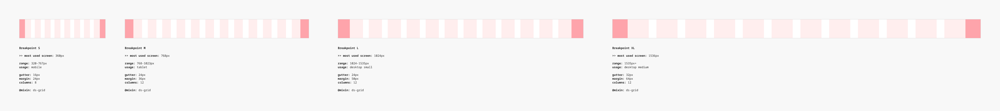

_Figure: Four web grid strips for the breakpoints, each wider than the last and each with dark pink margins at both ends. Breakpoint S: most used screen 360px, range 320-767px, usage mobile, gutter 16px, margin 24px, columns 8, @mixin ds-grid. Breakpoint M: most used screen 768px, range 768-1023px, usage tablet, gutter 24px, margin 36px, columns 12, @mixin ds-grid. Breakpoint L: most used screen 1024px, range 1024-1535px, usage desktop small, gutter 24px, margin 50px, columns 12, @mixin ds-grid. Breakpoint XL: most used screen 1536px, range 1535px+, usage desktop medium, gutter 32px, margin 64px, columns 12, @mixin ds-grid._

### Contribute

Contribute to improving these styles by sharing your feedback, asking questions, or suggesting features [here](https://www.figma.com/design/lLmw7PfIdKjFG4uT3B2Hyj/Onboarding-%F0%9F%93%96?node-id=446-868&t=zKmRu4kAkxMeRDmK-4).

## Formatting and Construction

### Anatomy

1. **Margins** Margins separate the grid from the left and right edges. Their widths change depending on the breakpoint.
1. **Columns** Columns define the areas where the content will be placed. The column widths change with the size of the grid. The number of columns are affected by the breakpoint.
1. **Gutters** Gutters are fixed spaces between columns which help to separate the content. Their widths are fixed within each breakpoint range.
1. **Sidebar closed** Space for a main sidebar that has been closed. The width of the closed sidebar is fixed.
1. **Sidebar open** Space for a main sidebar that is open. The width of the open sidebar is fixed

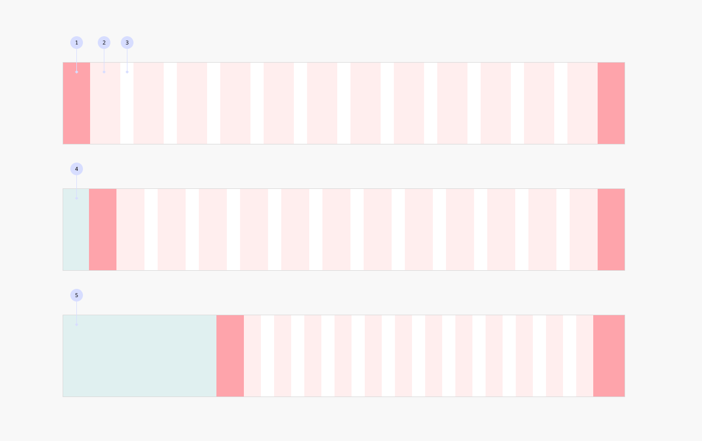

_Figure: Three stacked web grid strips. The first has no sidebar, with callout 1 on the dark pink margin at the left edge, callout 2 on a light pink column and callout 3 on a white gutter. In the second strip callout 4 points at a narrow light teal area at the left, the closed sidebar, placed before the grid margin. In the third strip callout 5 points at a wide light teal area at the left, the open sidebar, which leaves fewer and narrower columns on the right._

### Grid types

#### Web Grid

The default grid for all use cases, providing a responsive, center-aligned layout that expands up to 1536px.

_Figure: Web Grid without sidebar, shown as a single strip with a dark pink margin at the left and right edge and 12 light pink columns between them, separated by white gutters._

#### Web Grid Sidebar

Used only in combination with a Sidebar Menu, this responsive grid reserves space for a left-aligned sidebar while following the same margins and gutters as the Web Grid.

_Figure: Web Grid Sidebar, shown as a single strip with a wide light teal area at the left for the sidebar, followed by a dark pink margin, 12 narrow light pink columns separated by white gutters, and a dark pink margin at the right edge._

### ⚠️ Avoiding decimal pixel values

**Margins and Gutters** The Web Grid Sidebar uses the same margins and gutters as the Web Grid, with one exception:

- **Figma:** Right margin is set to 58px (L) and 72px (XL) to avoid decimal column widths, since Figma does not support stretching columns with Sidebar Menus.
- **Code:** Right margin will be set to the intended 50px (L) and 64px (XL).

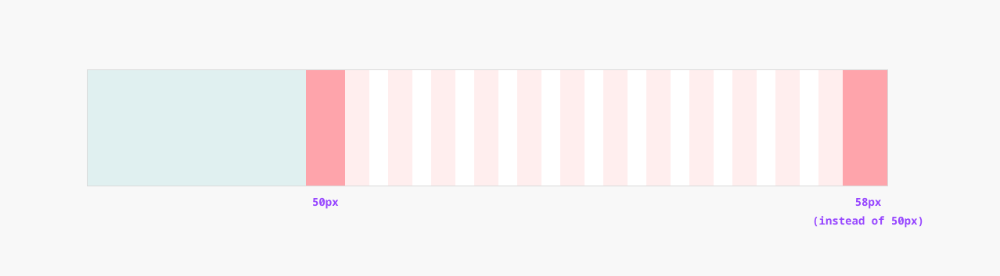

_Figure: Web Grid Sidebar strip with a wide light teal sidebar area at the left and a dark pink margin on each side of the columns. The left margin is labelled 50px, and the right margin is labelled 58px (instead of 50px), the wider value used in Figma to avoid decimal column widths._

### Responsive behavior

#### Responsive columns, fixed margins and gutters

The grid adapts fluidly to the viewport: margins and gutters stay fixed at defined breakpoints, while columns expand to fill the available space.

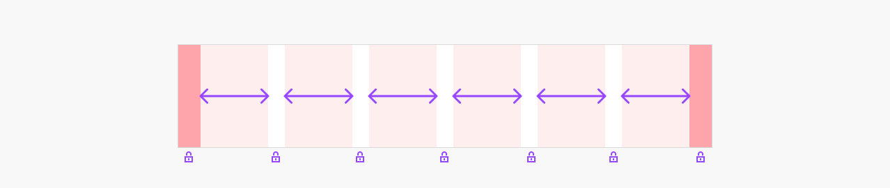

_Figure: Grid strip with six light pink columns, white gutters and dark pink margins at both ends. Purple double-headed arrows span each column width to show that columns stretch, and small purple lock icons below the margin and gutter edges show that margins and gutters stay fixed._

#### Grid widths

1. **Web Grid** Expands with the viewport up to a maximum width of 1408px
1. **Web Grid Sidebar** Expands to the full viewport width

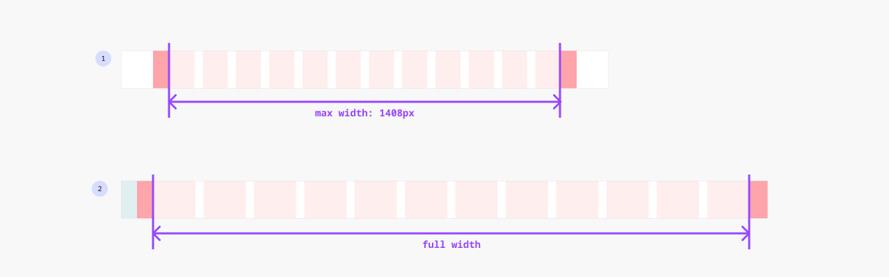

_Figure: Two horizontal column-grid strips with margins and gutters. Callout 1, the Web Grid, has a bracketed content span labelled "max width: 1408px" with empty space outside it on both sides. Callout 2, the Web Grid Sidebar, has a span labelled "full width" that stretches across the whole viewport, with a left area reserved for the sidebar._

## Grid Web: Content Placement

### Content areas

These areas define how content and modules can be placed within the grid:

1. **Full** Spans the entire screen width. Commonly used for top bars, footers, or full-bleed sections.
1. **Extended** Spans the full width of the screen but stops expanding beyond 1920px. Ideal for visually prominent elements such as hero sections or wide teasers.
1. **Main** Aligns with the central grid columns, excluding outer margins. Typically used for core content like teasers.
1. **Halves, thirds and quarters** Divides the grid into proportional segments, allowing for flexible layouts of content like teasers.
1. **Narrow** Uses a limited number of columns to constrain content width. Enhances readability for elements such as text blocks, accordions, forms, and images by reducing horizontal eye movement.

_Figure: Overview of the content areas of the web grid at four breakpoints, Breakpoint S, Breakpoint M, Breakpoint L and Breakpoint XL, each with one or two example screens. Breakpoint S covers 320px minimum to 767px, Breakpoint M 768px to 1023px, Breakpoint L 1024px to 1535px, and Breakpoint XL starts at 1536px and is also shown at an example size of 2560px. Each screen stacks coloured bars labelled Full, Extended and Main, then rows of halves, thirds, two thirds and quarters, then Narrow Center and Narrow Left bars; at XL on the 2560px screen Extended and Main stay centred and narrower than the Full bar._

### Text behavior within the gird / content areas

To maintain optimal readability, text should not exceed 80 characters per line. It is recommended to set **the maximum text width to 34em**, which corresponds to 34 times the used font size. This maximum width should be defined within each module.

[Further Guidelines: Typography and Text width →](https://www.figma.com/design/pQUiJaNuWrGzPaeMrEHf6N/DS-1117-Design-%7C-34em?node-id=2645-515)

[Further reading on Baymard Insitute →](https://baymard.com/blog/line-length-readability)

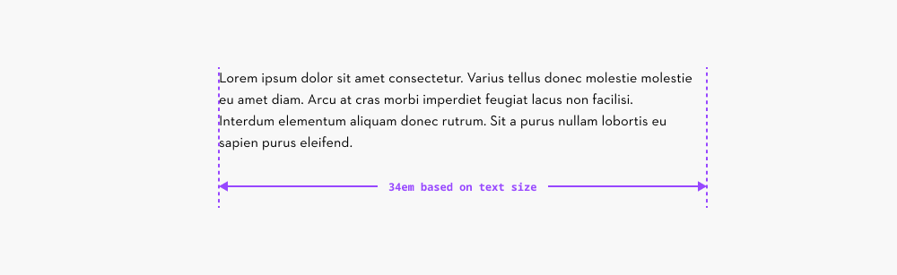

_Figure: Text in the figure: "Lorem ipsum dolor sit amet consectetur. Varius tellus donec molestie molestie...", "34em based on text size"._

#### Maximum Width within Content Areas

When text elements are placed inside Content Areas, the following rules apply:

1. **If the container width is smaller than the calculated max text width** → the container width is used.
1. **If the container width is larger than the calculated max text width** → the text is capped at its maximum allowed width.

This ensures text always respects both layout constraints and optimal readability, whether it's in a card, column, or larger content block.

[Further Guidelines: Typography and Text width →](https://www.figma.com/design/pQUiJaNuWrGzPaeMrEHf6N/DS-1117-Design-%7C-34em?node-id=2645-515)

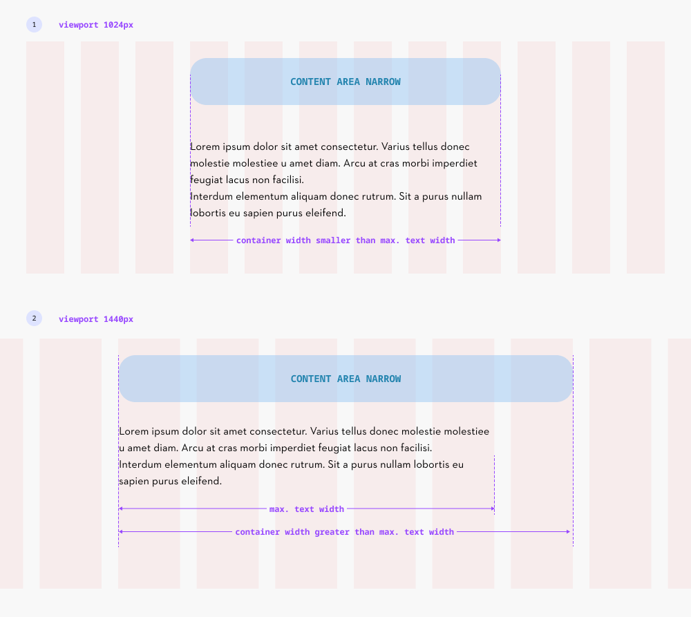

_Figure: Shows annotation-circle (number=1, type=center, color=blue); annotation-circle (number=2, type=center, color=blue). Callouts 1, 2. Text in the figure: "viewport 1024px", "Content area Narrow", "Lorem ipsum dolor sit amet consectetur. Varius tellus donec molestie molestie...", "container width smaller than max. text width", "viewport 1440px", "max. text width", "container width greater than max. text width"._

## Grid Web: Content Placement Examples

### Disclaimer

The screens and UI elements presented in this documentation serve as examples to illustrate how various modules could behave within different content areas.

This documentation is intended for reference purposes only and should not be considered a definitive representation of the final product.

**Breakpoint S**

**Breakpoint M**

**Breakpoint L**

**Breakpoint XL**

**Min. 320px**

**Most used 360px**

**Max. 767px**

**Min. 768px / most used size**

**Max. 1023px**

**Min. 1024px / most used size**

**Max. 1535px**

**Min. 1536px**

**Example 1920px**

**Example 2560px**

**Example 3242px**

**big artificial**

**Analytics scalability making training infrastructure**

Lorem ipsum dolor sit amet consectetur. Eget sollicitudin tellus id arcu sollicitudin id egestas sed tincidunt. Amet pulvinar tellus lacus vehicula sit ultrices.

**Analytics scalability making training infrastructure**

Lorem ipsum dolor sit amet consectetur. Eget sollicitudin tellus id arcu sollicitudin id egestas sed tincidunt. Amet pulvinar tellus lacus vehicula sit ultrices.

**Profi Akkuberater**

Lorem ipsum dolor sit amet consectetur. Eget sollicitudin tellus id arcu sollicitudin id egestas sed tincidunt. Amet pulvinar tellus lacus vehicula sit ultrices.

**Ketten- und Schienenberater**

Lorem ipsum dolor sit amet consectetur. Eget sollicitudin tellus id arcu sollicitudin id egestas sed tincidunt. Amet pulvinar tellus lacus vehicula sit ultrices.

**STIHL Schneidwerkzeugberater**

Lorem ipsum dolor sit amet consectetur. Eget sollicitudin tellus id arcu sollicitudin id egestas sed tincidunt. Amet pulvinar tellus lacus vehicula sit ultrices.

**big artificial**

**Analytics scalability making training infrastructure**

Lorem ipsum dolor sit amet consectetur. Eget sollicitudin tellus id arcu sollicitudin id egestas sed tincidunt. Amet pulvinar tellus lacus vehicula sit ultrices. Eu leo sit duis blandit. Volutpat amet amet augue ipsum eu felis sit. Cursus sit odio porttitor convallis venenatis faucibus neque massa porttitor.

**Der Beste seiner Klasse: STIHL AP 500 S**

Lorem ipsum dolor sit amet consectetur. Eget sollicitudin tellus id arcu sollicitudin id egestas sed tincidunt. Amet pulvinar tellus lacus vehicula sit ultrices.

**Innovation velit support**

**Big sint efficiency dolore amet**

**Infrastructure voluptate elit amet ex ecosystem**

Lorem ipsum dolor sit amet consectetur. Consequat facilisis mi dignissim feugiat dictumst aliquam porttitor nunc. Duis risus consequat consequat vitae ut sed at. Hac et et egestas sit. Egestas nulla sed vitae sit nunc blandit felis nunc tristique. Venenatis nibh ultrices mi et placerat massa quam lobortis maecenas.

Pellentesque varius parturient purus condimentum pellentesque odio nunc velit senectus. Augue tempor risus a nulla tellus rhoncus. Convallis ullamcorper fermentum dolor ultrices quam dui ullamcorper. Ut fames ut varius quis eget viverra a. Purus consequat quis integer amet semper habitasse. At fusce tincidunt pulvinar nunc ipsum gravida. A aliquet eu imperdiet eu id amet.

Nunc phasellus viverra vulputate magna euismod bibendum. Et tincidunt tortor laoreet feugiat sed hac lacus nisl. Sit pellentesque proin nibh amet felis. Id libero at mollis neque est faucibus ut vel. Mattis viverra orci semper aliquet donec sapien et. Urna pharetra et laoreet tortor at cras ornare diam orci.

Fieldset Legend Default Style

Lorem ipsum dolor sit amet, consectetur adipiscing elit. Cras nunc amet mauris turpis magna. Quisque ut mi rhoncus eget.

**big artificial**

**Analytics scalability making training infrastructure**

Lorem ipsum dolor sit amet consectetur. Eget sollicitudin tellus id arcu sollicitudin id egestas sed tincidunt. Amet pulvinar tellus lacus vehicula sit ultrices.

**Analytics scalability making training infrastructure**

Lorem ipsum dolor sit amet consectetur. Eget sollicitudin tellus id arcu sollicitudin id egestas sed tincidunt. Amet pulvinar tellus lacus vehicula sit ultrices.

**Profi Akkuberater**

Lorem ipsum dolor sit amet consectetur. Eget sollicitudin tellus id arcu sollicitudin id egestas sed tincidunt. Amet pulvinar tellus lacus vehicula sit ultrices.

**Ketten- und Schienenberater**

Lorem ipsum dolor sit amet consectetur. Eget sollicitudin tellus id arcu sollicitudin id egestas sed tincidunt. Amet pulvinar tellus lacus vehicula sit ultrices.

**STIHL Schneidwerkzeugberater**

Lorem ipsum dolor sit amet consectetur. Eget sollicitudin tellus id arcu sollicitudin id egestas sed tincidunt. Amet pulvinar tellus lacus vehicula sit ultrices.

**big artificial**

**Analytics scalability making training infrastructure**

Lorem ipsum dolor sit amet consectetur. Eget sollicitudin tellus id arcu sollicitudin id egestas sed tincidunt. Amet pulvinar tellus lacus vehicula sit ultrices. Eu leo sit duis blandit. Volutpat amet amet augue ipsum eu felis sit. Cursus sit odio porttitor convallis venenatis faucibus neque massa porttitor.

**Der Beste seiner Klasse: STIHL AP 500 S**

Lorem ipsum dolor sit amet consectetur. Eget sollicitudin tellus id arcu sollicitudin id egestas sed tincidunt. Amet pulvinar tellus lacus vehicula sit ultrices.

**Innovation velit support**

**Big sint efficiency dolore amet**

**Infrastructure voluptate elit amet ex ecosystem**

Lorem ipsum dolor sit amet consectetur. Consequat facilisis mi dignissim feugiat dictumst aliquam porttitor nunc. Duis risus consequat consequat vitae ut sed at. Hac et et egestas sit. Egestas nulla sed vitae sit nunc blandit felis nunc tristique. Venenatis nibh ultrices mi et placerat massa quam lobortis maecenas.

Pellentesque varius parturient purus condimentum pellentesque odio nunc velit senectus. Augue tempor risus a nulla tellus rhoncus. Convallis ullamcorper fermentum dolor ultrices quam dui ullamcorper. Ut fames ut varius quis eget viverra a. Purus consequat quis integer amet semper habitasse. At fusce tincidunt pulvinar nunc ipsum gravida. A aliquet eu imperdiet eu id amet.

Nunc phasellus viverra vulputate magna euismod bibendum. Et tincidunt tortor laoreet feugiat sed hac lacus nisl. Sit pellentesque proin nibh amet felis. Id libero at mollis neque est faucibus ut vel. Mattis viverra orci semper aliquet donec sapien et. Urna pharetra et laoreet tortor at cras ornare diam orci.

Fieldset Legend Default Style

Lorem ipsum dolor sit amet, consectetur adipiscing elit. Cras nunc amet mauris turpis magna. Quisque ut mi rhoncus eget.

**big artificial**

**Analytics scalability making training infrastructure**

Lorem ipsum dolor sit amet consectetur. Eget sollicitudin tellus id arcu sollicitudin id egestas sed tincidunt. Amet pulvinar tellus lacus vehicula sit ultrices.

**Analytics scalability making training infrastructure**

Lorem ipsum dolor sit amet consectetur. Eget sollicitudin tellus id arcu sollicitudin id egestas sed tincidunt. Amet pulvinar tellus lacus vehicula sit ultrices.

**Profi Akkuberater**

Lorem ipsum dolor sit amet consectetur. Eget sollicitudin tellus id arcu sollicitudin id egestas sed tincidunt. Amet pulvinar tellus lacus vehicula sit ultrices.

**Ketten- und Schienenberater**

Lorem ipsum dolor sit amet consectetur. Eget sollicitudin tellus id arcu sollicitudin id egestas sed tincidunt. Amet pulvinar tellus lacus vehicula sit ultrices.

**STIHL Schneidwerkzeugberater**

Lorem ipsum dolor sit amet consectetur. Eget sollicitudin tellus id arcu sollicitudin id egestas sed tincidunt. Amet pulvinar tellus lacus vehicula sit ultrices.

**big artificial**

**Analytics scalability making training infrastructure**

Lorem ipsum dolor sit amet consectetur. Eget sollicitudin tellus id arcu sollicitudin id egestas sed tincidunt. Amet pulvinar tellus lacus vehicula sit ultrices. Eu leo sit duis blandit. Volutpat amet amet augue ipsum eu felis sit. Cursus sit odio porttitor convallis venenatis faucibus neque massa porttitor.

**Der Beste seiner Klasse: STIHL AP 500 S**

Lorem ipsum dolor sit amet consectetur. Eget sollicitudin tellus id arcu sollicitudin id egestas sed tincidunt. Amet pulvinar tellus lacus vehicula sit ultrices.

**Innovation velit support**

**Big sint efficiency dolore amet**

**Infrastructure voluptate elit amet ex ecosystem**

Lorem ipsum dolor sit amet consectetur. Consequat facilisis mi dignissim feugiat dictumst aliquam porttitor nunc. Duis risus consequat consequat vitae ut sed at. Hac et et egestas sit. Egestas nulla sed vitae sit nunc blandit felis nunc tristique. Venenatis nibh ultrices mi et placerat massa quam lobortis maecenas.

Pellentesque varius parturient purus condimentum pellentesque odio nunc velit senectus. Augue tempor risus a nulla tellus rhoncus. Convallis ullamcorper fermentum dolor ultrices quam dui ullamcorper. Ut fames ut varius quis eget viverra a. Purus consequat quis integer amet semper habitasse. At fusce tincidunt pulvinar nunc ipsum gravida. A aliquet eu imperdiet eu id amet.

Nunc phasellus viverra vulputate magna euismod bibendum. Et tincidunt tortor laoreet feugiat sed hac lacus nisl. Sit pellentesque proin nibh amet felis. Id libero at mollis neque est faucibus ut vel. Mattis viverra orci semper aliquet donec sapien et. Urna pharetra et laoreet tortor at cras ornare diam orci.

Fieldset Legend Default Style

Lorem ipsum dolor sit amet, consectetur adipiscing elit. Cras nunc amet mauris turpis magna. Quisque ut mi rhoncus eget.

**big artificial**

**Analytics scalability making training infrastructure**

Lorem ipsum dolor sit amet consectetur. Eget sollicitudin tellus id arcu sollicitudin id egestas sed tincidunt. Amet pulvinar tellus lacus vehicula sit ultrices.

**Analytics scalability making training infrastructure**

Lorem ipsum dolor sit amet consectetur. Eget sollicitudin tellus id arcu sollicitudin id egestas sed tincidunt. Amet pulvinar tellus lacus vehicula sit ultrices.

**Profi Akkuberater**

Lorem ipsum dolor sit amet consectetur. Eget sollicitudin tellus id arcu sollicitudin id egestas sed tincidunt. Amet pulvinar tellus lacus vehicula sit ultrices.

**Ketten- und Schienenberater**

Lorem ipsum dolor sit amet consectetur. Eget sollicitudin tellus id arcu sollicitudin id egestas sed tincidunt. Amet pulvinar tellus lacus vehicula sit ultrices.

**STIHL Schneidwerkzeugberater**

Lorem ipsum dolor sit amet consectetur. Eget sollicitudin tellus id arcu sollicitudin id egestas sed tincidunt. Amet pulvinar tellus lacus vehicula sit ultrices.

**big artificial**

**Analytics scalability making training infrastructure**

Lorem ipsum dolor sit amet consectetur. Eget sollicitudin tellus id arcu sollicitudin id egestas sed tincidunt. Amet pulvinar tellus lacus vehicula sit ultrices. Eu leo sit duis blandit. Volutpat amet amet augue ipsum eu felis sit. Cursus sit odio porttitor convallis venenatis faucibus neque massa porttitor.

**Der Beste seiner Klasse: STIHL AP 500 S**

Lorem ipsum dolor sit amet consectetur. Eget sollicitudin tellus id arcu sollicitudin id egestas sed tincidunt. Amet pulvinar tellus lacus vehicula sit ultrices.

**Innovation velit support**

**Big sint efficiency dolore amet**

**Infrastructure voluptate elit amet ex ecosystem**

Lorem ipsum dolor sit amet consectetur. Consequat facilisis mi dignissim feugiat dictumst aliquam porttitor nunc. Duis risus consequat consequat vitae ut sed at. Hac et et egestas sit. Egestas nulla sed vitae sit nunc blandit felis nunc tristique. Venenatis nibh ultrices mi et placerat massa quam lobortis maecenas.

Pellentesque varius parturient purus condimentum pellentesque odio nunc velit senectus. Augue tempor risus a nulla tellus rhoncus. Convallis ullamcorper fermentum dolor ultrices quam dui ullamcorper. Ut fames ut varius quis eget viverra a. Purus consequat quis integer amet semper habitasse. At fusce tincidunt pulvinar nunc ipsum gravida. A aliquet eu imperdiet eu id amet.

Nunc phasellus viverra vulputate magna euismod bibendum. Et tincidunt tortor laoreet feugiat sed hac lacus nisl. Sit pellentesque proin nibh amet felis. Id libero at mollis neque est faucibus ut vel. Mattis viverra orci semper aliquet donec sapien et. Urna pharetra et laoreet tortor at cras ornare diam orci.

Fieldset Legend Default Style

Lorem ipsum dolor sit amet, consectetur adipiscing elit. Cras nunc amet mauris turpis magna. Quisque ut mi rhoncus eget.

**big artificial**

**Analytics scalability making training infrastructure**

Lorem ipsum dolor sit amet consectetur. Eget sollicitudin tellus id arcu sollicitudin id egestas sed tincidunt. Amet pulvinar tellus lacus vehicula sit ultrices.

**Analytics scalability making training infrastructure**

Lorem ipsum dolor sit amet consectetur. Eget sollicitudin tellus id arcu sollicitudin id egestas sed tincidunt. Amet pulvinar tellus lacus vehicula sit ultrices.

**Profi Akkuberater**

Lorem ipsum dolor sit amet consectetur. Eget sollicitudin tellus id arcu sollicitudin id egestas sed tincidunt. Amet pulvinar tellus lacus vehicula sit ultrices.

**Ketten- und Schienenberater**

Lorem ipsum dolor sit amet consectetur. Eget sollicitudin tellus id arcu sollicitudin id egestas sed tincidunt. Amet pulvinar tellus lacus vehicula sit ultrices.

**STIHL Schneidwerkzeugberater**

Lorem ipsum dolor sit amet consectetur. Eget sollicitudin tellus id arcu sollicitudin id egestas sed tincidunt. Amet pulvinar tellus lacus vehicula sit ultrices.

**big artificial**

**Analytics scalability making training infrastructure**

Lorem ipsum dolor sit amet consectetur. Eget sollicitudin tellus id arcu sollicitudin id egestas sed tincidunt. Amet pulvinar tellus lacus vehicula sit ultrices. Eu leo sit duis blandit. Volutpat amet amet augue ipsum eu felis sit. Cursus sit odio porttitor convallis venenatis faucibus neque massa porttitor.

**Der Beste seiner Klasse: STIHL AP 500 S**

Lorem ipsum dolor sit amet consectetur. Eget sollicitudin tellus id arcu sollicitudin id egestas sed tincidunt. Amet pulvinar tellus lacus vehicula sit ultrices.

**Innovation velit support**

**Big sint efficiency dolore amet**

**Infrastructure voluptate elit amet ex ecosystem**

Lorem ipsum dolor sit amet consectetur. Consequat facilisis mi dignissim feugiat dictumst aliquam porttitor nunc. Duis risus consequat consequat vitae ut sed at. Hac et et egestas sit. Egestas nulla sed vitae sit nunc blandit felis nunc tristique. Venenatis nibh ultrices mi et placerat massa quam lobortis maecenas.

Pellentesque varius parturient purus condimentum pellentesque odio nunc velit senectus. Augue tempor risus a nulla tellus rhoncus. Convallis ullamcorper fermentum dolor ultrices quam dui ullamcorper. Ut fames ut varius quis eget viverra a. Purus consequat quis integer amet semper habitasse. At fusce tincidunt pulvinar nunc ipsum gravida. A aliquet eu imperdiet eu id amet.

Nunc phasellus viverra vulputate magna euismod bibendum. Et tincidunt tortor laoreet feugiat sed hac lacus nisl. Sit pellentesque proin nibh amet felis. Id libero at mollis neque est faucibus ut vel. Mattis viverra orci semper aliquet donec sapien et. Urna pharetra et laoreet tortor at cras ornare diam orci.

Fieldset Legend Default Style

Lorem ipsum dolor sit amet, consectetur adipiscing elit. Cras nunc amet mauris turpis magna. Quisque ut mi rhoncus eget.

**big artificial**

**Analytics scalability making training infrastructure**

Lorem ipsum dolor sit amet consectetur. Eget sollicitudin tellus id arcu sollicitudin id egestas sed tincidunt. Amet pulvinar tellus lacus vehicula sit ultrices.

**Analytics scalability making training infrastructure**

Lorem ipsum dolor sit amet consectetur. Eget sollicitudin tellus id arcu sollicitudin id egestas sed tincidunt. Amet pulvinar tellus lacus vehicula sit ultrices.

**Profi Akkuberater**

Lorem ipsum dolor sit amet consectetur. Eget sollicitudin tellus id arcu sollicitudin id egestas sed tincidunt. Amet pulvinar tellus lacus vehicula sit ultrices.

**Ketten- und Schienenberater**

Lorem ipsum dolor sit amet consectetur. Eget sollicitudin tellus id arcu sollicitudin id egestas sed tincidunt. Amet pulvinar tellus lacus vehicula sit ultrices.

**STIHL Schneidwerkzeugberater**

Lorem ipsum dolor sit amet consectetur. Eget sollicitudin tellus id arcu sollicitudin id egestas sed tincidunt. Amet pulvinar tellus lacus vehicula sit ultrices.

**big artificial**

**Analytics scalability making training infrastructure**

Lorem ipsum dolor sit amet consectetur. Eget sollicitudin tellus id arcu sollicitudin id egestas sed tincidunt. Amet pulvinar tellus lacus vehicula sit ultrices. Eu leo sit duis blandit. Volutpat amet amet augue ipsum eu felis sit. Cursus sit odio porttitor convallis venenatis faucibus neque massa porttitor.

**Der Beste seiner Klasse: STIHL AP 500 S**

Lorem ipsum dolor sit amet consectetur. Eget sollicitudin tellus id arcu sollicitudin id egestas sed tincidunt. Amet pulvinar tellus lacus vehicula sit ultrices.

**Innovation velit support**

**Big sint efficiency dolore amet**

**Infrastructure voluptate elit amet ex ecosystem**

Lorem ipsum dolor sit amet consectetur. Consequat facilisis mi dignissim feugiat dictumst aliquam porttitor nunc. Duis risus consequat consequat vitae ut sed at. Hac et et egestas sit. Egestas nulla sed vitae sit nunc blandit felis nunc tristique. Venenatis nibh ultrices mi et placerat massa quam lobortis maecenas.

Pellentesque varius parturient purus condimentum pellentesque odio nunc velit senectus. Augue tempor risus a nulla tellus rhoncus. Convallis ullamcorper fermentum dolor ultrices quam dui ullamcorper. Ut fames ut varius quis eget viverra a. Purus consequat quis integer amet semper habitasse. At fusce tincidunt pulvinar nunc ipsum gravida. A aliquet eu imperdiet eu id amet.

Nunc phasellus viverra vulputate magna euismod bibendum. Et tincidunt tortor laoreet feugiat sed hac lacus nisl. Sit pellentesque proin nibh amet felis. Id libero at mollis neque est faucibus ut vel. Mattis viverra orci semper aliquet donec sapien et. Urna pharetra et laoreet tortor at cras ornare diam orci.

Fieldset Legend Default Style

Lorem ipsum dolor sit amet, consectetur adipiscing elit. Cras nunc amet mauris turpis magna. Quisque ut mi rhoncus eget.

**big artificial**

**Analytics scalability making training infrastructure**

Lorem ipsum dolor sit amet consectetur. Eget sollicitudin tellus id arcu sollicitudin id egestas sed tincidunt. Amet pulvinar tellus lacus vehicula sit ultrices.

**Analytics scalability making training infrastructure**

Lorem ipsum dolor sit amet consectetur. Eget sollicitudin tellus id arcu sollicitudin id egestas sed tincidunt. Amet pulvinar tellus lacus vehicula sit ultrices.

**Profi Akkuberater**

Lorem ipsum dolor sit amet consectetur. Eget sollicitudin tellus id arcu sollicitudin id egestas sed tincidunt. Amet pulvinar tellus lacus vehicula sit ultrices.

**Ketten- und Schienenberater**

Lorem ipsum dolor sit amet consectetur. Eget sollicitudin tellus id arcu sollicitudin id egestas sed tincidunt. Amet pulvinar tellus lacus vehicula sit ultrices.

**STIHL Schneidwerkzeugberater**

Lorem ipsum dolor sit amet consectetur. Eget sollicitudin tellus id arcu sollicitudin id egestas sed tincidunt. Amet pulvinar tellus lacus vehicula sit ultrices.

**big artificial**

**Analytics scalability making training infrastructure**

Lorem ipsum dolor sit amet consectetur. Eget sollicitudin tellus id arcu sollicitudin id egestas sed tincidunt. Amet pulvinar tellus lacus vehicula sit ultrices. Eu leo sit duis blandit. Volutpat amet amet augue ipsum eu felis sit. Cursus sit odio porttitor convallis venenatis faucibus neque massa porttitor.

**Der Beste seiner Klasse: STIHL AP 500 S**

Lorem ipsum dolor sit amet consectetur. Eget sollicitudin tellus id arcu sollicitudin id egestas sed tincidunt. Amet pulvinar tellus lacus vehicula sit ultrices.

**Innovation velit support**

**Big sint efficiency dolore amet**

**Infrastructure voluptate elit amet ex ecosystem**

Lorem ipsum dolor sit amet consectetur. Consequat facilisis mi dignissim feugiat dictumst aliquam porttitor nunc. Duis risus consequat consequat vitae ut sed at. Hac et et egestas sit. Egestas nulla sed vitae sit nunc blandit felis nunc tristique. Venenatis nibh ultrices mi et placerat massa quam lobortis maecenas.

Pellentesque varius parturient purus condimentum pellentesque odio nunc velit senectus. Augue tempor risus a nulla tellus rhoncus. Convallis ullamcorper fermentum dolor ultrices quam dui ullamcorper. Ut fames ut varius quis eget viverra a. Purus consequat quis integer amet semper habitasse. At fusce tincidunt pulvinar nunc ipsum gravida. A aliquet eu imperdiet eu id amet.

Nunc phasellus viverra vulputate magna euismod bibendum. Et tincidunt tortor laoreet feugiat sed hac lacus nisl. Sit pellentesque proin nibh amet felis. Id libero at mollis neque est faucibus ut vel. Mattis viverra orci semper aliquet donec sapien et. Urna pharetra et laoreet tortor at cras ornare diam orci.

Fieldset Legend Default Style

Lorem ipsum dolor sit amet, consectetur adipiscing elit. Cras nunc amet mauris turpis magna. Quisque ut mi rhoncus eget.

**big artificial**

**Analytics scalability making training infrastructure**

Lorem ipsum dolor sit amet consectetur. Eget sollicitudin tellus id arcu sollicitudin id egestas sed tincidunt. Amet pulvinar tellus lacus vehicula sit ultrices.

**Analytics scalability making training infrastructure**

Lorem ipsum dolor sit amet consectetur. Eget sollicitudin tellus id arcu sollicitudin id egestas sed tincidunt. Amet pulvinar tellus lacus vehicula sit ultrices.

**Profi Akkuberater**

Lorem ipsum dolor sit amet consectetur. Eget sollicitudin tellus id arcu sollicitudin id egestas sed tincidunt. Amet pulvinar tellus lacus vehicula sit ultrices.

**Ketten- und Schienenberater**

Lorem ipsum dolor sit amet consectetur. Eget sollicitudin tellus id arcu sollicitudin id egestas sed tincidunt. Amet pulvinar tellus lacus vehicula sit ultrices.

**STIHL Schneidwerkzeugberater**

Lorem ipsum dolor sit amet consectetur. Eget sollicitudin tellus id arcu sollicitudin id egestas sed tincidunt. Amet pulvinar tellus lacus vehicula sit ultrices.

**big artificial**

**Analytics scalability making training infrastructure**

Lorem ipsum dolor sit amet consectetur. Eget sollicitudin tellus id arcu sollicitudin id egestas sed tincidunt. Amet pulvinar tellus lacus vehicula sit ultrices. Eu leo sit duis blandit. Volutpat amet amet augue ipsum eu felis sit. Cursus sit odio porttitor convallis venenatis faucibus neque massa porttitor.

**Der Beste seiner Klasse: STIHL AP 500 S**

Lorem ipsum dolor sit amet consectetur. Eget sollicitudin tellus id arcu sollicitudin id egestas sed tincidunt. Amet pulvinar tellus lacus vehicula sit ultrices.

**Innovation velit support**

**Big sint efficiency dolore amet**

**Infrastructure voluptate elit amet ex ecosystem**

Lorem ipsum dolor sit amet consectetur. Consequat facilisis mi dignissim feugiat dictumst aliquam porttitor nunc. Duis risus consequat consequat vitae ut sed at. Hac et et egestas sit. Egestas nulla sed vitae sit nunc blandit felis nunc tristique. Venenatis nibh ultrices mi et placerat massa quam lobortis maecenas.

Pellentesque varius parturient purus condimentum pellentesque odio nunc velit senectus. Augue tempor risus a nulla tellus rhoncus. Convallis ullamcorper fermentum dolor ultrices quam dui ullamcorper. Ut fames ut varius quis eget viverra a. Purus consequat quis integer amet semper habitasse. At fusce tincidunt pulvinar nunc ipsum gravida. A aliquet eu imperdiet eu id amet.

Nunc phasellus viverra vulputate magna euismod bibendum. Et tincidunt tortor laoreet feugiat sed hac lacus nisl. Sit pellentesque proin nibh amet felis. Id libero at mollis neque est faucibus ut vel. Mattis viverra orci semper aliquet donec sapien et. Urna pharetra et laoreet tortor at cras ornare diam orci.

Fieldset Legend Default Style

Lorem ipsum dolor sit amet, consectetur adipiscing elit. Cras nunc amet mauris turpis magna. Quisque ut mi rhoncus eget.

**big artificial**

**Analytics scalability making training infrastructure**

Lorem ipsum dolor sit amet consectetur. Eget sollicitudin tellus id arcu sollicitudin id egestas sed tincidunt. Amet pulvinar tellus lacus vehicula sit ultrices.

**Analytics scalability making training infrastructure**

Lorem ipsum dolor sit amet consectetur. Eget sollicitudin tellus id arcu sollicitudin id egestas sed tincidunt. Amet pulvinar tellus lacus vehicula sit ultrices.

**Profi Akkuberater**

Lorem ipsum dolor sit amet consectetur. Eget sollicitudin tellus id arcu sollicitudin id egestas sed tincidunt. Amet pulvinar tellus lacus vehicula sit ultrices.

**Ketten- und Schienenberater**

Lorem ipsum dolor sit amet consectetur. Eget sollicitudin tellus id arcu sollicitudin id egestas sed tincidunt. Amet pulvinar tellus lacus vehicula sit ultrices.

**STIHL Schneidwerkzeugberater**

Lorem ipsum dolor sit amet consectetur. Eget sollicitudin tellus id arcu sollicitudin id egestas sed tincidunt. Amet pulvinar tellus lacus vehicula sit ultrices.

**big artificial**

**Analytics scalability making training infrastructure**

Lorem ipsum dolor sit amet consectetur. Eget sollicitudin tellus id arcu sollicitudin id egestas sed tincidunt. Amet pulvinar tellus lacus vehicula sit ultrices. Eu leo sit duis blandit. Volutpat amet amet augue ipsum eu felis sit. Cursus sit odio porttitor convallis venenatis faucibus neque massa porttitor.

**Der Beste seiner Klasse: STIHL AP 500 S**

Lorem ipsum dolor sit amet consectetur. Eget sollicitudin tellus id arcu sollicitudin id egestas sed tincidunt. Amet pulvinar tellus lacus vehicula sit ultrices. Eu leo sit duis blandit. Volutpat amet amet augue ipsum eu felis sit. Cursus sit odio porttitor convallis venenatis faucibus neque massa porttitor.

**Innovation velit support**

**Big sint efficiency dolore amet**

**Infrastructure voluptate elit amet ex ecosystem**

Lorem ipsum dolor sit amet consectetur. Consequat facilisis mi dignissim feugiat dictumst aliquam porttitor nunc. Duis risus consequat consequat vitae ut sed at. Hac et et egestas sit. Egestas nulla sed vitae sit nunc blandit felis nunc tristique. Venenatis nibh ultrices mi et placerat massa quam lobortis maecenas.

Pellentesque varius parturient purus condimentum pellentesque odio nunc velit senectus. Augue tempor risus a nulla tellus rhoncus. Convallis ullamcorper fermentum dolor ultrices quam dui ullamcorper. Ut fames ut varius quis eget viverra a. Purus consequat quis integer amet semper habitasse. At fusce tincidunt pulvinar nunc ipsum gravida. A aliquet eu imperdiet eu id amet.

Nunc phasellus viverra vulputate magna euismod bibendum. Et tincidunt tortor laoreet feugiat sed hac lacus nisl. Sit pellentesque proin nibh amet felis. Id libero at mollis neque est faucibus ut vel. Mattis viverra orci semper aliquet donec sapien et. Urna pharetra et laoreet tortor at cras ornare diam orci.

Fieldset Legend Default Style

Lorem ipsum dolor sit amet, consectetur adipiscing elit. Cras nunc amet mauris turpis magna. Quisque ut mi rhoncus eget.

**big artificial**

**Analytics scalability making training infrastructure**

Lorem ipsum dolor sit amet consectetur. Eget sollicitudin tellus id arcu sollicitudin id egestas sed tincidunt. Amet pulvinar tellus lacus vehicula sit ultrices.

**Analytics scalability making training infrastructure**

Lorem ipsum dolor sit amet consectetur. Eget sollicitudin tellus id arcu sollicitudin id egestas sed tincidunt. Amet pulvinar tellus lacus vehicula sit ultrices.

**Profi Akkuberater**

Lorem ipsum dolor sit amet consectetur. Eget sollicitudin tellus id arcu sollicitudin id egestas sed tincidunt. Amet pulvinar tellus lacus vehicula sit ultrices.

**Ketten- und Schienenberater**

Lorem ipsum dolor sit amet consectetur. Eget sollicitudin tellus id arcu sollicitudin id egestas sed tincidunt. Amet pulvinar tellus lacus vehicula sit ultrices.

**STIHL Schneidwerkzeugberater**

Lorem ipsum dolor sit amet consectetur. Eget sollicitudin tellus id arcu sollicitudin id egestas sed tincidunt. Amet pulvinar tellus lacus vehicula sit ultrices.

**big artificial**

**Analytics scalability making training infrastructure**

Lorem ipsum dolor sit amet consectetur. Eget sollicitudin tellus id arcu sollicitudin id egestas sed tincidunt. Amet pulvinar tellus lacus vehicula sit ultrices. Eu leo sit duis blandit. Volutpat amet amet augue ipsum eu felis sit. Cursus sit odio porttitor convallis venenatis faucibus neque massa porttitor.

**Der Beste seiner Klasse: STIHL AP 500 S**

Lorem ipsum dolor sit amet consectetur. Eget sollicitudin tellus id arcu sollicitudin id egestas sed tincidunt. Amet pulvinar tellus lacus vehicula sit ultrices. Eu leo sit duis blandit. Volutpat amet amet augue ipsum eu felis sit. Cursus sit odio porttitor convallis venenatis faucibus neque massa porttitor.

**Innovation velit support**

**Big sint efficiency dolore amet**

**Infrastructure voluptate elit amet ex ecosystem**

Lorem ipsum dolor sit amet consectetur. Consequat facilisis mi dignissim feugiat dictumst aliquam porttitor nunc. Duis risus consequat consequat vitae ut sed at. Hac et et egestas sit. Egestas nulla sed vitae sit nunc blandit felis nunc tristique. Venenatis nibh ultrices mi et placerat massa quam lobortis maecenas.

Pellentesque varius parturient purus condimentum pellentesque odio nunc velit senectus. Augue tempor risus a nulla tellus rhoncus. Convallis ullamcorper fermentum dolor ultrices quam dui ullamcorper. Ut fames ut varius quis eget viverra a. Purus consequat quis integer amet semper habitasse. At fusce tincidunt pulvinar nunc ipsum gravida. A aliquet eu imperdiet eu id amet.

Nunc phasellus viverra vulputate magna euismod bibendum. Et tincidunt tortor laoreet feugiat sed hac lacus nisl. Sit pellentesque proin nibh amet felis. Id libero at mollis neque est faucibus ut vel. Mattis viverra orci semper aliquet donec sapien et. Urna pharetra et laoreet tortor at cras ornare diam orci.

Fieldset Legend Default Style

Lorem ipsum dolor sit amet, consectetur adipiscing elit. Cras nunc amet mauris turpis magna. Quisque ut mi rhoncus eget.

**Dynamic Spacing**

**big artificial**

**48px**

**Analytics scalability making training infrastructure**

Lorem ipsum dolor sit amet consectetur. Eget sollicitudin tellus id arcu sollicitudin id egestas sed tincidunt. Amet pulvinar tellus lacus vehicula sit ultrices.

**Analytics scalability making training infrastructure**

Lorem ipsum dolor sit amet consectetur. Eget sollicitudin tellus id arcu sollicitudin id egestas sed tincidunt. Amet pulvinar tellus lacus vehicula sit ultrices.

**120px**

**Profi Akkuberater**

Lorem ipsum dolor sit amet consectetur. Eget sollicitudin tellus id arcu sollicitudin id egestas sed tincidunt. Amet pulvinar tellus lacus vehicula sit ultrices.

**Ketten- und Schienenberater**

Lorem ipsum dolor sit amet consectetur. Eget sollicitudin tellus id arcu sollicitudin id egestas sed tincidunt. Amet pulvinar tellus lacus vehicula sit ultrices.

**STIHL Schneidwerkzeugberater**

Lorem ipsum dolor sit amet consectetur. Eget sollicitudin tellus id arcu sollicitudin id egestas sed tincidunt. Amet pulvinar tellus lacus vehicula sit ultrices.

**120px**

**big artificial**

**48px**

**Analytics scalability making training infrastructure**

Lorem ipsum dolor sit amet consectetur. Eget sollicitudin tellus id arcu sollicitudin id egestas sed tincidunt. Amet pulvinar tellus lacus vehicula sit ultrices. Eu leo sit duis blandit. Volutpat amet amet augue ipsum eu felis sit. Cursus sit odio porttitor convallis venenatis faucibus neque massa porttitor.

**48px**

**Der Beste seiner Klasse: STIHL AP 500 S**

Lorem ipsum dolor sit amet consectetur. Eget sollicitudin tellus id arcu sollicitudin id egestas sed tincidunt. Amet pulvinar tellus lacus vehicula sit ultrices. Eu leo sit duis blandit. Volutpat amet amet augue ipsum eu felis sit. Cursus sit odio porttitor convallis venenatis faucibus neque massa porttitor.

**120px**

**Innovation velit support**

**56px**

**Big sint efficiency dolore amet**

**48px**

**120px**

**Infrastructure voluptate elit amet ex ecosystem**

**Dynamic Spacing**

**Dynamic Spacing**

Lorem ipsum dolor sit amet consectetur. Consequat facilisis mi dignissim feugiat dictumst aliquam porttitor nunc. Duis risus consequat consequat vitae ut sed at. Hac et et egestas sit. Egestas nulla sed vitae sit nunc blandit felis nunc tristique. Venenatis nibh ultrices mi et placerat massa quam lobortis maecenas.

Pellentesque varius parturient purus condimentum pellentesque odio nunc velit senectus. Augue tempor risus a nulla tellus rhoncus. Convallis ullamcorper fermentum dolor ultrices quam dui ullamcorper. Ut fames ut varius quis eget viverra a. Purus consequat quis integer amet semper habitasse. At fusce tincidunt pulvinar nunc ipsum gravida. A aliquet eu imperdiet eu id amet.

Nunc phasellus viverra vulputate magna euismod bibendum. Et tincidunt tortor laoreet feugiat sed hac lacus nisl. Sit pellentesque proin nibh amet felis. Id libero at mollis neque est faucibus ut vel. Mattis viverra orci semper aliquet donec sapien et. Urna pharetra et laoreet tortor at cras ornare diam orci.

**Dynamic Spacing**

Fieldset Legend Default Style

Lorem ipsum dolor sit amet, consectetur adipiscing elit. Cras nunc amet mauris turpis magna. Quisque ut mi rhoncus eget.

## Grid Web Sidebar

- Overview
   - There are two grid types:
      - A center-aligned grid (without Sidebar Menu)
      - A grid with Sidebar Menu
   - The Grid Web Sidebar is always used in combination with the Sidebar Menu.
   - The grid expands with the viewport, using the same margins and gutters as the regular Web Grid.
   - It provides space for a left-aligned Sidebar Menu, which can be open or collapsed.

[→ See the Sidebar Menu component](https://www.figma.com/design/Ie2r0R9QwjEc7O3nrFbXhV/Web-Pattern-Library?node-id=6583-79899&t=HHn6c4dcDRzZzOMP-4)

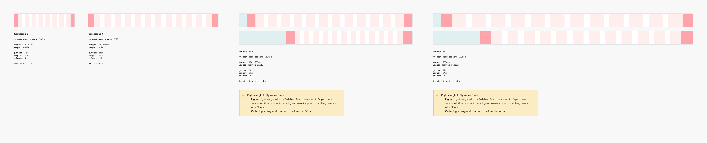

_Figure: Grid Web Sidebar specification as column strips for four breakpoints. Breakpoint S: most used screen 360px, range 320-767px, usage mobile, gutter 16px, margin 24px, 8 columns, @mixin ds-grid. Breakpoint M: most used screen 768px, range 768-1023px, usage tablet, gutter 24px, margin 36px, 12 columns, @mixin ds-grid. Breakpoint L: most used screen 1024px, range 1024-1535px, usage desktop small, gutter 24px, margin 50px, 12 columns, @mixin ds-grid-sidebar. Breakpoint XL: most used screen 1536px, range 1535px+, usage desktop medium, gutter 32px, margin 64px, 12 columns, @mixin ds-grid-sidebar. L and XL each show two strips, one centred without sidebar and one with a left area for the open Sidebar Menu. A warning "Right margin in Figma vs. Code" under L and XL says Figma sets the right margin with the Sidebar Menu open to 58px (L) and 72px (XL) to keep column widths consistent, because Figma cannot stretch columns with sidebars, while code uses the intended 50px (L) and 64px (XL)._

### Contribute

Contribute to improving these styles by sharing your feedback, asking questions, or suggesting features [here](https://www.figma.com/design/lLmw7PfIdKjFG4uT3B2Hyj/Onboarding-%F0%9F%93%96?node-id=446-868&t=zKmRu4kAkxMeRDmK-4).

## Grid Web Sidebar: Content Placement

### Content Areas

#### No content areas for Web Grid Sidebar

The Web Grid Sidebar **does not** define fixed content areas, since its use cases differ from the standard Web Grid. In combination with Sidebar Menus, layouts are often more complex—supporting dashboards, tables, and information-dense screens. Defining rigid content areas here would reduce flexibility without adding real value.

Instead, the Web Grid Sidebar allows content to be placed more freely.

An emerging pattern in this context is the Split View (see below for details).

> **Disclaimer** There aren’t many use cases available at the moment, so we’re working with some assumptions. Once the Grid has been tested by different teams and we’ve gathered feedback on their experience and satisfaction, we’ll evaluate whether adjustments are needed (e.g., margin and gutter widths). If **your project** includes a sidebar layout, please reach out to the Design System Team to check whether there has been recent progress or existing solutions. Some teams, e.g. Connected Web Portal, have already explored and tested sidebar implementations, and we encourage sharing experiences and insights to ensure the Grid continues to evolve based on collective feedback and real use cases. **Please note** that the use case examples shown here incorporate the new navigation concept and do not reflect the product’s current state.

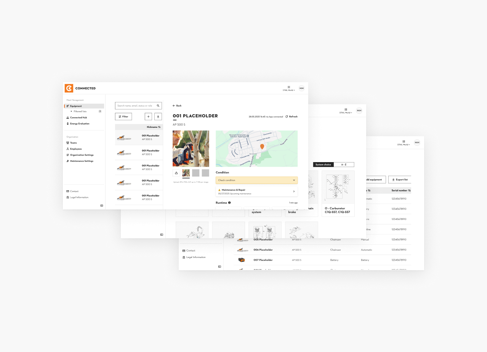

_Figure: Three overlapping screenshots of the STIHL "CONNECTED" web app, each with a top bar and an expandable sidebar menu (Fleet Management with Equipment, Filtered lists, Connected Hub, Energy Evaluation; Organization with Teams, Employees, Organization Settings, Maintenance Settings; Contact and Legal Information). The front screen is a split layout with an equipment list (search field, Filter, add and download buttons, Nickname column) next to the detail view "001 PLACEHOLDER, AP 500 S" with a photo, map, Condition dropdown and Runtime section. The screens behind show a grid of part drawings and a table with Add equipment and Export list; the layouts place content freely with no fixed content areas._

### Split View

#### Concept

Split View is a layout pattern that divides the screen into two areas:

1. **Primary area** for navigation or selection (e.g., a list or table)
1. **Secondary area** for displaying details of the selected item.

This pattern is especially useful for dashboards, data-heavy screens, and workflows where users need to browse and view details side by side.

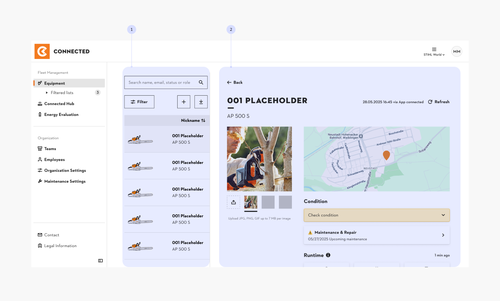

_Figure: Split View inside the "CONNECTED" web app with a top bar and an expandable sidebar menu (Fleet Management, Equipment, Connected Hub, Energy Evaluation, Organization, Teams, Employees, Contact, Legal Information). Callout 1 marks the primary area, highlighted in blue, with a search field, Filter, add and download buttons and a list of equipment entries named "001 Placeholder, AP 500 S" under a Nickname header. Callout 2 marks the secondary area, highlighted in blue, with the details of the selected item "001 PLACEHOLDER": a Back link, photo, map, Condition dropdown, Maintenance & Repair entry and Runtime heading._

#### Split View in the Web Grid Sidebar

There are two ways to create a Split View inside a layout:

1. **Within the grid**
   - Columns are divided between the primary and secondary areas (e.g., 4 columns for the primary area, 12 for the secondary).
   - These columns scale dynamically at different breakpoints, since they are set to stretch.
1. **Through panes**
   - Instead of columns, the layout is divided into two areas while maintaining margins and gutters.
   - One area (e.g., the left pane) can be fixed and remain the same across all breakpoints, while the secondary area expands with the viewport.
   - Panes are not provided as a separate grid. For more information, see the [Material Design Guidelines](https://m3.material.io/foundations/layout/applying-layout/pane-layouts).

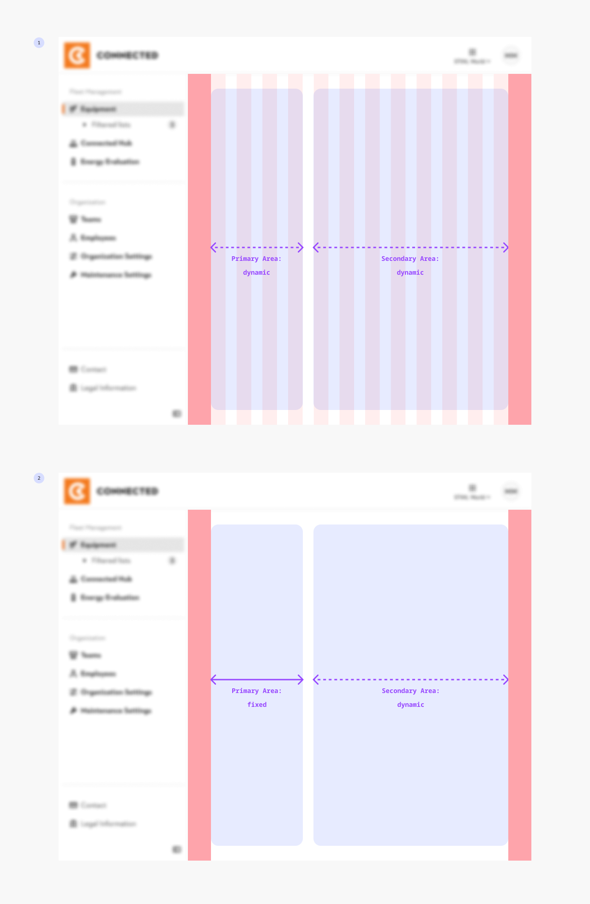

_Figure: Two blurred app layouts with a top bar and expandable sidebar menu on the left, showing how the content next to the sidebar is split into a narrower primary area and a wider secondary area, between red margin bands. Callout 1: the grid columns are visible behind both areas and both are labelled "Primary Area: dynamic" and "Secondary Area: dynamic", so each scales with the breakpoint. Callout 2: no columns are shown, the primary area is labelled "fixed" with a solid arrow and the secondary area is labelled "dynamic" with a dashed arrow, so only the secondary area expands with the viewport._

## Grid Web Sidebar: Content Placement Examples

> The use case examples shown feature the new navigation concept and do not reflect the current state of the product.

**STIHL Service Communication (SSC)**

Internal tool for quickly finding spare parts and relevant information for STIHL products, primarily used by official dealers and customer service teams.

The sidebar provides fast access to categories and search functions, supporting a high-frequency workflow.

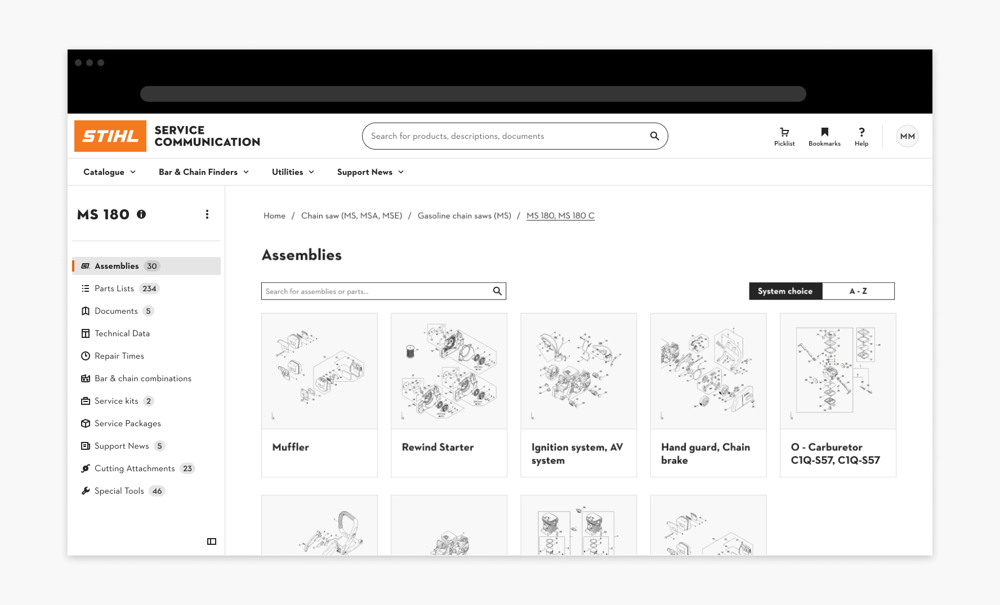

_Figure: Browser window showing the STIHL Service Communication web tool. The header has the logo, a search field "Search for products, descriptions, documents", Picklist, Bookmarks, Help and an MM avatar, with a navigation row Catalogue, Bar & Chain Finders, Utilities and Support News. The sidebar for "MS 180" lists Assemblies (30, active), Parts Lists (234), Documents (5), Technical Data, Repair Times, Bar & chain combinations, Service kits (2), Service Packages, Support News (5), Cutting Attachments (23) and Special Tools (46). The main area has the breadcrumb Home / Chain saw (MS, MSA, MSE) / Gasoline chain saws (MS) / MS 180, MS 180 C, the title "Assemblies", a search field, a System choice / A - Z toggle, and a grid of assembly cards such as Muffler, Rewind Starter, Ignition system, AV system, Hand guard, Chain brake and O - Carburetor C1Q-S57, C1Q-S57._

**Connected Portal**

A logged-in user portal designed to navigate between tools and manage STIHL products. The sidebar supports quick orientation and task switching.

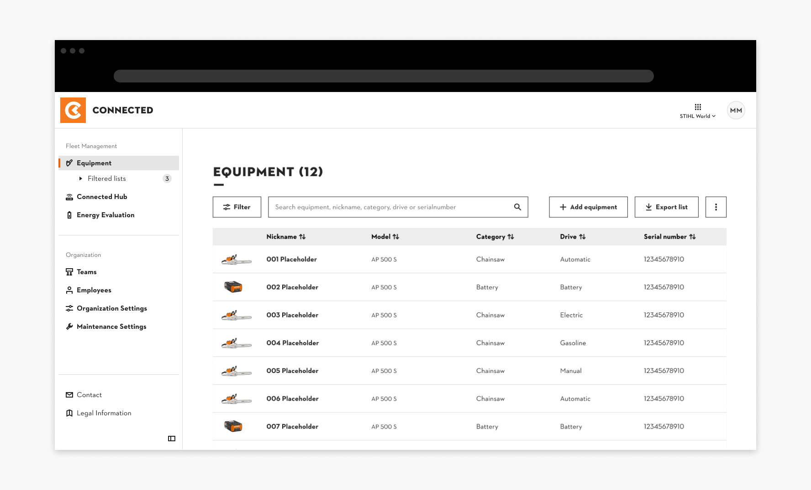

_Figure: Browser window showing the Connected Portal equipment list. The top bar shows the CONNECTED logo, a STIHL World menu and an MM avatar. The expandable sidebar lists Fleet Management (Equipment active, Filtered lists 3, Connected Hub, Energy Evaluation), Organization (Teams, Employees, Organization Settings, Maintenance Settings), and Contact and Legal Information. The main area has the title "EQUIPMENT (12)", a Filter button, a search field, Add equipment, Export list and a more menu, above a table with sortable columns Nickname, Model, Category, Drive and Serial number and rows such as 001 Placeholder, AP 500 S, Chainsaw, Automatic, 12345678910._
