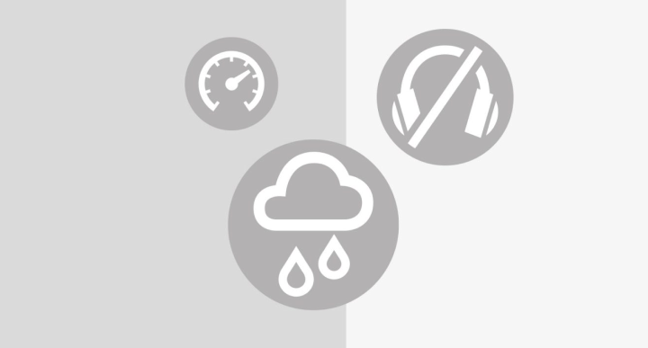
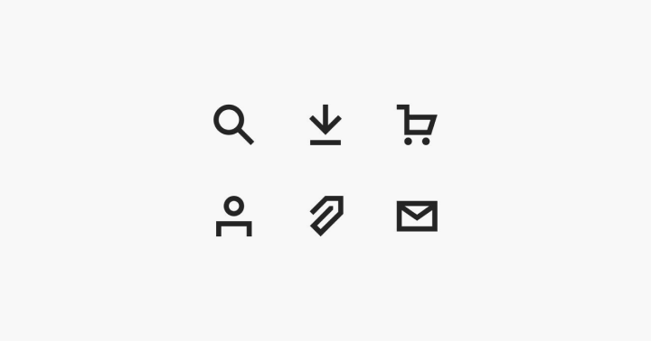
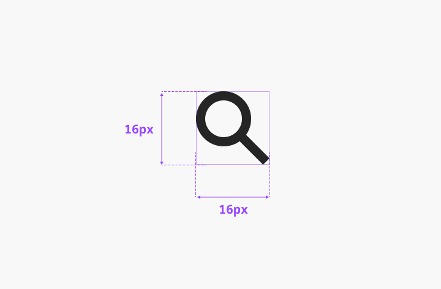
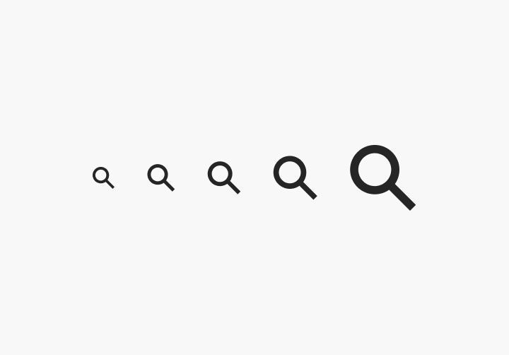
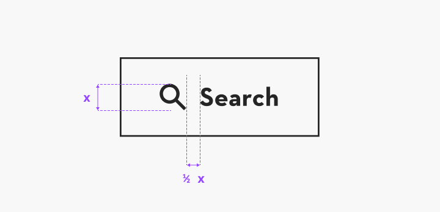
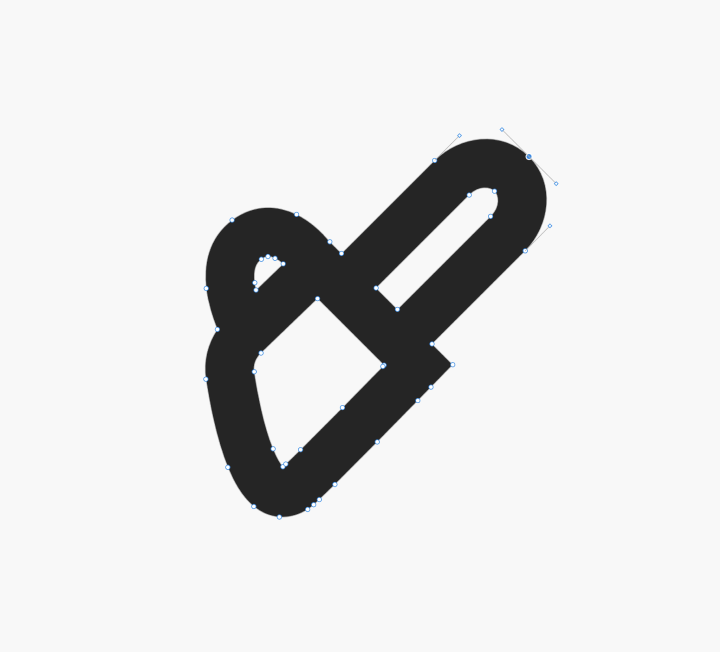

# Iconography Guidelines

## STIHL Iconography Guidelines

### About STIHL Icons

STIHL Icons are used to convey information where space is limited or language may be a barrier.

They ensure clarity, consistency, and recognizability across all digital and physical touchpoints.

STIHL uses different icon categories (Functional, Content & Feature, Product, and others) for various applications.

Only **Functional Icons** are part of the Design System and provided as a reusable Icon Library.

All other categories can be found in the [STIHL Brand Portal](https://brandportal.stihl.com/en/basic-elements/icons).

### Functional Icons

Functional Icons are used across STIHL’s digital products — websites, apps, and digital tools.

They feature a minimal, low-detail style to ensure legibility at small sizes and across devices.

Use Functional Icons for all UI components and digital interfaces.

### Design Specifications

**Default size**

16 x 16px

**Minimum size**

8 x 8px

**Maximum size**

24 x 24px

**Style**

Minimal, low detail

**Shape**

Square (1:1)

**Line thickness**

2px; can combine with filled shapes

**Color**

content-color/primary on transparent background

Icons should appear clean, balanced, and visually consistent with STIHL’s brand elements such as typography and logo.

### Usage Guidelines

#### Scaling

Always scale icons proportionally to maintain line consistency.

Avoid overly large sizes — low detail can make icons appear coarse.

Recommended sizes:

- **16 × 16px** Default for components (e.g., Buttons)
- **24 × 24px** Larger use cases (e.g., Teasers) - use sparingly
- **12 × 12px / 10 × 10px / 8 × 8px** Small and detailed use cases (e.g., Links) - use sparingly

#### Protected Area

Maintain a clear space equal to **½ the icon’s size** around it.

E.g., for a 16px icon, keep an 8px distance from adjacent elements.

### Need a Specific Icon?

If the icon you need is not available in the library, follow this process:

1. **Create your Icon** Follow the rules under Functional Icons: Design and Usage Guidelines.
1. **Add it to the Playground** Create a dedicated page in the [Fundamentals Playground](https://www.figma.com/design/oquHPjeHdmt8ByTwZp0JQr/Playground-%F0%9F%8F%90-Fundamentals?node-id=0-1) and add your icon there. If you don’t have access, contact the Design System team.
1. **Submit your request** Send the Playground link to the Design System team using the contribution process.
1. **Review and inclusion** The Design System team reviews, adjusts if necessary, and adds approved icons to the library.
1. **Update your designs** Replace your temporary icon once the approved version is available.

### Complete Icon Guidelines

For full STIHL icon principles, specifications, and non-functional icon categories, visit the [STIHL Brand Portal](https://brandportal.stihl.com/en/basic-elements/icons).
