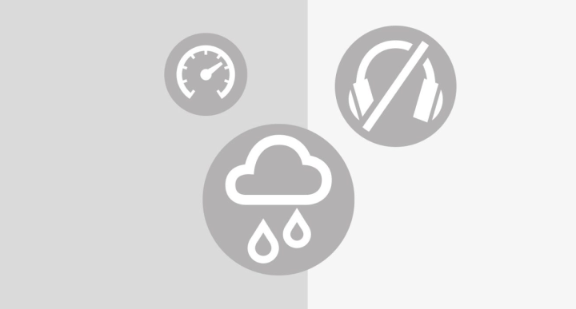
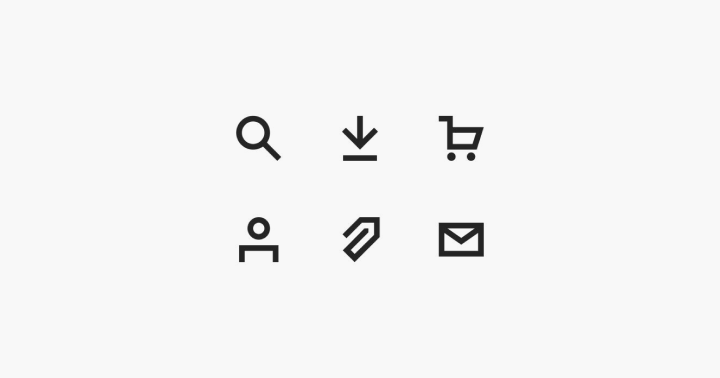
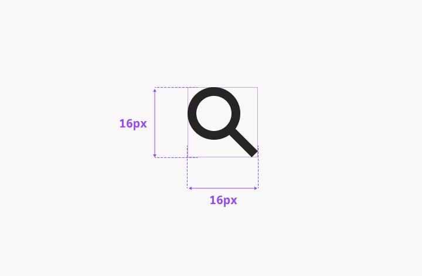
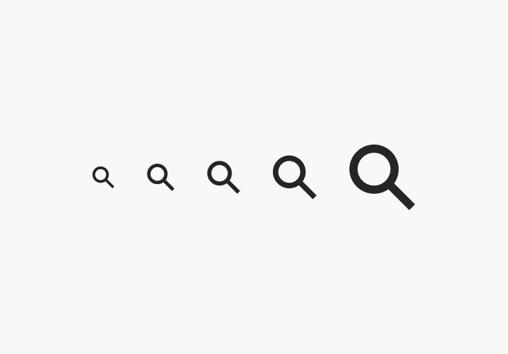
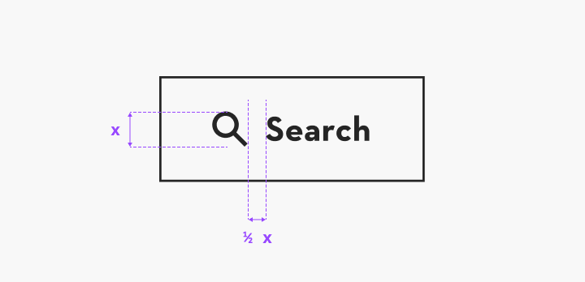
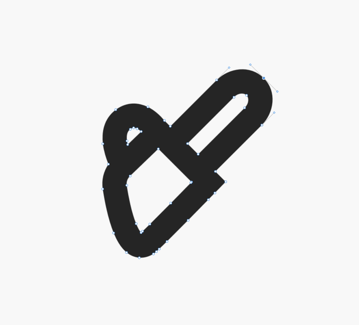

# Iconography Guidelines

## STIHL Iconography Guidelines

### About STIHL Icons

STIHL Icons are used to convey information where space is limited or language may be a barrier.

They ensure clarity, consistency, and recognizability across all digital and physical touchpoints.

STIHL uses different icon categories (Functional, Content & Feature, Product, and others) for various applications.

Only **Functional Icons** are part of the Design System and provided as a reusable Icon Library.

All other categories can be found in the [STIHL Brand Portal](https://brandportal.stihl.com/en/basic-elements/icons).

_Figure: Three icons: a speedometer, a speedometer with a prohibition sign over it, and a cloud with raindrops. These icons are examples of Functional Icons from the STIHL Design System. The speedometer icon represents speed or velocity, the speedometer with a prohibition sign indicates a restriction or limitation on speed, and the cloud with raindrops signifies rain or wet conditions._

### Functional Icons

Functional Icons are used across STIHL’s digital products — websites, apps, and digital tools.

They feature a minimal, low-detail style to ensure legibility at small sizes and across devices.

Use Functional Icons for all UI components and digital interfaces.

_Figure: Six Functional Icons arranged in two rows of three. Each icon features a minimal, low-detail style for use in UI components and digital interfaces. The icons from left to right, top to bottom, are: search, download, shopping cart, user, pencil, and email._

### Design Specifications

**Default size**

16 x 16px

**Minimum size**

8 x 8px

**Maximum size**

24 x 24px

**Style**

Minimal, low detail

**Shape**

Square (1:1)

**Line thickness**

2px; can combine with filled shapes

**Color**

content-color/primary on transparent background

Icons should appear clean, balanced, and visually consistent with STIHL’s brand elements such as typography and logo.

_Figure: A magnifying glass icon with a default size of 16 pixels by 16 pixels. The measurement labels indicate the width and height of the icon, both of which are 16 pixels. This icon is part of the Iconography Guidelines in the STIHL Design System and adheres to the specified design specifications, including a minimal style, low detail, and a square shape with a 1:1 aspect ratio. Measurements in the figure: 16px._

### Usage Guidelines

#### Scaling

Always scale icons proportionally to maintain line consistency.

Avoid overly large sizes — low detail can make icons appear coarse.

Recommended sizes:

- **16 × 16px** Default for components (e.g., Buttons)
- **24 × 24px** Larger use cases (e.g., Teasers) - use sparingly
- **12 × 12px / 10 × 10px / 8 × 8px** Small and detailed use cases (e.g., Links) - use sparingly

_Figure: A magnifying glass icon at five different sizes, scaled proportionally. Each size represents different recommended dimensions for use in various UI components. The measurements 16 × 16px, 24 × 24px, 12 × 12px, 10 × 10px, and 8 × 8px refer to the pixel dimensions for default components, larger use cases, and small detailed use cases respectively. The text advises to always scale icons proportionally to maintain line consistency and to avoid overly large sizes to prevent icons from appearing coarse._

#### Protected Area

Maintain a clear space equal to **½ the icon’s size** around it.

E.g., for a 16px icon, keep an 8px distance from adjacent elements.

_Figure: A button with the text "Search", an outline variant, enabled state, medium size, and an icon positioned to the left. The measurements "x" and "½ x" refer to the size of the icon and the required clear space around it, respectively. The clear space is maintained equally around the icon to ensure proper visibility and usability._

### Need a Specific Icon?

If the icon you need is not available in the library, follow this process:

1. **Create your Icon** Follow the rules under Functional Icons: Design and Usage Guidelines.
1. **Add it to the Playground** Create a dedicated page in the [Fundamentals Playground](https://www.figma.com/design/oquHPjeHdmt8ByTwZp0JQr/Playground-%F0%9F%8F%90-Fundamentals?node-id=0-1) and add your icon there. If you don’t have access, contact the Design System team.
1. **Submit your request** Send the Playground link to the Design System team using the contribution process.
1. **Review and inclusion** The Design System team reviews, adjusts if necessary, and adds approved icons to the library.
1. **Update your designs** Replace your temporary icon once the approved version is available.

_Figure: An infinity symbol icon with blue dots around its perimeter. The blue dots likely indicate anchor points or nodes used for editing the icon's shape. The icon is filled with a solid black color and is set against a white background._

### Complete Icon Guidelines

For full STIHL icon principles, specifications, and non-functional icon categories, visit the [STIHL Brand Portal](https://brandportal.stihl.com/en/basic-elements/icons).
