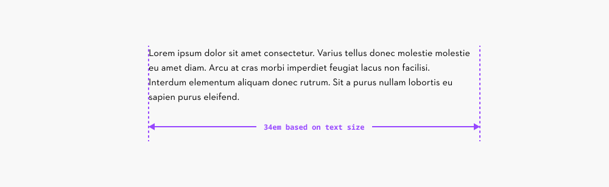
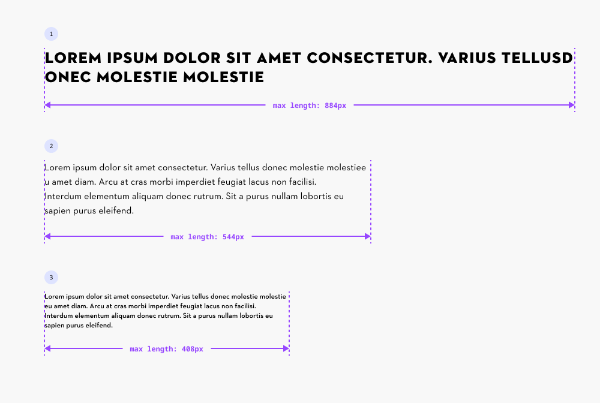
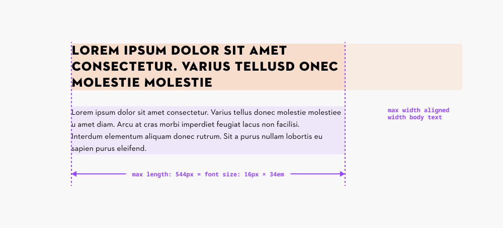
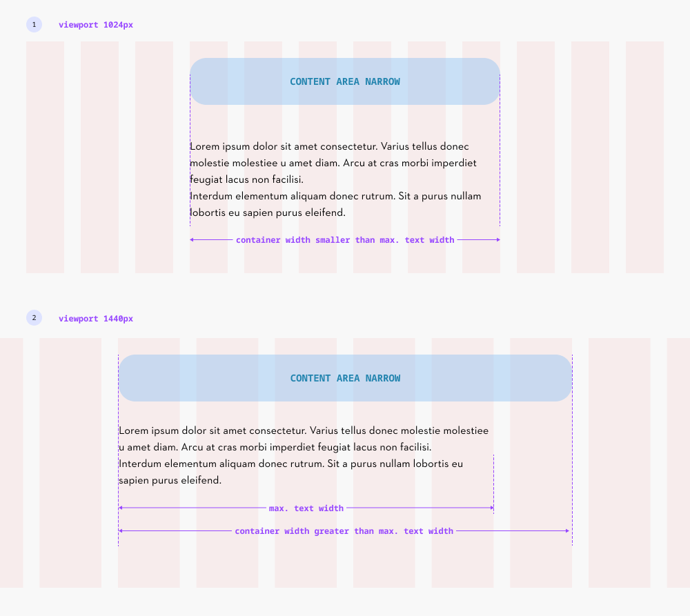

# Maximum Text Width

## Maximum Text Width

To maintain optimal readability, text should not exceed 80 characters per line. It is recommended to set **the maximum text width to 34em**, which corresponds to 34 times the used font size. This maximum width should be defined within each module.

[Further reading on Baymard Insitute →](https://baymard.com/blog/line-length-readability)

_Figure: A paragraph of four lines of placeholder text enclosed by two vertical dashed purple lines at its left and right edges. A horizontal double-headed arrow below spans the full text block and is labelled 34em based on text size, showing the maximum text width._

### Calculation examples

1. **Heading L Uppercase** Font size: 26px Max length: 26px × 34em = **884px**
1. **Text M** Font size: 16px Max length: 16px × 34em = **544px**
1. **Utility XS Demi** Font size: 12px Max length: 12px × 34em = **408px**

_Figure: Three numbered text samples, each bounded by dashed purple lines and a double-headed arrow with its calculated width. Callout 1 points to a two-line uppercase bold heading (Heading L Uppercase) with max length: 884px, callout 2 to a four-line body paragraph (Text M) with max length: 544px, and callout 3 to a smaller four-line paragraph (Utility XS Demi) with max length: 408px._

### Content-Heavy Pages (Reading-Focused)

For pages where reading flow is primary — such as articles, editorial content, or blog entries — the headline should inherit the same maximum width as the body text to maintain visual consistency.

Example:

- **Body Text:** Text M (16px font size) **=\> Max Length**: 16px × 34 = 544px
- **Heading L:** Should match this maximum width (544px) to align with the body text.

This creates a harmonious reading experience by preventing oversized headlines from breaking the text rhythm.

_Figure: A three-line uppercase bold headline on an orange tinted background above a four-line body paragraph on a lilac tinted background. Two dashed vertical lines mark the same left and right limit for both, with an arrow labelled max length: 544px = font size: 16px × 34em, and a note on the right reading max width aligned width body text._

### Maximum Width within Content Areas

When text elements are placed inside Content Areas, the following rules apply:

1. **If the container width is smaller than the calculated max text width** → the container width is used.
1. **If the container width is larger than the calculated max text width** → the text is capped at its maximum allowed width.

This ensures text always respects both layout constraints and optimal readability, whether it's in a card, column, or larger content block.

[Grid and Content areas →](https://www.figma.com/design/JyyYtoCYbtJrzqHs38OXSQ/Grid---Spacing-%F0%9F%A7%AE?node-id=1-132)

_Figure: Two layouts over a 12-column pink grid, each with a blue rounded bar labelled CONTENT AREA NARROW above a paragraph. Callout 1, viewport 1024px: the content area is narrower than the maximum text width, so the text fills the container, marked container width smaller than max. text width. Callout 2, viewport 1440px: the content area is wider, so the text stops at a shorter line marked max. text width, while a longer arrow below is marked container width greater than max. text width._
