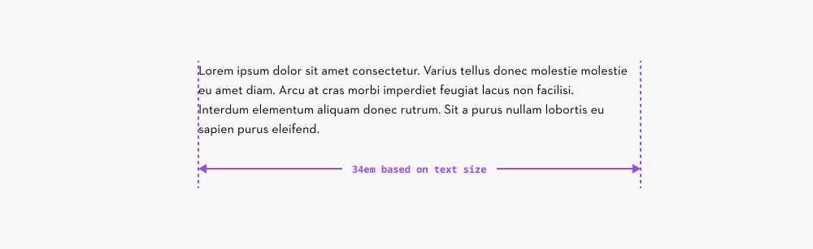
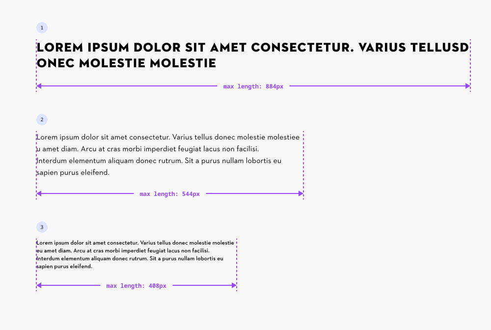
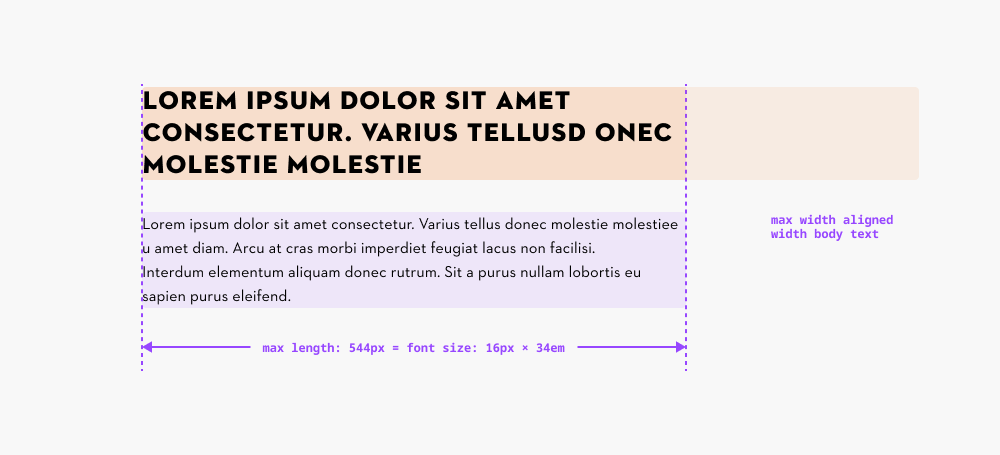
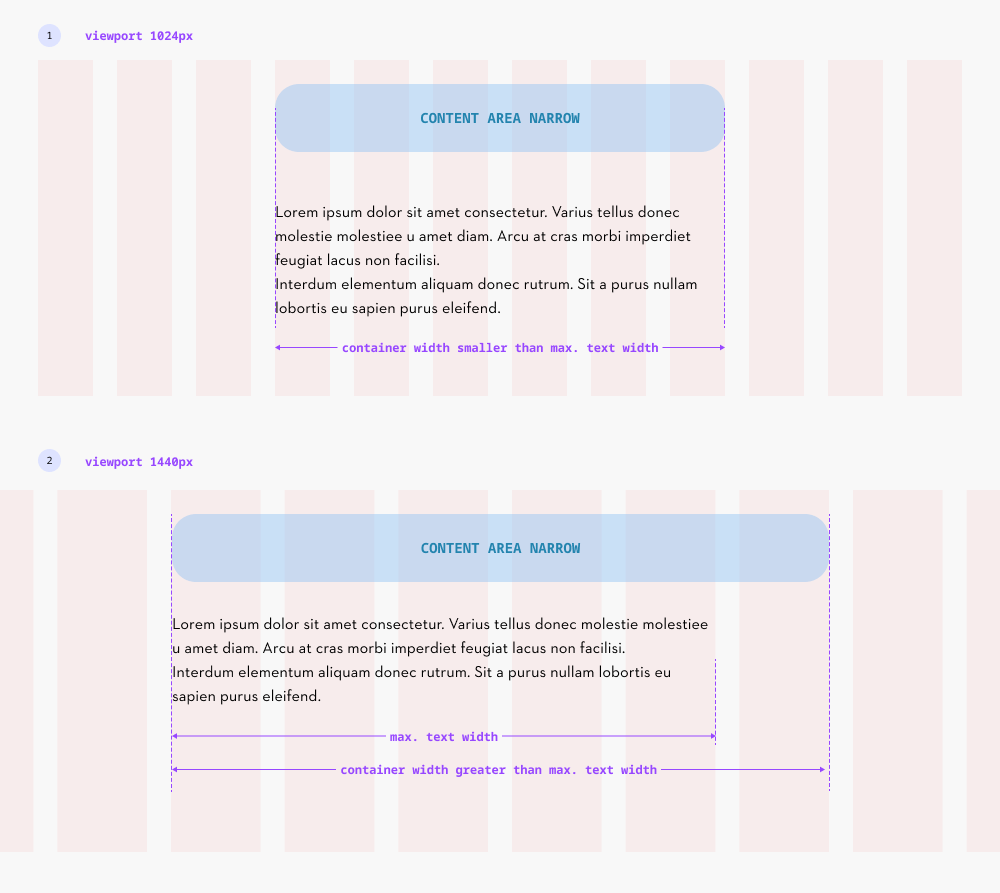

# Maximum Text Width

## Maximum Text Width

To maintain optimal readability, text should not exceed 80 characters per line. It is recommended to set **the maximum text width to 34em**, which corresponds to 34 times the used font size. This maximum width should be defined within each module.

[Further reading on Baymard Insitute →](https://baymard.com/blog/line-length-readability)

### Calculation examples

1. **Heading L Uppercase** Font size: 26px Max length: 26px × 34em = **884px**
1. **Text M** Font size: 16px Max length: 16px × 34em = **544px**
1. **Utility XS Demi** Font size: 12px Max length: 12px × 34em = **408px**

### Content-Heavy Pages (Reading-Focused)

For pages where reading flow is primary — such as articles, editorial content, or blog entries — the headline should inherit the same maximum width as the body text to maintain visual consistency.

Example:

- **Body Text:** Text M (16px font size) **=\> Max Length**: 16px × 34 = 544px
- **Heading L:** Should match this maximum width (544px) to align with the body text.

This creates a harmonious reading experience by preventing oversized headlines from breaking the text rhythm.

### Maximum Width within Content Areas

When text elements are placed inside Content Areas, the following rules apply:

1. **If the container width is smaller than the calculated max text width** → the container width is used.
1. **If the container width is larger than the calculated max text width** → the text is capped at its maximum allowed width.

This ensures text always respects both layout constraints and optimal readability, whether it's in a card, column, or larger content block.

[Grid and Content areas →](https://www.figma.com/design/JyyYtoCYbtJrzqHs38OXSQ/Grid---Spacing-%F0%9F%A7%AE?node-id=1-132)

