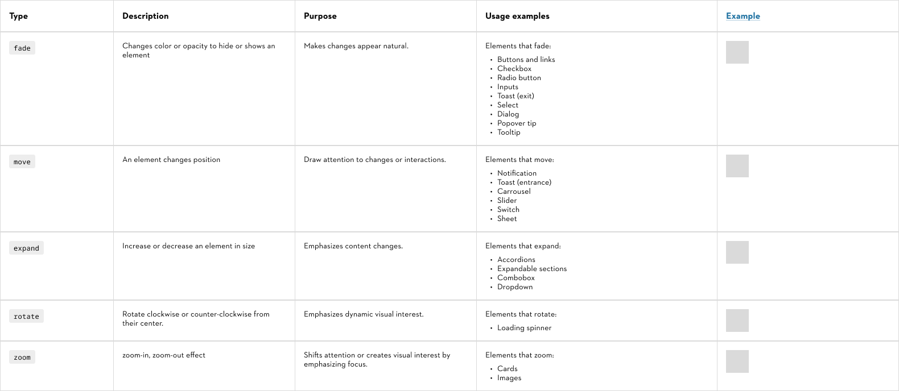
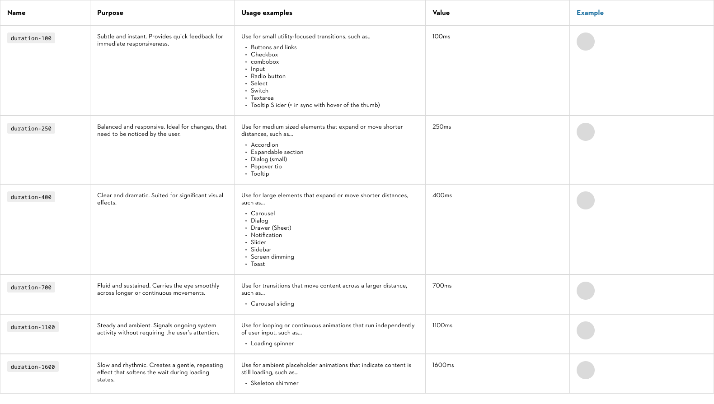
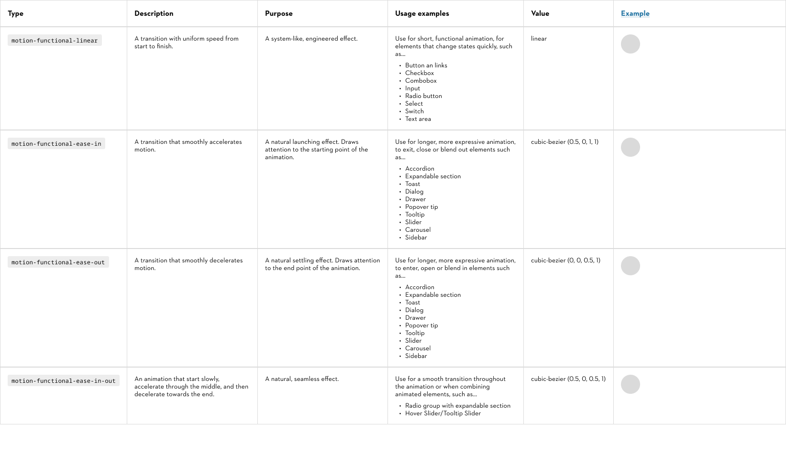

# Motion

## Motion basics

Basic motion buildings blocks and tokens. Motion is divided in functional motion and expressive motion. In the context of digital design, the terms "transition" and "animation" are related but have distinct meanings:

- Transitions are typically linked to changes between states triggered by user interactions.
- Animations are broader, more complex sequences that may or may not depend on user inputs.

▶️️ **View** [**prototype**](https://www.figma.com/proto/UYHZEckQObDvLuuRoMP8ps/Styles-%F0%9F%AA%AD?page-id=1%3A148&node-id=3-3818&viewport=4013%2C3997%2C1&t=9PoCNdMVFd6ZOzz8-1&scaling=min-zoom&content-scaling=fixed)[**mode**](https://www.figma.com/proto/UYHZEckQObDvLuuRoMP8ps/Styles-%F0%9F%AA%AD?page-id=1%3A148&node-id=3-3818&viewport=4013%2C3997%2C1&t=9PoCNdMVFd6ZOzz8-1&scaling=min-zoom&content-scaling=fixed) for animation examples

### Animation types

### Duration

#### Contribute

Contribute to improving these styles by sharing your feedback, asking questions, or suggesting features [here](https://www.figma.com/design/lLmw7PfIdKjFG4uT3B2Hyj/Onboarding-%F0%9F%93%96?node-id=446-868&t=zKmRu4kAkxMeRDmK-4).

## Functional motion

Functional motion is used to create responsiveness (reactivity), while remaining subtle. Utilize for micro interactions.

▶️️ **View** [**prototype**](https://www.figma.com/proto/UYHZEckQObDvLuuRoMP8ps/Styles-%F0%9F%AA%AD?page-id=1%3A148&node-id=3-3907&viewport=4013%2C3997%2C1&t=9PoCNdMVFd6ZOzz8-1&scaling=min-zoom&content-scaling=fixed)[**mode**](https://www.figma.com/proto/UYHZEckQObDvLuuRoMP8ps/Styles-%F0%9F%AA%AD?page-id=1%3A148&node-id=3-3907&viewport=4013%2C3997%2C1&t=9PoCNdMVFd6ZOzz8-1&scaling=min-zoom&content-scaling=fixed) for animation examples

### Easing

#### Contribute

Contribute to improving these styles by sharing your feedback, asking questions, or suggesting features [here](https://www.figma.com/design/lLmw7PfIdKjFG4uT3B2Hyj/Onboarding-%F0%9F%93%96?node-id=446-868&t=zKmRu4kAkxMeRDmK-4).

## Expressive motion

Expressive motion creates lively and highly visible movement. Utilize for significant moments and to reinforce brand expression.

### 🗓️

### Coming soon

> The current **roadmap** is shared during **sprint reviews** and included in the design system **release notes**, which are emailed after each sprint. If you have any questions or would like to be added to the sprint review meetings or release notes distribution list, please reach out to [design.system@stihl.de](mailto:design.system@stihl.de).

## Test Page

[**▶️ See klickdummy**](https://www.figma.com/proto/UYHZEckQObDvLuuRoMP8ps/Styles-%F0%9F%AA%AD?page-id=1%3A9616&node-id=7-8464&viewport=785%2C348%2C0.25&t=PBKzcVMiqqaHxxVD-1&scaling=min-zoom&content-scaling=fixed&starting-point-node-id=7%3A8464)

## Next Step

The current focus is on **functional animation**, though some UI elements could be refined to better reflect the STIHL brand identity. Future Steps include:

- Defining an overall (UI)Motion concept for STIHL Products (align with brand-team)(2025)
- Defining an expressive Animation style (potential elements like. Buttons, Cards, Onboarding Journey,... (end 2025) (\>\> Definitions of other Product Teams working on something similar can be added to our current specs)
- Defining choreography (= process and order of animations playing together \>\> relevant for bigger and more complex modules)
- Define transition guidelines

Potential elements that can profit from a more expressive Animation to convey the brand or the define the brands animation look/feel:

> The current **roadmap** is shared during **sprint reviews** and included in the design system **release notes**, which are emailed after each sprint. If you have any questions or would like to be added to the sprint review meetings or release notes distribution list, please reach out to [design.system@stihl.de](mailto:design.system@stihl.de).

### Buttons

### Cards

### Onboarding screens

### Example STIHL Codes

### Loading and Transitions

Loading spinners and skeleton loading

### Guided Selling / Product Guide (Advisor)

Explanations + Immersion

### Pages

Motion for STIHL expression \> strategic for Brand Experience \> Landing Pages \> Campaign pages

\> Timbesports

\> Collection

ect.
