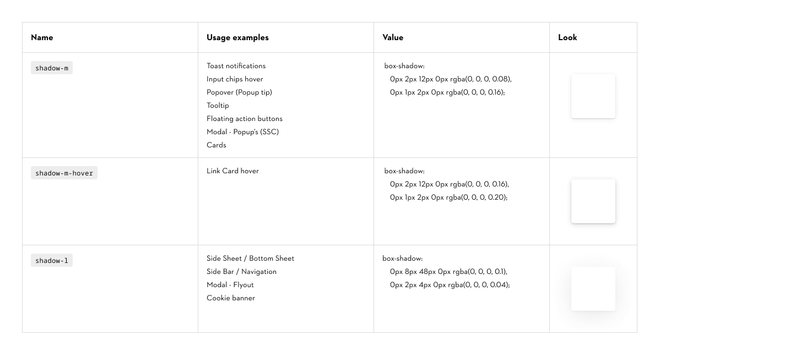
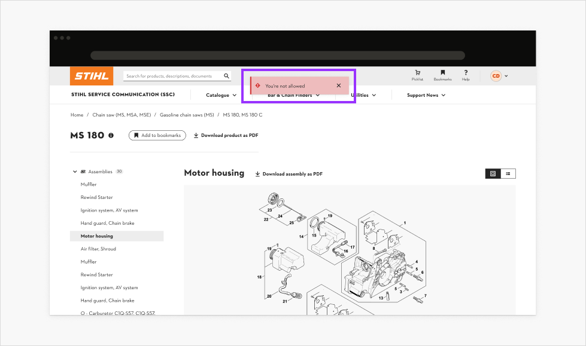
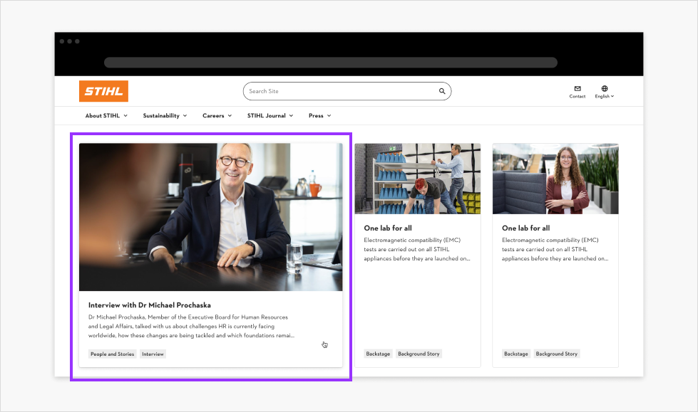
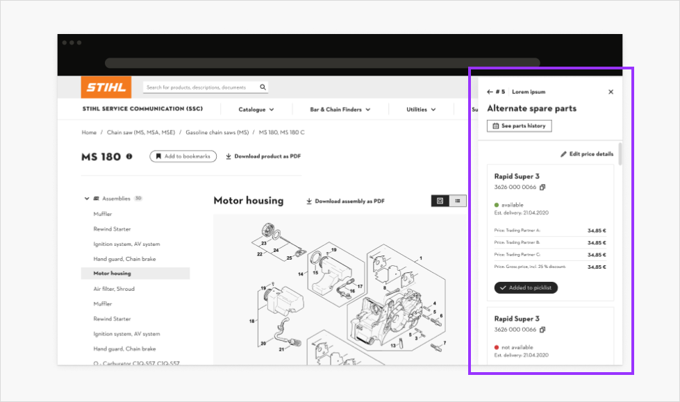

# Shadows

## Shadows

Overview:

- In digital context shadows are necessary, in contrary to print and visuals with marketing purposes.
- Shadow M is used for elements that are shown above content.
- Shadow L is used for elements that are placed over the content or move the content.

_Figure: Table of three shadow tokens with the columns Name, Usage examples, Value and Look (a white square showing the shadow). shadow-m is used for Toast notifications, Input chips hover, Popover (Popup tip), Tooltip, Floating action buttons, Modal - Popup's (SSC) and Cards, with box-shadow: 0px 2px 12px 0px rgba(0, 0, 0, 0.08), 0px 1px 2px 0px rgba(0, 0, 0, 0.16). shadow-m-hover is used for Link Card hover, with box-shadow: 0px 2px 12px 0px rgba(0, 0, 0, 0.16), 0px 1px 2px 0px rgba(0, 0, 0, 0.20). shadow-l is used for Side Sheet / Bottom Sheet, Side Bar / Navigation, Modal - Flyout and Cookie banner, with box-shadow: 0px 8px 48px 0px rgba(0, 0, 0, 0.1), 0px 2px 4px 0px rgba(0, 0, 0, 0.04), a larger and softer shadow._

### Contribute

Contribute to improving these styles by sharing your feedback, asking questions, or suggesting features [here](https://www.figma.com/design/lLmw7PfIdKjFG4uT3B2Hyj/Onboarding-%F0%9F%93%96?node-id=446-868&t=zKmRu4kAkxMeRDmK-4).

## Shadow types & application

> In STIHL’s corporate design, shadows are used sparingly. However, in digital interfaces, they play an important role in conveying depth and establishing visual hierarchy.

### Shadow M

Shadow M is used for elements that sit slightly above the main content layer, such as Toast Notifications, or for components that need subtle visual emphasis.

While multiple elements may overlap, their use should remain minimal to avoid visual clutter.

_Figure: Screenshot of the STIHL Service Communication (SSC) web application, a spare parts page for the MS 180 chain saw showing a Motor housing exploded diagram, with a purple frame highlighting a red error Toast notification at the top centre that reads You're not allowed and has a close button. The toast floats above the page header and navigation and carries Shadow M._

### Shadow M hover

Shadow M Hover is applied to interactive elements that require a hover state which cannot be achieved through fill color changes alone (as is typically done with most of the Core Components).

This style is currently used for the Cards.

_Figure: Screenshot of a STIHL website page with a search field and navigation, showing three story Cards in a row. A purple frame highlights the first Card, an Interview with Dr Michael Prochaska with a photo, teaser text and the tags People and Stories and Interview, which is in hover state with the mouse pointer on it and shows the Shadow M hover shadow. The other two cards, One lab for all with the tags Backstage and Background Story, are not hovered._

### Shadow L

Shadow L is used for elements that are clearly elevated above the main content layer or that actively overlay or shift content, such as Sidebars.

_Figure: Screenshot of the STIHL Service Communication (SSC) spare parts page for the MS 180 with a Motor housing diagram, overlaid on the right by a sidebar titled Alternate spare parts that lists Rapid Super 3 parts with availability, delivery dates, prices and an Added to picklist button. A purple frame highlights the sidebar, which sits over the content and carries Shadow L._
