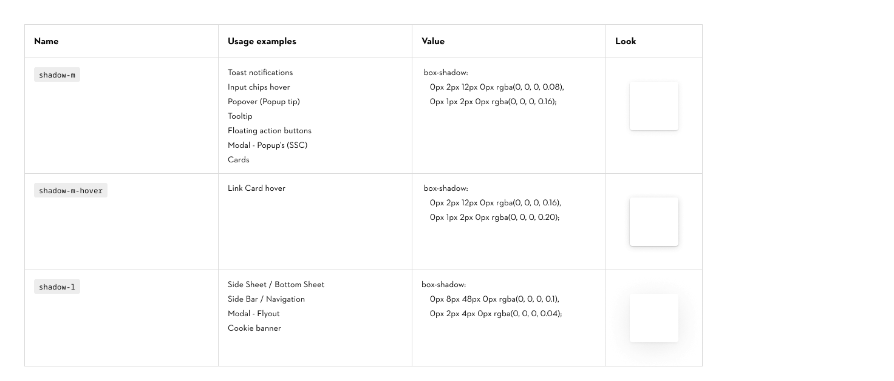
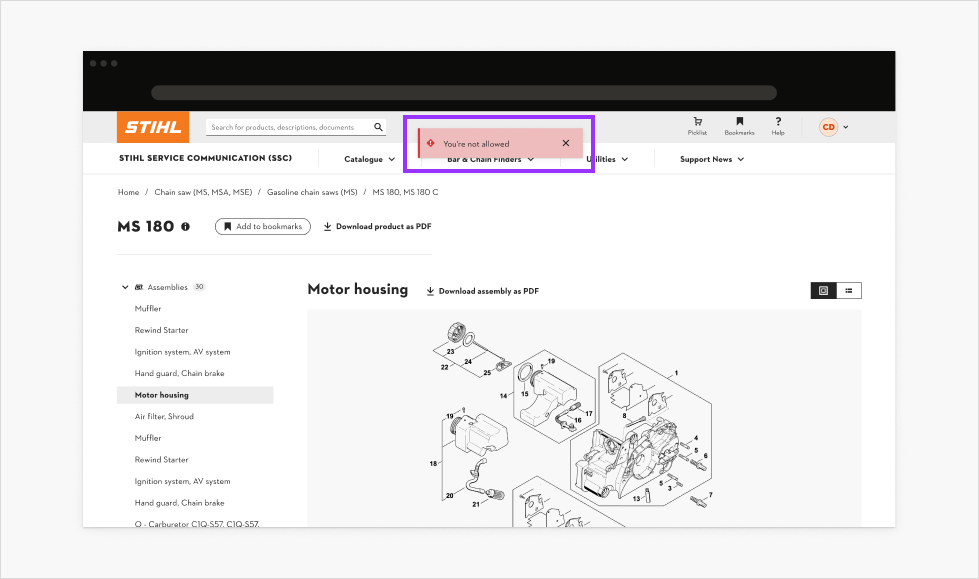
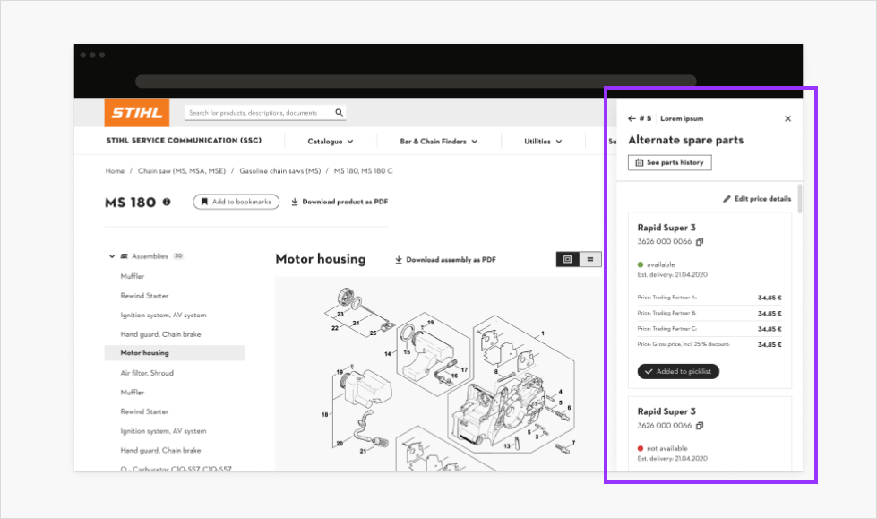

# Shadows

## Shadows

Overview:

- In digital context shadows are necessary, in contrary to print and visuals with marketing purposes.
- Shadow M is used for elements that are shown above content.
- Shadow L is used for elements that are placed over the content or move the content.

### Contribute

Contribute to improving these styles by sharing your feedback, asking questions, or suggesting features [here](https://www.figma.com/design/lLmw7PfIdKjFG4uT3B2Hyj/Onboarding-%F0%9F%93%96?node-id=446-868&t=zKmRu4kAkxMeRDmK-4).

## Shadow types & application

> In STIHL’s corporate design, shadows are used sparingly. However, in digital interfaces, they play an important role in conveying depth and establishing visual hierarchy.

### Shadow M

Shadow M is used for elements that sit slightly above the main content layer, such as Toast Notifications, or for components that need subtle visual emphasis.

While multiple elements may overlap, their use should remain minimal to avoid visual clutter.

### Shadow M hover

Shadow M Hover is applied to interactive elements that require a hover state which cannot be achieved through fill color changes alone (as is typically done with most of the Core Components).

This style is currently used for the Cards.

### Shadow L

Shadow L is used for elements that are clearly elevated above the main content layer or that actively overlay or shift content, such as Sidebars.

