# Spacing Styles

## Spacing overview

Spacing refers to distance between elements within a layout, also known as whitespace.

Consistent spacings are essential for organizing content, establishing a clear visual hierarchy, and guiding users effectively, all while ensuring a cohesive experience across digital products.

### Spacing system

Our spacing system uses 8px as a base unit - meaning that each spacing value is a multiple of this base unit. The defined spacings range from 0px to 160px, allowing for maximum flexibility.

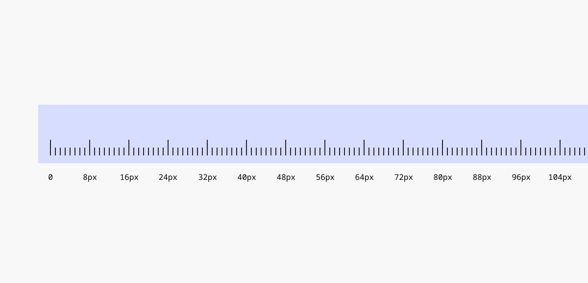

_Figure: A spacing system with a base unit of 8px, displaying a horizontal ruler with measurements marked at intervals of 8px. Each measurement label, such as 8px, 16px, 24px, and so on up to 104px, represents a spacing value that is a multiple of the base unit. The ruler extends from 0px to 104px, indicating the defined spacings within the system. Measurements in the figure: 32px, 40px, 48px, 56px, 64px, 72px, 80px, 88px, 96px._

## Spacing: Token System

Tokens contain raw design values and embed design intent, helping to create a consistent and cohesive system.

### Spacing token layers

We categorize spacing tokens into four layers, starting with general numerical values and progressing to component-specific references:

**Values** refer to a raw pixel unit.

**Core Tokens** store the raw pixel units.

**Semantic Tokens** reference core tokens. The name suggests the token’s general intent.

**Component Tokens** define the specific context of use, allowing for more precise references. ⚠️ For now we don’t use component tokens.

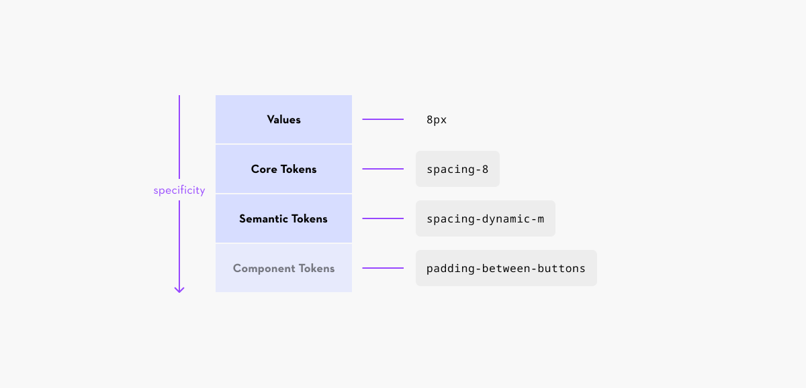

_Figure: The categorization of spacing tokens into four layers: Values, Core Tokens, Semantic Tokens, and Component Tokens. The measurement 8px refers to a raw pixel unit under Values. The label spacing-8 is an example of Core Tokens, which store raw pixel units, while spacing-dynamic-m is an example of Semantic Tokens that reference core tokens and suggest a general intent. Padding-between-buttons is an example of Component Tokens, which define specific contexts of use, although it is noted that component tokens are not currently used. The figure also indicates that specificity increases from Values to Component Tokens._

### Spacing token syntax structure

Our general token syntax structure combines three main areas. Relevant for spacings are the following:

**Namspace** levels combine any of the following: system, theme or domain.

**Type** refers to the property such as “spacing”.

**Modifier** refers to variants and scales.

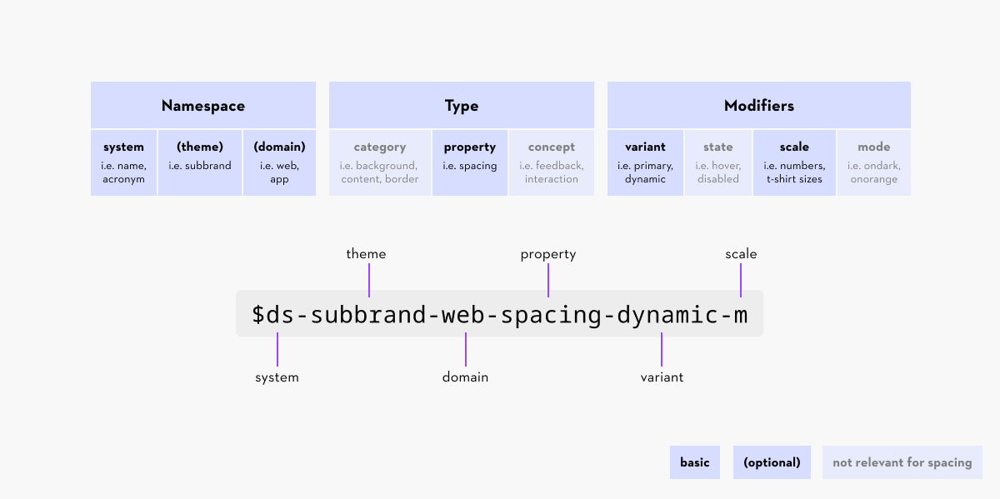

_Figure: The syntax structure for spacing tokens in a UI design system, breaking it down into three main areas: Namespace, Type, and Modifiers. The Namespace can include system, theme, or domain, Type refers specifically to the property such as spacing, and Modifiers include variants and scales. The example token $ds-subbrand-web-spacing-dynamic-m demonstrates this structure, where "subbrand" is the theme, "web" is the domain, "spacing" is the property, "dynamic" is the variant, and "m" is the scale. The figure also indicates that some components like category, concept, state, and mode are not relevant for spacing._

### Variables handover

The Figma plugin “variables2json” is used to export the Figma variables to a json file.

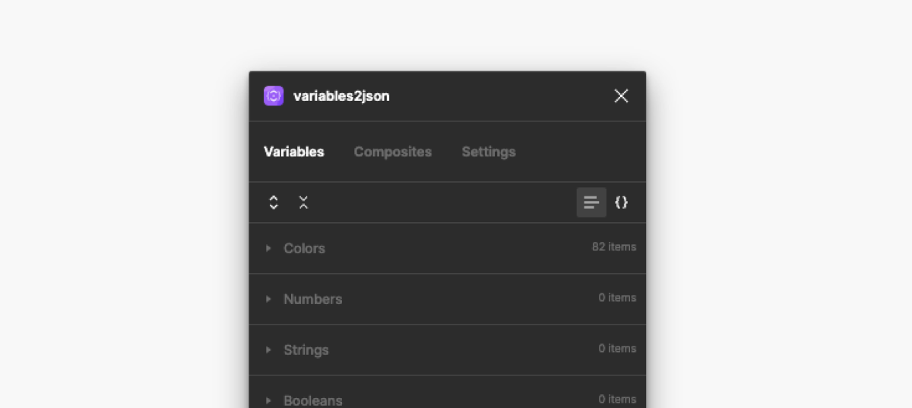

_Figure: A screenshot of the Figma plugin named "variables2json." The plugin interface includes three tabs labeled Variables, Composites, and Settings. Under the Variables tab, there are categories for Colors, Numbers, Strings, and Booleans, with the Colors category containing 82 items and the others showing 0 items. The interface also includes icons for importing and exporting variables, as well as a toggle for viewing variables in JSON format._

## Spacing: Core Tokens

Core tokens correspond directly to raw pixel values, with each token’s name indicating its specific pixel value. For example, a token named spacing-2 represents a spacing of 2 pixels.

These tokens are intended as static spacings that stay consistent across all screen sizes.

> Use only the provided tokens and avoid any other spacing values.

> The new spacing tokens ‘spacing-0’ and ‘spacing-56’ have not been added to the Figma components yet.

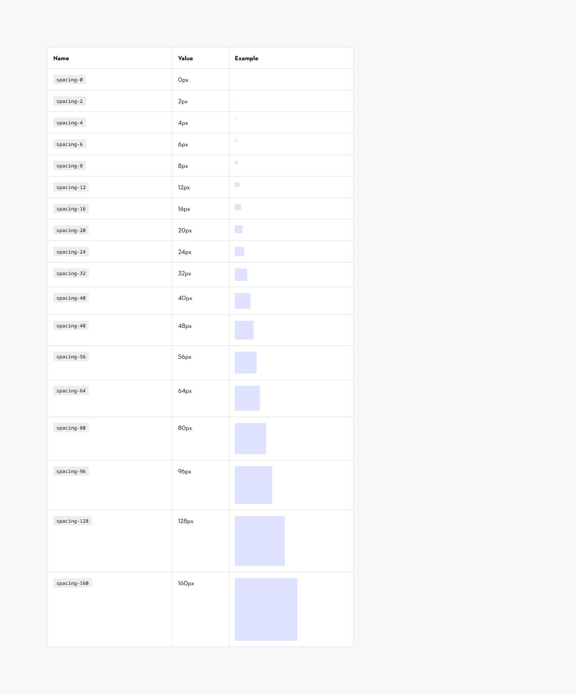

_Figure: A table of spacing core tokens used in the STIHL Design System. Each row in the table lists a token name, its corresponding pixel value, and a visual example. The pixel values range from 0px to 160px, with each token name indicating its specific pixel value, such as spacing-2 representing 2 pixels. The table includes tokens like spacing-0, spacing-2, spacing-4, up to spacing-160, and notes that spacing-0 and spacing-56 are new and not yet added to the Figma components. The examples visually represent the spacing values to provide a clear understanding of each token's application. Measurements in the figure: 2px, 4px, 6px, 8px, 12px, 16px, 20px, 24px, 32px, 40px, 48px, 56px, 64px, 80px, 96px, 128px._

### Contribute

Contribute to improving these variables by sharing your feedback, asking questions, or suggesting features [here](https://www.figma.com/design/lLmw7PfIdKjFG4uT3B2Hyj/Onboarding-%F0%9F%93%96?node-id=446-868&t=zKmRu4kAkxMeRDmK-4).

## Spacing: Semantic Tokens

Semantic tokens are based on core tokens, with names that indicate their intended purpose.

In our system, these tokens provide dynamic spacings that adapt according to breakpoints.

> Use only the provided tokens and avoid any other spacing values.

> These spacing tokens have not been added to the Figma components yet.

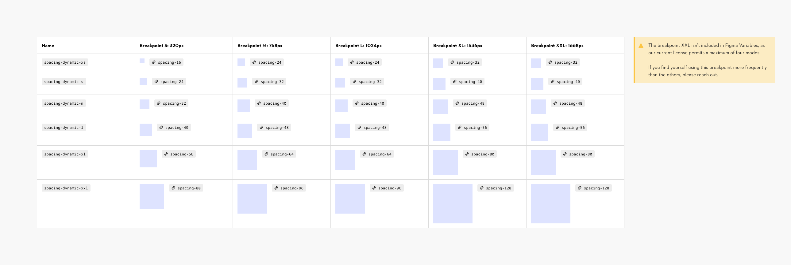

_Figure: A table of semantic tokens for spacing styles in the STIHL Design System, detailing how spacing values adapt across different breakpoints. Each row in the table lists a semantic token name and its corresponding spacing values for breakpoints labeled Breakpoint S: 320px, Breakpoint M: 768px, Breakpoint L: 1024px, Breakpoint XL: 1536px, and Breakpoint XXL: 1668px. A warning notification indicates that the Breakpoint XXL is not included in Figma Variables due to license limitations. The table includes tokens such as spacing-dynamic-xs, spacing-dynamic-s, spacing-dynamic-m, spacing-dynamic-l, spacing-dynamic-xl, and spacing-dynamic-xxl, each with specific spacing values like spacing-16..._

### Contribute

Contribute to improving these variables by sharing your feedback, asking questions, or suggesting features [here](https://www.figma.com/design/lLmw7PfIdKjFG4uT3B2Hyj/Onboarding-%F0%9F%93%96?node-id=446-868&t=zKmRu4kAkxMeRDmK-4).

## Spacing usage

### Core Tokens (Static spacings)

These tokens are intended as static spacings that stay consistent across all screen sizes. Different scenarios require different spacings to achieve optimal results. We can break them down in roughly three usage ranges:

**Small**

**(**

spacing-2

**-**

spacing-8

**)**

Used for small and compact elements:

- Padding within smaller components (i.e. small buttons)
- Vertical and horizontal spacing between elements inside a component (i.e. between labels and elements)

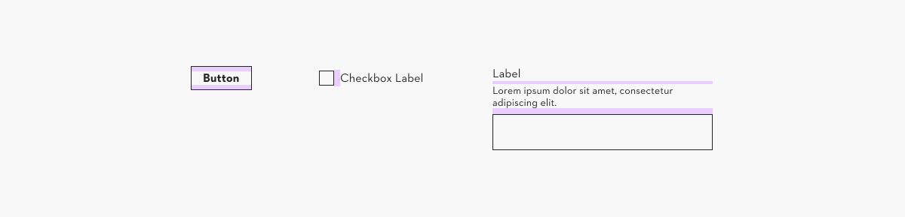

_Figure: A button labeled "Button" with an outline variant, enabled state, small size, and no icon. It also shows a checkbox labeled "Checkbox Label" in the default state, unchecked, and not invalid. Additionally, there is an input field labeled "Label" with a hint text "Lorem ipsum dolor sit amet, consectetur adipiscing elit." The layout includes vertical spacing between these components, illustrating the use of static spacing tokens for small and compact elements such as padding within smaller components and spacing between labels and elements inside a component._

**Medium**

**(**

spacing-12

**-**

spacing-24

**)**

Used for larger and less dense elements:

- Padding within bigger components and modules (i.e. toasts)
- Vertical and horizontal spacing between elements inside a component or pattern (i.e. fieldsets)

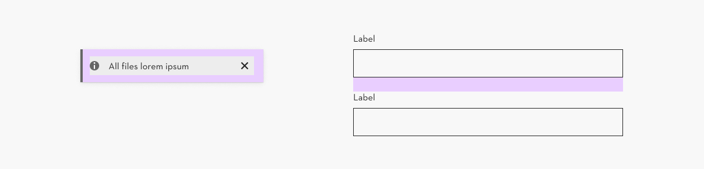

_Figure: The use of medium spacing styles within UI components. It shows a toast with the text "All files lorem ipsum" and an info icon, and a fieldset with the label "Label." The medium spacing, ranging from spacing-12 to spacing-24, is used for padding within larger components like toasts and for vertical and horizontal spacing between elements inside components or patterns, such as fieldsets._

**Large**

**(**

spacing-32

**-**

spacing-160

**)**

Used for the largest elements and layout:

- Space between elements inside a bigger pattern or on a page (i.e. between modules and buttons)

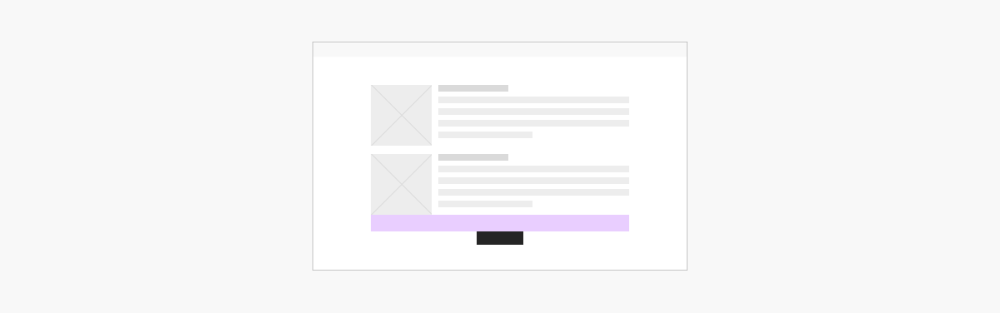

_Figure: The use of vertical spacing core tokens ranging from spacing-32 to spacing-160. These spacings are used for the largest elements and layout, specifically for space between elements inside a bigger pattern or on a page, such as between modules and buttons. The components in the figure are spacers of type core token, arranged in a vertical direction._

### Semantic Tokens (Dynamic spacings)

These tokens are intended as dynamic spacings that adapt to the breakpoint they’re used in.

They are mainly used for spacings between elements in a layout (i.e. between modules) and for padding within components and patterns (i.e. dialogs)

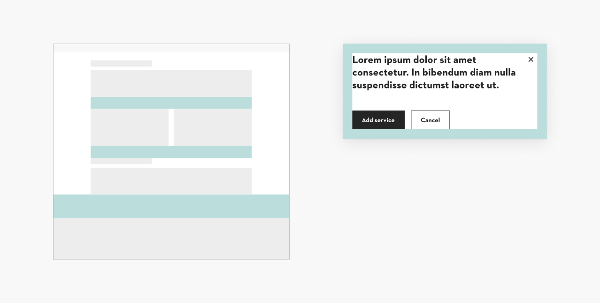

_Figure: The use of semantic tokens for dynamic spacings in a UI design system. It shows a layout with vertical spacings between elements, including a dialog with text and buttons. The dialog contains a button labeled "Add service" with a ghost variant, enabled state, small size, no icon, hidden label, and non-flush alignment, and another button labeled "Cancel". The spacings adapt based on the breakpoint and are used for padding within the dialog and spacing between layout elements._

**Horizontal spacing watchout**

Bigger modules within the grid typically inherit horizontal spacing from the predefined gutter, which utilizes the following token:

spacing-dynamic-xs

By default, when modules stack on smaller screens, horizontal spacings shift to vertical, with dynamic spacings still in effect.

**(1)** Example: 24px horizontal spacing (dynamic) on small desktop screens shifts to 16px vertical spacing (dynamic) on mobile screens.

It’s essential to remember that horizontal and vertical spacings are perceived differently, so dynamic spacings may not always work effectively for both orientations. When horizontal spacing shifts to vertical, a static spacing token can be used in place of the dynamic one.

**(2)** Example: 24px horizontal spacing (dynamic) on small desktop screens shifts to 24px vertical spacing (static) on mobile screens.

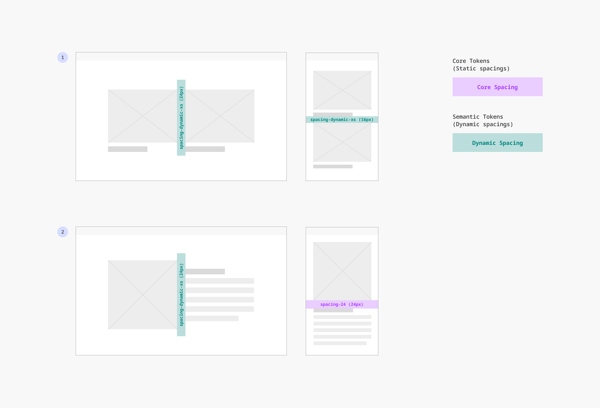

_Figure: The use of spacing tokens in a UI design system, comparing core tokens and semantic tokens. Callout 1 shows horizontal spacing of 24 pixels using the dynamic token spacing-dynamic-xs on small desktop screens, which shifts to 16 pixels vertical spacing on mobile screens. Callout 2 demonstrates the same dynamic token applied vertically with multiple elements. The core token spacing-24 is shown as a static vertical spacing of 24 pixels._

### Inspection of variables for developers

Ensure you use the appropriate spacing variables in your designs so developers can view the correct specifications during inspection **(1)**.

- For developers with a [Design or Dev Mode seat](https://help.figma.com/hc/en-us/articles/360039960434-Manage-seats-in-Figma), spacing specs are displayed directly when selecting an element **(2)**.
- For developers with a Viewer seat, spacing specs appear in the right-side panel **(3)**.

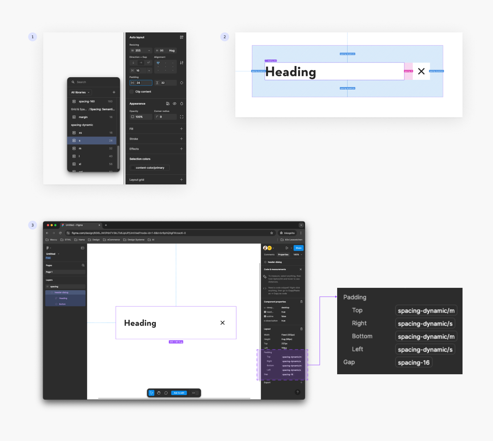

_Figure: The inspection of spacing variables in a UI design system. Callout 1 shows a list of spacing variables available in the design tool, with "s" selected, indicating a spacing value of 24. Callout 2 highlights a selected element in the design interface, displaying its dimensions and padding values directly. Callout 3 demonstrates the right-side panel in the design tool where spacing specifications, including padding and gap values, are shown for a selected element, with specific references to "spacing-dynamic/m", "spacing-dynamic/s", and "spacing-16"._

## Spacing: Web usage example

### Example with spacers

> The modules shown below are for visual representation only and are not intended as finalized modules.

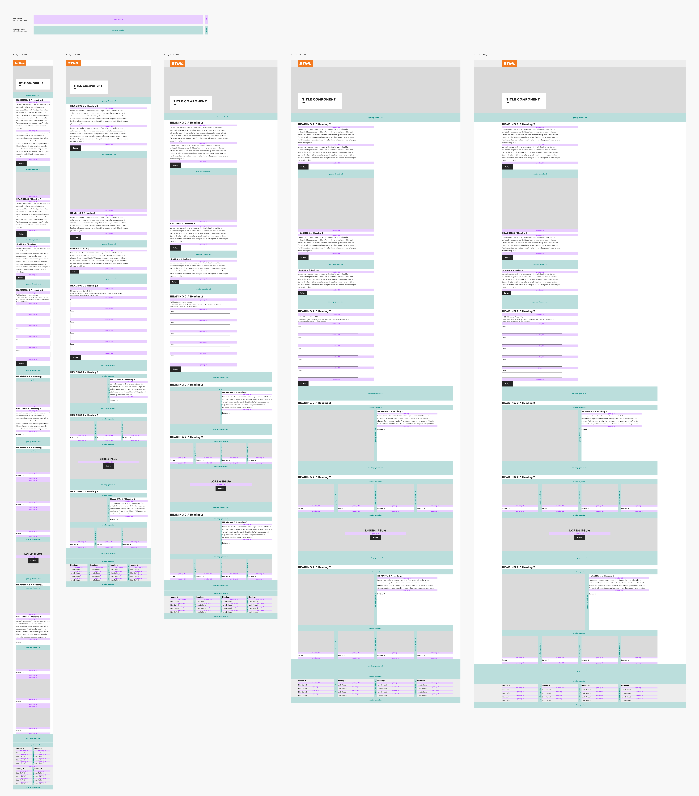

_Figure: Various spacing styles within the STIHL Design System, demonstrating how different components are spaced using core and dynamic tokens. Measurements such as 24px refer to the spacing between UI elements, with labels like "Core Spacing" and "Dynamic Spacing" indicating static and dynamic spacing tokens respectively. The figure includes components like buttons, input fields, links, and titles, each with specified variants and states, arranged to show spacing at different breakpoints such as "Breakpoint S: 320px" and "Breakpoint XL: 1536px._

### Example without spacers

> The modules shown below are for visual representation only and are not intended as finalized modules.

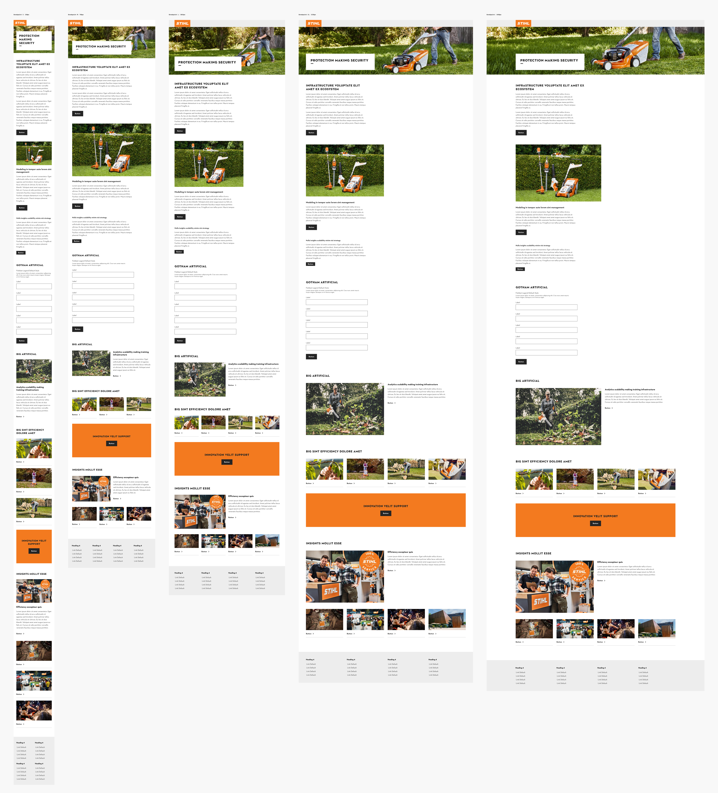

_Figure: Shows logo (type=deafult, logos=main); title (title text=Protection making security, size=xl, viewport=mobile); spacer (type=dynamic token, direction=vertical); spacer (type=core token, direction=vertical); button (button text=Button, variant=filled, state=enabled, size=medium, icon position=none, hide label=off, flush alignment=off); button (button text=Button, variant=filled, state=enabled, size=small, icon position=none, hide label=off, flush alignment=off); input-medium (system feedback, state=enabled, invalid=false); button (button text=Button, variant=ghost, state=enabled, size=medium, icon position=right, hide label=off, flush alignment=on); button (button text=Button, variant=ghost, state=enabled, size=small, icon position=right, hide label=off, flush alignment=on); link-default (label=Link Default, variant=neutral, state=enabled, icon position=none); title (title text=Protection making security, size=xl, viewport=desktop). Measurements: 56px, 16px, 24px, 80px, 32px, 40px, 8px, 64px, 96px, 48px, 120px. Text in the figure: "Breakpoint S: 320px", "Breakpoint M: 768px", "Breakpoint L: 1024px", "Breakpoint XL: 1536px", "Breakpoint: 1668px", "Protection making security", "ƒ", "Infrastructure voluptate elit amet ex ecosystem", "Lorem ipsum dolor sit amet consectetur. Eget sollicitudin tellus id arcu soll...", "Button", "Modeling in tempor aute lorem sint management", "Nulla insights scalability minim nisi strategy", "Gotham artificial", "Fieldset Legend Default Style", "Lorem ipsum dolor sit amet, consectetur adipiscing elit. Cras nunc amet mauri...", "Label", "big artificial", "Analytics scalability making training infrastructure", "Big sint efficiency dolore amet", "Innovation velit support", "Insights mollit esse", "Efficiency excepteur quis", "Heading 4", "Link Default"._

## Spacing: Basic web template Dev

> This template is just a reference for code

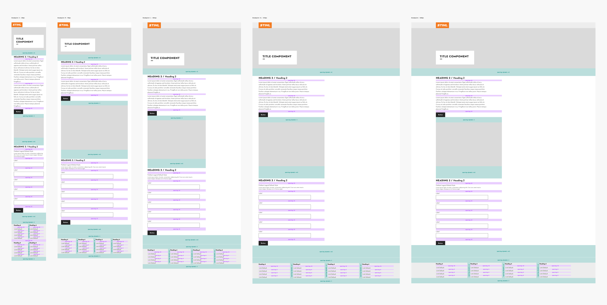

_Figure: A basic web template for the STIHL Design System, illustrating spacing styles across different breakpoints and viewports. It includes components such as a logo, title, spacers, button, input, and link, each with specified variants and states. The measurements refer to spacing tokens, both dynamic and core, used to maintain consistent spacing throughout the design. The breakpoints are labeled as S: 320px, M: 768px, L: 1024px, XL: 1536px, and 1668px, indicating responsive design adjustments for different screen sizes. The title component is shown in both mobile and desktop viewports, with various spacing tokens like spacing-dynamic-xl, spacing-16, and spacing-24 applied to different elements._
