# Spacing Styles

## Spacing overview

Spacing refers to distance between elements within a layout, also known as whitespace.

Consistent spacings are essential for organizing content, establishing a clear visual hierarchy, and guiding users effectively, all while ensuring a cohesive experience across digital products.

### Spacing system

Our spacing system uses 8px as a base unit - meaning that each spacing value is a multiple of this base unit. The defined spacings range from 0px to 160px, allowing for maximum flexibility.

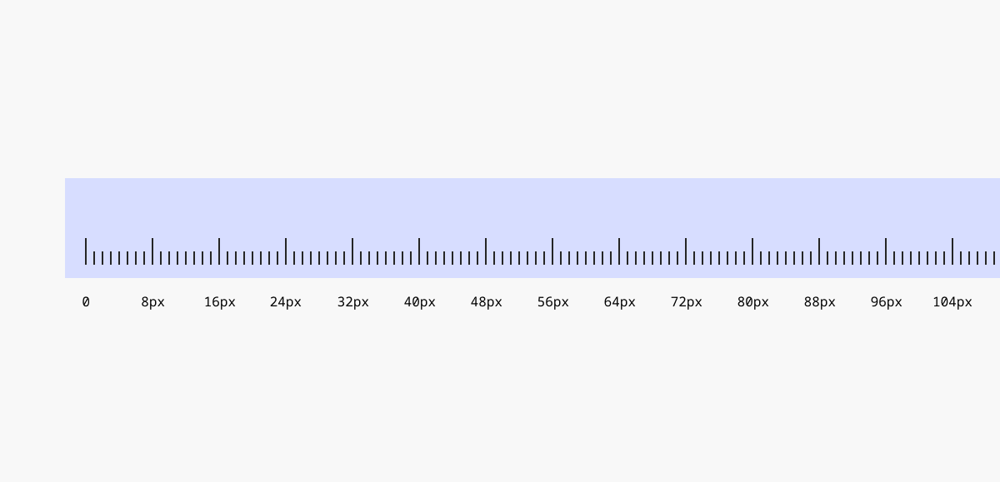

## Spacing: Token System

Tokens contain raw design values and embed design intent, helping to create a consistent and cohesive system.

### Spacing token layers

We categorize spacing tokens into four layers, starting with general numerical values and progressing to component-specific references:

**Values** refer to a raw pixel unit.

**Core Tokens** store the raw pixel units.

**Semantic Tokens** reference core tokens. The name suggests the token’s general intent.

**Component Tokens** define the specific context of use, allowing for more precise references. ⚠️ For now we don’t use component tokens.

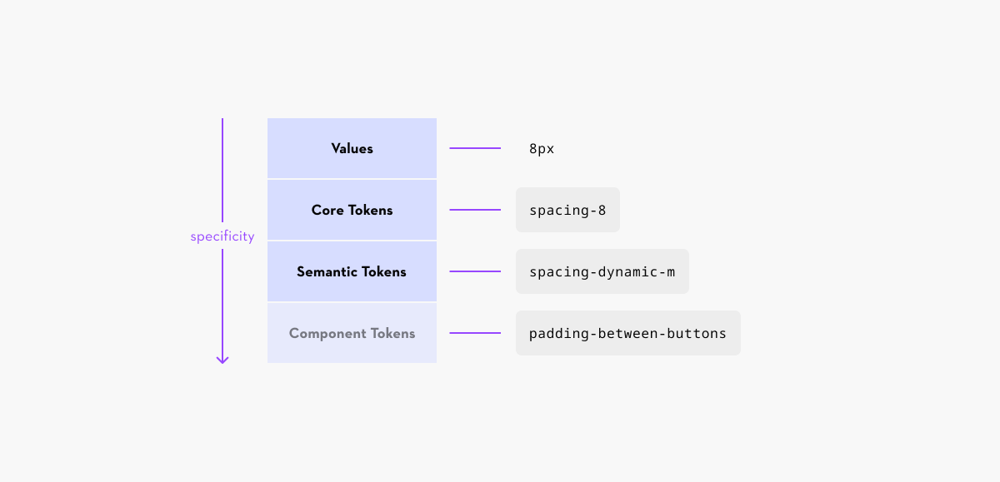

### Spacing token syntax structure

Our general token syntax structure combines three main areas. Relevant for spacings are the following:

**Namspace** levels combine any of the following: system, theme or domain.

**Type** refers to the property such as “spacing”.

**Modifier** refers to variants and scales.

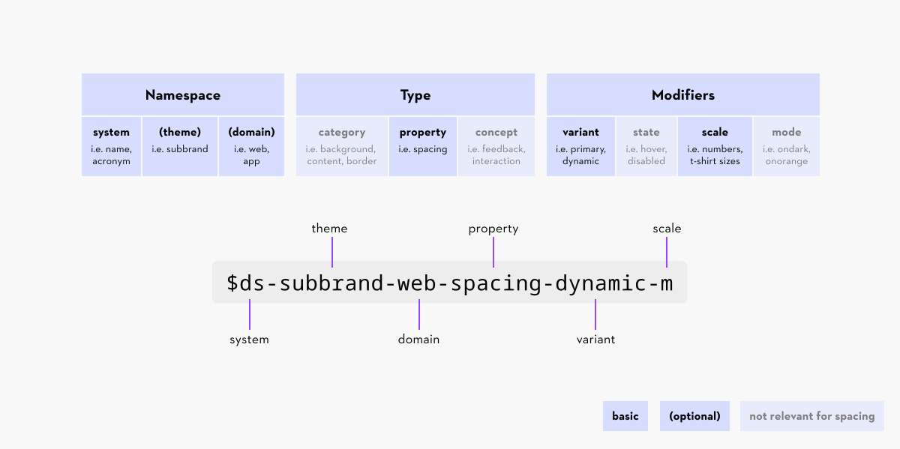

### Variables handover

The Figma plugin “variables2json” is used to export the Figma variables to a json file.

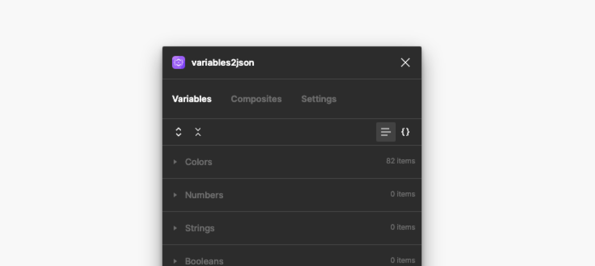

## Spacing: Core Tokens

Core tokens correspond directly to raw pixel values, with each token’s name indicating its specific pixel value. For example, a token named spacing-2 represents a spacing of 2 pixels.

These tokens are intended as static spacings that stay consistent across all screen sizes.

> Use only the provided tokens and avoid any other spacing values.

> The new spacing tokens ‘spacing-0’ and ‘spacing-56’ have not been added to the Figma components yet.

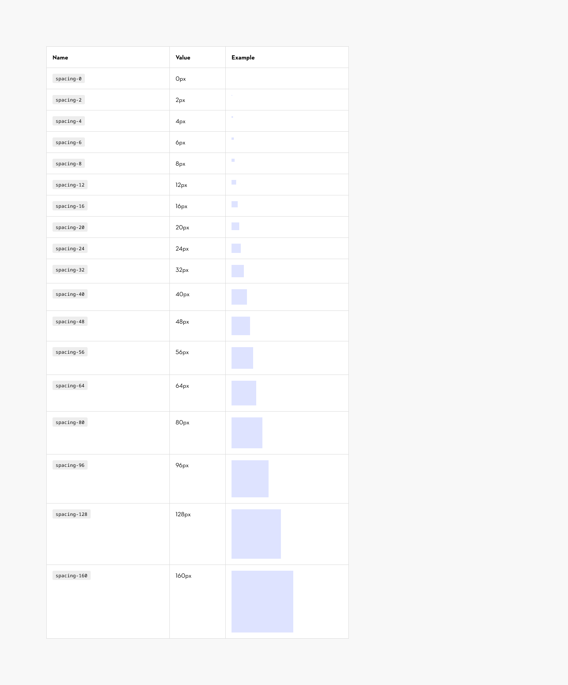

### Contribute

Contribute to improving these variables by sharing your feedback, asking questions, or suggesting features [here](https://www.figma.com/design/lLmw7PfIdKjFG4uT3B2Hyj/Onboarding-%F0%9F%93%96?node-id=446-868&t=zKmRu4kAkxMeRDmK-4).

## Spacing: Semantic Tokens

Semantic tokens are based on core tokens, with names that indicate their intended purpose.

In our system, these tokens provide dynamic spacings that adapt according to breakpoints.

> Use only the provided tokens and avoid any other spacing values.

> These spacing tokens have not been added to the Figma components yet.

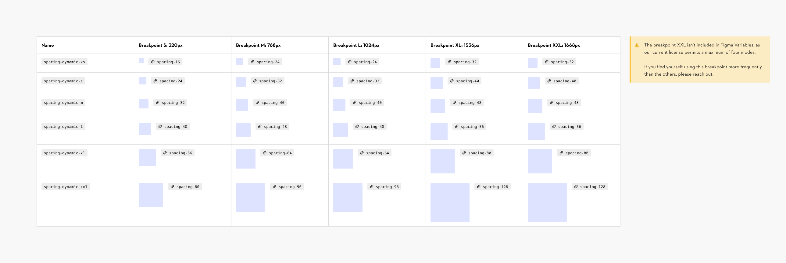

### Contribute

Contribute to improving these variables by sharing your feedback, asking questions, or suggesting features [here](https://www.figma.com/design/lLmw7PfIdKjFG4uT3B2Hyj/Onboarding-%F0%9F%93%96?node-id=446-868&t=zKmRu4kAkxMeRDmK-4).

## Spacing usage

### Core Tokens (Static spacings)

These tokens are intended as static spacings that stay consistent across all screen sizes. Different scenarios require different spacings to achieve optimal results. We can break them down in roughly three usage ranges:

**Small**

**(**

spacing-2

**-**

spacing-8

**)**

Used for small and compact elements:

- Padding within smaller components (i.e. small buttons)
- Vertical and horizontal spacing between elements inside a component (i.e. between labels and elements)

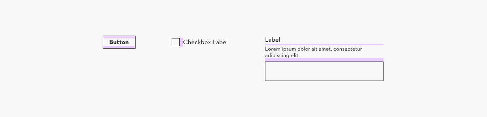

**Medium**

**(**

spacing-12

**-**

spacing-24

**)**

Used for larger and less dense elements:

- Padding within bigger components and modules (i.e. toasts)
- Vertical and horizontal spacing between elements inside a component or pattern (i.e. fieldsets)

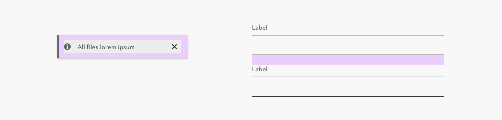

**Large**

**(**

spacing-32

**-**

spacing-160

**)**

Used for the largest elements and layout:

- Space between elements inside a bigger pattern or on a page (i.e. between modules and buttons)

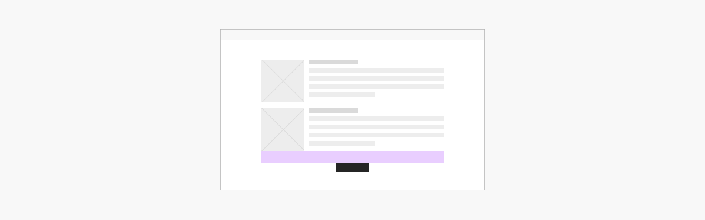

### Semantic Tokens (Dynamic spacings)

These tokens are intended as dynamic spacings that adapt to the breakpoint they’re used in.

They are mainly used for spacings between elements in a layout (i.e. between modules) and for padding within components and patterns (i.e. dialogs)

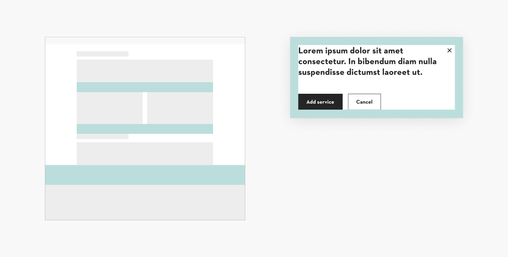

**Horizontal spacing watchout**

Bigger modules within the grid typically inherit horizontal spacing from the predefined gutter, which utilizes the following token:

spacing-dynamic-xs

By default, when modules stack on smaller screens, horizontal spacings shift to vertical, with dynamic spacings still in effect.

**(1)** Example: 24px horizontal spacing (dynamic) on small desktop screens shifts to 16px vertical spacing (dynamic) on mobile screens.

It’s essential to remember that horizontal and vertical spacings are perceived differently, so dynamic spacings may not always work effectively for both orientations. When horizontal spacing shifts to vertical, a static spacing token can be used in place of the dynamic one.

**(2)** Example: 24px horizontal spacing (dynamic) on small desktop screens shifts to 24px vertical spacing (static) on mobile screens.

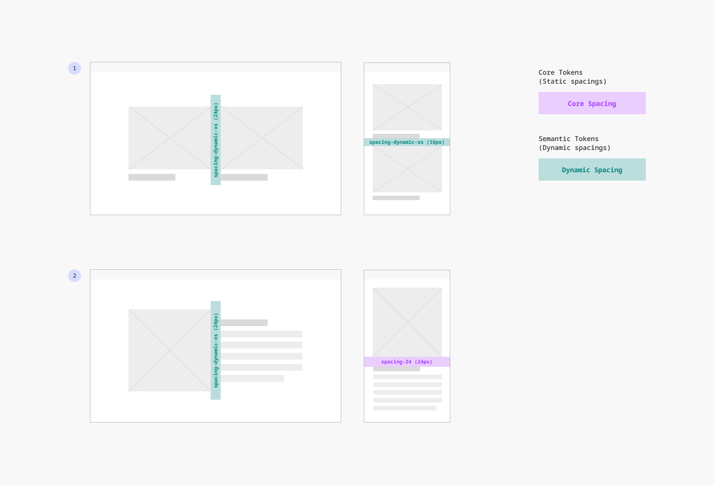

### Inspection of variables for developers

Ensure you use the appropriate spacing variables in your designs so developers can view the correct specifications during inspection **(1)**.

- For developers with a [Design or Dev Mode seat](https://help.figma.com/hc/en-us/articles/360039960434-Manage-seats-in-Figma), spacing specs are displayed directly when selecting an element **(2)**.
- For developers with a Viewer seat, spacing specs appear in the right-side panel **(3)**.

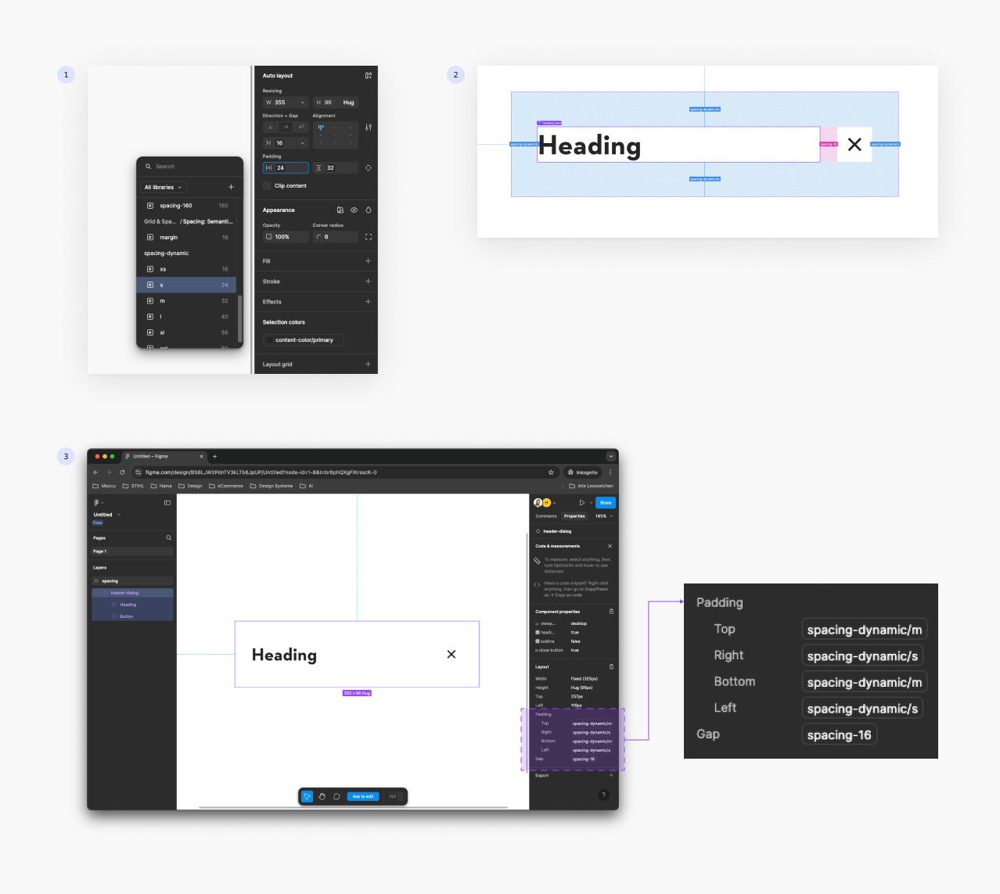

## Spacing: Web usage example

### Example with spacers

> The modules shown below are for visual representation only and are not intended as finalized modules.

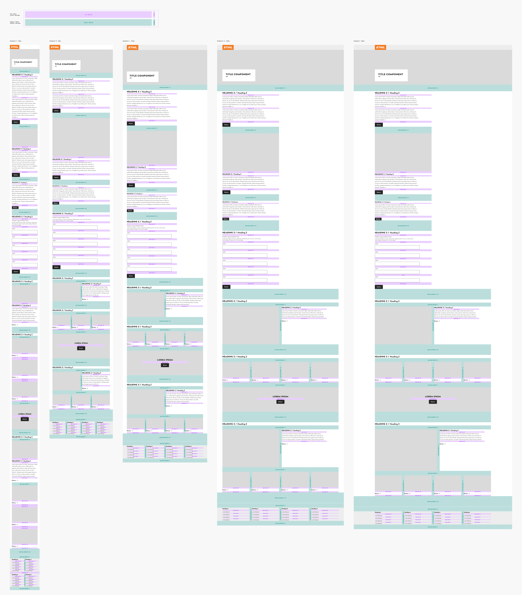

### Example without spacers

> The modules shown below are for visual representation only and are not intended as finalized modules.

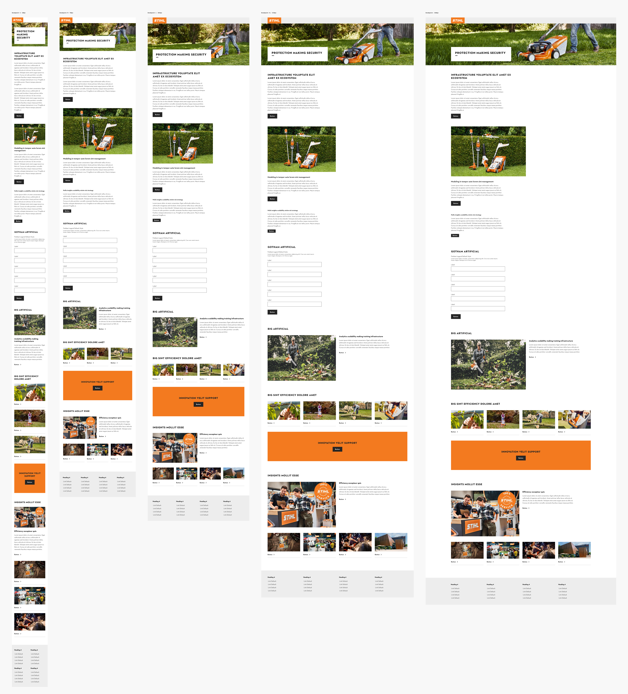

## Spacing: Basic web template Dev

> This template is just a reference for code

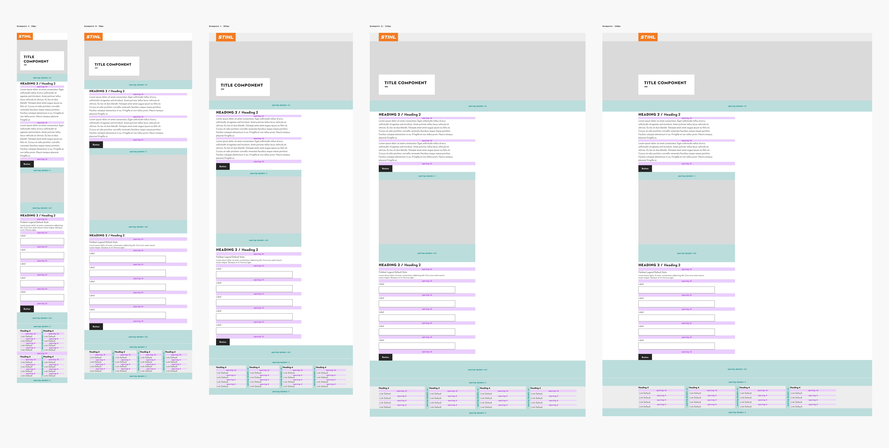
