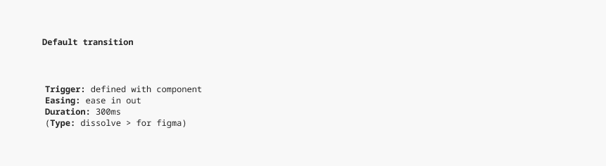

# Transitions

## Transitions

In this context, transitions refer to state changes triggered by user interactions that do not involve additional animations. Currently, transitions are primarily applied to buttons and other interactive elements.

The triggers for these transitions (e.g., hover, focus, pressed) are documented with their respective components and applied to specific properties such as background color or border color. For now, we rely on a default transition style.

This will be reviewed at the end of 2025 as part of the animation enhancement phase.

> The current **roadmap** is shared during **sprint reviews** and included in the design system **release notes**, which are emailed after each sprint. If you have any questions or would like to be added to the sprint review meetings or release notes distribution list, please reach out to [design.system@stihl.de](mailto:design.system@stihl.de).
