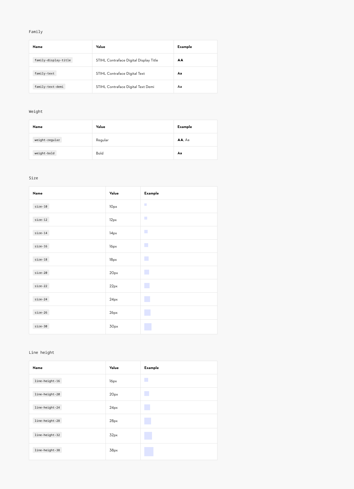

# Typography Tokens

## Typography: core tokens

A consistent usage of typography throughout all digital applications is essential. That’s why we link our font styles to core tokens - to create a foundation for the future.

> For now the implementation of Figma Font Variables is limited to **style values** like “font family” and **doesn’t represent the token structure used in code**. Currently the core variables reflect the exact naming or pixel value (i.e. size-10 references 10px and display-title references STIHL Contraface Digital Display Title). When Figma changes the way of handling Typography Variables in the future, we will transition to using semantic spacing tokens.

_Figure: A table of typography core tokens used in the STIHL Design System, detailing font family, weight, size, and line height. Each measurement label such as 10px, 12px, 14px, and so on, refers to the specific font size in pixels. The table includes rows for different font families like "family-display-title", "family-text", and "family-text-demi", each with corresponding values and examples. Additionally, it lists font weights like "weight-regular" and "weight-bold", along with their examples. The line height section provides various line height values in pixels, such as 16px, 20px, 24px, and so on. Measurements in the figure: 18px, 22px, 26px, 30px, 28px, 32px, 38px._

### Contribute

Contribute to improving these styles by sharing your feedback, asking questions, or suggesting features [here](https://www.figma.com/design/lLmw7PfIdKjFG4uT3B2Hyj/Onboarding-%F0%9F%93%96?node-id=446-868&t=zKmRu4kAkxMeRDmK-4).
