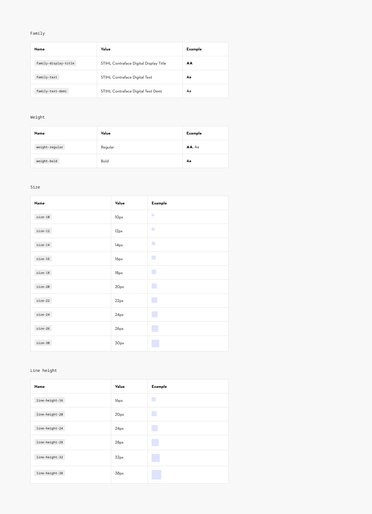

# Typography Tokens

## Typography: core tokens

A consistent usage of typography throughout all digital applications is essential. That’s why we link our font styles to core tokens - to create a foundation for the future.

> For now the implementation of Figma Font Variables is limited to **style values** like “font family” and **doesn’t represent the token structure used in code**. Currently the core variables reflect the exact naming or pixel value (i.e. size-10 references 10px and display-title references STIHL Contraface Digital Display Title). When Figma changes the way of handling Typography Variables in the future, we will transition to using semantic spacing tokens.

### Contribute

Contribute to improving these styles by sharing your feedback, asking questions, or suggesting features [here](https://www.figma.com/design/lLmw7PfIdKjFG4uT3B2Hyj/Onboarding-%F0%9F%93%96?node-id=446-868&t=zKmRu4kAkxMeRDmK-4).
