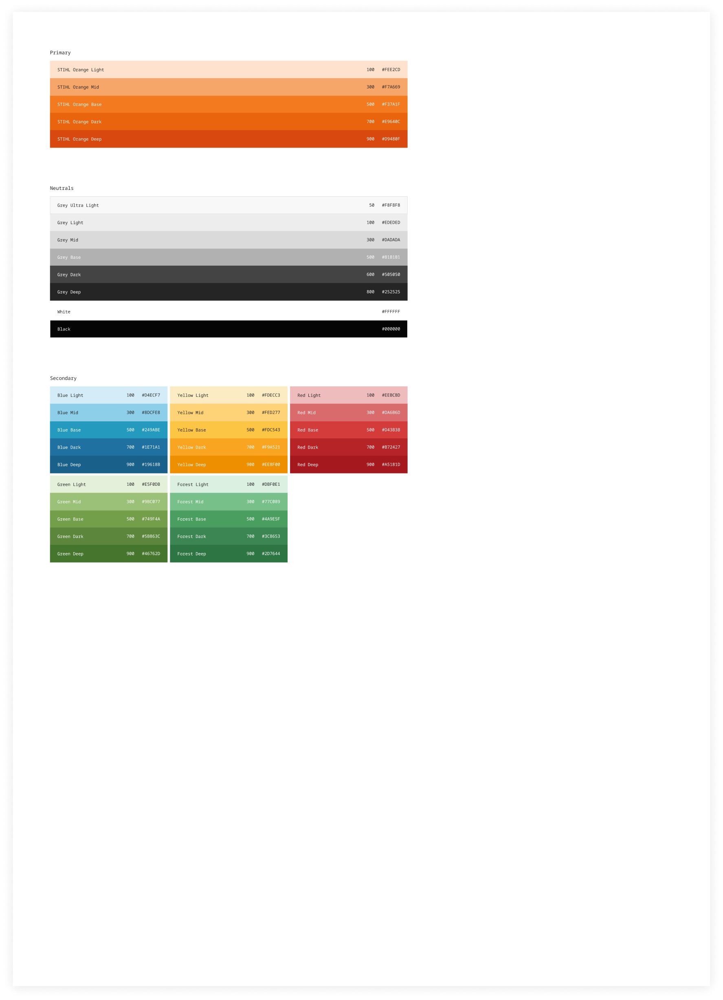
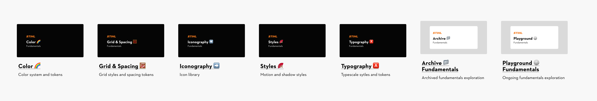
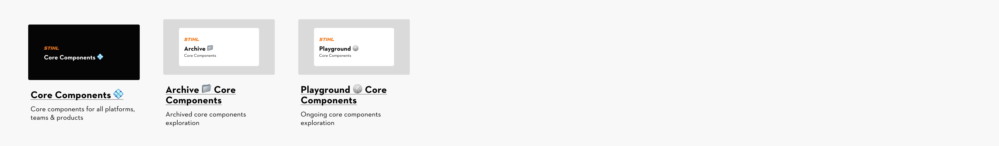
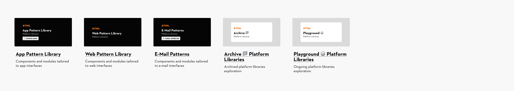
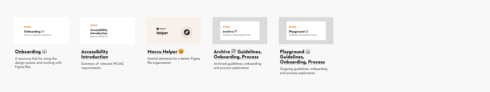

# STIHL Design System Introduction

## Introduction

### Introduction

### What is a Design System?

**A design system is**

- a collection of accessible basic elements & components,
- used by designers & developers,
- and monitored by means of guidelines & regulations.

Detailed information about the STIHL Design System and its involved areas is available in the STIHL Brand Portal.

The design elements and components are stored and published via [Figma libraries](https://www.figma.com/design/lLmw7PfIdKjFG4uT3B2Hyj?node-id=371-196).

The corresponding library in code is available here:

[Storybook](http://designsystem.stihl.de/)

## Figma File-Structure

### Figma File-Structure

### STIHL Design System - Figma File Structure

The STIHL Figma file structure follows the atomic design approach, organizing elements into hierarchical levels that build upon each other. Below is an overview of the current Figma files, their purposes and contents

The corresponding code library is available under [http://designsystem.stihl.de/](http://designsystem.stihl.de/).

### 01. Fundamentals

Libraries containing foundational design principles applicable across all platforms, teams, and products.

### 02. Core Components

A library with core components built on the fundamentals and accompanied by documentation, applicable to all platforms, teams, and products.

### 03. Platform Libraries

Platform-specific libraries with tailored components and modules designed for their unique use, **not** applicable to other platforms, teams, or products.

### 04. Guidelines, Onboarding, Process

Files containing guidelines, onboarding ressources, process documentation and more.

## How to ...

### How to ...

### ... use the STIHL Design System Figma files.

We use **Figma** to store design elements from the STIHL Design System and create digital interfaces.

If you’re new to Figma, you can access an internal STIHL Figma introduction here (available exclusively for STIHL employees, dealers, and VUs):

[STIHL Academy](https://academy.stihl.com/ilp/pages/description.jsf?client=intern#/users/@self/catalogues/115996/courses/28103476/description)

View basic information about the Figma tool on the web here:

[Figma for beginners](https://help.figma.com/hc/en-us/sections/4405269443991-Figma-for-beginners-4-parts)

[Figma Demos](https://www.figma.com/demo/?fuid=938091300777648663)

[Figma for beginners](https://www.youtube.com/watch?v=Cx2dkpBxst8&list=PLXDU_eVOJTx7QHLShNqIXL1Cgbxj7HlN4&index=1)

[Erste Schritte mit Figma (Deutsch)](https://youtu.be/BYgkyTM_Xss?si=s-BsKvdzGKDGrdPl)

#### How to ...

### ... add libraries in Figma.

STIHL Design System components, elements and styles are accessible in your Figma file via **dedicated libraries**.

These libraries should be enabled in your **files by default**. If not, go to the Assets tab (top left), click the book icon and manage your libraries. Explore the STIHL Design System Figma files overview [here](https://www.figma.com/design/lLmw7PfIdKjFG4uT3B2Hyj?node-id=371-196).

When you add libraries to your Figma file, you’ll receive **update notifications** whenever changes are made. Be sure to accept these updates to keep your designs up to date.

Below are links to documentation and guides for Figma libraries:

[Start designing with UI kits](https://help.figma.com/hc/en-us/articles/24037724065943-Start-designing-with-UI-kits)

[Guide to libraries in Figma](https://help.figma.com/hc/en-us/articles/360041051154-Guide-to-libraries-in-Figma)

[Review and accept library updates](https://help.figma.com/hc/en-us/articles/360039234193-Review-and-accept-library-updates)

#### How to ...

**Button**

### ... use components in Figma.

Components are reusable **UI elements** for consistent and efficient design. Figma libraries allow you to use instances of these components directly in your projects.

To find components, use the search field in the “Assets” tab or the “Actions” widget. All published components are **ready for immediate use**. Simply drag a component into your workspace. Component properties, such as text or images, can be customized via the properties panel on the right.

The libraries offer a collection of **foundational and general-purpose elements**. However, they may not cover every specific use case. For unique requirements, use these library elements as a starting point to build customized solutions.

If you need to make advanced changes beyond property adjustments, drag the component into your workspace, right-click, and select “**Detach Instance**” to edit it. Keep in mind that **detached components won’t update** automatically with future library changes.

To propose modifications or add new components to the libraries, please follow the [established process](https://www.figma.com/design/lLmw7PfIdKjFG4uT3B2Hyj?node-id=356-2488).

Here’s a link to documentation and guides for Figma components:

[Create and insert component instances](https://help.figma.com/hc/en-us/articles/360039150173-Create-and-insert-component-instances)

#### How to ...

### ... use styles and variables in Figma.

You can enhance objects appearance and behavior by applying styles and variables.

In Figma, **styles** ensure consistent, fixed visual properties, while **variables** provide dynamic values that adapt to contexts like themes or modes.

All styles and variables currently used in the STIHL Design System libraries:

- [Colors (variables)](https://www.figma.com/design/C7xQUXnwdZFYYIcvyDnsJA/Color-%F0%9F%8C%88?m=auto)
- [Spacings (variables)](https://www.figma.com/design/JyyYtoCYbtJrzqHs38OXSQ/Grid-%26-Spacing-%F0%9F%A7%AE?m=auto&t=BeEhj6WvByw9x6HJ-6)
- [Texts (styles)](https://www.figma.com/design/d9wrOp4aCplDsV9AVC87Xn/Typography-%F0%9F%85%B0%EF%B8%8F?m=auto&t=BeEhj6WvByw9x6HJ-6)
- [Shadows (styles)](https://www.figma.com/design/UYHZEckQObDvLuuRoMP8ps/Styles-%F0%9F%AA%AD?m=auto&t=BeEhj6WvByw9x6HJ-6)
- [Layout grids (styles)](https://www.figma.com/design/JyyYtoCYbtJrzqHs38OXSQ/Grid-%26-Spacing-%F0%9F%A7%AE?m=auto&t=BeEhj6WvByw9x6HJ-6)

When selecting an object, you can adjust its properties in the **right sidebar** by changing, adding, or removing styles and variables.

Below are links to documentation and guides for Figma styles and variables:

[Styles in Figma](https://help.figma.com/hc/en-us/articles/360039238753-Styles-in-Figma)

[Guide to variables in Figma](https://help.figma.com/hc/en-us/articles/15339657135383-Guide-to-variables-in-Figma)

[Apply styles to layers and objects](https://help.figma.com/hc/en-us/articles/360040316193-Apply-styles-to-layers-and-objects)

[Apply variables to designs](https://help.figma.com/hc/en-us/articles/15343107263511-Apply-variables-to-designs)

#### How to ...

Lable

Email-Adresse

Success hint

### ... follow the Code of Conduct.

In order to keep the STIHL Design System files as clean as possible and ensure that everyone can work with them, please consider a few things:

1. **Editing libraries** If you have edit rights, please refrain from making changes or deleting anything in the STIHL Design System libraries, as such actions will impact all users. Please avoid adding elements to the libraries, as they may be linked to external styles, which will then appear in this library.
1. **Comments** Keep comments in these document to a minimum. Rather, use the process shown [here](https://www.figma.com/design/lLmw7PfIdKjFG4uT3B2Hyj?node-id=356-2488) to flag problems, give input or feedback. If comments are necessary, please direct them to **Benedikt Schramm** and make sure to archive or delete them as soon as the discussed topic has been resolved. Old comments that are not archived will be removed periodically.

#### How to ...

### use the Dev Mode in Figma?

**The Dev Mode is**

- a new type of fee-based licence
- replacement for the previously free Inspect features
- for developer to analyze the distances, dimensions, colors, design tokens, assets and code snippets in detail, making it much easier to switch from design to code

Detailed information about the Dev Mode and it’s features are here [Guide to Dev Mode in Figma – Figma Learn - Help Center](https://help.figma.com/hc/en-us/articles/15023124644247-Guide-to-Dev-Mode-in-Figma)

[Figma Dev Mode](https://help.figma.com/hc/en-us/articles/15023124644247-Guide-to-Dev-Mode-in-Figma)

[Figma Dev Mode for beginners](https://www.youtube.com/watch?v=XEgGOgWCfF0)

## Process

### Process

### Requirement-Design-Delivery process

The STIHL Design System team develops and refines the system through a **sprint-based workflow**:

- A sprint always lasts **3 weeks** and includes fixed [meetings](https://www.figma.com/design/lLmw7PfIdKjFG4uT3B2Hyj?node-id=356-2496).
- [Tickets](https://andreasstihl.atlassian.net/jira/software/projects/DS/boards/230) are created by the sprint team and collaboratively with stakeholders.
- Each sprint allows stakeholders to review progress and share feedback.

> The current **roadmap** is shared during **sprint reviews** and included in the design system **release notes**, which are emailed after each sprint. If you have any questions or would like to be added to the sprint review meetings or release notes distribution list, please reach out to [design.system@stihl.de](mailto:design.system@stihl.de).

#### Process

### Meetings

Every sprint has **several meetings**. Some are only for the sprint team, some are with the stakeholders.

#### Sprint Planning

#### Sprint Review

- MCX makes a preselection of which tasks should be processed in the upcoming sprint.
- The selection is based on the ‘Roadmap - Design System’ and priority, available resources , stakeholder needs and information content in the ticket.
- The pre selected scope will be discussed with the sprint team and adapted if necessary.

- At the end of the sprint, the status and all results of the tasks are presented by the sprint team.
- Designer/Devs report the status of the tickets to MCX/POs on an early stage, so the agenda can be made.
- Tasks are approved by MCX/POs and appropriate stakeholders.
   - If a task cannot be approved, then the task is moved to the next sprint or, if necessary, to the backlog.
   - If a change request is discussed, a new task is created.

#### Sprint Check-In

- Twice in one sprint, there is a feedback loop (if needed) called Sprint Check-In.
- Design and Dev reports status/need for clarification to MCX at an early stage.
- MCX plans a corresponding agenda and invites the relevant stakeholders and task creators to clarify questions and provide feedback, which is provided in the tickets.
- If stakeholders/creators cannot attend, they must seek clarification elsewhere.
   - If this is not possible, necessary decisions are made by the MCX alone or the task is postponed.

#### Sprint Refinement

- There is a dedicated meeting for backlog refinement between POs, designers and devs and there is a continuous refinement that runs in parallel.
- Everyone who creates a task must ensure that all the necessary information for processing the task is noted in the task before the task is processed in a sprint.
- If there are conceptual questions to be clarified, then the task creator and sprint team must clarify these before planning in order to avoid long discussions in planning.
   - Low-fidelity concept and/or example screenshots in the task before planning.
   - High-fidelity design concept in planning / feedback loop or check-in.

#### Sprint Work Session

- Twice or three times in one sprint, there is a working meeting called Sprint Work Session.
- Design and Dev reports status/need for clarification to MCX at an early stage.
- The entire design system team continues to work together on the topic and clarifies open points together.

#### Sprint Retro

- A Sprint Retro is also held after a Sprint Review.
- The Design System Team participates
- Changes to the process are discussed and implemented.

#### Process

### Roles

As part of the sprint process, there are different roles with different tasks and responsibilities.

#### Product Owner (PO)

#### Developer (Devs)

- Backlog Grooming and Refinement of Tasks before Sprint:
   - Pre-selection of tasks,
   - Stakeholder management.
- All organizational tasks around the Sprint Team.
- Control of schedule and agenda.
- Agenda related invitation of stakeholders / creators.
- Authority to "reject" tasks / send them to refinement again if they are not filled sufficiently.

- Responsible for code development and dev specific docu tasks.
- Participation in all relevant sprint meetings.
- Handle assigned tasks and clarify / present them as needed.
- Timely notification of need for clarification so that POs / designer / Stakeholders have time to prepare or set it up.

#### Stakeholder / Task creator

- Complete filling of tasks, so that as far as possible no queries remain unanswered
- Participation in Check-Ins / Reviews or other appointments as needed to present set tasks and answer queries as needed.
- Timely commenting of queries in tickets.
- Participation in the Sprint Review and acceptance of the tasks set by them, if required.
- In the case of time-critical demand for components, it is possible to create components yourself, taking into account the existing Corporate Identity / guidelines, and to introduce them into the design process as a proposal.

#### Designer

- Responsible for design and docu tasks.
- Participate in all sprint meetings to present tasks that have been worked on.
- Comment or raise queries in the ticket.
- Timely notification of need for clarification so POs / Devs / Stakeholders have time to prepare or set it up.

#### Process

### Design Process Scope

#### Scope

#### Not in Scope

- Providing of new components as Figma Design and Code in Storybook.
- Additions and extensions of the libraries. \>\> If required and after review by MCX, creation of component variants for special requirements possible
- Addition and optimization of documentation / provision of patterns / components (e.g. modular structure, dos & don’ts, guidelines).

- Project and concept work (e.g. consultant, design surveys, usability tests...etc.).
- Full conception of “page modules” (except topbar, footer, navigation).

#### Process

### Definition of Done & Acceptance Criteria

A **design task or component** is considered **Done** and **Accepted** when the following criteria are met:

#### Concept & Design

#### Quality Assurance

- Designs meet all functional, visual, and accessibility requirements.
- All relevant screen sizes and breakpoints are covered.
- The design aligns visually and conceptually with the existing design system and brand guidelines.

- At least one team member has reviewed the design and documentation (4-eye principle).
- All feedback from design reviews and stakeholders has been addressed.
- Accessibility checks (contrast ratios, font sizes, focus states) are completed.

#### Consistency & Standards

#### Handoff & Alignment

- Design tokens (colors, typography, spacing, etc.) are correctly applied.
- Components are integrated into the library following naming conventions.
- There are no inconsistencies or unused styles.

- The design has been discussed with the development team, and technical feasibility is confirmed.
- All specifications and assets are available and up-to-date in Figma.
- The task status is updated to "Ready for Development" or "Done" in **JIRA**.

#### Documentation

#### Release Process

- Each component is documented in **Figma** with a clear description, use cases, and visual examples (including dos & don’ts).
- Designs in **Figma** are linked to the corresponding components in **Storybook**.
- **💡 Tip**: Use Figma’s Find functionality (Command + F on Mac, Ctrl + F on Windows) to quickly locate information.

- **Merge Branch:** Integrate changes and ensure all notes are merged
- **Prepare Release Notes:** Update version number, release date, and sprint name
- **Publish Library:** Make the latest version of the Figma Pattern Library available
- **Review and Update Deprecated Elements:** Identify outdated components and apply necessary updates

## Contribute

### Contribute

### Get involved

Our design system grows stronger when everyone gets involved.

Give Feedback, suggest ideas, report bugs, or join the conversations in our community channels. Every contribution helps us build a better system for all.

#### Requests and feedack

To request something or provide feedback, select one of the options below, and the STIHL Design System team will review and respond accordingly.

[Create a Jira Ticket](https://andreasstihl.atlassian.net/jira/software/projects/DS/boards/230)

[Submit a feature request](https://main--63440bbb95889041542a5ba3.chromatic.com/?path=/docs/feature-request--documentation&globals=backgrounds.name:!undefined;backgrounds.value:!undefined)

#### Designs and drafts

If you have designs or drafts to share, please create a page in one of the respective playgrounds:

[Add designs to Playground 🏐 Fundamentals](https://www.figma.com/design/oquHPjeHdmt8ByTwZp0JQr/Playground-%F0%9F%8F%90-Fundamentals?m=auto&t=TjdR2O0GylyS4K9v-6)

[Add designs to Playground 🏐 Core Components](https://www.figma.com/design/5FxFGoT9NYVQgiu3mJknJH/Playground-%F0%9F%8F%90-Core-Components?m=auto&t=TjdR2O0GylyS4K9v-6)

[Add designs to Playground 🏐 Platform Libraries](https://www.figma.com/design/gtjLVb5HHtEpRfrMRm2Zvw/Playground-%F0%9F%8F%90-Platform-Libraries?m=auto&t=TjdR2O0GylyS4K9v-6)

#### STIHL Design System Community

Join our STIHL Design System Community in Teams to access General Information, Release Notes, and channels where you can ask questions, report bugs, or request features.

[Join the Team STIHL Design System](https://teams.microsoft.com/l/team/19%3AuDrITGQPNOye7F3v_7P5RYmx5lqusaxFIu3WVnWEUgs1%40thread.tacv2/conversations?groupId=b959e53f-075c-4bef-88ea-f20d1d15ace1&tenantId=702ed1df-fbf3-42e7-a14d-db80a314e632)

#### General enquiries

Do you have any questions about design systems?

Write us an email at: [design.system@stihl.de](mailto:design.system@stihl.de)
