# Banner

## Banner

- Used to highlight marketing content such as promotions, campaigns, events, or key service messages
- Designed to draw attention without interrupting the user experience
- Intended for temporary, non-critical information
- Not used for system status updates or warnings (use notifications for that purpose)
- Helps engage users with timely and relevant content

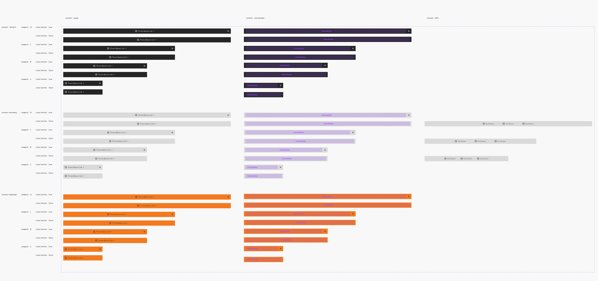

_Figure: Overview of the Banner pattern as a matrix of full-width bars in three variants (default dark, secondary light grey, highlight orange), four viewports (XL, L, M, S) and close-button true or false. The columns are "content: promo" (centered "Promo Banner Link" with icon and chevron), "content: placeholder" (purple dashed "Placeholder" slot) and "content: USPs" (three "Text Element" items, shown only for the secondary variant), with the close button as an X at the right edge when enabled and bar width shrinking with the viewport._

### Further guidelines

[Storybook documentation](https://main--63440bbb95889041542a5ba3.chromatic.com/?path=/docs/components-notification--documentation&globals=backgrounds.name:!undefined;backgrounds.value:!undefined)

[Decision tree](https://www.figma.com/design/qXldpLO6gxHJNLdcXIPxYt?node-id=26738-47603)

### Related elements

[Navigation](https://www.figma.com/design/Ie2r0R9QwjEc7O3nrFbXhV?node-id=5381-18)

Top bar

[Notification](https://www.figma.com/design/qXldpLO6gxHJNLdcXIPxYt/Core-Components-%F0%9F%92%A0?node-id=7251-8)

[Link](https://www.figma.com/design/qXldpLO6gxHJNLdcXIPxYt/Core-Components-%F0%9F%92%A0?node-id=26711-8034)

[Button](https://www.figma.com/design/qXldpLO6gxHJNLdcXIPxYt/Core-Components-%F0%9F%92%A0?node-id=162-126)

[Iconography](https://www.figma.com/design/U218NNP4OsipaHOtv5flns/Iconography-%E2%9E%A1%EF%B8%8F?m=auto)

### Contribute

Contribute to improving this component by sharing your feedback, asking questions, or suggesting features [here](https://www.figma.com/design/lLmw7PfIdKjFG4uT3B2Hyj/Onboarding-%F0%9F%93%96?node-id=446-868&t=zKmRu4kAkxMeRDmK-4).

## Formatting and Construction

### Anatomy

#### Elements

The Promo Banner consists of two main parts:

1. **Container:** Holds content such as text, links, or buttons.
1. **Close Button (optional):** Allows users to dismiss the banner.

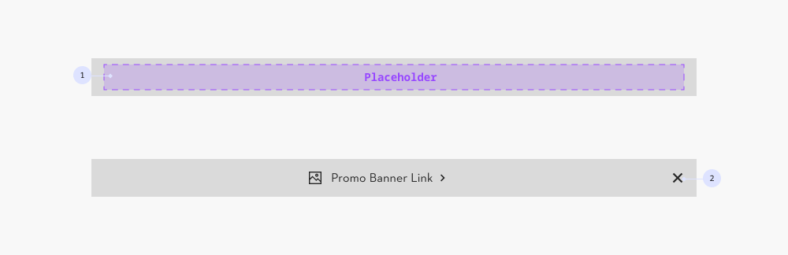

_Figure: Shows banner (variant=secondary, viewport=m, content=placeholder, close-button=false); annotation-circle (number=1, type=left, color=blue); banner (variant=secondary, viewport=m, content=promo, close-button=true); annotation-circle (number=2, type=right, color=blue). Callouts 1, 2. Text in the figure: "❖ Placeholder", "Promo Banner Link"._

#### Variants

There are three main variants:

1. **Default:** Primary variant for general use.
1. **Secondary:** Less prominent; suitable when used alongside another banner.
1. **Highlight:** Most attention-grabbing; use sparingly for critical messages.

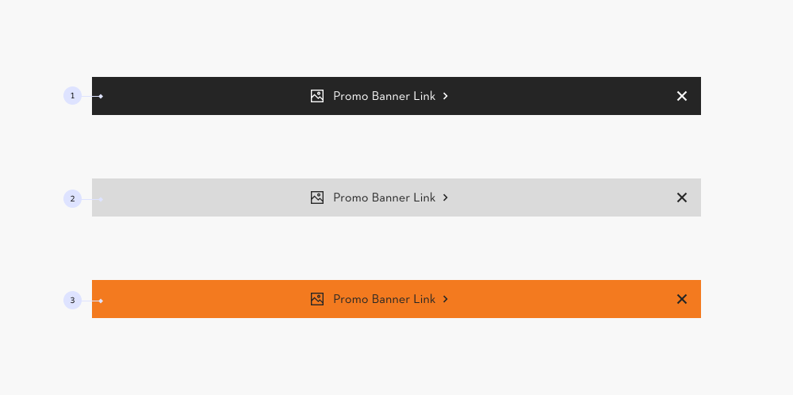

_Figure: Three full-width promo banners stacked vertically, each with an image icon, the centered link text "Promo Banner Link" with a chevron, and a close button on the right. Callout 1 marks the dark Default banner, callout 2 the light grey Secondary banner and callout 3 the orange Highlight banner._

### Alignment & Placement

The Promo Banner is positioned **above the top bar** and spans the **full width of the viewport**.

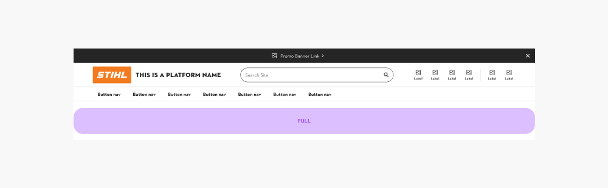

_Figure: On the XL viewport the dark Promo Banner with the link "Promo Banner Link" and a close button sits above the top bar, which holds the STIHL logo, "This is a Platform name", a "Search Site" field and icon buttons labelled "Label". The nav bar with "Button nav" items sits below it, and a purple bar labelled "Full" shows that the banner spans the full width of the viewport._

#### Content Alignment

On **viewports XL, L, M, content is centered (1)** within the banner. **On viewport S, it is left-aligned (2)** to make better use of available space.

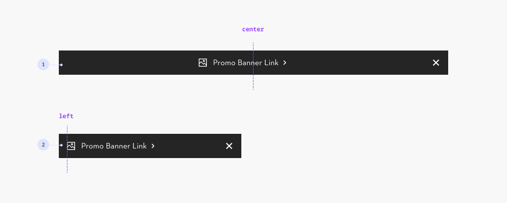

_Figure: Two dark promo banners with the link "Promo Banner Link" and a close button. Callout 1 marks the wider banner (viewports XL, L, M) whose content is centered on a dashed vertical line labelled "center"; callout 2 marks the narrower banner (viewport S) whose content is left-aligned to a dashed line labelled "left"._

### Sizing

#### Height

The banner has a **maximum height of 48px on XL, L, and M viewports (1)**. On **viewport S**, height adjusts **dynamically based on the content (2)**. More information about max. character count and max lines can be found in content documentation.

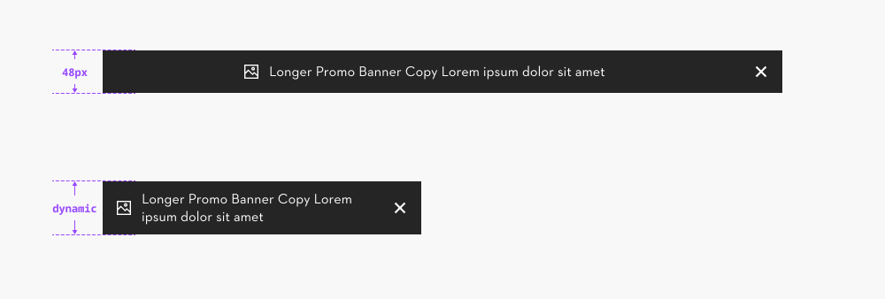

_Figure: Two dark promo banners with the text "Longer Promo Banner Copy Lorem ipsum dolor sit amet". The wider banner (M viewport) keeps the text on one line and has a height marked "48px"; the narrower banner (S viewport) wraps the text onto two lines and its height is marked "dynamic"._

## Content and Assets

### Maximum Character

The maximum character count should not exceed **65 characters**. Depending on the amount of elements and combination of icons this value might vary.

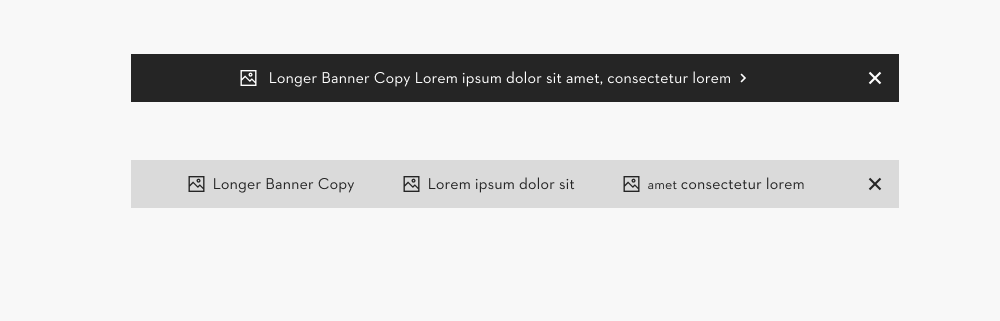

_Figure: Two banners illustrating character length. The dark banner holds one long text, "Longer Banner Copy Lorem ipsum dolor sit amet, consectetur lorem", with a link chevron and close button. The light grey banner splits the copy into three short items, "Longer Banner Copy", "Lorem ipsum dolor sit" and "amet consectetur lorem", each with its own icon, followed by a close button._

### Overflow

1. On **XL, L, and M viewports**, banner content remains on a **single line (no overflow)**.
1. On **S viewports, overflow is allowed** and the banner will expand in height, but is limited to a **maximum of two lines of text**.

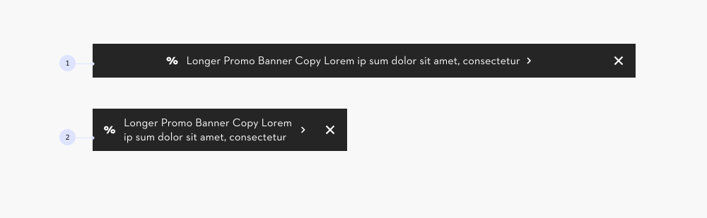

_Figure: Two dark promo banners with a percent icon, the text "Longer Promo Banner Copy Lorem ip sum dolor sit amet, consectetur", a chevron and a close button. Callout 1 marks the wide banner (XL, L, M) where the text stays on a single line; callout 2 marks the narrow banner (S) where the text wraps onto two lines and the banner grows in height._

### Pairing

A **maximum of two banners** can be displayed at the same time:

**1x Default (1) or Highlight Banner (2)** Used to present key information with an action or link (e.g. a promotion or campaign).

**1x Secondary Banner (3)** Used for supporting or general information (e.g. USPs or delivery conditions).

> **Important:** Banners can increase cognitive load for users. Use them sparingly and only when necessary.

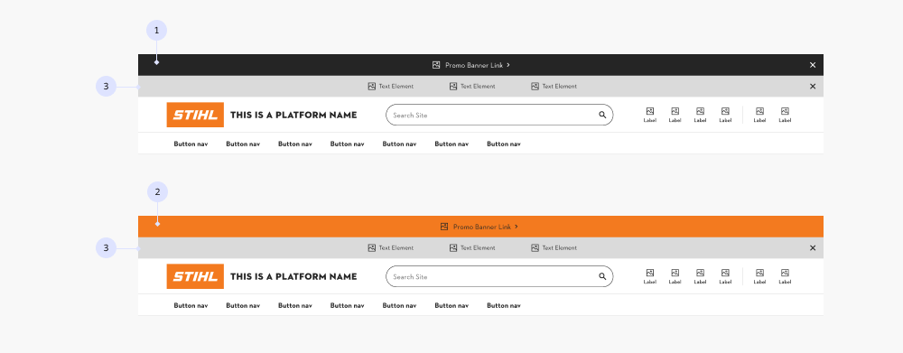

_Figure: Two page headers, each with two banners stacked above the top bar (STIHL logo, "This is a Platform name", "Search Site") and nav bar ("Button nav"). The first has the dark Default banner "Promo Banner Link" (callout 1) and the second has the orange Highlight banner (callout 2); in both a light grey Secondary banner with three "Text Element" items (callout 3) sits below it._

#### Combinations

Do not combine the Default and Highlight variants.

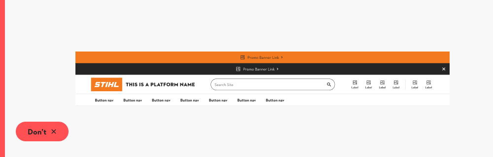

_Figure: Don't: an orange Highlight banner and a dark Default banner, both with "Promo Banner Link", are stacked above the top bar and nav bar. This is wrong because the Default and Highlight variants must not be combined._

#### Actions and hierachy

Avoid including multiple actions per banner. Focus on a single, clear call to action.

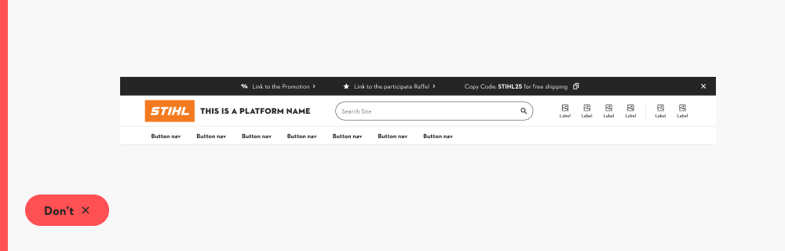

_Figure: Don't: a single dark banner above the top bar contains three links, "Link to the Promotion", "Link to the participate Raffel" and "Copy Code: STIHL25 for free shipping" with a copy icon, plus a close button. This is wrong because a banner should offer one clear call to action, not multiple actions._

### Pattern

In the Figma component, we provide two **commonly used content patterns for banners: Promotion and USPs.**

#### Promo

As the name suggests, this template is designed for promotions, campaigns, or events. It includes:

An **icon (1),** paired with a **link component (2)** that directs users to the promotional content.

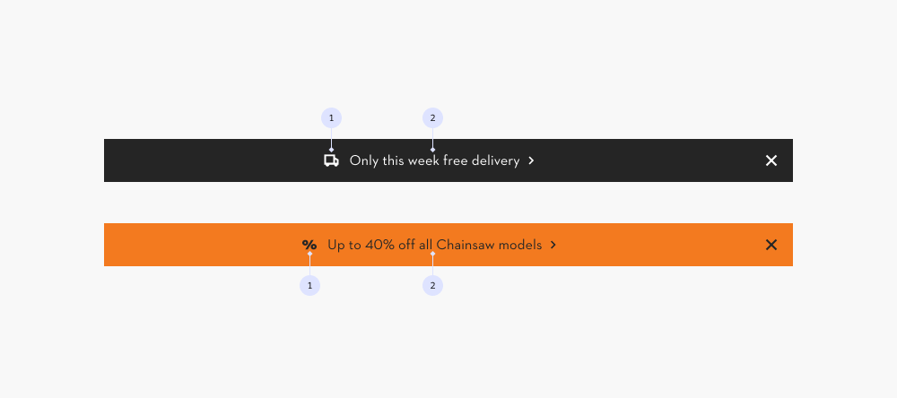

_Figure: Two promo banners, a dark one reading "Only this week free delivery" with a delivery truck icon and an orange one reading "Up to 40% off all Chainsaw models" with a percent icon, each with a chevron and close button. In both, callout 1 points at the icon and callout 2 points at the link text._

#### USPs

The USP (Unique Selling Proposition) pattern uses the Secondary banner variant. It can contain **up to three text elements with icons** to visually support the content.

This pattern is most often used to communicate USPs or other non-essential or supporting information.

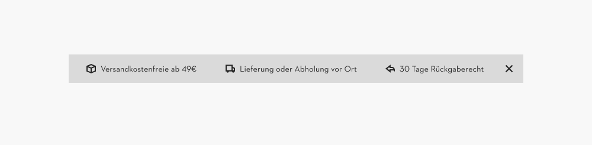

_Figure: Secondary banner on a grey background used as a USP bar, with three icon plus text elements side by side, "Versandkostenfreie ab 49€" (box icon), "Lieferung oder Abholung vor Ort" (truck icon) and "30 Tage Rückgaberecht" (return arrow icon), and a close button at the right end._

#### Status

Don’t display status messages (e.g. success, error, or warning) in the Promotion Banner. Use the Notification component instead, as it is already optimized with the correct ARIA roles and is properly interpreted by assistive technologies.

> **Note:** An optimized Information variant for specific use cases with documentation will be added in the future.

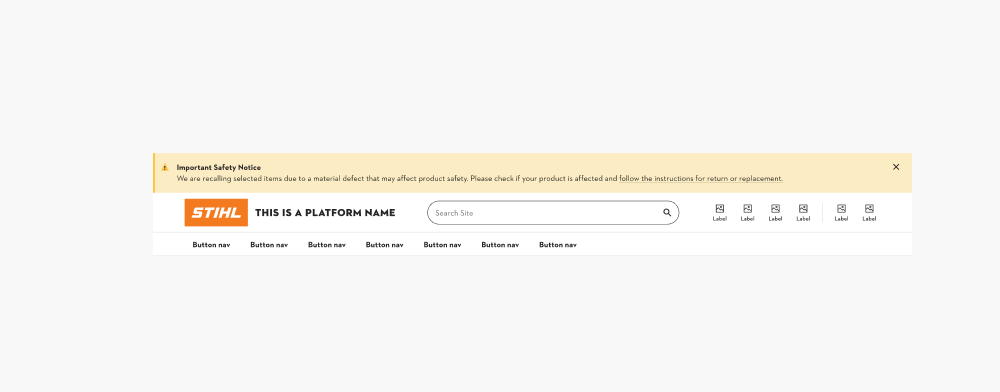

_Figure: Header on a desktop viewport (xl) with a yellow warning Notification above the top bar and nav bar, titled "Important Safety Notice" with a text and link about a product recall and a close button, shown instead of a promotional banner. The top bar has the STIHL logo, "This is a Platform name", a "Search Site" field and icon buttons labelled "Label", and the nav bar has seven "Button nav" items._

## Behavior

### General

#### Dismissibility

**Banners should be dismissible** to reduce visual noise and allow users to focus on relevant content. This is especially important for temporary or repeating information like promotions.

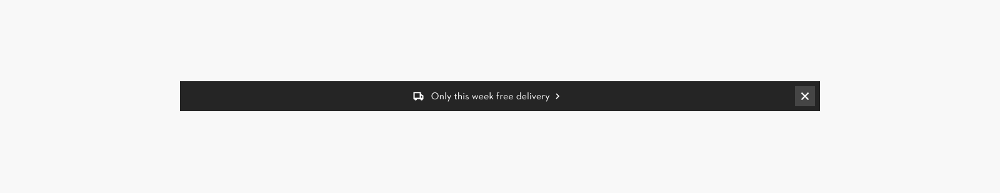

_Figure: Default promo banner on a dark background at viewport l, centered truck icon with the link "Only this week free delivery" and a chevron, and a close button at the right end that makes the banner dismissible._

#### Focus order

In a promo banner, the focus order should **start with the first interactive element in the banner (1) followed by the next interactive element (2) in this case the close button**. The text itself is not focusable but must be accessible to screen readers.

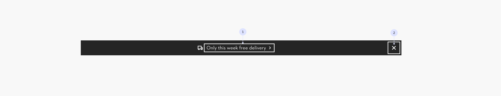

_Figure: Default promo banner with the focus order marked by two numbered callouts. Callout 1 points at the link "Only this week free delivery", the first focusable element, and callout 2 points at the close button at the right end, the second focusable element; both show a focus outline._

#### Status

If a **Notification is used in the banner area to display a status message**, no Promotional Banner should be shown at the same time. This ensures clarity and avoids competing messages.

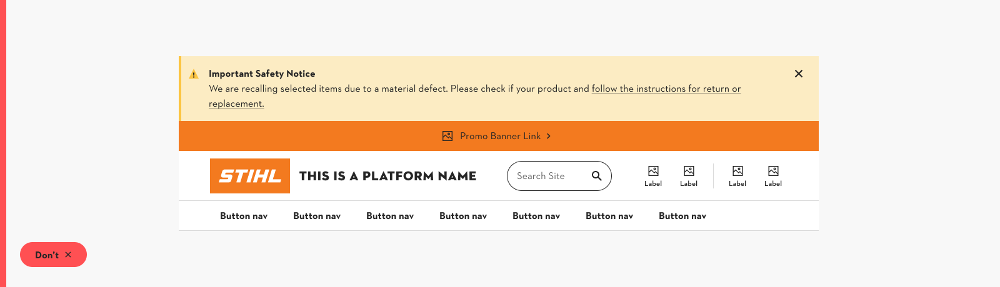

_Figure: Don't example: a yellow warning Notification ("Important Safety Notice" with a recall text and link) is displayed directly above an orange highlight promo banner ("Promo Banner Link") and the top bar and nav bar at viewport l. A Notification used for a status message must not appear together with a promotional banner because the two compete for attention._

### Viewport behavior

#### Primary or Highlight banner

When a Default or Highlight banner is used alone, it remains visible across all viewports.

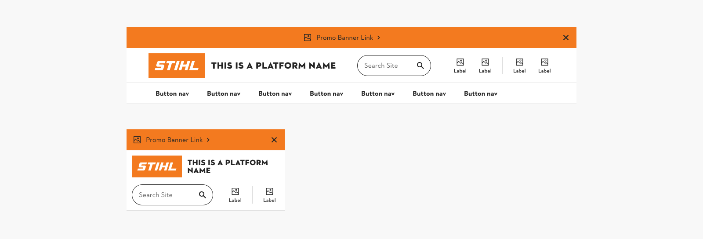

_Figure: Orange highlight promo banner ("Promo Banner Link" with a close button) shown above the top bar and nav bar on viewport l, and below it the same banner above the top bar on viewport s, showing that a banner used alone stays visible on both viewports._

#### Secondary Banner

When using the secondary banner alone or in combination with another banner:

1. The Default/Highlight banner stays **visible on all viewports**.
1. The Secondary banner is **hidden on small viewports (S)** to optimize space.

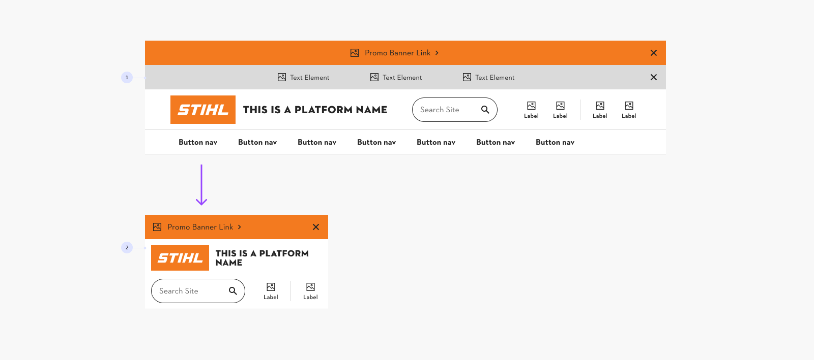

_Figure: Orange highlight banner with a grey secondary banner below it (three "Text Element" items with icons and a close button) above the top bar and nav bar on viewport l, marked with callout 1. An arrow leads to viewport s, marked with callout 2, where only the orange highlight banner remains above the top bar and the secondary banner is hidden._

### Scroll behavior

1. **Default (Start)** On initial loading of the page the banner is visible.
1. **Start scrolling down** The banner is hidden and only the top bar is visible.
1. **Start scrolling back up** The banner stays hidden and only the top bar and nav bar are visible.
1. **Back to top** Only when reaching the top of the page the banner is shown again.

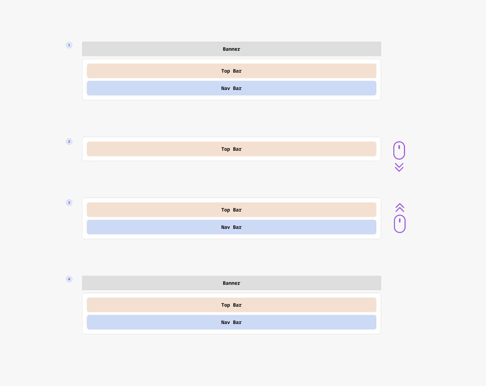

_Figure: Four numbered states of a page header during scrolling. 1: "Banner", "Top Bar" and "Nav Bar" all visible. 2 (after scrolling down, mouse icon with a double down chevron): only "Top Bar". 3 (after scrolling up, mouse icon with a double up chevron): "Top Bar" and "Nav Bar" without the banner. 4 (back at the top): "Banner", "Top Bar" and "Nav Bar" visible again._

## Usage Guidelines

### Functionality & Priority

Components are chosen based on their level of urgency:

1. **Dialog** Highest urgency. Requires explicit user action before continuing. → [See Dialog](https://www.figma.com/design/JNhJDymoWR1o9rQIZ5nhYU?node-id=14115-4051)

1. **Notification / Toast** Draws attention but does not block usage. Useful for immediate or transient feedback. → [See Notification](https://www.figma.com/design/JNhJDymoWR1o9rQIZ5nhYU?node-id=7251-8) → [See Toast](https://www.figma.com/design/JNhJDymoWR1o9rQIZ5nhYU?node-id=8844-4923)

1. **Banner** Persistent but non-blocking. Ideal for supporting information, promotions, or optional actions. → [See Banner](https://www.figma.com/design/Ie2r0R9QwjEc7O3nrFbXhV/Web-Pattern-Library?node-id=7171-9055)

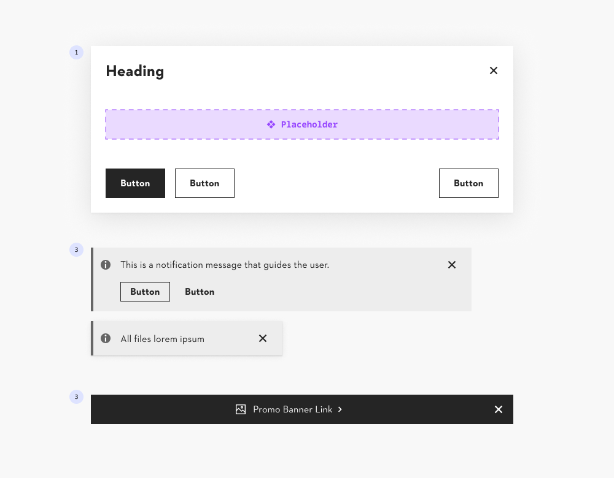

_Figure: Shows annotation-circle (number=1, type=center, color=blue); header-dialog (heading, close button, viewport=desktop); footer-dialog (first button, second button, third button, viewport=desktop, direction=horizontal, primary position=left); annotation-circle (number=3, type=center, color=blue); notification (custom action area=\[object Object\], custom action area, children=\[object Object\], close button, type=info, icon=True); toast (text=All files lorem ipsum, icon, type=info); banner (variant=default, viewport=m, content=promo, close-button=true). Callouts 1, 3. Text in the figure: "Heading", "❖ Placeholder", "Button", "This is a notification message that guides the user.", "All files lorem ipsum", "Promo Banner Link"._

### Use Cases

#### System / Mandatory

- **System feedback (success, error)** → Notification / Toast
- **Cookies / Privacy notices** → Banner (if navigation can continue without consent) → Dialog (if explicit consent is required before continuing)
- **Urgent notifications (downtime, outages, maintenance)** → Notification (when only informing) → Dialog (when user actions are blocked)
- **Critical announcements (recalls, legal or policy changes)** → Notification (when only informing) → Dialog (when user actions are blocked)

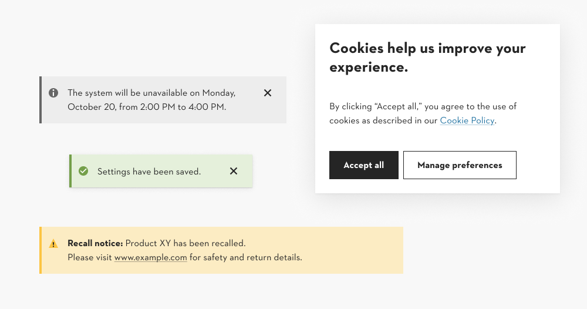

_Figure: Shows header-dialog (heading, viewport=desktop); content-placeholder (type=text, format=none); footer-dialog (first button, third button, viewport=desktop, direction=horizontal, primary position=left); notification (custom action area=\[object Object\], children=\[object Object\], close button, type=info, icon=True); toast (text=Settings have been saved., icon, type=success); notification (custom action area=\[object Object\], children=\[object Object\], type=warning, icon=True). Text in the figure: "Cookies help us improve your experience.", "By clicking “Accept all,” you agree to the use of cookies as described in our...", "Accept all", "Manage preferences", "The system will be unavailable on Monday, October 20, from 2:00 PM to 4:00 PM.", "Settings have been saved.", "Recall notice: Product XY has been recalled. Please visit www.example.com for..."._

#### Marketing / Engagement

- **Sales & promotions** → Banner
- **Seasonal campaigns** → Banner
- **USPs / Value propositions** → Banner (for general positioning) → Notification (when contextually relevant, e.g., delivery info next to cart price)
- **Newsletter sign-up / Loyalty programs / Referrals** → Banner

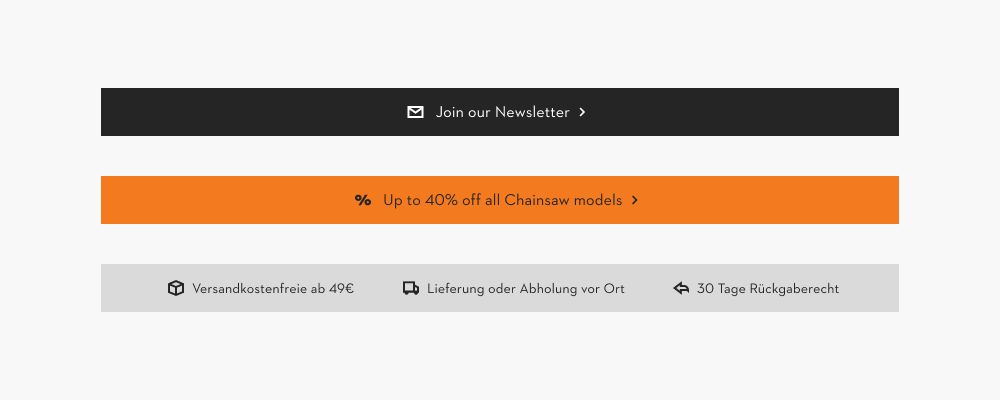

_Figure: Shows banner (variant=default, viewport=m, content=promo, close-button=false); banner (variant=highlight, viewport=m, content=promo, close-button=false). Text in the figure: "Join our Newsletter", "Up to 40% off all Chainsaw models", "Versandkostenfreie ab 49€", "Lieferung oder Abholung vor Ort", "30 Tage Rückgaberecht"._

#### Informational

- **Product / feature updates (non-critical)** → Banner
- **Tips, nudges, reminders** → Banner

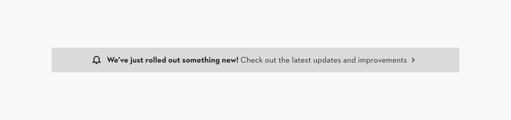

_Figure: Shows banner (variant=secondary, viewport=m, content=promo, close-button=false). Text in the figure: "We’ve just rolled out something new! Check out the latest updates and improve..."._

## Examples

> The use case examples shown feature the new navigation concept and do not reflect the current state of the product.

**E-Shop**

Banner focused on promotions, campaigns and USPs

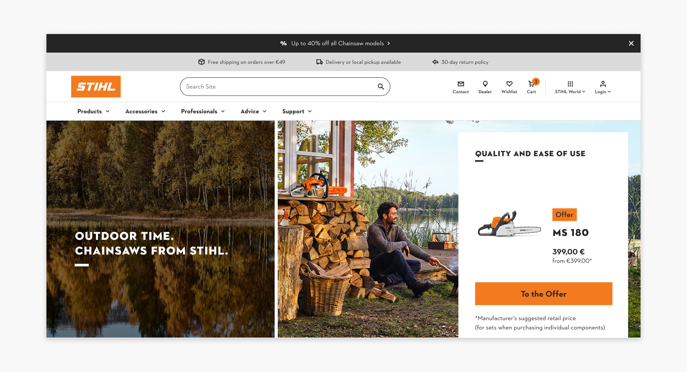

_Figure: E-shop page at breakpoint xl showing banners above the navigation: a dark default promo banner "Up to 40% off all Chainsaw models" with a close button, then a grey secondary USP banner with "Free shipping on orders over €49", "Delivery or local pickup available" and "30-day return policy". Below are the top-bar (STIHL logo, "Search Site" field, Contact, Dealer, Wishlist, Cart with badge "3", STIHL World, Login) and nav-bar (Products, Accessories, Professionals, Advice, Support), followed by a hero with the headline "OUTDOOR TIME. CHAINSAWS FROM STIHL." and a product teaser card "QUALITY AND EASE OF USE" with an "Offer" flag, "MS 180", "399,00 €", "from €399.00\*" and a highlight button "To the Offer"._
