# Banner

## Banner

- Used to highlight marketing content such as promotions, campaigns, events, or key service messages
- Designed to draw attention without interrupting the user experience
- Intended for temporary, non-critical information
- Not used for system status updates or warnings (use notifications for that purpose)
- Helps engage users with timely and relevant content

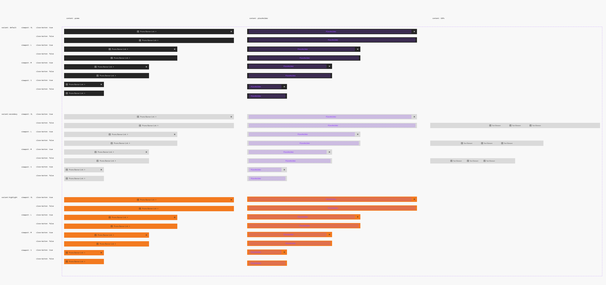

### Further guidelines

[Storybook documentation](https://main--63440bbb95889041542a5ba3.chromatic.com/?path=/docs/components-notification--documentation&globals=backgrounds.name:!undefined;backgrounds.value:!undefined)

[Decision tree](https://www.figma.com/design/qXldpLO6gxHJNLdcXIPxYt?node-id=26738-47603)

### Related elements

[Navigation](https://www.figma.com/design/Ie2r0R9QwjEc7O3nrFbXhV?node-id=5381-18)

Top bar

[Notification](https://www.figma.com/design/qXldpLO6gxHJNLdcXIPxYt/Core-Components-%F0%9F%92%A0?node-id=7251-8)

[Link](https://www.figma.com/design/qXldpLO6gxHJNLdcXIPxYt/Core-Components-%F0%9F%92%A0?node-id=26711-8034)

[Button](https://www.figma.com/design/qXldpLO6gxHJNLdcXIPxYt/Core-Components-%F0%9F%92%A0?node-id=162-126)

[Iconography](https://www.figma.com/design/U218NNP4OsipaHOtv5flns/Iconography-%E2%9E%A1%EF%B8%8F?m=auto)

### Contribute

Contribute to improving this component by sharing your feedback, asking questions, or suggesting features [here](https://www.figma.com/design/lLmw7PfIdKjFG4uT3B2Hyj/Onboarding-%F0%9F%93%96?node-id=446-868&t=zKmRu4kAkxMeRDmK-4).

## Formatting and Construction

### Anatomy

#### Elements

The Promo Banner consists of two main parts:

1. **Container:** Holds content such as text, links, or buttons.
1. **Close Button (optional):** Allows users to dismiss the banner.

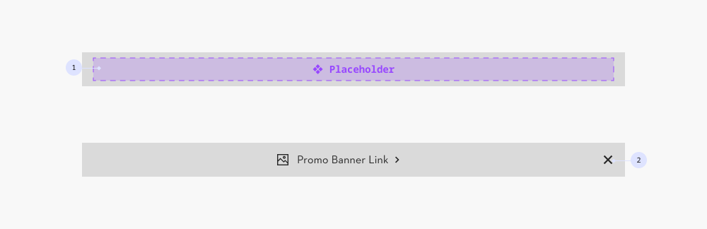

#### Variants

There are three main variants:

1. **Default:** Primary variant for general use.
1. **Secondary:** Less prominent; suitable when used alongside another banner.
1. **Highlight:** Most attention-grabbing; use sparingly for critical messages.

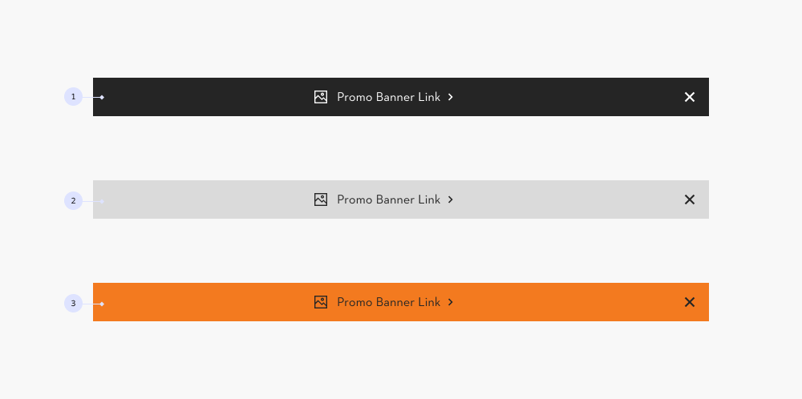

### Alignment & Placement

The Promo Banner is positioned **above the top bar** and spans the **full width of the viewport**.

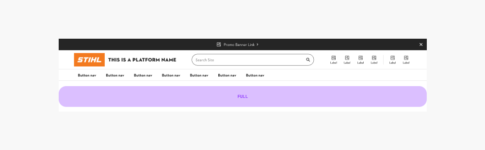

#### Content Alignment

On **viewports XL, L, M, content is centered (1)** within the banner. **On viewport S, it is left-aligned (2)** to make better use of available space.

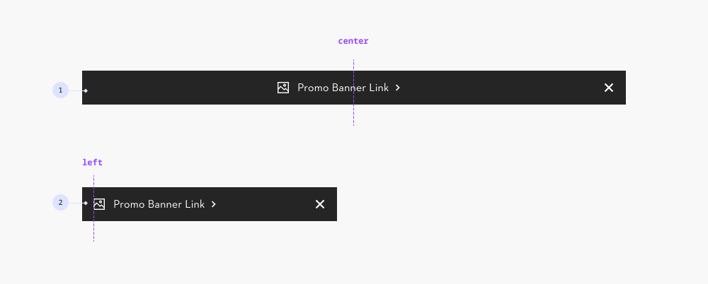

### Sizing

#### Height

The banner has a **maximum height of 48px on XL, L, and M viewports (1)**. On **viewport S**, height adjusts **dynamically based on the content (2)**. More information about max. character count and max lines can be found in content documentation.

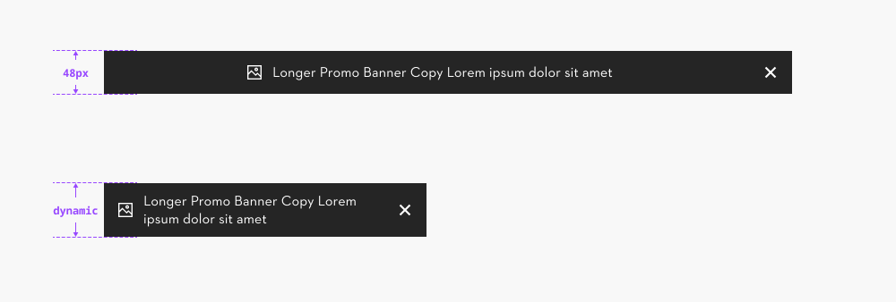

## Content and Assets

### Maximum Character

The maximum character count should not exceed **65 characters**. Depending on the amount of elements and combination of icons this value might vary.

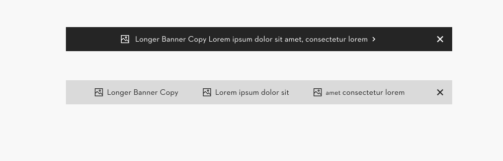

### Overflow

1. On **XL, L, and M viewports**, banner content remains on a **single line (no overflow)**.
1. On **S viewports, overflow is allowed** and the banner will expand in height, but is limited to a **maximum of two lines of text**.

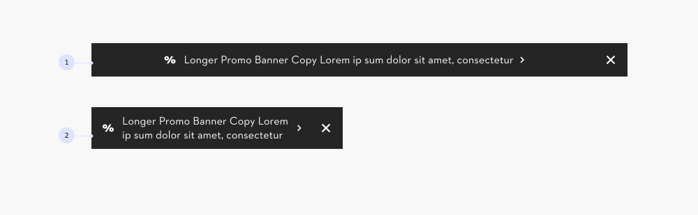

### Pairing

A **maximum of two banners** can be displayed at the same time:

**1x Default (1) or Highlight Banner (2)** Used to present key information with an action or link (e.g. a promotion or campaign).

**1x Secondary Banner (3)** Used for supporting or general information (e.g. USPs or delivery conditions).

> **Important:** Banners can increase cognitive load for users. Use them sparingly and only when necessary.

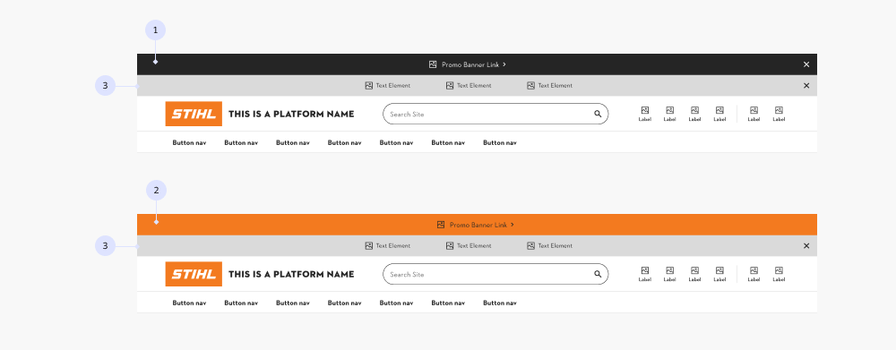

#### Combinations

Do not combine the Default and Highlight variants.

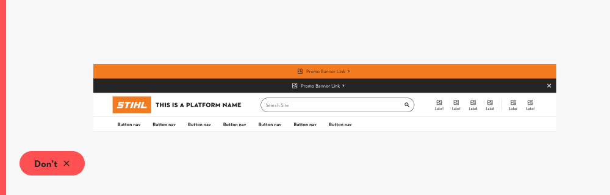

#### Actions and hierachy

Avoid including multiple actions per banner. Focus on a single, clear call to action.

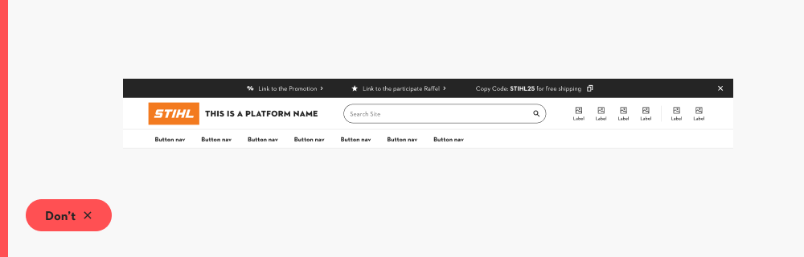

### Pattern

In the Figma component, we provide two **commonly used content patterns for banners: Promotion and USPs.**

#### Promo

As the name suggests, this template is designed for promotions, campaigns, or events. It includes:

An **icon (1),** paired with a **link component (2)** that directs users to the promotional content.

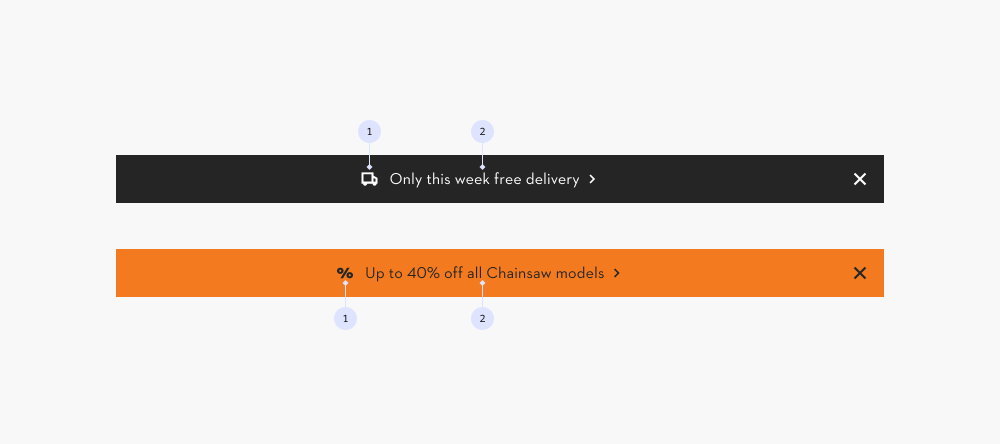

#### USPs

The USP (Unique Selling Proposition) pattern uses the Secondary banner variant. It can contain **up to three text elements with icons** to visually support the content.

This pattern is most often used to communicate USPs or other non-essential or supporting information.

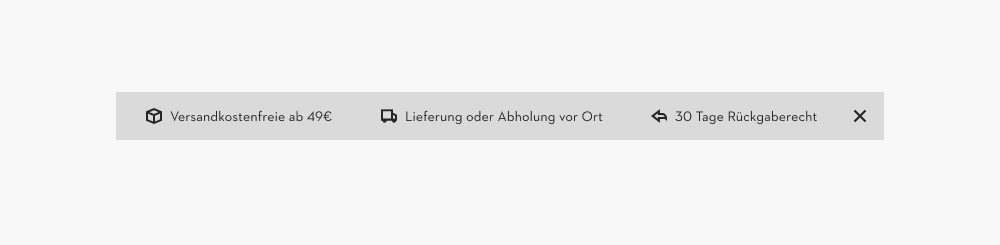

#### Status

Don’t display status messages (e.g. success, error, or warning) in the Promotion Banner. Use the Notification component instead, as it is already optimized with the correct ARIA roles and is properly interpreted by assistive technologies.

> **Note:** An optimized Information variant for specific use cases with documentation will be added in the future.

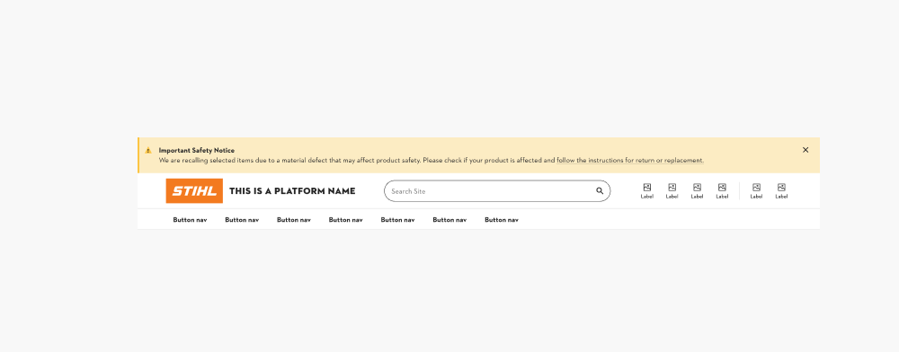

## Behavior

### General

#### Dismissibility

**Banners should be dismissible** to reduce visual noise and allow users to focus on relevant content. This is especially important for temporary or repeating information like promotions.

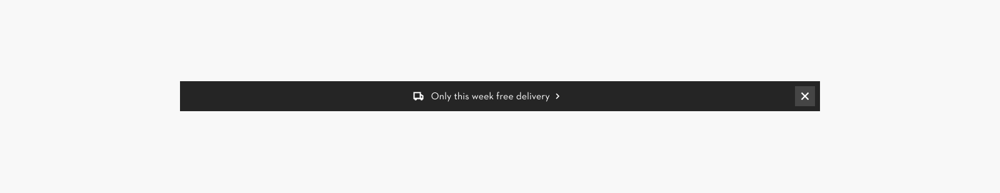

#### Focus order

In a promo banner, the focus order should **start with the first interactive element in the banner (1) followed by the next interactive element (2) in this case the close button**. The text itself is not focusable but must be accessible to screen readers.

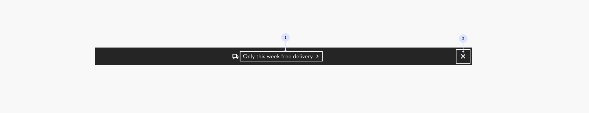

#### Status

If a **Notification is used in the banner area to display a status message**, no Promotional Banner should be shown at the same time. This ensures clarity and avoids competing messages.

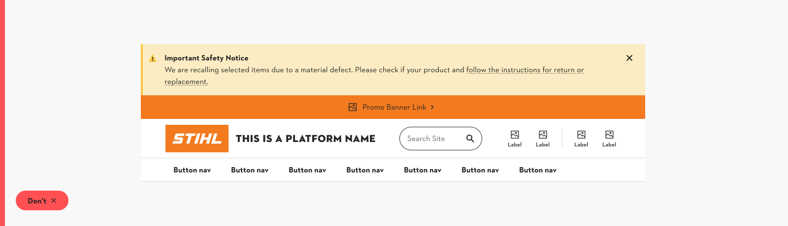

### Viewport behavior

#### Primary or Highlight banner

When a Default or Highlight banner is used alone, it remains visible across all viewports.

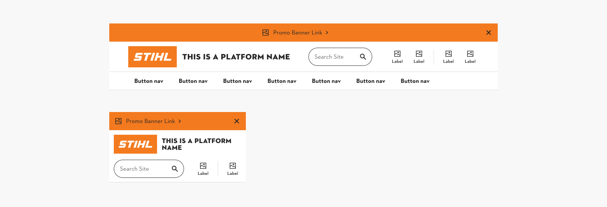

#### Secondary Banner

When using the secondary banner alone or in combination with another banner:

1. The Default/Highlight banner stays **visible on all viewports**.
1. The Secondary banner is **hidden on small viewports (S)** to optimize space.

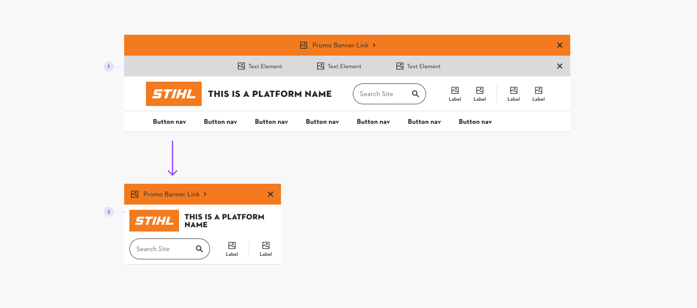

### Scroll behavior

1. **Default (Start)** On initial loading of the page the banner is visible.
1. **Start scrolling down** The banner is hidden and only the top bar is visible.
1. **Start scrolling back up** The banner stays hidden and only the top bar and nav bar are visible.
1. **Back to top** Only when reaching the top of the page the banner is shown again.

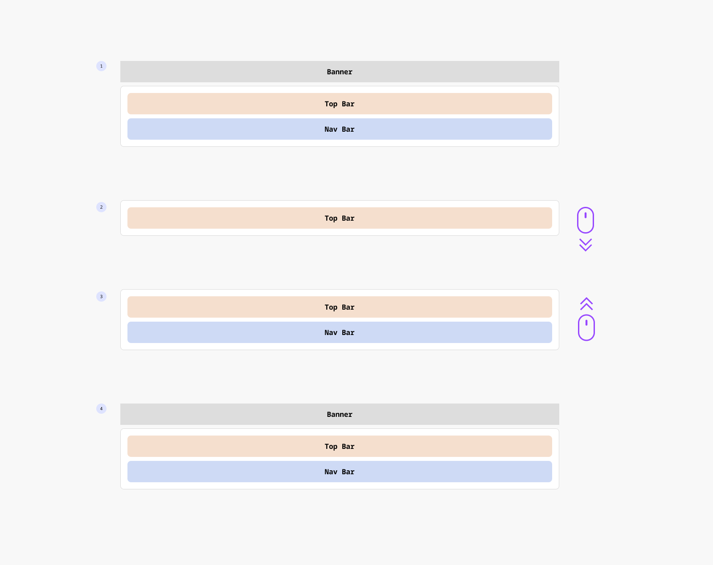

## Usage Guidelines

### Functionality & Priority

Components are chosen based on their level of urgency:

1. **Dialog** Highest urgency. Requires explicit user action before continuing. → [See Dialog](https://www.figma.com/design/JNhJDymoWR1o9rQIZ5nhYU?node-id=14115-4051)

1. **Notification / Toast** Draws attention but does not block usage. Useful for immediate or transient feedback. → [See Notification](https://www.figma.com/design/JNhJDymoWR1o9rQIZ5nhYU?node-id=7251-8) → [See Toast](https://www.figma.com/design/JNhJDymoWR1o9rQIZ5nhYU?node-id=8844-4923)

1. **Banner** Persistent but non-blocking. Ideal for supporting information, promotions, or optional actions. → [See Banner](https://www.figma.com/design/Ie2r0R9QwjEc7O3nrFbXhV/Web-Pattern-Library?node-id=7171-9055)

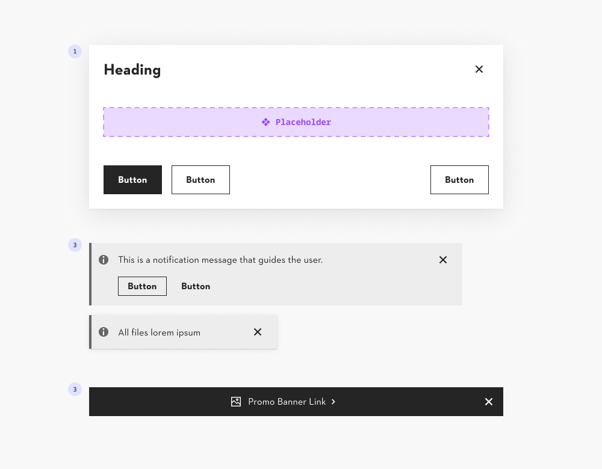

### Use Cases

#### System / Mandatory

- **System feedback (success, error)** → Notification / Toast
- **Cookies / Privacy notices** → Banner (if navigation can continue without consent) → Dialog (if explicit consent is required before continuing)
- **Urgent notifications (downtime, outages, maintenance)** → Notification (when only informing) → Dialog (when user actions are blocked)
- **Critical announcements (recalls, legal or policy changes)** → Notification (when only informing) → Dialog (when user actions are blocked)

#### Marketing / Engagement

- **Sales & promotions** → Banner
- **Seasonal campaigns** → Banner
- **USPs / Value propositions** → Banner (for general positioning) → Notification (when contextually relevant, e.g., delivery info next to cart price)
- **Newsletter sign-up / Loyalty programs / Referrals** → Banner

#### Informational

- **Product / feature updates (non-critical)** → Banner
- **Tips, nudges, reminders** → Banner

## Examples

> The use case examples shown feature the new navigation concept and do not reflect the current state of the product.

**E-Shop**

Banner focused on promotions, campaigns and USPs

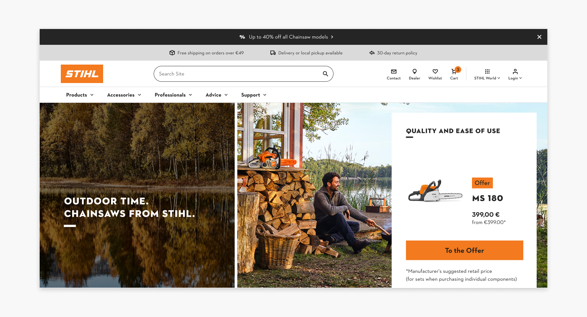
