# Fieldset

## Fieldset

Overview:

- Use to group related form elements, to provide visual and semantic grouping cues.
- Do not mix ‘size small’ and ‘size medium’ input fields in fieldset.
- It is possible to nest field sets, if the content thematically fit together.

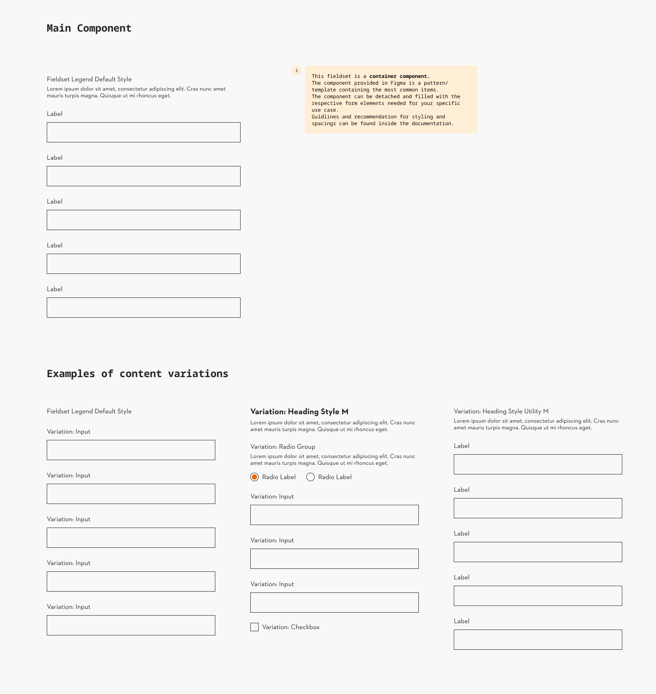

_Figure: Top: the main fieldset component with the legend "Fieldset Legend Default Style", a description and five stacked inputs each with the label "Label", next to callout 1 stating that the fieldset is a container component, a pattern/template of the most common items that can be detached and filled with the form elements needed, with styling and spacing guidelines in the documentation. Bottom, "Examples of content variations": three fieldsets, one with five "Variation: Input" fields, one with Heading Style M legend containing a "Variation: Radio Group" with two "Radio Label" options (first checked), three inputs and a "Variation: Checkbox", and one with legend "Variation: Heading Style Utility M" and five labeled inputs._

### Further guidelines

[Storybook documentation](https://main--63440bbb95889041542a5ba3.chromatic.com/?path=/docs/components-fieldset--documentation)

### Related elements

[Input](https://www.figma.com/design/qXldpLO6gxHJNLdcXIPxYt/Core-Components-%F0%9F%92%A0?node-id=1591-2)

[Radio Button](https://www.figma.com/design/qXldpLO6gxHJNLdcXIPxYt?node-id=860-2728)

[Switch](https://www.figma.com/design/qXldpLO6gxHJNLdcXIPxYt?node-id=513-2)

### Contribute

Contribute to improving this component by sharing your feedback, asking questions, or suggesting features [here](https://www.figma.com/design/lLmw7PfIdKjFG4uT3B2Hyj/Onboarding-%F0%9F%93%96?node-id=446-868&t=zKmRu4kAkxMeRDmK-4).

## Formatting and Construction

### Anatomy

The field set is a container that can contain elements, together they become a form

**Fixed elements**

1. **Legend** Describes the field set or its purpose
1. **Info Button (optional)** Can be used to trigger a popover with additional information
1. **Description** Provides guidance or further context or clarity for the following form elements
1. **System feedback** Error message
1. **Form element group** Group of different form elements that can be used (highlighted in purple)

Common components used in a fields can be:

[Radio group →](https://www.figma.com/design/qXldpLO6gxHJNLdcXIPxYt?node-id=860-2728)

[Input text →](https://www.figma.com/design/qXldpLO6gxHJNLdcXIPxYt?node-id=1744-7211)

[Single checkbox →](https://www.figma.com/design/qXldpLO6gxHJNLdcXIPxYt?node-id=3354-3357)

[Checkbox group →](https://www.figma.com/design/qXldpLO6gxHJNLdcXIPxYt?node-id=5626-11361)

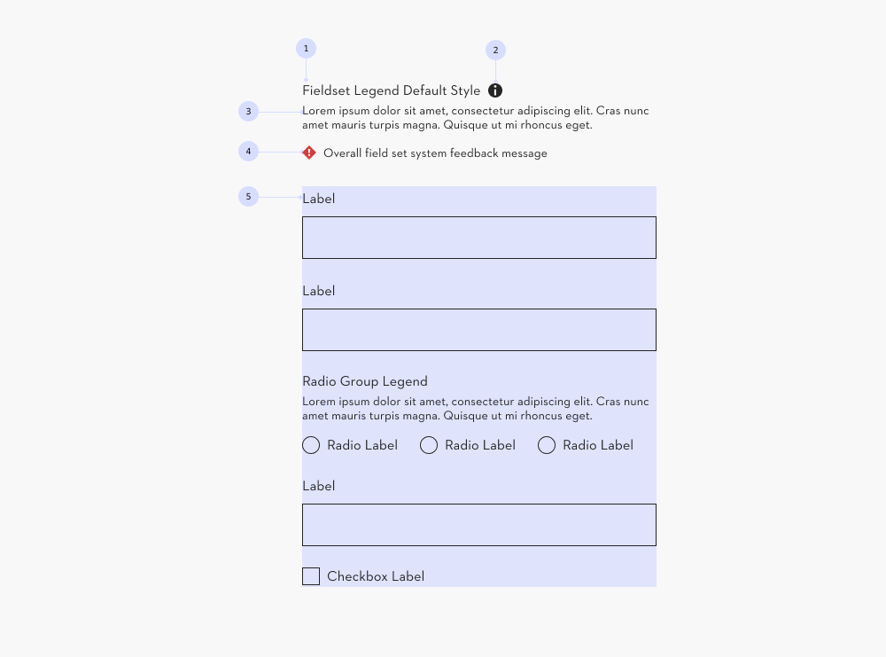

_Figure: Fieldset anatomy with five numbered callouts: 1 points at the legend "Fieldset Legend Default Style", 2 at the optional info button right of the legend, 3 at the description text, 4 at the system feedback error message "Overall field set system feedback message" with an error icon, and 5 at the form element group highlighted in purple, containing two labeled inputs, a "Radio Group Legend" with three "Radio Label" options, another labeled input and a "Checkbox Label"._

### Legend styling

#### Default vs. heading style

The field set legend can be styled customary:

1. **By default** it uses Utility M – the same styling as for other Labels.
1. To create more hierarchy the legend can also use the **heading styles S, M, L & XL.**

**If used with header styles, the spacing between legend and hint needs to be adjusted from 2px to 6px**

[Text styles →](https://www.figma.com/design/qXldpLO6gxHJNLdcXIPxYt?node-id=2-23)

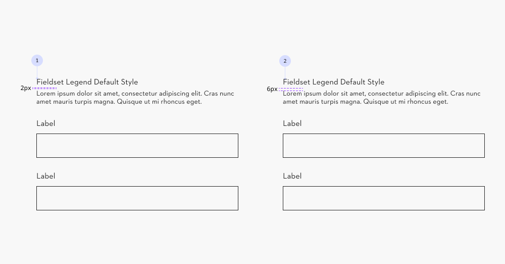

_Figure: Two fieldsets side by side, each with legend "Fieldset Legend Default Style", a description and two labeled inputs. Callout 1 (left, default Utility M legend) marks a 2px gap between legend and description; callout 2 (right, used with heading styles) marks the increased 6px gap._

### Spacing recommendations

#### Adjusted spacing depending on content

**Complex field sets profit from wider spacing** to clarify structure and clearer visual hierarchy.

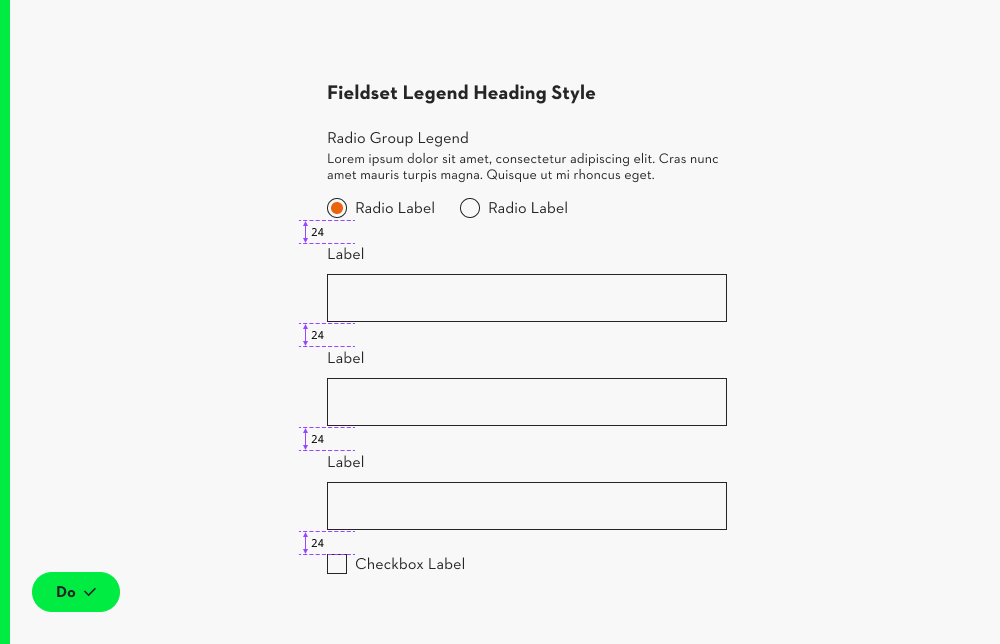

_Figure: Do example: a complex fieldset with legend "Fieldset Legend Heading Style", a "Radio Group Legend" with two "Radio Label" options (first checked), three labeled inputs and a "Checkbox Label", with wider vertical spacing of 24 between each element group, which is right because complex fieldsets need wider spacing for clear structure and hierarchy._

#### Do not use compact spacing in complex field sets.

Use the checkbox group component, due to the optimized compact spacing.

The checkbox group is a variation of the field set.

[Checkbox group →](https://www.figma.com/design/qXldpLO6gxHJNLdcXIPxYt?node-id=5626-11361)

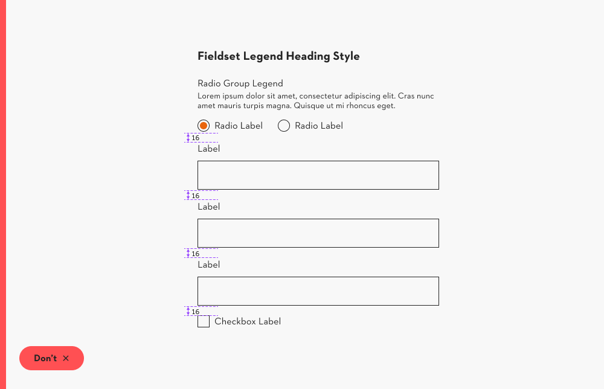

_Figure: Don't example: the same complex fieldset (legend "Fieldset Legend Heading Style", radio group, three labeled inputs, "Checkbox Label") with compact vertical spacing of 16 between elements, which is wrong because complex fieldsets should not use compact spacing; the checkbox group component has optimized compact spacing for that case._

#### Combination of input fields

Do not mix ‘size small’ and ‘size medium’ input fields in one fieldset in the same viewport.

Note: It is okay to mix sizes in different steps, in e.g. a wizard, as long as they’re not in the same step.

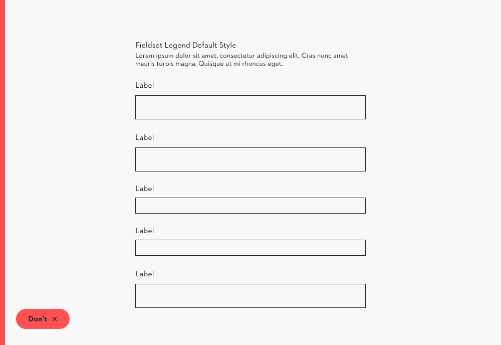

_Figure: Don't example: a fieldset with legend "Fieldset Legend Default Style", a description and five labeled inputs where the first two and the last are medium size and the third and fourth are visibly smaller, which is wrong because small and medium input sizes must not be mixed in one fieldset in the same viewport._

### Sizing

#### Maximum width

The width of the fieldset is determined by the container it is placed in. This should ideally be the “[content area narrow](https://www.figma.com/design/HHM9B6UjMStGLxMf6loNLn/DS-945-Grid-Optimisations-%7C-Design?node-id=1-857&t=FFOFP94g90gl91Ko-4)” defined within the grid layout.

While the input can adjust to fit its container, we recommend not exceeding a maximum width of 544px, matching the [maximum text width](https://www.figma.com/design/JyyYtoCYbtJrzqHs38OXSQ/Grid-%26-Spacing-%F0%9F%A7%AE?node-id=1-132), for better scanability and readability. This max width calculated by multiplying the font size with 34. For our default copy styling Text M (16px) that defines a max. width of 544px (16px\*34= 544px).

In the Figma component, the maximum width is set to the recommended 544px. ([Link to calculation](https://www.figma.com/design/JyyYtoCYbtJrzqHs38OXSQ/Grid-%26-Spacing-%F0%9F%A7%AE?m=auto&node-id=1-857&t=p2GU3oXS9Ao4MbV0-1))

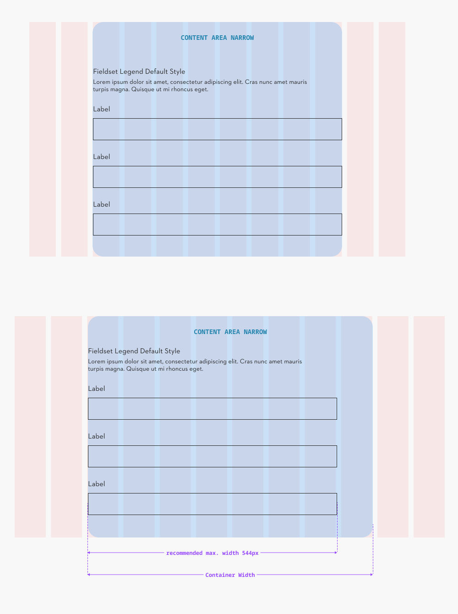

_Figure: Two layouts of a fieldset (legend "Fieldset Legend Default Style", description, three labeled inputs) placed in the "CONTENT AREA NARROW" of a column grid. In the upper one the inputs fill the container width; in the lower one the container is wider, the inputs stop at the "recommended max. width 544px", and the dimension line "Container Width" spans the full content area._

#### Maximum width of text container

To ensure good readability the maximum width of the legend text container and description text container should not exceed 476px (14px\*34 calculation based on the font size).

[Text width for body text→](https://www.figma.com/design/qXldpLO6gxHJNLdcXIPxYt?node-id=1445-5050)

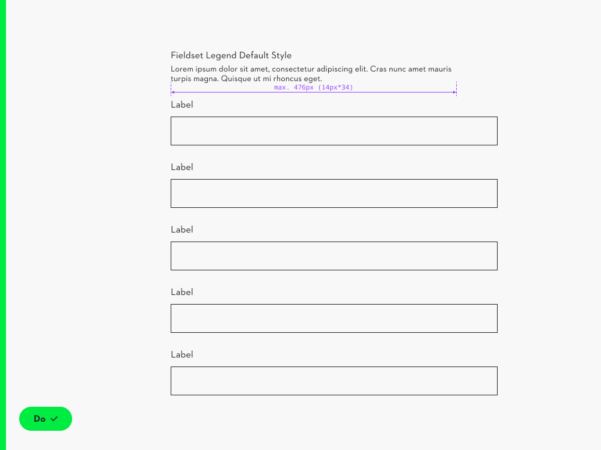

_Figure: Do example: a fieldset with the legend "Fieldset Legend Default Style" and a two-line description above five stacked inputs, each with a "Label". The legend and description text container is measured as "max. 476px (14px\*34)" wide and is narrower than the inputs below it._

Do not exceed 476px, even when the module or grid is wider.

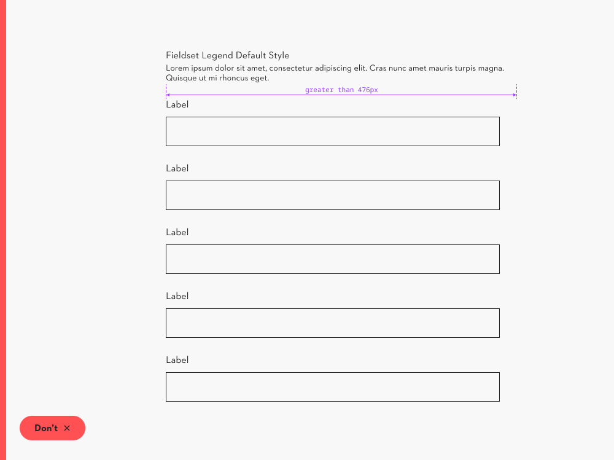

_Figure: Don't example: the same fieldset with the legend "Fieldset Legend Default Style", a description and five stacked inputs with "Label", but the description text container is stretched to the full width of the inputs and measured as "greater than 476px". This is wrong because the text container exceeds the 476px maximum, which hurts readability._

### Mobile behavior

Elements that are placed horizontally on desktop will be displayed vertically on mobile.

In both cases the elements are positioned within the narrow grid, that is optimized for legibility and short mouse paths.

[Content placement →](https://www.figma.com/design/qXldpLO6gxHJNLdcXIPxYt?node-id=1445-5050)

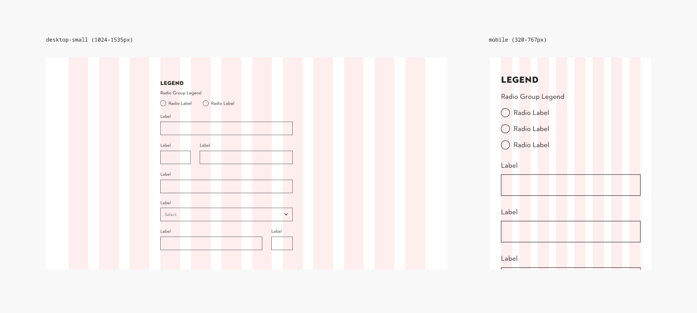

_Figure: Shows building-element-radio (label=Radio Label, label, type=label, state=enabled, checked=false, invalid=false); input (system feedback, hint=Lorem ipsum dolor sit amet, consectetur adipiscing elit. Cras nunc amet mauris turpis magna. Quisque ut mi rhoncus eget., label=Label, input, size=medium, state=enabled, invalid=false); input (system feedback, hint=Lorem ipsum dolor sit amet, consectetur adipiscing elit. Cras nunc amet mauris turpis magna. Quisque ut mi rhoncus eget., input=Input, label=Label, size=medium, state=enabled, invalid=false); building-element/select-field\_medium (Show Placeholder Text, Show System Feedback, state=default, Invalid=false); input (system feedback, hint=Lorem ipsum dolor sit amet, consectetur adipiscing elit. Cras nunc amet mauris turpis magna. Quisque ut mi rhoncus eget., label=Addition to address (optional), input, size=medium, state=enabled, invalid=false); input (system feedback, hint=Please enter the phone in the following format (e.g. +49013909023), hint, label=Phone Number (optional), input, size=medium, state=enabled, invalid=false); button (button text=Send From, variant=filled, state=enabled, size=medium, icon position=none, hide label=off, flush alignment=off). Text in the figure: "desktop-small (1024-1535px)", "mobile (320-767px)", "Legend", "Radio Group Legend", "Radio Label", "Label", "Select", "Addition to address (optional)", "Phone Number (optional)", "Please enter the phone in the following format (e.g. +49013909023)", "Send From"._

## Content and Assets

### Simple text

- Keep labels and hints short and simple.
- It is recommended to avoid abbreviations.
- Test the understandability of the copy in the form at all times.

_Figure: Example of simple text: an input with the label "Machine number" and the short hint "For example: MS 170" above an empty input field._

### Nesting fieldsets

It is possible to nest field sets, if the content thematically fit together. Though, it is recommended to separate fieldsets, in order to keep it simple and provide overview and structure.

Examples

1. Horizontally placed input fields
1. Radio/Checkbox group in a fieldset
1. Main fieldset, that spans all fields and fieldsets

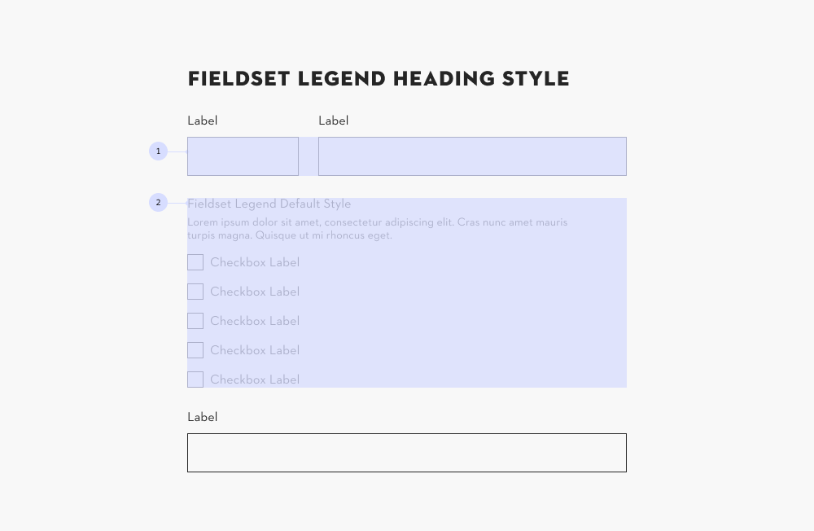

_Figure: Shows input (system feedback, hint=Lorem ipsum dolor sit amet, consectetur adipiscing elit. Cras nunc amet mauris turpis magna. Quisque ut mi rhoncus eget., input=Input, label=Label, size=medium, state=enabled, invalid=false); annotation-cirlce (line=on, position=right). Callouts 1, 2. Text in the figure: "Fieldset Legend Heading Style", "Label", "Fieldset Legend Default Style", "Lorem ipsum dolor sit amet, consectetur adipiscing elit. Cras nunc amet mauri...", "Checkbox Label"._

### Required indicator

The whole field set can be set to required. In order to communicate this an **asterisk (1)** is shown next to the legend. When using the code component the asterisk will be shown automatically when component is set to required.

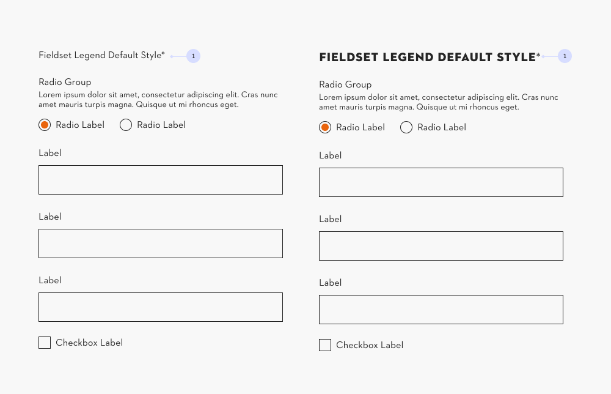

_Figure: Two fieldsets side by side, one with the legend "Fieldset Legend Default Style\*" in default style and one in heading style, each containing a "Radio Group" with a description and two "Radio Label" options (first selected), three inputs with "Label" and a "Checkbox Label". Callout 1 points at the asterisk shown next to each legend, marking the whole fieldset as required._

### Inline link in the description

A fieldset description can contain an inline link **(1)**, depending on the use-case with or without an icon. You can find more information on link styling:

[Inline Links→](https://www.figma.com/design/qXldpLO6gxHJNLdcXIPxYt?node-id=168-6140)

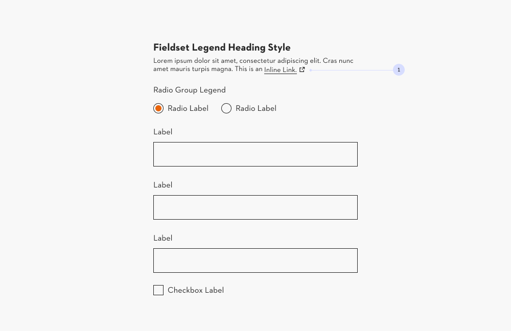

_Figure: A fieldset with the legend "Fieldset Legend Heading Style" and a description that ends with the text "This is an Inline Link." with an external-link icon. Callout 1 points at the inline link; below it are a "Radio Group Legend" with two "Radio Label" options (first selected), three inputs with "Label" and a "Checkbox Label"._

## Behavior

### Fieldset Validation

If a fieldset contains invalid inputs, System Feedback should be shown in two ways:

1. **Overall System Feedback** – a message displayed below the legend or description.
   - This message provides an overview that there are errors within the fieldset.
   - It represents the overall system feedback for the group.
   - There are two ways to display this message (see below).
1. **Input-specific System Feedback** – messages shown next to each invalid input, explaining the exact issue.

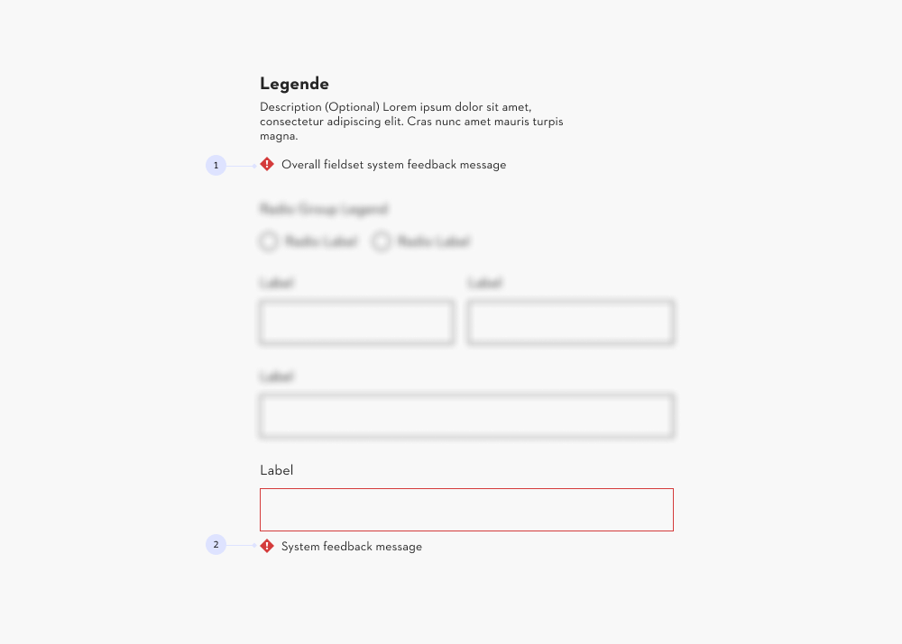

_Figure: A fieldset with the legend "Legende" and the description "Description (Optional)" containing invalid input; the other fields are blurred and one input with "Label" has a red border. Callout 1 points at the "Overall fieldset system feedback message" shown with an error icon below the description, and callout 2 points at the "System feedback message" shown below the invalid input._

#### Overall System Feedback Variations

Our Design System supports two types of Overall System Feedback:

1. **Inline Feedback** – a simple message displayed below the legend or description to indicate errors within a fieldset.
1. **Notification Error Summary** – a comprehensive summary displayed at the top of the form (inside a Notification component).
   - Summarises all validation messages across the fieldset
   - Includes anchor links that jump directly to the related input field and focus it.
   - Positioned above the form title

While both variations are supported, the **Notification Error Summary** is the preferred and more accessible option.

**Inline Feedback** provides limited context and can be more difficult for screen reader users to navigate.

> **Note:** The Notification Error Summary is not yet available as a design component but will be added soon. It is already available in code.

> Detailed validation patterns are not currently provided. Accessible form patterns will be introduced in a future update.

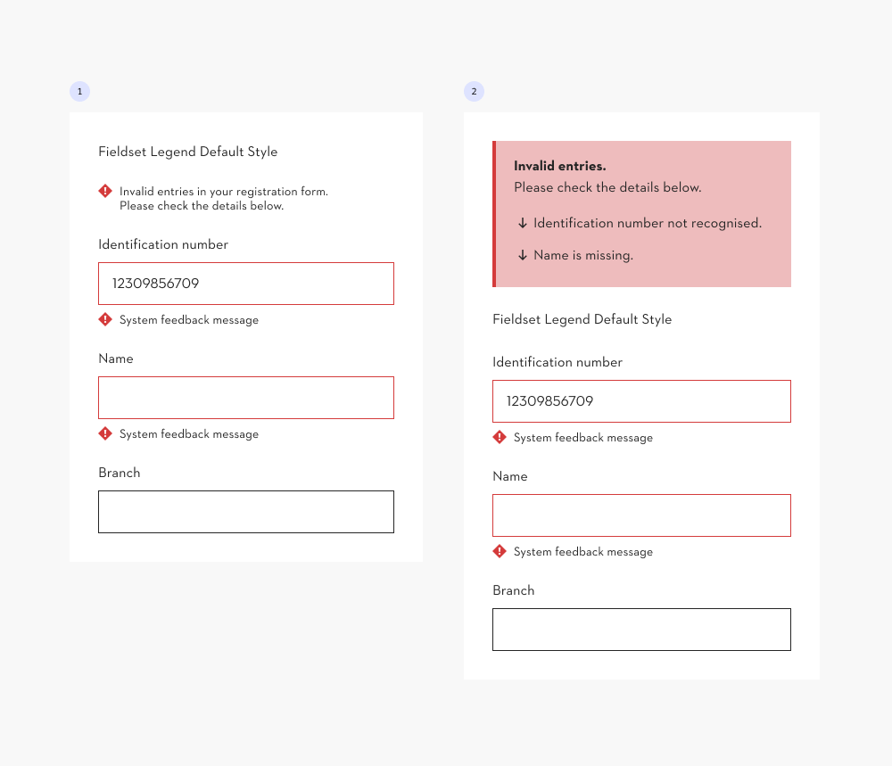

_Figure: Two variants of overall system feedback for a fieldset with the legend "Fieldset Legend Default Style" and the invalid inputs "Identification number" and "Name" (plus a valid "Branch" input), each with a "System feedback message". Callout 1 is the inline feedback "Invalid entries in your registration form. Please check the details below." below the legend; callout 2 is a Notification error summary above the fieldset with "Invalid entries. Please check the details below." and the links "Identification number not recognised." and "Name is missing."._

## Examples

### Checkout form

This is an example of four following field sets, in a checkout form.

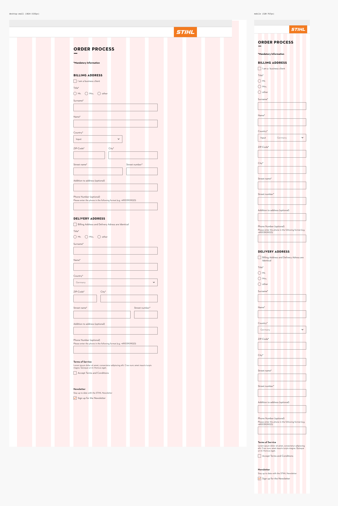

_Figure: Shows title (title text=Order Process, size=xl, viewport=desktop); building-element-radio (label=Mr., label, type=label, state=enabled, checked=false, invalid=false); building-element-radio (label=Mrs., label, type=label, state=enabled, checked=false, invalid=false); building-element-radio (label=other, label, type=label, state=enabled, checked=false, invalid=false); input (system feedback, hint=Lorem ipsum dolor sit amet, consectetur adipiscing elit. Cras nunc amet mauris turpis magna. Quisque ut mi rhoncus eget., label=Surname\*, input, size=medium, state=enabled, invalid=false); input (system feedback, hint=Lorem ipsum dolor sit amet, consectetur adipiscing elit. Cras nunc amet mauris turpis magna. Quisque ut mi rhoncus eget., label=Name\*, input, size=medium, state=enabled, invalid=false); building-element/select-field\_medium (Show Input Text, Show System Feedback, state=default, Invalid=false); input (system feedback, hint=Lorem ipsum dolor sit amet, consectetur adipiscing elit. Cras nunc amet mauris turpis magna. Quisque ut mi rhoncus eget., label=ZIP-Code\*, input, size=medium, state=enabled, invalid=false); input (system feedback, hint=Lorem ipsum dolor sit amet, consectetur adipiscing elit. Cras nunc amet mauris turpis magna. Quisque ut mi rhoncus eget., input=Input, label=City\*, size=medium, state=enabled, invalid=false); input (system feedback, hint=Lorem ipsum dolor sit amet, consectetur adipiscing elit. Cras nunc amet mauris turpis magna. Quisque ut mi rhoncus eget., input=Input, label=Street name\*, size=medium, state=enabled, invalid=false); input (system feedback, hint=Lorem ipsum dolor sit amet, consectetur adipiscing elit. Cras nunc amet mauris turpis magna. Quisque ut mi rhoncus eget., label=Street number\*, input, size=medium, state=enabled, invalid=false); input (system feedback, hint=Lorem ipsum dolor sit amet, consectetur adipiscing elit. Cras nunc amet mauris turpis magna. Quisque ut mi rhoncus eget., label=Addition to address (optional), input, size=medium, state=enabled, invalid=false). Text in the figure: "desktop-small (1024-1535px)", "mobile (320-767px)", "Order Process", "ƒ", "\*Mandatory Information", "Billing Address", "I am a business client", "Title\*", "Mr.", "Mrs.", "other", "Surname\*", "Name\*", "Country\*", "Input", "ZIP-Code\*", "City\*", "Street name\*", "Street number\*", "Addition to address (optional)", "Phone Number (optional)", "Please enter the phone in the following format (e.g. +49013909023)", "Delivery Address", "Billing Address and Delivery Adress are Identical"._
