# Fieldset

## Fieldset

Overview:

- Use to group related form elements, to provide visual and semantic grouping cues.
- Do not mix ‘size small’ and ‘size medium’ input fields in fieldset.
- It is possible to nest field sets, if the content thematically fit together.

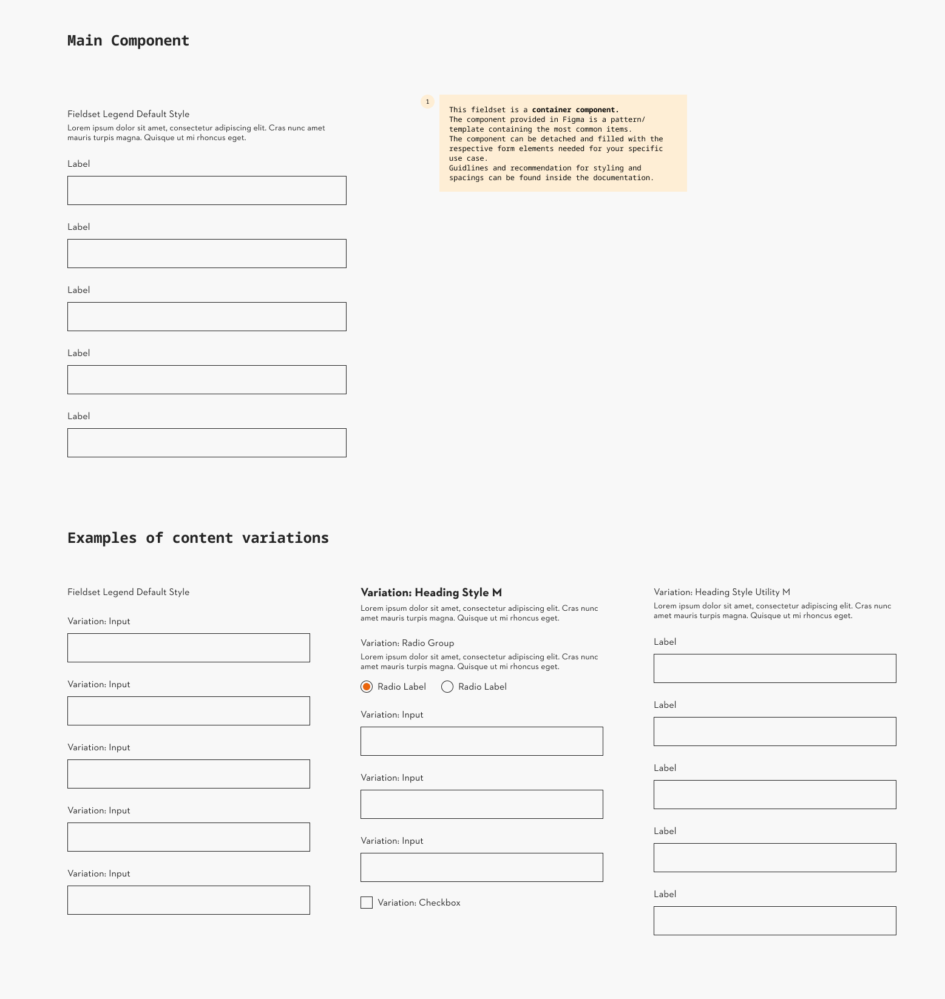

### Further guidelines

[Storybook documentation](https://main--63440bbb95889041542a5ba3.chromatic.com/?path=/docs/components-fieldset--documentation)

### Related elements

[Input](https://www.figma.com/design/qXldpLO6gxHJNLdcXIPxYt/Core-Components-%F0%9F%92%A0?node-id=1591-2)

[Radio Button](https://www.figma.com/design/qXldpLO6gxHJNLdcXIPxYt?node-id=860-2728)

[Switch](https://www.figma.com/design/qXldpLO6gxHJNLdcXIPxYt?node-id=513-2)

### Contribute

Contribute to improving this component by sharing your feedback, asking questions, or suggesting features [here](https://www.figma.com/design/lLmw7PfIdKjFG4uT3B2Hyj/Onboarding-%F0%9F%93%96?node-id=446-868&t=zKmRu4kAkxMeRDmK-4).

## Formatting and Construction

### Anatomy

The field set is a container that can contain elements, together they become a form

**Fixed elements**

1. **Legend** Describes the field set or its purpose
1. **Info Button (optional)** Can be used to trigger a popover with additional information
1. **Description** Provides guidance or further context or clarity for the following form elements
1. **System feedback** Error message
1. **Form element group** Group of different form elements that can be used (highlighted in purple)

Common components used in a fields can be:

[Radio group →](https://www.figma.com/design/qXldpLO6gxHJNLdcXIPxYt?node-id=860-2728)

[Input text →](https://www.figma.com/design/qXldpLO6gxHJNLdcXIPxYt?node-id=1744-7211)

[Single checkbox →](https://www.figma.com/design/qXldpLO6gxHJNLdcXIPxYt?node-id=3354-3357)

[Checkbox group →](https://www.figma.com/design/qXldpLO6gxHJNLdcXIPxYt?node-id=5626-11361)

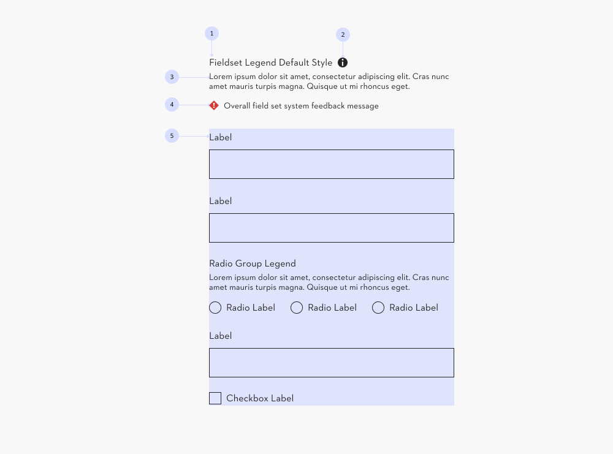

### Legend styling

#### Default vs. heading style

The field set legend can be styled customary:

1. **By default** it uses Utility M – the same styling as for other Labels.
1. To create more hierarchy the legend can also use the **heading styles S, M, L & XL.**

**If used with header styles, the spacing between legend and hint needs to be adjusted from 2px to 6px**

[Text styles →](https://www.figma.com/design/qXldpLO6gxHJNLdcXIPxYt?node-id=2-23)

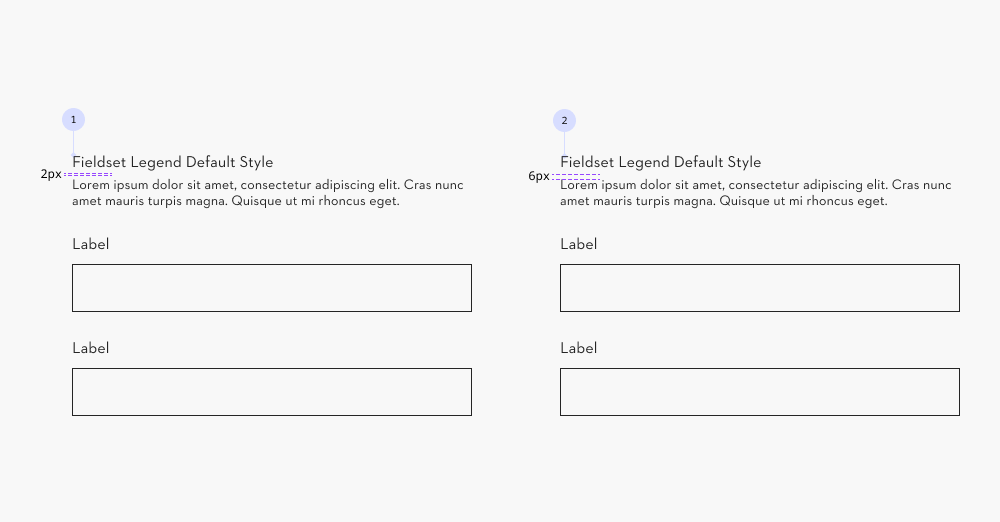

### Spacing recommendations

#### Adjusted spacing depending on content

**Complex field sets profit from wider spacing** to clarify structure and clearer visual hierarchy.

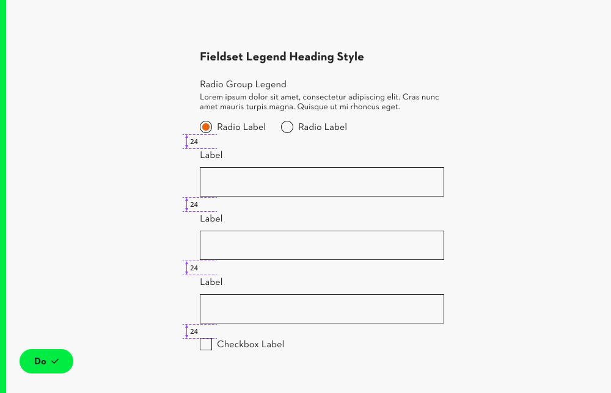

#### Do not use compact spacing in complex field sets.

Use the checkbox group component, due to the optimized compact spacing.

The checkbox group is a variation of the field set.

[Checkbox group →](https://www.figma.com/design/qXldpLO6gxHJNLdcXIPxYt?node-id=5626-11361)

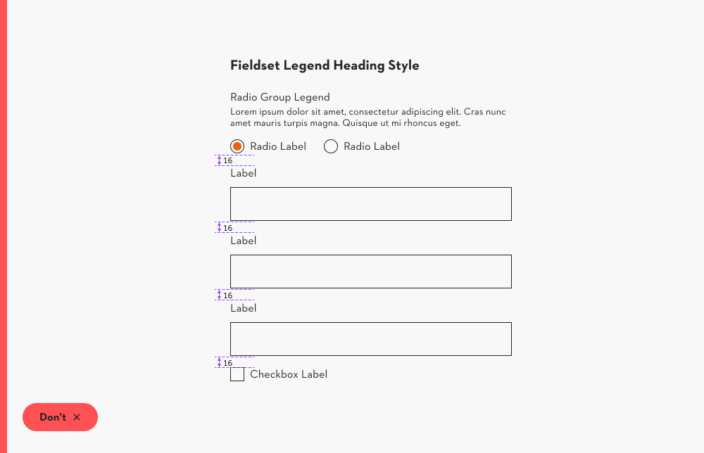

#### Combination of input fields

Do not mix ‘size small’ and ‘size medium’ input fields in one fieldset in the same viewport.

Note: It is okay to mix sizes in different steps, in e.g. a wizard, as long as they’re not in the same step.

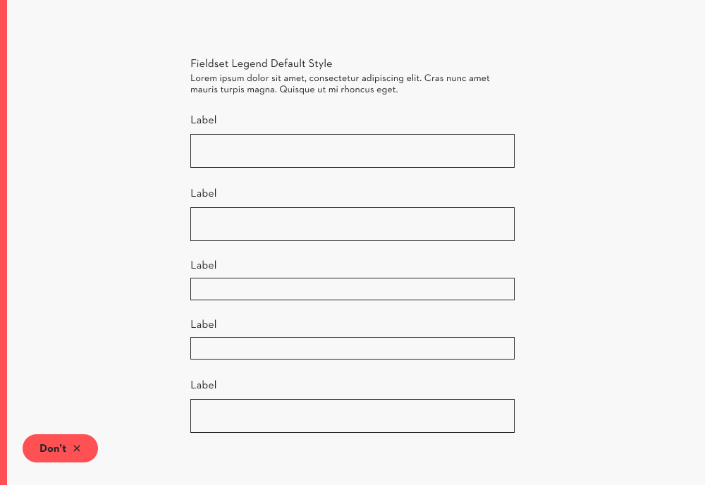

### Sizing

#### Maximum width

The width of the fieldset is determined by the container it is placed in. This should ideally be the “[content area narrow](https://www.figma.com/design/HHM9B6UjMStGLxMf6loNLn/DS-945-Grid-Optimisations-%7C-Design?node-id=1-857&t=FFOFP94g90gl91Ko-4)” defined within the grid layout.

While the input can adjust to fit its container, we recommend not exceeding a maximum width of 544px, matching the [maximum text width](https://www.figma.com/design/JyyYtoCYbtJrzqHs38OXSQ/Grid-%26-Spacing-%F0%9F%A7%AE?node-id=1-132), for better scanability and readability. This max width calculated by multiplying the font size with 34. For our default copy styling Text M (16px) that defines a max. width of 544px (16px\*34= 544px).

In the Figma component, the maximum width is set to the recommended 544px. ([Link to calculation](https://www.figma.com/design/JyyYtoCYbtJrzqHs38OXSQ/Grid-%26-Spacing-%F0%9F%A7%AE?m=auto&node-id=1-857&t=p2GU3oXS9Ao4MbV0-1))

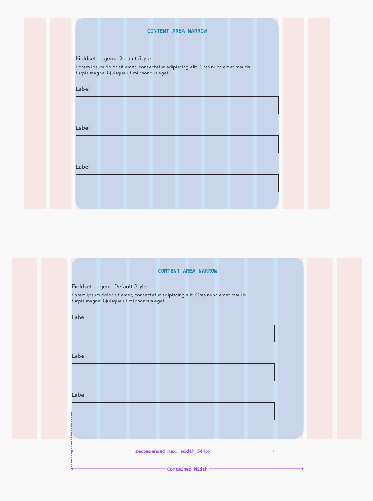

#### Maximum width of text container

To ensure good readability the maximum width of the legend text container and description text container should not exceed 476px (14px\*34 calculation based on the font size).

[Text width for body text→](https://www.figma.com/design/qXldpLO6gxHJNLdcXIPxYt?node-id=1445-5050)

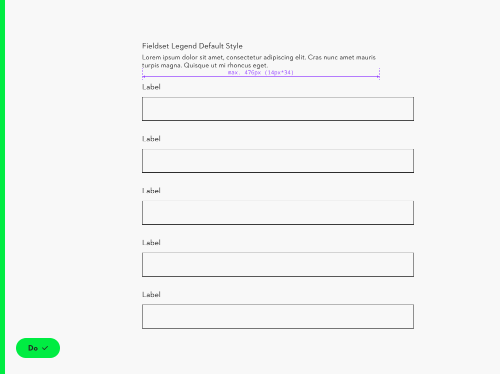

Do not exceed 476px, even when the module or grid is wider.

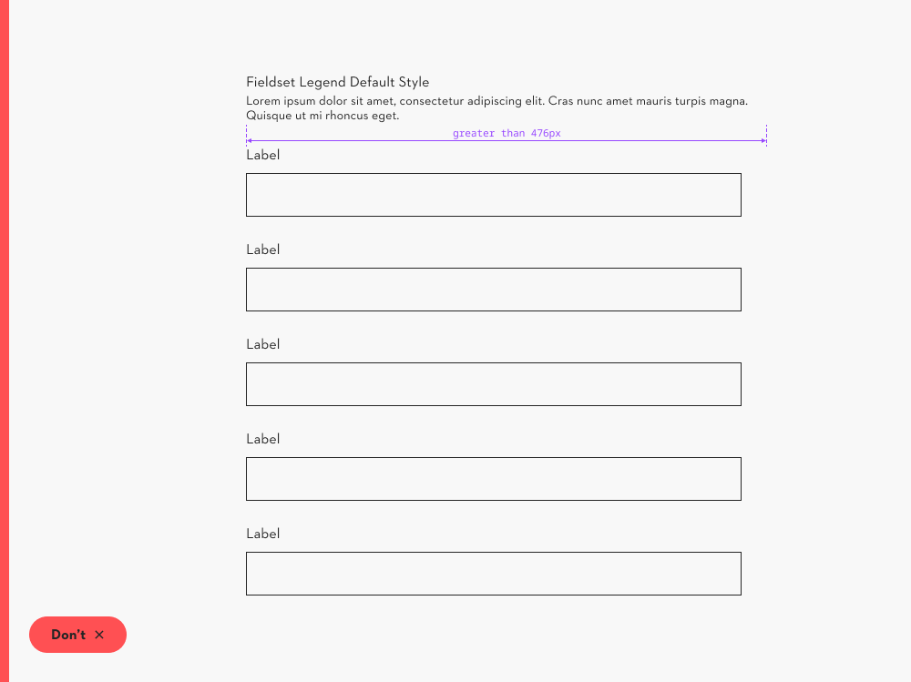

### Mobile behavior

Elements that are placed horizontally on desktop will be displayed vertically on mobile.

In both cases the elements are positioned within the narrow grid, that is optimized for legibility and short mouse paths.

[Content placement →](https://www.figma.com/design/qXldpLO6gxHJNLdcXIPxYt?node-id=1445-5050)

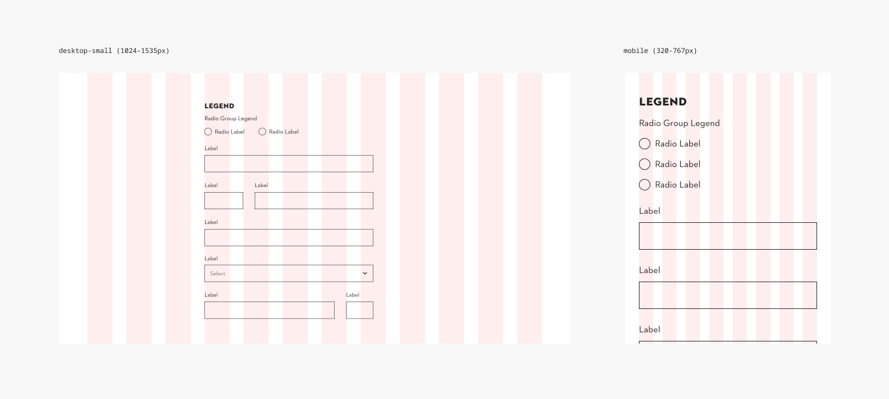

## Content and Assets

### Simple text

- Keep labels and hints short and simple.
- It is recommended to avoid abbreviations.
- Test the understandability of the copy in the form at all times.

### Nesting fieldsets

It is possible to nest field sets, if the content thematically fit together. Though, it is recommended to separate fieldsets, in order to keep it simple and provide overview and structure.

Examples

1. Horizontally placed input fields
1. Radio/Checkbox group in a fieldset
1. Main fieldset, that spans all fields and fieldsets

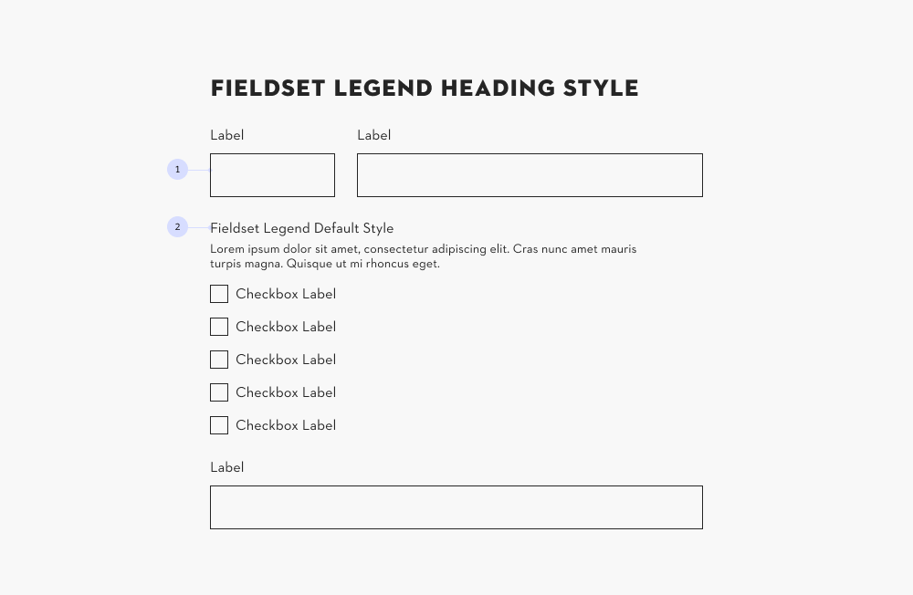

### Required indicator

The whole field set can be set to required. In order to communicate this an **asterisk (1)** is shown next to the legend. When using the code component the asterisk will be shown automatically when component is set to required.

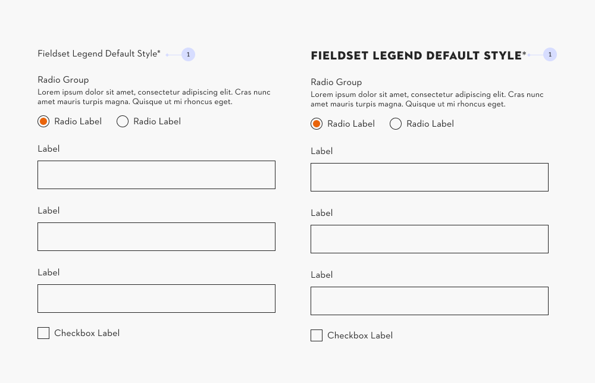

### Inline link in the description

A fieldset description can contain an inline link **(1)**, depending on the use-case with or without an icon. You can find more information on link styling:

[Inline Links→](https://www.figma.com/design/qXldpLO6gxHJNLdcXIPxYt?node-id=168-6140)

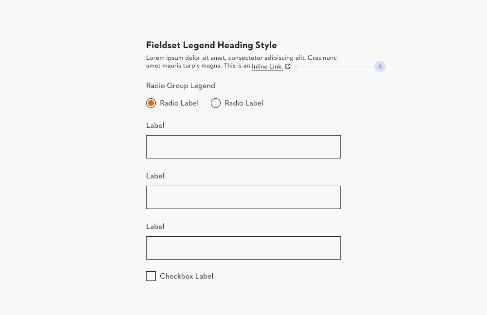

## Behavior

### Fieldset Validation

If a fieldset contains invalid inputs, System Feedback should be shown in two ways:

1. **Overall System Feedback** – a message displayed below the legend or description.
   - This message provides an overview that there are errors within the fieldset.
   - It represents the overall system feedback for the group.
   - There are two ways to display this message (see below).
1. **Input-specific System Feedback** – messages shown next to each invalid input, explaining the exact issue.

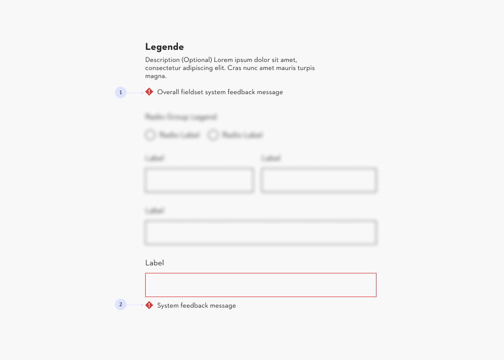

#### Overall System Feedback Variations

Our Design System supports two types of Overall System Feedback:

1. **Inline Feedback** – a simple message displayed below the legend or description to indicate errors within a fieldset.
1. **Notification Error Summary** – a comprehensive summary displayed at the top of the form (inside a Notification component).
   - Summarises all validation messages across the fieldset
   - Includes anchor links that jump directly to the related input field and focus it.
   - Positioned above the form title

While both variations are supported, the **Notification Error Summary** is the preferred and more accessible option.

**Inline Feedback** provides limited context and can be more difficult for screen reader users to navigate.

> **Note:** The Notification Error Summary is not yet available as a design component but will be added soon. It is already available in code.

> Detailed validation patterns are not currently provided. Accessible form patterns will be introduced in a future update.

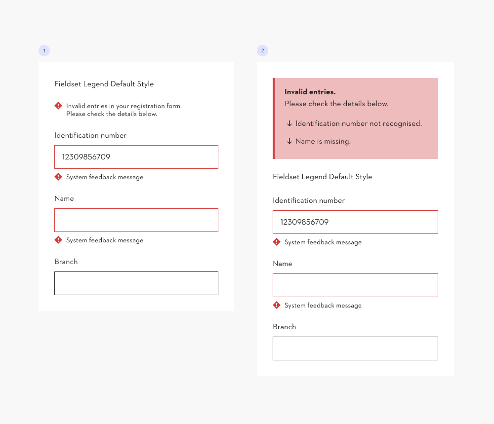

## Examples

### Checkout form

This is an example of four following field sets, in a checkout form.

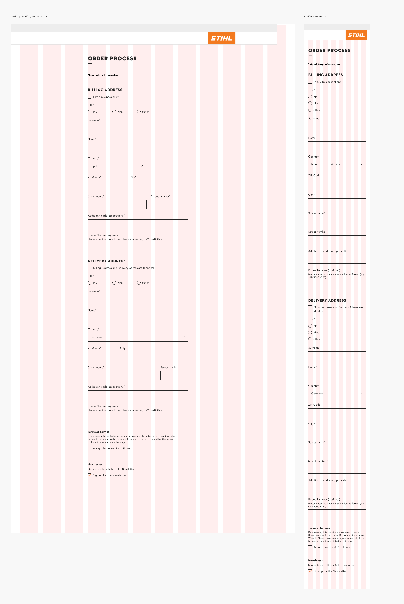
