# Navigation

## Navigation: Introduction

**Overview**

The navigation system offers clear, consistent pathways for users to explore content across the product ecosystem. It includes key patterns like the main header, sidebar navigation, and menus, designed for use across all products, platforms, and devices. These components support intuitive wayfinding, maintain content hierarchy, and uphold accessibility.

**Key Features**

- **Flexible Layouts** The header supports multiple configurations for branding, navigation, search, and user actions — ideal for both simple and complex interfaces.
- **Platform Consistency** Reusable across all screen sizes and products, with consistent placement of global nav, utilities, and responsive behaviors.
- **Modular Structure** Built from interchangeable components — Top Bar, Navigation Bar, Utility Menu, and contextual actions — customizable for any product or layout.
- **Responsive Design** Elements adapt across breakpoints. Navigation collapses into dropdowns or mobile menus to stay usable on any screen.
- **Branding Support** Flexible zones allow for logo placement and scaling to suit various layout needs.

**The following elements are documented in detail:**

- [Header](https://www.figma.com/design/Ie2r0R9QwjEc7O3nrFbXhV?node-id=6576-33832)
   - [Top Bar](https://www.figma.com/design/Ie2r0R9QwjEc7O3nrFbXhV?node-id=6576-38939)
   - [Nav Bar](https://www.figma.com/design/Ie2r0R9QwjEc7O3nrFbXhV?node-id=6583-59828)
   - [Utility Menu](https://www.figma.com/design/Ie2r0R9QwjEc7O3nrFbXhV?node-id=7158-32869)
- [Mega Menu](https://www.figma.com/design/Ie2r0R9QwjEc7O3nrFbXhV?node-id=6583-87264)
- [Dropdown Menu](https://www.figma.com/design/Ie2r0R9QwjEc7O3nrFbXhV?node-id=6583-85690)
- [Sidebar Menu](https://www.figma.com/design/Ie2r0R9QwjEc7O3nrFbXhV?node-id=6583-79899)
- [Navigation Elements](https://www.figma.com/design/Ie2r0R9QwjEc7O3nrFbXhV?node-id=6924-87853)
   - [Action Items](https://www.figma.com/design/Ie2r0R9QwjEc7O3nrFbXhV?node-id=6583-73372)
   - [Text Component](https://www.figma.com/design/Ie2r0R9QwjEc7O3nrFbXhV?node-id=6583-74332)
   - [Mobile Menu](https://www.figma.com/design/Ie2r0R9QwjEc7O3nrFbXhV?node-id=6583-64557)

### Navigation Structural Patterns

Depending on the product context and content complexity, the navigation system can be composed using different structural patterns. Each pattern consists of modular components and is tailored to specific use cases. The following presets represent recommended combinations:

**Mega Navigation**

**Recommended for:** Large E-Commerce and Brand platforms with deep page hierarchies. **Must have:** Top Bar, Nav Bar, Mega Menu **Optional:** Utility Menu

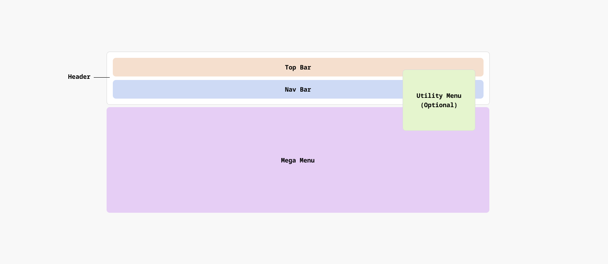

_Figure: \[unverified\] Wireframe of the Mega Navigation structural pattern, labelled "Header" and made up of a "Top Bar", a "Nav Bar", an optional "Utility Menu (Optional)" and an open "Mega Menu" panel below the Nav Bar._

**Dropdown Navigation**

**Recommended for:** Smaller brand and marketing platforms or portals with moderate content depth. **Must have:** Top Bar, Nav Bar, Dropdown Menu **Optional:** Utility Menu

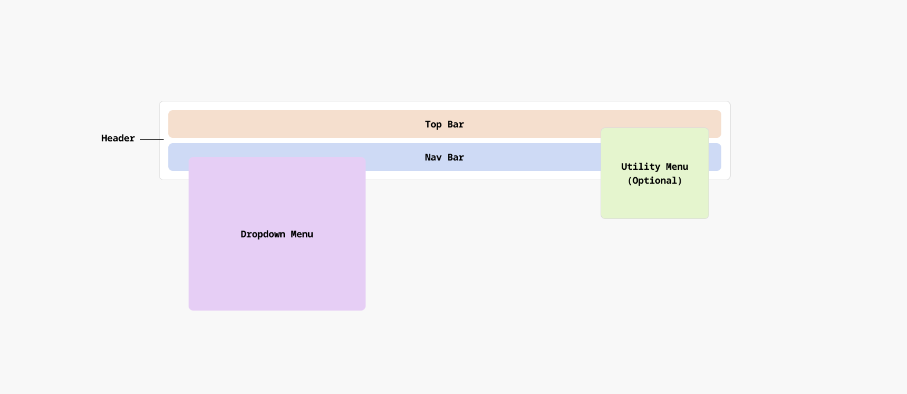

_Figure: \[unverified\] Wireframe of the Dropdown Navigation structural pattern, labelled "Header" and made up of a "Top Bar", a "Nav Bar", an optional "Utility Menu (Optional)" and a "Dropdown Menu" opening below the Nav Bar._

**Sidebar Navigation**

**Recommended for:** Portals, dashboards, or tools with many sections. **Must have:** Top Bar, Sidebar **Optional:** Nav Bar, Utility Menu

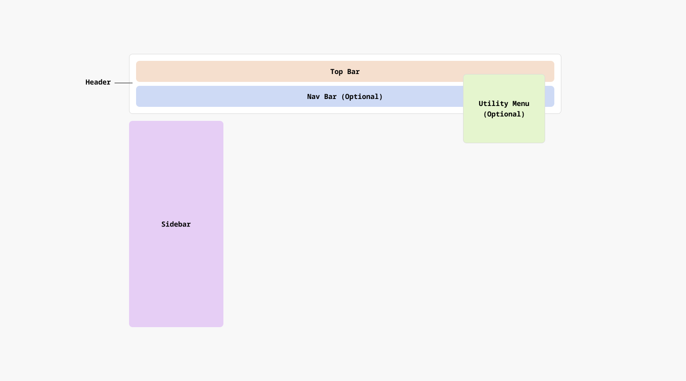

_Figure: \[unverified\] Wireframe of the Sidebar Navigation structural pattern, labelled "Header" and made up of a "Top Bar", an optional "Nav Bar (Optional)", an optional "Utility Menu (Optional)" and a "Sidebar" for the section navigation._

**Reduced Navigation**

**Recommended for:** Focused flows like checkout, onboarding, or standalone tools. **Must have:** Top Bar

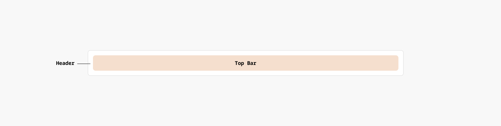

_Figure: \[unverified\] Wireframe of the Reduced Navigation structural pattern, where the "Header" consists only of a "Top Bar"._

#### Contribute

Contribute to improving this component by sharing your feedback, asking questions, or suggesting features [here](https://www.figma.com/design/lLmw7PfIdKjFG4uT3B2Hyj/Onboarding-%F0%9F%93%96?node-id=446-868&t=zKmRu4kAkxMeRDmK-4).

## Mega Navigation: Examples

> The use case examples shown feature the new navigation concept and do not reflect the current state of the product.

**E-Shop**

The navigation is optimized for browsing and product discovery. It provides access to categories, search, cart, and user account.

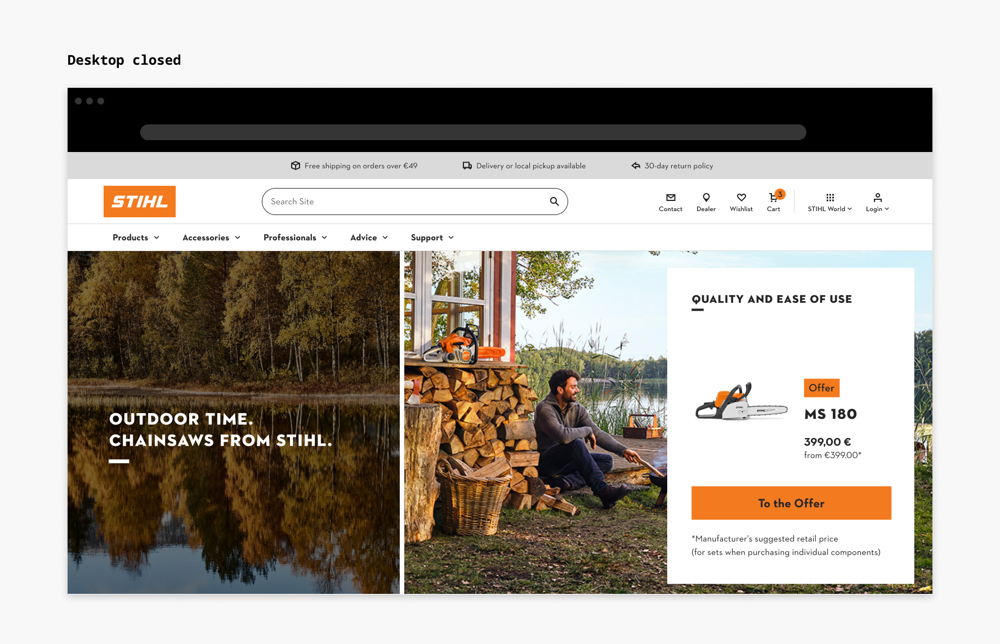

_Figure: \[unverified\] E-Shop example of the Mega Navigation on desktop in its closed state ("Desktop closed"): a secondary promo-banner with the USPs "Free shipping on orders over €49", "Delivery or local pickup available" and "30-day return policy", a top-bar with "Search Site", "Contact", "Dealer", "Wishlist", "Cart" (badge "3"), "STIHL World" and "Login", and a nav-bar with "Products", "Accessories", "Professionals", "Advice" and "Support", above a hero with the "Offer" flag, product "MS 180" at "399,00 €" and a highlight button "To the Offer"._

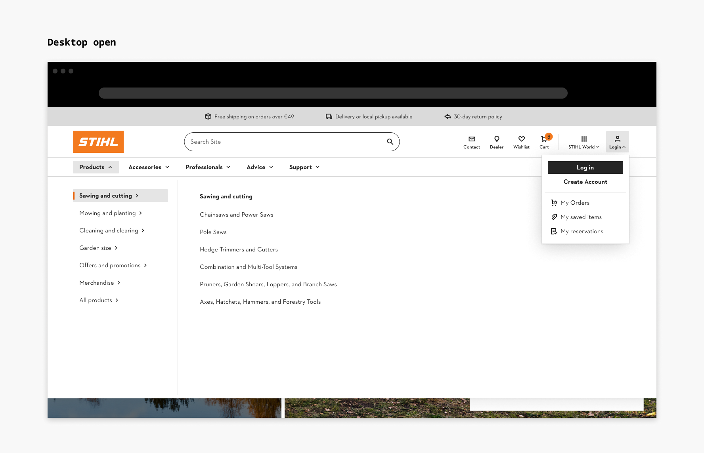

_Figure: \[unverified\] E-Shop example of the Mega Navigation on desktop with the utility menu open ("Desktop open"): the top-bar action items "Contact", "Dealer", "Wishlist" and "Cart" (badge "3") sit left of a vertical divider, and the "Login" item is active with a chevron, expanding a right-aligned utility-menu containing a filled "Log in" button, a ghost "Create Account" button, a horizontal divider and the links "My Orders", "My saved items" and "My reservations"; the promo-banner, "Search Site" and the nav-bar items "Products", "Accessories", "Professionals", "Advice" and "Support" remain visible._

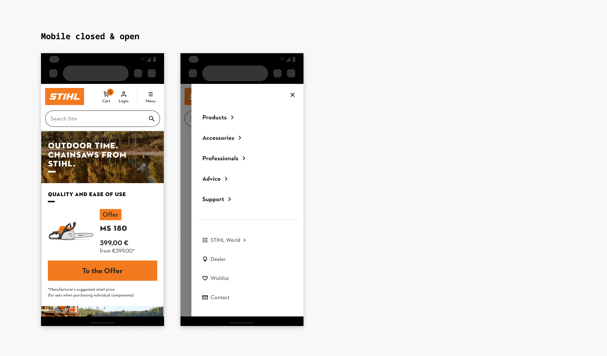

_Figure: \[unverified\] E-Shop example of the Mega Navigation on mobile ("Mobile closed & open"): the closed state shows a top-bar with logo, "Search Site", "Cart" (badge "3"), "Login" and a "Menu" button above the "Offer" hero for "MS 180" at "399,00 €", and the open state shows a full-width menu listing "Products", "Accessories", "Professionals", "Advice" and "Support" with right-pointing nav buttons, a divider, and the horizontal action items "STIHL World" (with chevron), "Dealer", "Wishlist" and "Contact"._

## Dropdown Navigation: Examples

> The use case examples shown feature the new navigation concept and do not reflect the current state of the product.

**Corporate**

A content-driven structure highlights brand identity, services, press, and company information. The dropdown menu supports moderate content depth without overwhelming users.

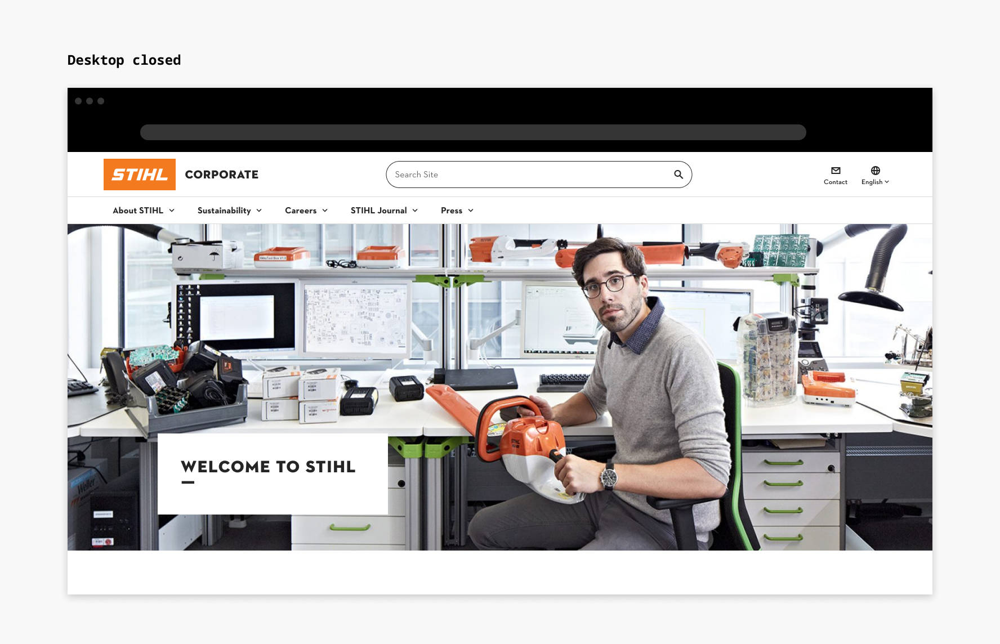

_Figure: Corporate example of the Dropdown Navigation on desktop in its closed state ("Desktop closed"): an orange STIHL logo with "Corporate", a "Search Site" field in the centre, the "Contact" and "English" items at the right, and below them a nav-bar with the chevron items "About STIHL", "Sustainability", "Careers", "STIHL Journal" and "Press", followed by a hero photo with the title "Welcome to STIHL"._

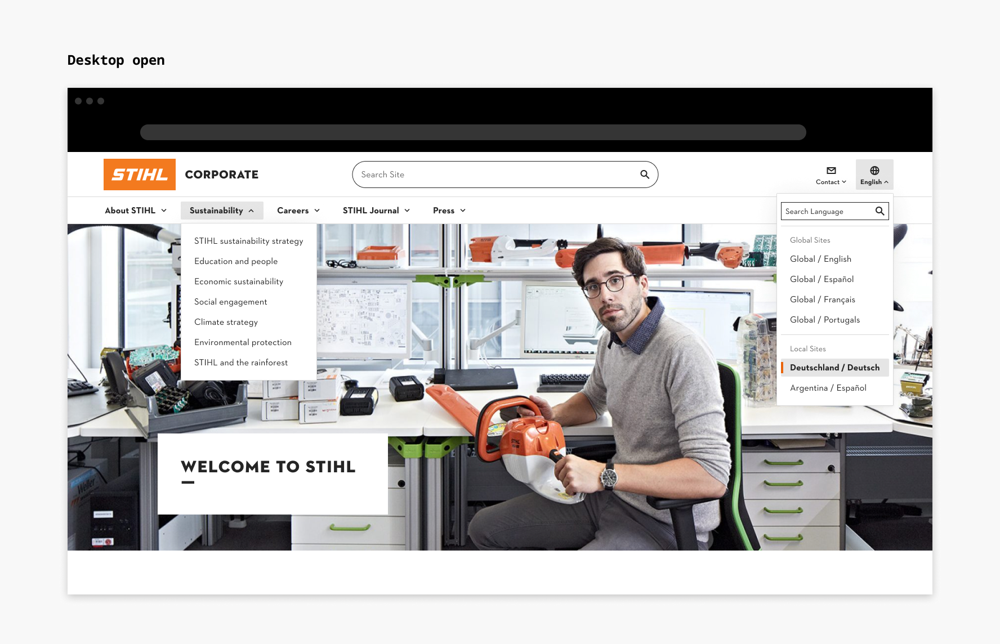

_Figure: Shows top-bar (grid variant=main, breakpoint=l, brand add-on=true, number areas=2); nav-bar (variant=main, breakpoint=l); title (title text=Welcome to STIHL, size=xl, viewport=desktop). Text in the figure: "Desktop open", "corporate", "Search Site", "Contact", "English", "Search Language", "Global Sites", "Global / English", "Global / Español", "Global / Français", "Global / Portugals", "Local Sites", "Deutschland / Deutsch", "Argentina / Español", "About STIHL", "Sustainability", "STIHL sustainability strategy", "Education and people", "Economic sustainability", "Social engagement", "Climate strategy", "Environmental protection", "STIHL and the rainforest", "Careers"._

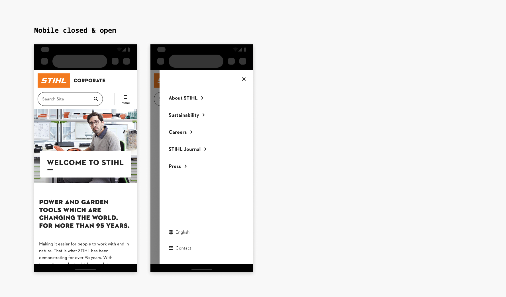

_Figure: \[unverified\] Corporate example of the Dropdown Navigation on mobile ("Mobile closed & open"): the closed state shows a compact top-bar with logo, "Search Site" and a "Menu" button above the "Welcome to STIHL" hero, and the open state shows a full-width menu with right-pointing nav buttons "About STIHL", "Sustainability", "Careers", "STIHL Journal" and "Press", a divider, and the horizontal action items "English" and "Contact"._

## Sidebar Navigation: Examples

> The use case examples shown feature the new navigation concept and do not reflect the current state of the product.

**STIHL Service Communication (SSC)**

Internal tool for quickly finding spare parts and relevant information for STIHL products, primarily used by official dealers and customer service teams.

The sidebar provides fast access to categories and search functions, supporting a high-frequency workflow.

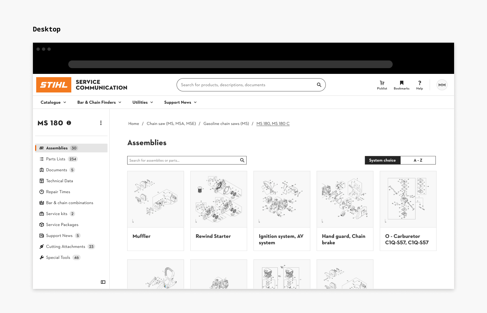

_Figure: Desktop layout of the STIHL Service Communication tool: a top-bar with STIHL logo, platform name SERVICE COMMUNICATION, a search field ("Search for products, descriptions, documents") and the icon actions Picklist, Bookmarks, Help and the user avatar "MM", above a nav-bar with Catalogue, Bar & Chain Finders, Utilities and Support News. Below it a left sidebar titled "MS 180" with an info icon lists Assemblies (active, 30), Parts Lists (234), Documents (5), Technical Data, Repair Times, Bar & chain combinations, Service kits (2), Service Packages, Support News (5), Cutting Attachments (23) and Special Tools (46), next to the main content with breadcrumb, the heading "Assemblies", a search field, a "System choice" / "A - Z" toggle and a grid of assembly cards such as Muffler and Rewind Starter._

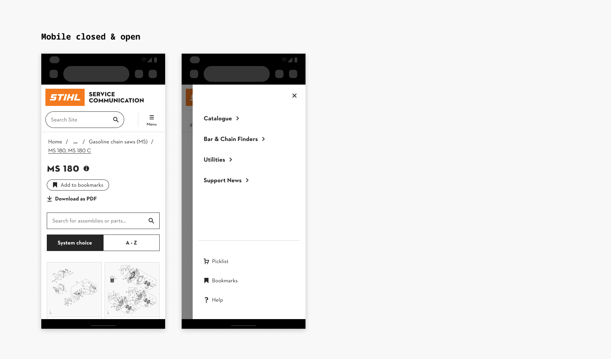

_Figure: Two mobile screens of the Service Communication tool, closed and open. The closed screen shows the top-bar with logo and platform name, a "Search Site" field and a "Menu" button, then breadcrumb, the title "MS 180", "Add to bookmarks", "Download as PDF", a search field, a "System choice" / "A - Z" toggle and cards. The open screen shows a side menu with a close icon, the entries Catalogue, Bar & Chain Finders, Utilities and Support News with chevrons, and below a divider Picklist, Bookmarks and Help, while the page behind is dimmed._

**Connected Portal**

A logged-in user portal designed to navigate between tools and manage STIHL products. The sidebar supports quick orientation and task switching.

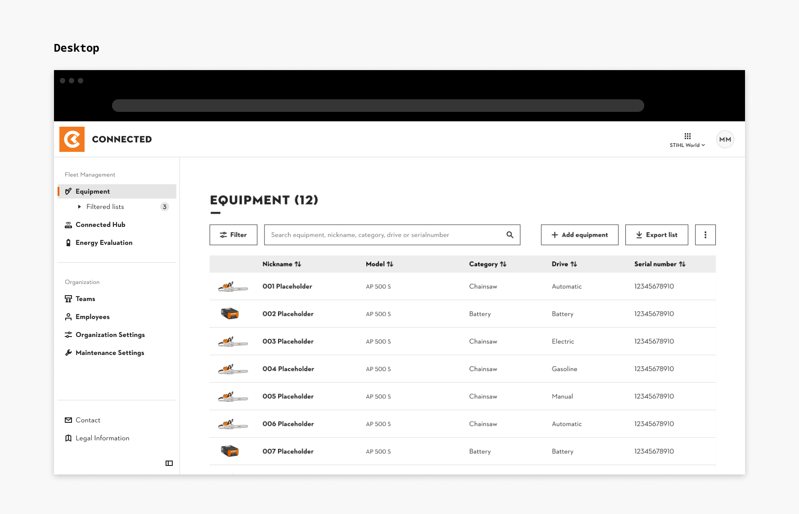

_Figure: Desktop layout of the STIHL Connected portal: a top-bar with the Connected logo and platform name CONNECTED, the "STIHL World" menu and the user avatar "MM", and an expandable left sidebar with the group Fleet Management (Equipment active with sub-item Filtered lists, badge 3, Connected Hub, Energy Evaluation), the group Organization (Teams, Employees, Organization Settings, Maintenance Settings), and Contact and Legal Information at the bottom. The main area shows the heading "EQUIPMENT (12)" with Filter, search, Add equipment and Export list buttons above a sortable table with the columns Nickname, Model, Category, Drive and Serial number._

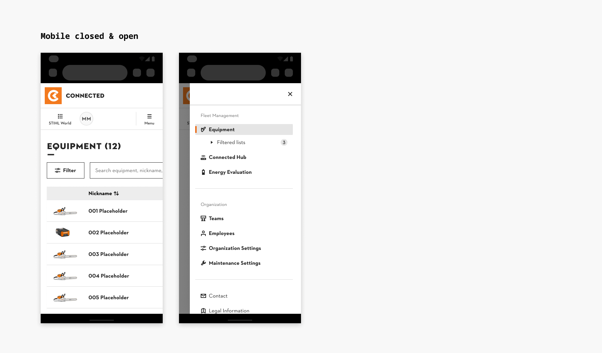

_Figure: Two mobile screens of the Connected portal, closed and open. The closed screen shows the top-bar with the Connected logo, "STIHL World", the avatar "MM" and a "Menu" button above the heading "EQUIPMENT (12)", a Filter button, a search field and a table with the Nickname column. The open screen shows a side menu with a close icon and the groups Fleet Management (Equipment active, Filtered lists with badge 3, Connected Hub, Energy Evaluation), Organization (Teams, Employees, Organization Settings, Maintenance Settings) and Contact and Legal Information, with the page behind dimmed._

## Reduced Navigation: Examples

> The use case examples shown feature the new navigation concept and do not reflect the current state of the product.

**Checkout**

A minimal, linear flow that guides users step-by-step through the purchase process. Distractions are removed to reduce friction and focus attention on the task.

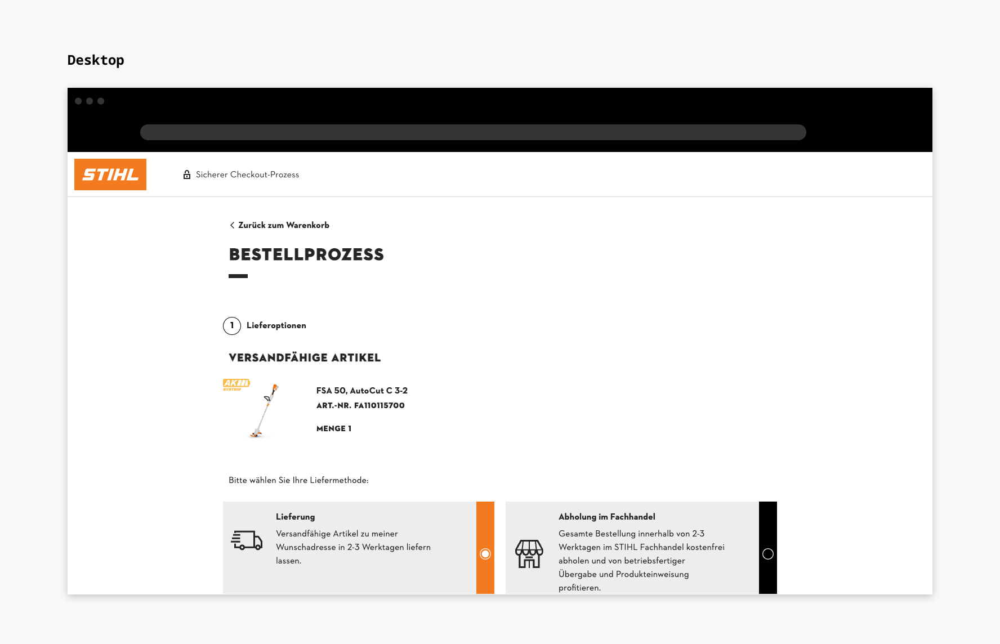

_Figure: Desktop checkout page with a reduced top-bar that contains only the STIHL logo and a lock icon with the text "Sicherer Checkout-Prozess", without navigation or utility actions. Below it the page shows the link "Zurück zum Warenkorb", the heading "BESTELLPROZESS", step 1 "Lieferoptionen", the article FSA 50, AutoCut C 3-2 and two delivery options, "Lieferung" (selected) and "Abholung im Fachhandel"._

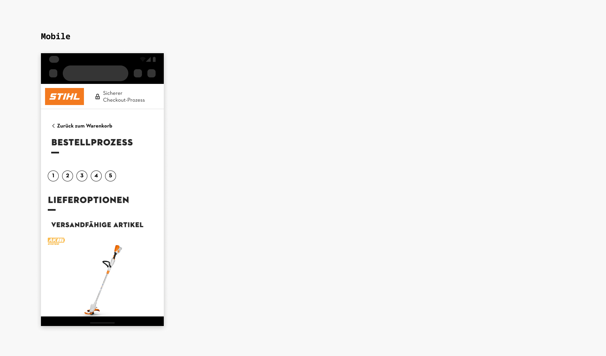

_Figure: Mobile checkout page with a reduced top-bar that contains only the STIHL logo and a lock icon with the text "Sicherer Checkout-Prozess". Below it the page shows the link "Zurück zum Warenkorb", the heading "BESTELLPROZESS", a stepper with the steps 1 to 5, the heading "LIEFEROPTIONEN", the subheading "VERSANDFÄHIGE ARTIKEL" and a product image of a trimmer._

## Header: Overview

**Recommended for:** all sites and platforms **Must have:** Top Bar **Optional:** Nav Bar, Utility Menu

The Header is the primary navigation pattern located at the top of the page, combining brand identity, core site navigation, and essential user tools.

It includes links to key sections — like **Home**, **Products**, or **Services** — and actions such as **Login** and **Language Selector**, ensuring a consistent and intuitive experience across all products and platforms.

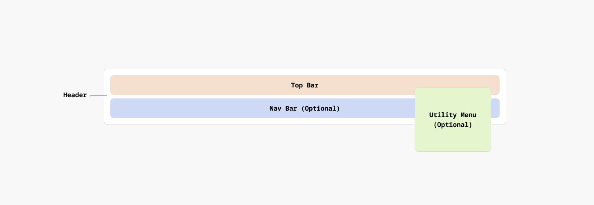

_Figure: Schematic of the Header, labelled "Header": a wide container with a "Top Bar" at the top and below it a "Nav Bar (Optional)". A "Utility Menu (Optional)" box overlaps the right end of the Top Bar and Nav Bar and extends below them._

### Header Variants

#### Top Bar – Only The basic version of the Header.

In addition to displaying **logos** and **platform names**, the Top Bar includes **user tools** and **system-level actions** that enhance the overall user experience without being part of the main site navigation. Common examples include: Search, Cart, Wishlist, Language Selector, and User Profile. [Go to Top bar →](https://www.figma.com/design/Ie2r0R9QwjEc7O3nrFbXhV?node-id=6576-38939)

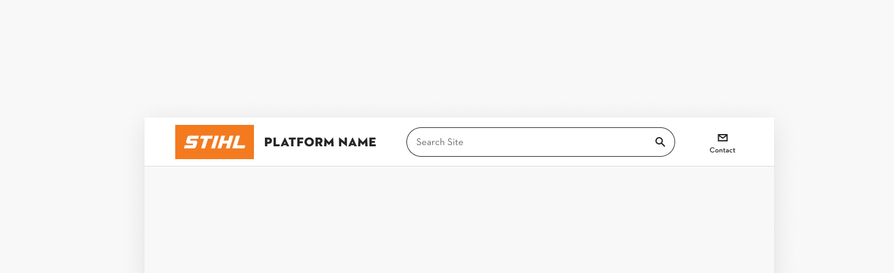

_Figure: Top Bar as the basic version of the Header: the STIHL logo with the platform name "PLATFORM NAME", a rounded search field "Search Site" with a magnifier icon and a "Contact" icon action with an envelope._

#### Top Bar + Nav Bar Adds a primary navigation layer to the Top Bar.

The Nav Bar represents the **primary level of navigation** and defines the core structure of the site or application. It includes links to key sections — such as Products, Services, or Blog — guiding users through the main content and helping them understand the overall offering. [Go to Nav Bar →](https://www.figma.com/design/Ie2r0R9QwjEc7O3nrFbXhV?node-id=6583-59828)

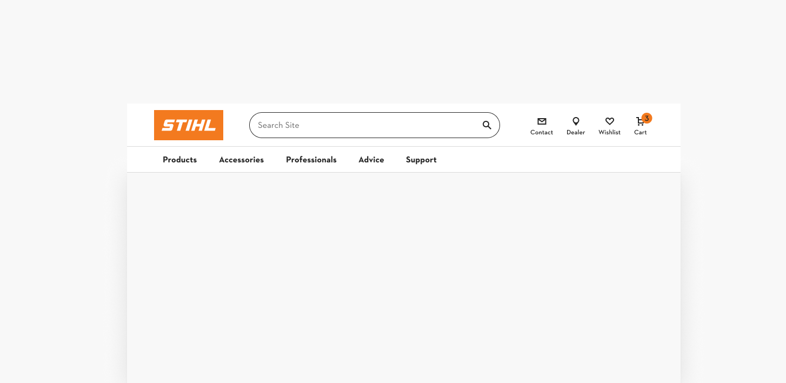

_Figure: Top Bar with a Nav Bar below it. The Top Bar shows the STIHL logo, a "Search Site" field and the icon actions Contact, Dealer, Wishlist and Cart with a badge showing 3. The Nav Bar underneath lists the primary navigation entries Products, Accessories, Professionals, Advice and Support._

#### Top Bar + Nav Bar (Optional) + Utility Menu A fully featured header, enhanced with a Utility Menu.

The Utility Menu is a popover component that provides quick access to **essential functions**, **user tools**, and **system-level actions** — such as login, language selection, and other key options. [Go to Utility Menu →](https://www.figma.com/design/Ie2r0R9QwjEc7O3nrFbXhV?node-id=7158-32869)

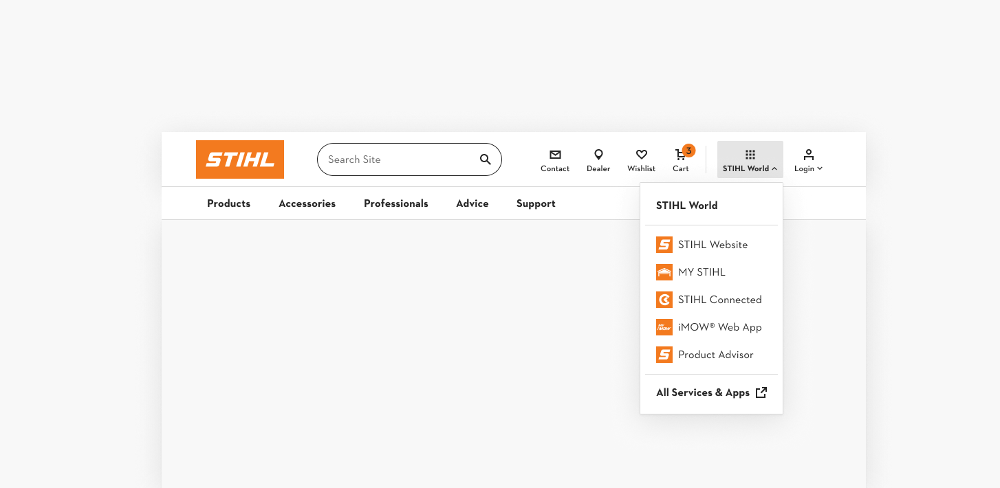

_Figure: Shows top-bar (variant=main, breakpoint=l, logo add-on=true, number areas=2); top-bar (grid variant=main, breakpoint=l, brand add-on=false, number areas=2); nav-bar (variant=main, breakpoint=l). Text in the figure: "This is a Platform name", "Search Site", "Label", "Contact", "Dealer", "Wishlist", "3", "Cart", "STIHL World", "STIHL Website", "MY STIHL", "STIHL Connected", "iMOW® Web App", "Product Advisor", "All Services & Apps", "Login", "Products", "Accessories", "Professionals", "Advice", "Support"._

#### Top Bar – reduced Minimal header for focused user flows.

The reduced variant of the Top Bar is typically used in **focused flows**, such as the checkout process, where minimizing navigation elements helps reduce distractions. [Go to Top bar →](https://www.figma.com/design/Ie2r0R9QwjEc7O3nrFbXhV?node-id=6576-38939)

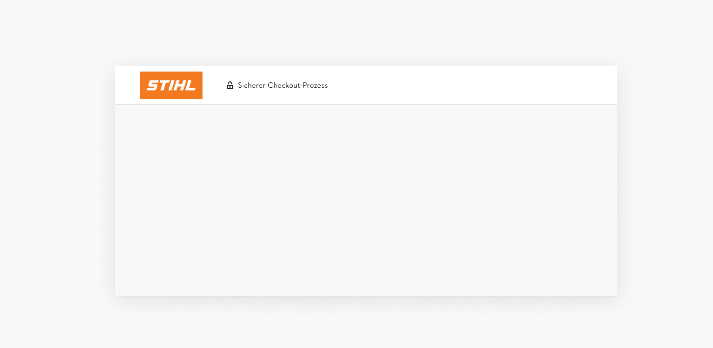

_Figure: Reduced Top Bar (grid variant main, breakpoint l, brand add-on false, number areas 1) for a focused flow: only the orange STIHL logo on the left and a lock icon with the text "Sicherer Checkout-Prozess" next to it, with no search, action items or avatar, above an empty page area._

#### Contribute

Contribute to improving this component by sharing your feedback, asking questions, or suggesting features [here](https://www.figma.com/design/lLmw7PfIdKjFG4uT3B2Hyj/Onboarding-%F0%9F%93%96?node-id=446-868&t=zKmRu4kAkxMeRDmK-4).

## Header: Pattern

> The Header is provided as a frame that includes the two components: Top Bar and Nav Bar. This structure allows for easy customization and flexibility when adapting or modifying the components within the header container.

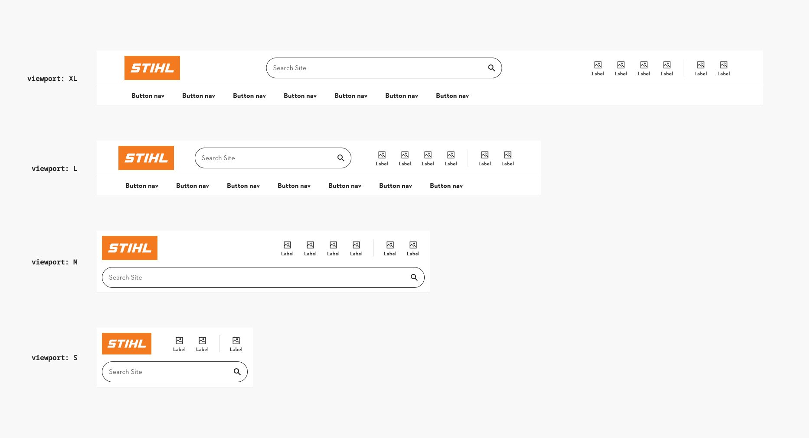

_Figure: The Header pattern at four viewports. At "viewport: XL" and "viewport: L" a Top Bar (logo, "Search Site" field, six icon action items labelled "Label" with a divider before the last two) sits above a Nav Bar row of seven "Button nav" items. At "viewport: M" and "viewport: S" only the Top Bar is shown, with the search field moved below the logo and action items, and fewer action items at S._

### Further guidelines

[Storybook Documentation](https://feat-ds-971--63440bbb95889041542a5ba3.chromatic.com/?path=/docs/templates-header--documentation)

### Related elements

[Top Bar](https://www.figma.com/design/Ie2r0R9QwjEc7O3nrFbXhV?node-id=6576-38939)

[Nav Bar](https://www.figma.com/design/Ie2r0R9QwjEc7O3nrFbXhV?node-id=6583-59828)

[Mobile Menu](https://www.figma.com/design/Ie2r0R9QwjEc7O3nrFbXhV?node-id=6583-64557)

### Contribute

Contribute to improving this component by sharing your feedback, asking questions, or suggesting features [here](https://www.figma.com/design/lLmw7PfIdKjFG4uT3B2Hyj/Onboarding-%F0%9F%93%96?node-id=446-868&t=zKmRu4kAkxMeRDmK-4).

## Header: Top Bar

Overview:

- The **Top Bar** is the uppermost section of the header and can be used alongside a Nav Bar or Sidebar.
- It is always required, as it houses the **logo and company or platform name**, ensuring **consistent branding**.
- Beyond branding, the Top Bar contains **user tools and system-level actions** that enhance the overall experience but are not part of the main site navigation.
- **Common elements include:** Search, Cart, Wishlist, Language Selector, and User Profile.

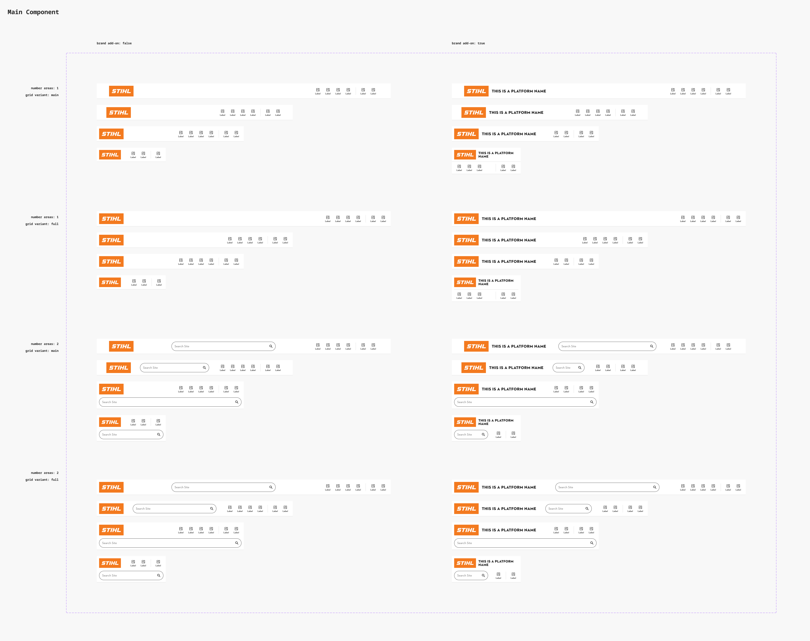

_Figure: Overview of the Top Bar main component on a matrix: columns "brand add-on: false" (logo only) and "brand add-on: true" (logo plus "This is a Platform name"), rows "number areas: 1" and "number areas: 2" each for "grid variant: main" and "grid variant: full". Each cell shows the four breakpoints from XL down to S; one-area bars have logo and action items, two-area bars add the "Search Site" field, which moves below the logo at M and S, and with the add-on at S the platform name wraps onto two lines._

### Further guidelines

[Storybook Documentation](https://main--63440bbb95889041542a5ba3.chromatic.com/?path=/docs/components-header--documentation)

### Related elements

[Nav Bar](https://www.figma.com/design/Ie2r0R9QwjEc7O3nrFbXhV?node-id=6583-59828)

[Utility Menu](https://www.figma.com/design/Ie2r0R9QwjEc7O3nrFbXhV?node-id=7158-32869)

[Sidebar Menu](https://www.figma.com/design/Ie2r0R9QwjEc7O3nrFbXhV?node-id=6583-79899)

[Action Item](https://www.figma.com/design/Ie2r0R9QwjEc7O3nrFbXhV?node-id=6583-73372)

[Mobile Menu](https://www.figma.com/design/Ie2r0R9QwjEc7O3nrFbXhV?node-id=6583-64557)

[Motion Design](https://www.figma.com/design/UYHZEckQObDvLuuRoMP8ps/Styles-%F0%9F%AA%AD?node-id=1-148)

### Contribute

Contribute to improving this component by sharing your feedback, asking questions, or suggesting features [here](https://www.figma.com/design/lLmw7PfIdKjFG4uT3B2Hyj/Onboarding-%F0%9F%93%96?node-id=446-868&t=zKmRu4kAkxMeRDmK-4).

## Top Bar: Formatting and Behaviour

### Anatomy

The Top Bar is a flexible layout component made up of up to three configurable areas. These areas can be used in a two- or three-area layout, depending on the product’s needs.

**Areas Overview**

The Top Bar consists of the following layout areas, which build on each other in order:

**a. Brand Area**

**b. Primary Area**

**c. Secondary Area (optional)**

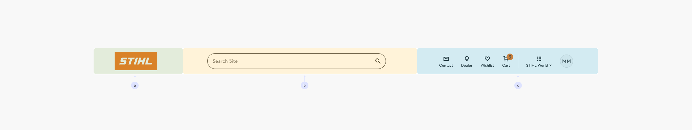

_Figure: Anatomy of the Top Bar (grid variant main, breakpoint xl, brand add-on false, number areas 2) with three coloured areas: a is the Brand Area (green) holding the STIHL logo, b is the Primary Area (yellow) holding the "Search Site" field, and c is the Secondary Area (blue) holding the action items Contact, Dealer, Wishlist, Cart (badge 3), STIHL World with a chevron, and the "MM" avatar._

### Area Configuration & Content

When using the Top Bar the user can chose between using one or two areas besides the brand area. There are two layout ways to use these areas:

#### Two-Area Layout

**Includes**:

Brand Area

Primary Area

**a. Brand Area** Positioned on the left and always visible. This area is reserved for brand elements such as the logo and optional extensions (e.g., platform name, tagline, additional picture or anniversary logo). [→ See the Brand Area section for details.](https://www.figma.com/design/Ie2r0R9QwjEc7O3nrFbXhV?node-id=6583-53815)

**b. Primary Area** Positioned to the right of the Brand Area. It can contain:

1. The Top Bar Nav component (Action items or an Avatar component)
1. A search bar
1. Icon-text combinations

Alignment and spacing may vary based on the elements included.

[→ See the Primary Area section for details.](https://www.figma.com/design/Ie2r0R9QwjEc7O3nrFbXhV?node-id=6583-55805)

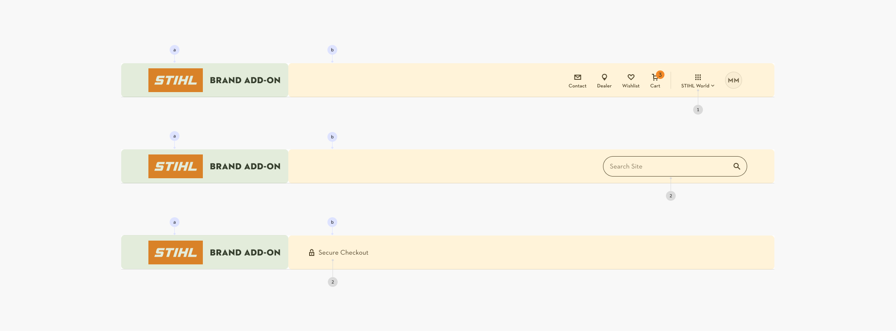

_Figure: Three Top Bars in the two-area layout, each with a Brand Area (a, logo plus "Brand Add-on") on the left and a Primary Area (b) to its right. Callout 1 points at the Top Bar Nav action items (Contact, Dealer, Wishlist, Cart with badge 3, STIHL World, "MM" avatar), callout 2 at the "Search Site" field in the second bar and at the icon-text combination "Secure Checkout" in the third bar._

#### Three-Area Layout

**Includes**:

Brand Area

Primary Area

Secondary Area

**a. Brand Area** Same as in the two-area layout: always visible and positioned on the left for brand elements. [→ See the Brand Area section for details.](https://www.figma.com/design/Ie2r0R9QwjEc7O3nrFbXhV?node-id=6583-53815)

**b. Primary Area** When all three areas are used, the Primary Area is typically used for:

1. A Search bar

**c. Secondary Area** Positioned alongside the Brand Area and Primary Area. It is typically used for:

1. The Top Bar Nav component (Action items or an Avatar component)

[→ See the Primary and Secondary Area section for details.](https://www.figma.com/design/Ie2r0R9QwjEc7O3nrFbXhV?node-id=6583-55805)

_Figure: Top Bar in the three-area layout: the Brand Area (a, green) with the STIHL logo, the Primary Area (yellow) with the "Search Site" field, and the Secondary Area (c, blue) with the Top Bar Nav items Contact, Dealer, Wishlist, Cart (badge 3), STIHL World and the "MM" avatar. Callout 1 points at the search field in the Primary Area and callout 2 at the Top Bar Nav in the Secondary Area._

### Responsive Behaviour

The Top Bar adapts fluidly across viewports. Its behavior depends on the number of active areas (Brand, Primary, Secondary) and the presence of brand add-ons.

#### Top Bar responsive behavior – Two-area layout

**Includes**:

Brand Area

Primary Area

1. **Default**
   - **All breakpoints:** Brand Area and Primary Area are placed side by side in a single row
1. **With Brand Add-On**
   - **Breakpoints xl, l and m:** Brand Area and Primary Area are placed side by side in a single row
   - **Breakpoint** **s**: Brand Area and Primary Area are stacked vertically for clarity and space management

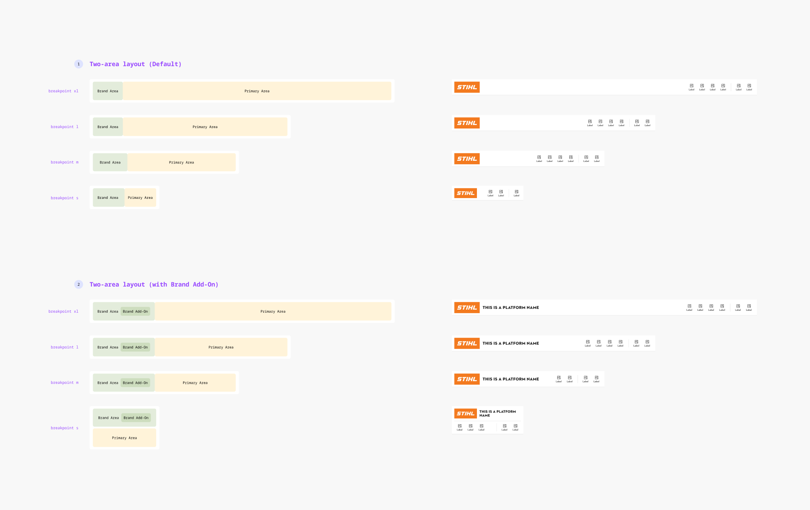

_Figure: Responsive behavior of the two-area Top Bar, as schematic area blocks next to real bars at breakpoints xl, l, m and s. Callout 1, "Two-area layout (Default)": Brand Area and Primary Area stay side by side in one row at every breakpoint. Callout 2, "Two-area layout (with Brand Add-On)": the Brand Area includes the Brand Add-On ("This is a Platform name") and stays in one row at xl, l and m, but at s the Primary Area is stacked below the Brand Area._

#### Top Bar responsive behavior – Three-area layout

**Includes**:

Brand Area

Primary Area

Secondary Area

1. **Default**
   - **Breakpoints xl and l:** All areas are placed inline, in a single row
   - **Breakpoints m and s:** The Primary Area (typically containing a search bar) moves below the Brand Area and Secondary Area. The Brand Area remains left-aligned, the Secondary Area stays top-right
1. **With Brand Add-On**
   - **Breakpoints xl and l:** All areas are placed inline, in a single row
   - **Breakpoint** **m**: The Brand Area and Secondary Area appear side by side, while the Primary Area shifts below and spans the full width.
   - **Breakpoint** **s**: The Brand Area spans the full width. The Primary Area and Secondary Area are placed side by side underneath the Brand Area

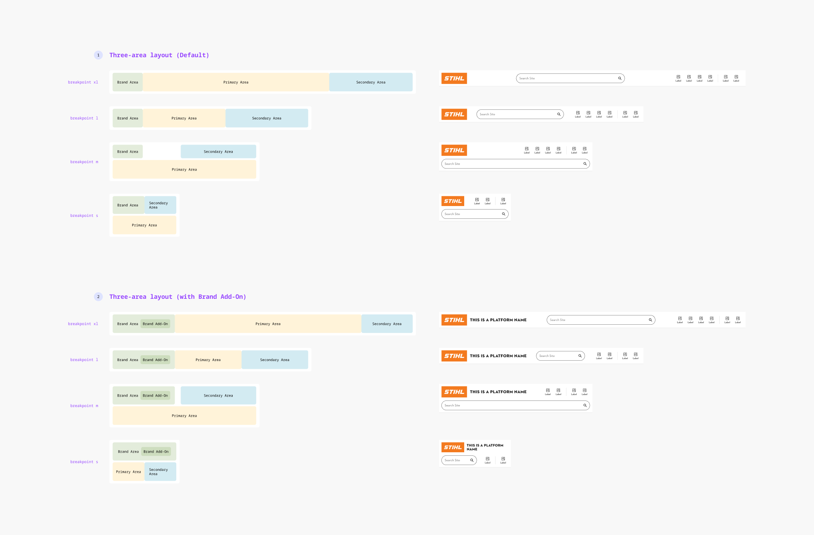

_Figure: Responsive behavior of the three-area Top Bar, as schematic blocks (Brand Area, Primary Area, Secondary Area) next to real bars at breakpoints xl, l, m and s. Callout 1, "Three-area layout (Default)": all three areas are in one row at xl and l; at m and s the Primary Area with the "Search Site" field drops below the Brand Area and Secondary Area. Callout 2, "Three-area layout (with Brand Add-On)": same at xl and l and at m; at s the Brand Area with Brand Add-On is on top and the Primary Area and Secondary Area sit side by side below it._

#### Combinations and flexibility

The responsive behaviors described above are **recommended best practices** and have been tested for usability and performance.

However, specific use cases may require different responsive approaches. Its components and responsive logic can be customized per breakpoint:

For example, if the Search function should be prominent on desktop but takes a secondary role on tablet and mobile, it can be displayed as a full **Search Field** on desktop and as an **Action Item** on smaller screens.

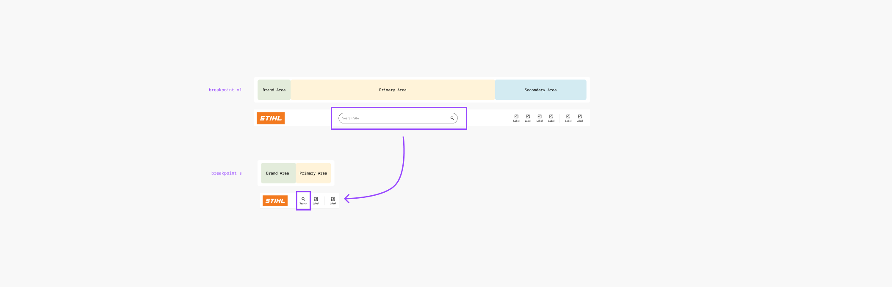

_Figure: Example of a per-breakpoint customization: at breakpoint xl the Top Bar shows the full "Search Site" field in the Primary Area between Brand Area and Secondary Area, while at breakpoint s the same search is shown as a "Search" action item (magnifier icon) in the Primary Area next to the logo, highlighted with a purple frame and an arrow from the xl search field._

### Grid Variants

The Top Bar can be configured using two layout variants:

**1. Main**

- **Content width:** Aligned with the main content area
- **Use case:** Ideal for e-commerce, brand, or marketing pages
- **Effect:** More white space left and right creates a clean and open appearance
- **Reference:** [Grid Guidelines](https://www.figma.com/design/JyyYtoCYbtJrzqHs38OXSQ/Grid---Spacing-%F0%9F%A7%AE?node-id=1-857&t=s1tr0PVToE1CuUp6-4)

**2. Full**

- **Content width:** Spans the full screen width
- **Use case:** Suitable for dashboards, internal tools, or content-dense interfaces
- **Effect:** Maximizes horizontal space; often used together with a sidebar
- **Reference:** [Grid Guidelines](https://www.figma.com/design/JyyYtoCYbtJrzqHs38OXSQ/Grid---Spacing-%F0%9F%A7%AE?node-id=1-857&t=s1tr0PVToE1CuUp6-4)

**a. Desktop b. Mobile** At **breakpoint** **m** and **s**, the Top Bar automatically adjusts to span the full width of the screen.

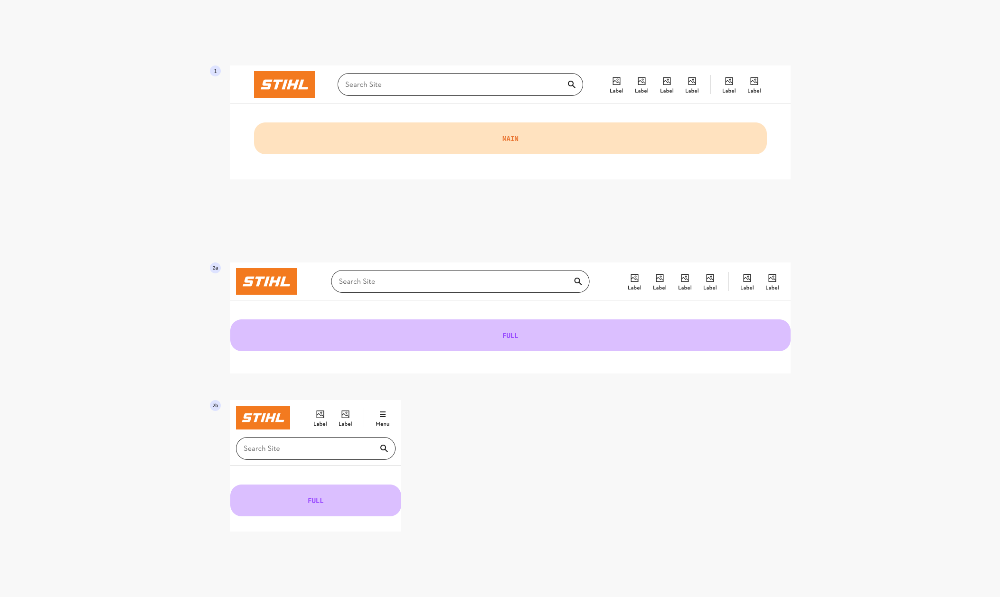

_Figure: Callout 1: Top Bar with grid variant "main" (breakpoint l), whose content aligns with the main content area, shown above a peach "MAIN" content block that is inset from the edges. Callout 2a: grid variant "Full" at the same width, where logo and action items sit near the screen edges above a lilac "FULL" block spanning the whole width. Callout 2b: the Full variant at a narrow breakpoint (s), with logo, two action items and a "Menu" item, the "Search Site" field below, and a full-width "FULL" block._

#### Do not modify the breakpoint properties of nested components.

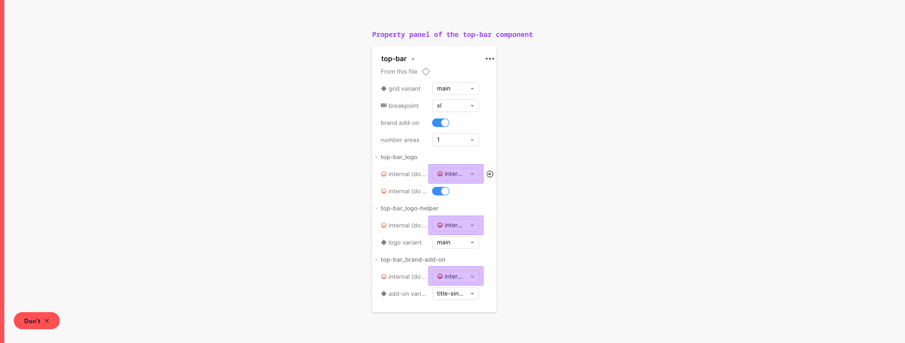

_Figure: Don't example: the "Property panel of the top-bar component" (grid variant main, breakpoint xl, brand add-on on, number areas 1) with the nested components top-bar\_logo, top-bar\_logo-helper and top-bar\_brand-add-on expanded. The internal (do not modify) breakpoint dropdowns of each nested component are highlighted in purple, marking that these nested breakpoint properties must not be changed individually._

#### Do modify the overall breakpoint property that’s affecting all nested components.

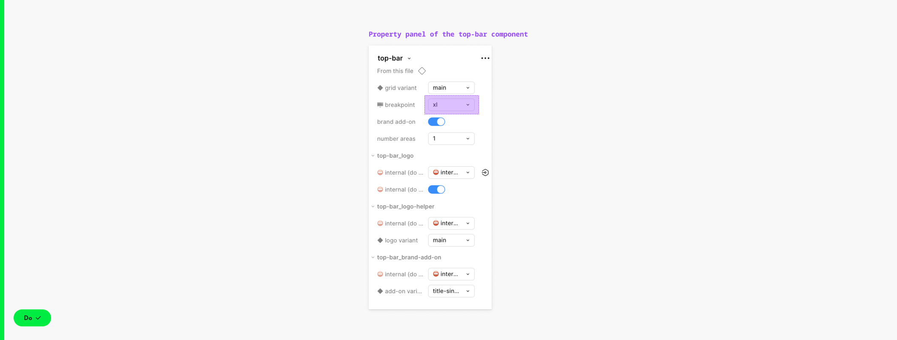

_Figure: Do example: the "Property panel of the top-bar component" (grid variant main, breakpoint xl, brand add-on on, number areas 1) with the nested components expanded. Only the top-level breakpoint dropdown (xl) is highlighted in purple, marking that the overall breakpoint property is the one to change, as it affects all nested components._

### Scroll behaviour

The Header adapts dynamically to the user's scroll direction to optimize visibility and usability:

1. **Default (Top of Page):** Top Bar and Nav Bar are visible.
1. **On Scroll Down:** Nav Bar hides to maximize content visibility. The Top Bar remains visible for persistent access to tools like search, cart, or profile.
1. **On Scroll Up:** Nav Bar reappears for easy access. The Top Bar is still visible.
1. **Back at Top:** Both Top Bar and Nav Bar are fully visible again.

#### Motion

**Animation type:** move up/down **Duration:** 400ms **Easing:** motion-functional-ease-out

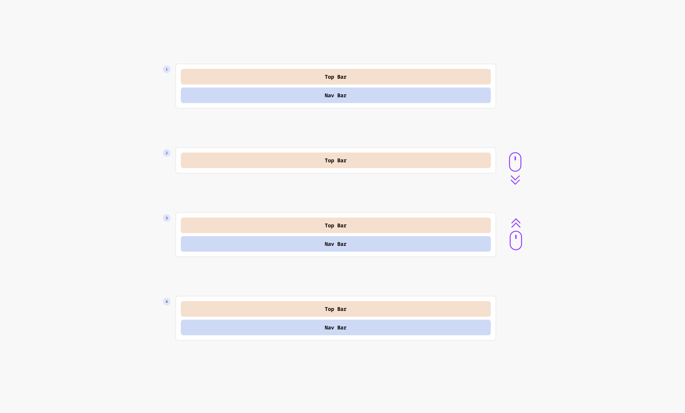

_Figure: Four stacked states of the navigation scroll behavior, each a white frame with colored bars labeled "Top Bar" and "Nav Bar". Callout 1 shows Top Bar above Nav Bar at the page top; callout 2 shows only the Top Bar after scrolling down (mouse icon with a downward double chevron); callout 3 shows Top Bar and Nav Bar again after scrolling up (upward double chevron above a mouse icon); callout 4 shows Top Bar and Nav Bar in the final state._

## Top Bar: Brand Area

### Elements

The Brand Area consists of two interchangeable elements, offering maximum flexibility to accommodate a wide range of use cases:

1. **Logo** The Logo component ([see Core Component Library](https://www.figma.com/design/qXldpLO6gxHJNLdcXIPxYt/Core-Components-%F0%9F%92%A0?node-id=9050-2)) is used in this instance. It supports both the primary STIHL logo and official digital product logos (e.g., STIHL Connected, MySTIHL, etc.). If your specific logo is not yet available, use the main STIHL logo as a temporary solution and contact us [here](https://www.figma.com/design/lLmw7PfIdKjFG4uT3B2Hyj/Onboarding-%F0%9F%93%96?node-id=446-868&t=A0kNEkSswKSae9BE-4) to request a variant.
1. **Brand Add-On (optional)** The Brand Add-On provides an additional slot that can be combined with the logo. Available variations include:
   1. **Title – Single** Used for digital product or platform names. (e.g. "STIHL Connected" - see example in use case section below)
   1. **Title – Double** Intended for authorized dealers or official importers. (See example in use case section below)
   1. **Placeholder** A flexible slot for use cases not covered above — such as anniversary badges (e.g., 100 Years of STIHL) or localized components like the U.S. shop dealer information that must remain visible in the top bar. (See examples in use case section below)

> **Note:** To ensure proper scaling in the Figma component, a Logo Helper component has been included (Figma only).

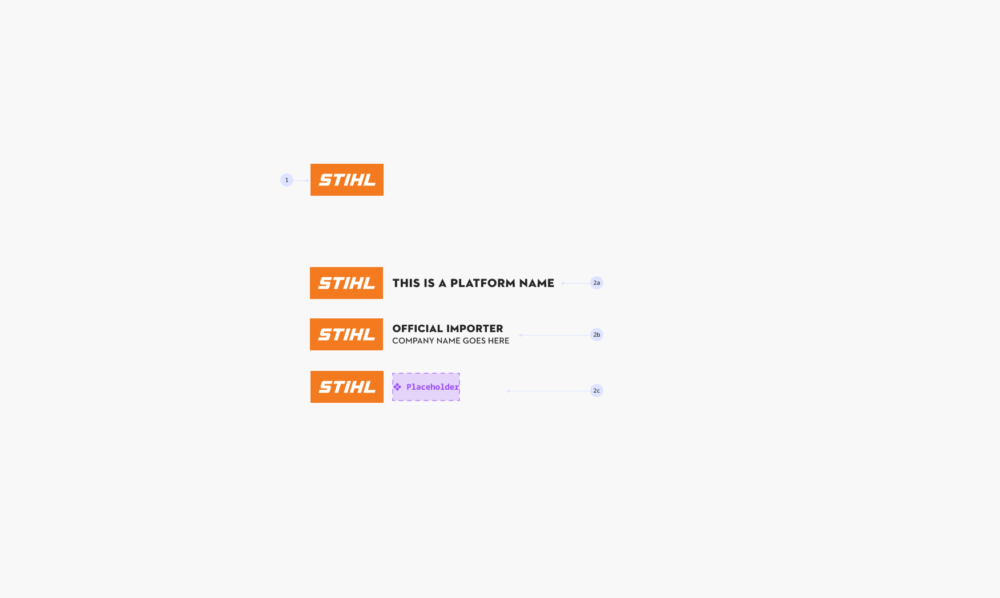

_Figure: Brand Area elements on a light background. Callout 1 points at the orange STIHL logo alone; the second group shows the logo with a brand add-on in three variants: 2a "This is a Platform name" as a single-line title, 2b "Official importer" with the second line "Company name goes here" as a double-line title, and 2c a dashed purple "Placeholder" instance for an additional logo._

### Logo

#### Don’t modify the ‘logo’ element directly.

Otherwise it may cause unexpected behaviour.

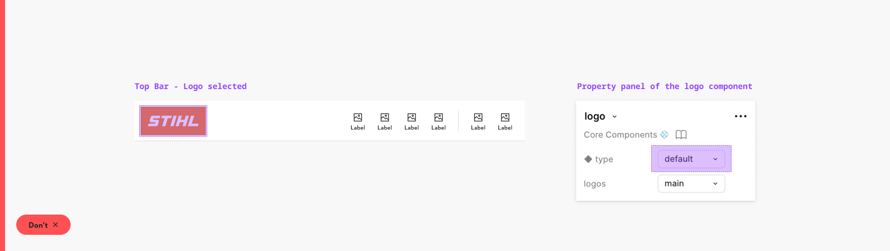

_Figure: Don't example: "Top Bar - Logo selected" shows a top bar with the STIHL logo selected directly (highlighted in purple) next to six icon items labeled "Label", and the "Property panel of the logo component" shows the logo component with its type dropdown (default) highlighted and logos set to main. Modifying the logo element directly this way may cause unexpected behaviour._

#### Do modify the ‘logo’ element through the Top Bar component property panel.

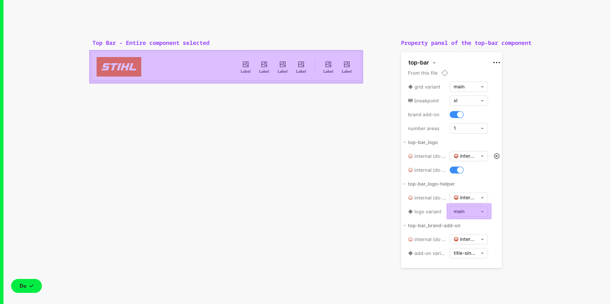

_Figure: Do example: "Top Bar - Entire component selected" shows the whole top bar highlighted in purple (STIHL logo and six icon items labeled "Label"), and the "Property panel of the top-bar component" (grid variant main, breakpoint xl, brand add-on on, number areas 1) has the logo variant dropdown (main) under top-bar\_logo-helper highlighted. The logo is modified through the Top Bar property panel._

### Brand Add-On

**Brand Add-On use cases**

On the right are examples of how the Brand Add-On can be used.

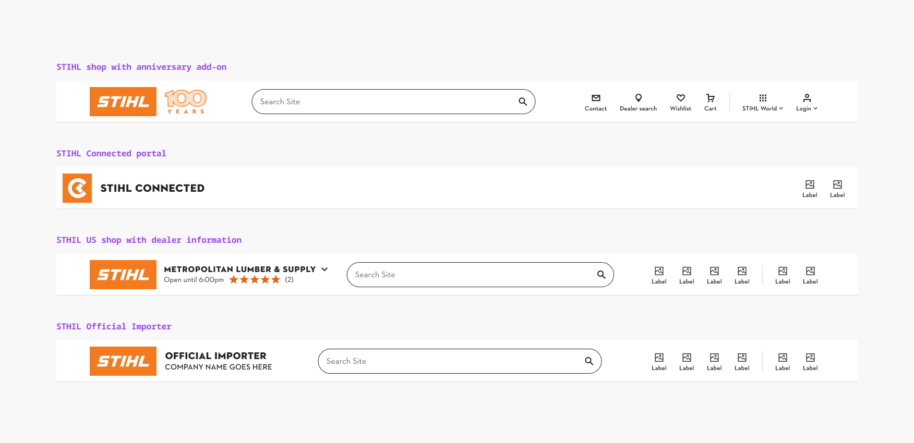

_Figure: Four top bar examples using the Brand Add-On: "STIHL shop with anniversary add-on" (STIHL logo with a 100 Years mark, search field "Search Site", and icons Contact, Dealer search, Wishlist, Cart, STIHL World, Login); "STIHL Connected portal" (STIHL Connected logo and title with two "Label" icons); "STHIL US shop with dealer information" (STIHL logo with dealer name "Metropolitan Lumber & Supply", "Open until 6:00pm", five-star rating "(2)", search field and six "Label" icons); and "STHIL Official Importer" (STIHL logo with "Official importer" and "Company name goes here", search field and six "Label" icons)._

### Brand Add-On max length

To ensure proper spacing and visual consistency, the following character limits apply to Brand Add-On titles:

1. **Title Single:** Maximum 24 characters
1. **Title Double:** First line: Maximum 14 characters Second line: Maximum 18 characters

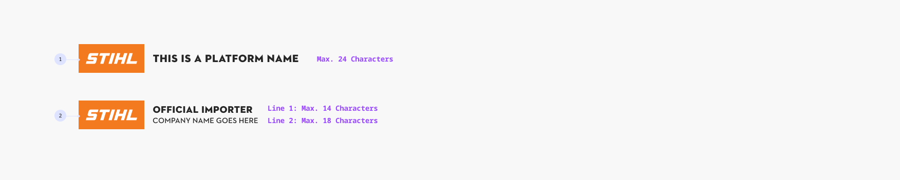

_Figure: Maximum lengths for Brand Add-On titles next to the STIHL logo. Callout 1 is the single-line title "This is a Platform name" with a limit of "Max. 24 Characters"; callout 2 is the double-line title "Official importer" / "Company name goes here" with "Line 1: Max. 14 Characters" and "Line 2: Max. 18 Characters"._

### Link Behavior

Both the logo and the brand add-on can be linked. While it’s technically possible to assign different link destinations to each element, it is strongly recommended to use the same destination for both. Users generally perceive the logo and add-on as a unified element and expect a consistent linking behavior.

The most common link destination is the product’s main homepage.

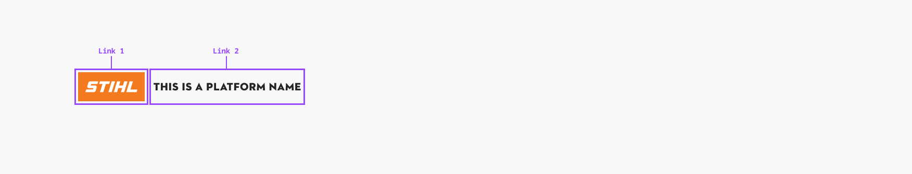

_Figure: The STIHL logo with the brand add-on title "This is a Platform name", each outlined in purple as a separate link target: "Link 1" for the logo and "Link 2" for the add-on title. Both are linkable, and they should preferably share the same destination._

### Additional Logo usage

To add another logo, replace “.placeholder: generic” by using Swap Instance.

Ensure the additional logo remains smaller than the main logo. To obtain a visual balance the placeholder component includes a built-in safety padding (xl–m: 4px, s: 2px).

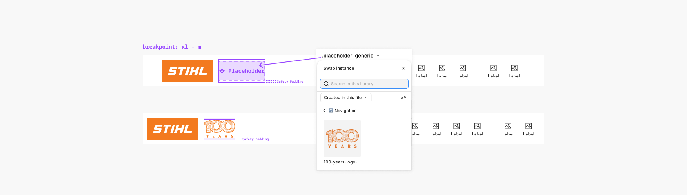

_Figure: Adding another logo to the top bar for "breakpoint: xl – m". In the upper top bar the dashed purple "Placeholder" (.placeholder: generic) next to the STIHL logo is replaced via a "Swap instance" panel (Navigation library, 100-years-logo), and in the lower top bar the swapped 100 Years logo sits smaller than the STIHL logo; both show a "Safety Padding" dashed marker beside the additional logo, followed by six "Label" icons._

## Top Bar: Primary and Secondary (Optional) Area

### Elements/ Building Blocks

#### Search

The Top Bar uses the Input Search Component from the [Core Component Library](https://www.figma.com/design/qXldpLO6gxHJNLdcXIPxYt/Core-Components-%F0%9F%92%A0?m=auto&node-id=2141-6712&t=SHmk2ghTC37Ex5QG-1), with a localized visual override: a custom corner radius differentiates it from in-content search fields. It inherits all states and behaviors from the base component. An example of the override is provided in the code to illustrate the styling customization.

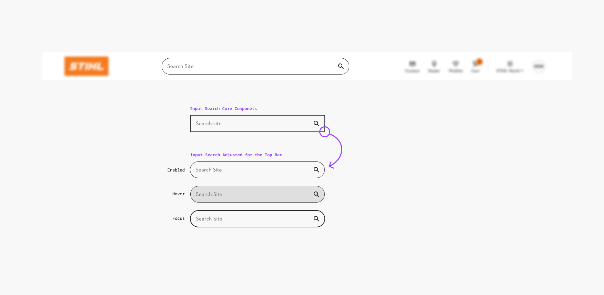

_Figure: A Top Bar (xl, two areas) with the STIHL logo, a pill-shaped "Search Site" input and action items, above a comparison of "Input Search Core Componets" (a rectangular "Search site" field with a search icon) and "Input Search Adjusted for the Top Bar" (the same field with a fully rounded corner radius). An arrow points from the core input to the adjusted one, which is shown in the states Enabled (thin outline), Hover (grey fill) and Focus (thicker outline)._

#### Icon with Text (for Reduced Navigation)

This element can be placed inside the Primary Area of the Top Bar.

**Use Case:** Commonly used in specific flows like the checkout process, where most navigation elements are hidden to reduce distractions — only the logo and this icon with text combination remain visible.

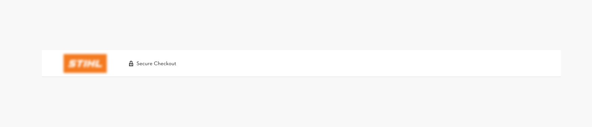

_Figure: A reduced Top Bar (xl, one area) containing only the STIHL logo and a lock icon with the text "Secure Checkout" in the Primary Area, with no search field or other action items._

#### Top Bar Nav

The Top Bar Nav can be placed in the Primary or Secondary Area of the Top Bar, depending on layout and content.

It consists of a group of **Action Items (1), Avatar (2), and Divider (3).**

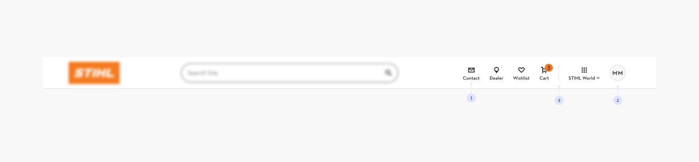

_Figure: A Top Bar (xl, two areas) with logo, search field and, on the right, the Top Bar Nav with the action items Contact, Dealer, Wishlist, Cart (with a count badge of 3) and STIHL World (with chevron), a vertical divider and an initials avatar "MM". Callout 1 marks the Action Items, callout 2 the Avatar and callout 3 the Divider._

1. **Action Items** An Action Item can be either a button or a link, depending on its function — whether it navigates to a page or triggers a Utility Menu. They are mainly used for user tools and system-level actions such as Login, Cart, Wishlist and Language Selector. Each item includes the following elements:
   1. **Icon**
   1. **Label**
   1. **Chevron (button only)**: Displayed when the item opens a dropdown menu.
   1. **Number Indicator (optional)**: Used to show specific counts, such as the number of items in a shopping cart.
   1. **Minimized Indicator (optional):** A subtle visual cue indicating an update or notification without showing an exact number —commonly used for unread messages or new alerts. In-depths documentation for Action Items can be found [here](https://www.figma.com/design/Ie2r0R9QwjEc7O3nrFbXhV?node-id=6583-73372).

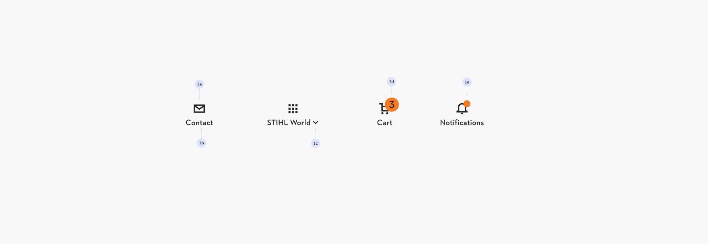

_Figure: Four Action Items in the enabled state, each with an icon above a label: Contact (1a icon, 1b label), STIHL World (a chevron, 1c, marks that it opens a dropdown menu), Cart (a number indicator "3", 1d) and Notifications (a small orange minimized indicator dot, 1e)._

1. **Avatar** The Avatar is displayed once the user is logged into their account. The component supports two variations:
   1. **Initials:** This is the default fallback when no profile image is available. The generation logic for user initials is not handled within the design system. It is the responsibility of the product development team.
   1. **Image:** Displayed when image upload is supported and the user has uploaded a profile picture.

_Figure: Two Avatar variants side by side: 2a is the initials variant showing "MM" in a circle with a grey outline, 2b is the image variant showing a profile photo of a smiling person with curly hair in a circle._

1. **Divider** The Divider visually separates items within the Top Bar Navigation:
   - **Left-side items (a):** Variable, product-specific
   - **Right-side items (b):** Core items such as STIHL World and Login/Avatar that appear consistently across platforms

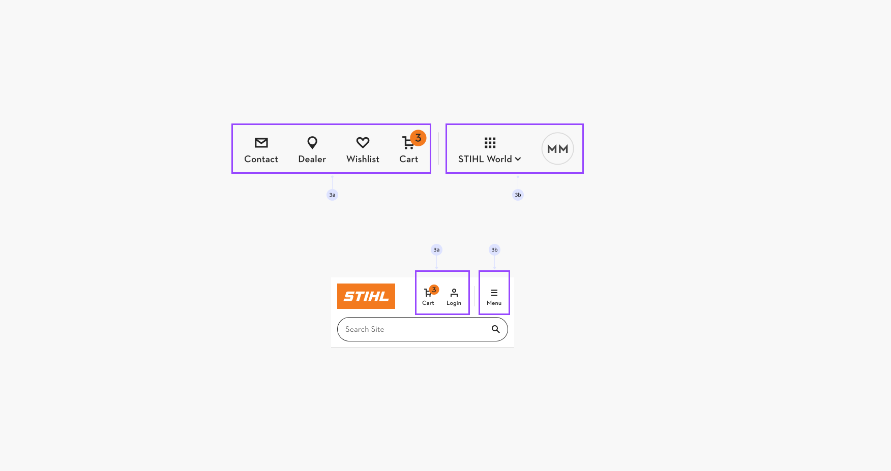

_Figure: Two Top Bar Nav groups with the Divider separating left and right items, each side outlined by a purple box. At breakpoint xl, 3a is Contact, Dealer, Wishlist and Cart (variable, product-specific items) and 3b is STIHL World and the avatar "MM" (core items). At breakpoint s, 3a is Cart (badge 3) and Login, and 3b is Menu, below the logo and a "Search Site" field._

### Content & Assets

#### Max. length Action Item label

The label for an Action Item should be no longer than **20 characters**.

To ensure clarity and usability, it’s recommended to collaborate with a UX writer to craft concise, meaningful labels that clearly communicate the item’s purpose. Labels should be brief and noun-based, avoiding action-oriented phrases or call-to-action language.

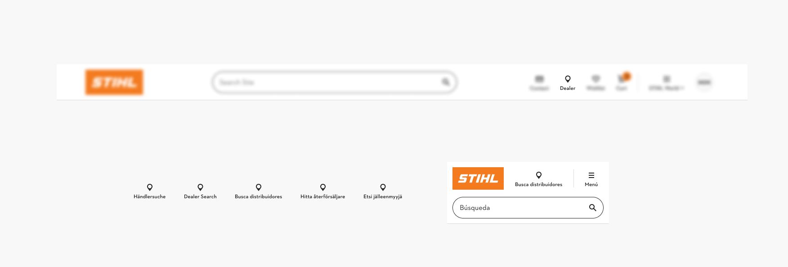

_Figure: A Top Bar at xl and a small-breakpoint Top Bar with the Dealer action item (pin icon) whose label is translated into several languages to show label lengths: Händlersuche, Dealer Search, Busca distribuidores, Hitta återförsäljare and Etsi jälleenmyyjä. The small Top Bar shows "Busca distribuidores", "Menú" and the search field "Búsqueda", demonstrating that labels stay short._

#### Action Item visibility

The number of visible Action Items depends on:

- Breakpoint size (xl, l, m, s)
- Layout type (e.g., 2 vs. 3 areas)
- Use of Brand Add-On

**For breakpoint from xl to l:**

- display **max. 6 Action Items** at a time to reduce cognitive load

**For breakpoint m and s:**

- Low-priority items should be moved to the Mobile Menu
- Each product team should define which items are kept and which are moved

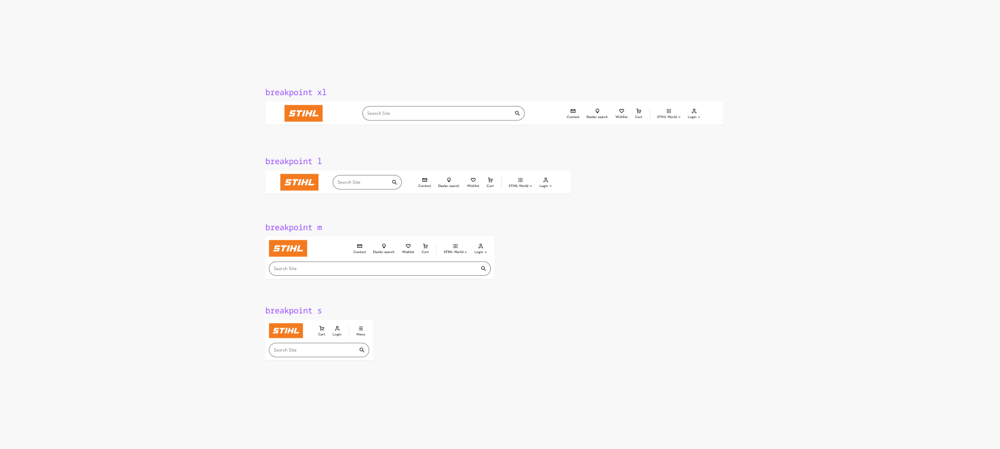

_Figure: The Top Bar with two areas at four breakpoints. Breakpoint xl, l and m show the full set of action items (Contact, Dealer search, Wishlist, Cart, STIHL World, Login), with the search field beside the logo at xl and l and on its own row at m. Breakpoint s reduces the items to Cart, Login and Menu, with the search field on a second row._

### Examples and Use Cases

#### Search behaviour

On click, the Search Field opens a **combobox** that displays suggestions based on user input, with the option to **group the results into categories.**

The same behaviour applies to smaller screens.

**Please note:** This behaviour is not yet available in code.

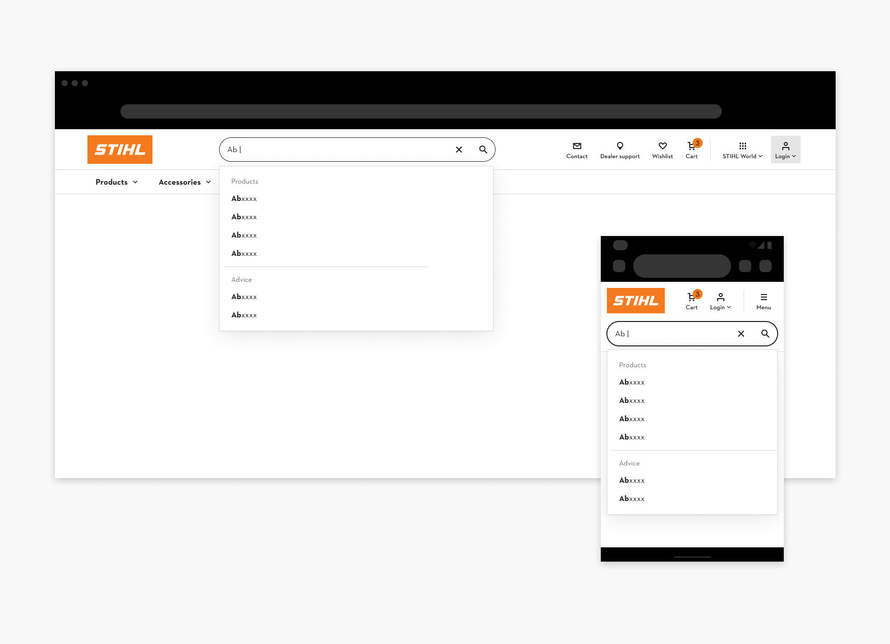

_Figure: Shows top-bar\_logo (internal (do not modify) 🖥️ breakpoint=⛔️ internal (do not modify): m - xl); popover (arrow=false, arrow placement=none, arrow alignment=none, color=white); top-bar\_nav (alignment=right); nav-bar (variant=main, breakpoint=xl); top-bar (grid variant=main, breakpoint=s, brand add-on=false, number areas=2). Text in the figure: "Ab |", "Products", "Abxxxx", "Advice", "Contact", "Dealer support", "Wishlist", "3", "Cart", "STIHL World", "Login", "Accessories", "Professionals", "Support", "Menu"._

#### Login

The “**Login” Action Item** **(1)** opens a **Utility Menu (2)** when clicked, containing several links that all direct the user to the **Login / Create Account page** **(3)**.

Once the user has successfully logged in or created an account, the Action Item in the Top Bar is replaced by the **Avatar** **component** **(4)**.

Clicking the **Avatar (5)** opens a different **Utility Menu (6)**, displaying the user’s name, profile picture, links to sections within the profile, and a Sign Out button.

**Please note:** This Avatar section within the Utility Menu is not yet available as a component. It will be provided in a future release.

On **breakpoint s** and **m**, Utility Menus are not used. Instead:

- If the user is **not logged in**, tapping the Action Item navigates directly to the **Login / Create Account** page.
- If the user is **logged in**, it navigates directly to the **User Profile** page.

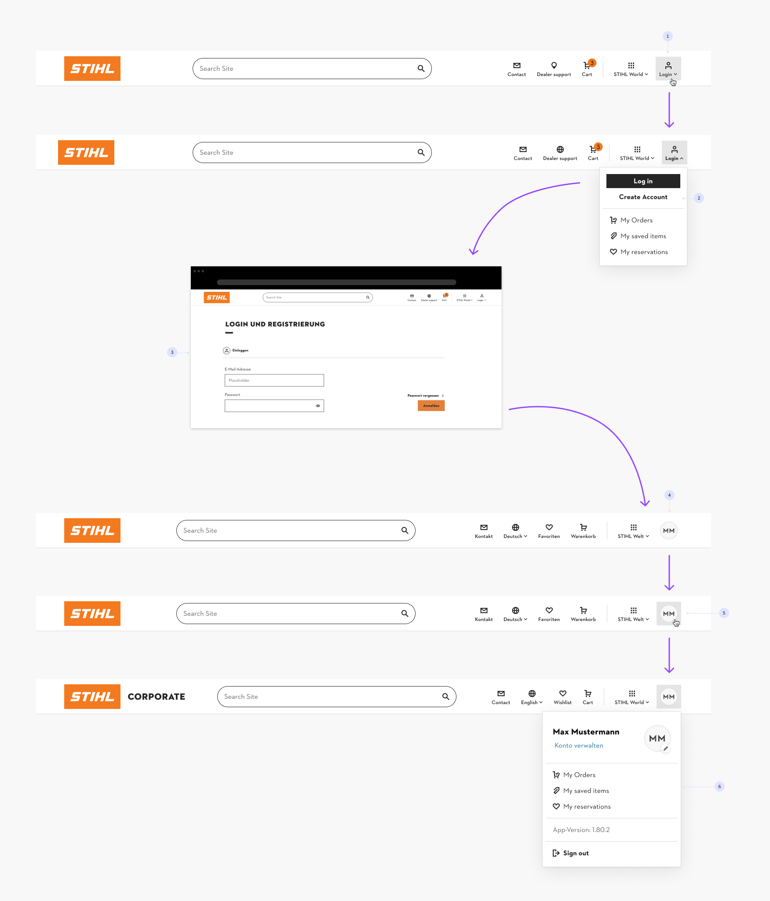

_Figure: Login flow in six numbered steps from top to bottom. 1: the "Login" Action Item in the Top Bar is clicked. 2: it opens a Utility Menu with the buttons "Log in" and "Create Account" and the links My Orders, My saved items and My reservations. 3: these lead to the Login and registration page with email and password fields. 4: after login the Action Item is replaced by the avatar "MM". 5: the avatar is clicked. 6: it opens a Utility Menu with the user name "Max Mustermann", "Konto verwalten", a profile picture, the links My Orders, My saved items and My reservations, the app version and a "Sign out" button._

#### Language selector

The **“Language” Action Item (1)** opens a **Utility Menu (2)** when clicked, containing a search field and a list of language options.

Once a language is selected, the chosen option is displayed as the **label** within the **Action Item (3)**.

**Please note:** This is a temporary solution that will be reviewed and optimized in future sprints.

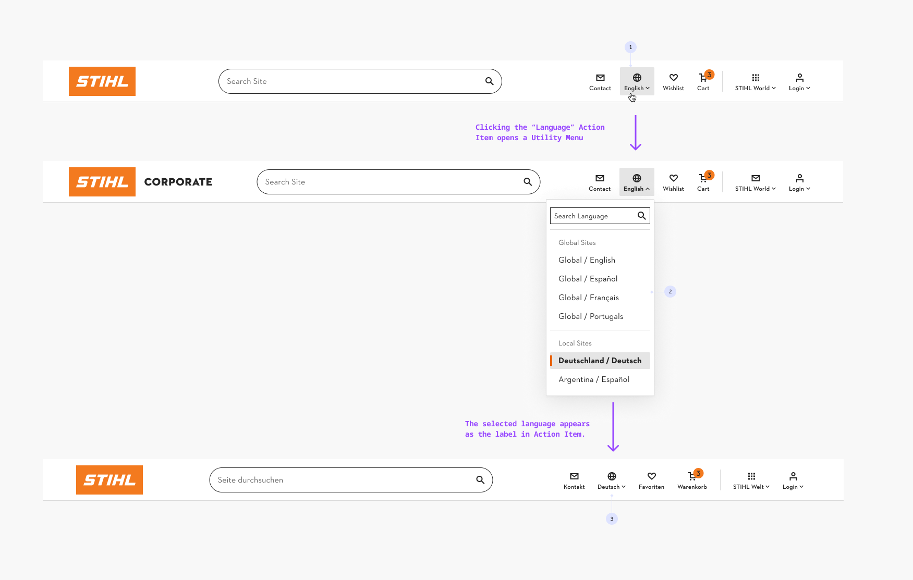

_Figure: Shows annotation-circle (number=1, type=top, color=blue); top-bar (grid variant=main, breakpoint=l, brand add-on=true, number areas=2); cursor (type=pointer); annotation-circle (number=2, type=right, color=blue); top-bar (grid variant=main, breakpoint=xl, brand add-on=false, number areas=2); annotation-circle (number=3, type=bottom, color=blue). Callouts 1, 2, 3. Text in the figure: "Search Site", "Contact", "English", "Wishlist", "3", "Cart", "STIHL World", "Login", "Clicking the “Language” Action Item opens a Utility Menu", "corporate", "Search Language", "Global Sites", "Global / English", "Global / Español", "Global / Français", "Global / Portugals", "Local Sites", "Deutschland / Deutsch", "Argentina / Español", "The selected language appears as the label in Action Item.", "Seite durchsuchen", "Kontakt", "Deutsch", "Favoriten"._

## Top Bar: Accessibility

### Focus Order

1. **Skip Link** Provides a quick way to bypass header content for keyboard users. Appears in the top-left corner when using keyboard navigation.
1. **Top Bar**
   1. **Logo** Should be focusable only if it functions as a link (typically to the homepage).
   1. **Primary Area** Focus moves from left to right if multiple elements are present.
   1. **Secondary Area** Focus moves from left to right if multiple elements are present.

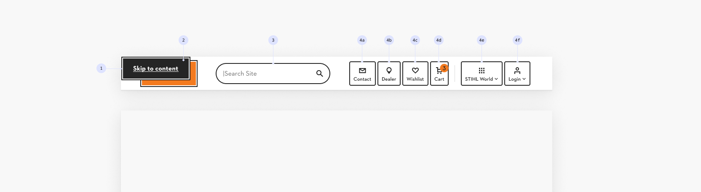

_Figure: Top Bar with the focus order marked by blue callouts: 1 is the "Skip to content" Skip Link at the top left, 2 the logo, 3 the "Search Site" input, and 4a to 4f the Secondary Area items Contact, Dealer, Wishlist, Cart (badge 3), STIHL World and Login, each shown with a focus outline from left to right._

### Keyboard Navigation

Users can navigate through focusable elements in the Top Bar using the keyboard:

- to move forward to the next focusable element by pressing **“Tab”**
- to move backward to the previous element by pressing **“Shift + Tab”**
- to open a Utility Menu by pressing **“Space”** or **“Enter”**
- to close or exit a Utility Menu by pressing **“Esc”**
- to navigate to a page by pressing **“Enter”**

_Figure: Five Top Bar examples of keyboard navigation: "Tab" moves focus to the next focusable element (Contact to Dealer), "Tab" + "Shift" moves to the previous one (Dealer back to Contact), "Space" or "Enter" opens the Utility Menu from the focused Login item (an empty dashed panel appears below it), "Esc" closes the open Login menu (Log in, Create Account, My Orders, My saved items, My reservations), and "Enter" on the focused Wishlist item navigates to a page (shown as a dashed content area)._

## Building elements

_Figure: Building elements of the Top Bar logo area: "Top Bar – Logo" shows the STIHL logo with the text "THIS IS A PLATFORM NAME" at breakpoint s and at breakpoint m - xl (larger); "Top Bar – Logo Helper" shows the logo variants Main, Main reduced, Connected, MySTIHL and iMow at breakpoint s and m - xl; "Top Bar – Brand Add-on" shows the variants title - single ("THIS IS A PLATFORM NAME"), title - double ("OFFICIAL IMPORTER" with "COMPANY NAME GOES HERE") and placeholder at both breakpoints, with a note "Name Max. Characters: 24"._

_Figure: Building element "Top Bar – Search": a rounded "Search Site" input with a search button, next to a square-cornered standard "Search site" input and a warning notification "Developement Status" explaining that the input search component is manually overwritten for the Top Bar (rounded corners, all states and styles retained) and that an optimized variant will be added later; on the right, the enabled, hover and focus states are shown for the "entire search" and for the "button in input search" (the hover or focus highlight applies to the whole field or only to the button)._

_Figure: Building element "Top Bar – Nav": rows of icon Action Items labelled "Label" with a vertical divider separating the last two, shown for "alignment: right" (all items grouped on the right) and "alignment: center"; an example Top Bar with logo, search and Contact, Dealer, Wishlist, Cart (badge), STIHL World and an "MM" avatar illustrates the placement._

_Figure: Building element "Top Bar – Text with icon": a "Placerholder text" element with icon and an info notice stating that it should not be used alongside navigation items, is reserved for critical information such as security messages during checkout, and has a maximum of 60 characters; the example shows a Top Bar with the STIHL logo and a lock icon with the text "Secure Checkout"._

_Figure: Building element "Top Bar – Avatar" with a warning notification "Development Status" that the component exists only in Figma and is not yet implemented as a standalone component in code; the Avatar (round "MM" initials) is shown in the states enabled, hover, active and focus, the Avatar Building Block in the variants initials and image (a photo), and an example Top Bar ends with the "MM" avatar._

## Header: Nav Bar

Overview:

- Represents the **primary level of navigation** and defines the core structure of the site or platform
- Includes **links to key sections** — such as Products, Services, or Blog — guiding users through the main content and helping them understand the overall offering
- For **breakpoint s** and **m** it moves inside the Mobile Menu
- **Optional usage:** The Nav Bar is an optional component within the Header layout. It is recommended when the platform or site has multiple core sections that users need to access frequently or in a structured way — such as Products, Services, or Resources. In simplified or focused flows (e.g., onboarding, checkout, standalone tools), the Nav Bar may be omitted to reduce distractions and streamline the interface.

> **Development Status:** This component currently exists only in Figma. In development, it is based on the Scroller component.

_Figure: Main Component of the Nav Bar: a row of seven "Button nav" items shown for variant: main and variant: full at breakpoint: xl and breakpoint: l (the xl bars are wider than the l bars), with an info notice that the Nav Bar is visible only on desktop and is moved into the mobile menu on tablet and mobile, linking to the Mobile documentation._

_Figure: "Nav Bar – Group" with seven "Button nav" items in four overflow states: overflow right: false and overflow left: false shows all items; overflow right: true shows a dark right arrow button over a partly cut last item; overflow left: true shows a dark left arrow button over a partly cut first item; both true shows arrow buttons on both sides._

### Further guidelines

[Storybook Documentation](https://main--63440bbb95889041542a5ba3.chromatic.com/?path=/docs/components-scroller--documentation)

### Related elements

[Top Bar](https://www.figma.com/design/Ie2r0R9QwjEc7O3nrFbXhV?node-id=6576-38939)

[Mega Menu](https://www.figma.com/design/Ie2r0R9QwjEc7O3nrFbXhV?node-id=6583-87264)

[Dropdown Menu](https://www.figma.com/design/Ie2r0R9QwjEc7O3nrFbXhV?node-id=6583-85690)

[Button Nav](https://www.figma.com/design/qXldpLO6gxHJNLdcXIPxYt/Core-Components-%F0%9F%92%A0?node-id=34553-28432&t=3sTzEA7VPrbAfAzB-4)

[Mobile Menu](https://www.figma.com/design/Ie2r0R9QwjEc7O3nrFbXhV?node-id=6583-64557)

[Motion Design](https://www.figma.com/design/UYHZEckQObDvLuuRoMP8ps/Styles-%F0%9F%AA%AD?node-id=1-148)

### Contribute

Contribute to improving this component by sharing your feedback, asking questions, or suggesting features [here](https://www.figma.com/design/lLmw7PfIdKjFG4uT3B2Hyj/Onboarding-%F0%9F%93%96?node-id=446-868&t=zKmRu4kAkxMeRDmK-4).

## Nav Bar: Formatting and Construction

### Anatomy

#### Elements

The Nav Bar is a key element in the header pattern and is composed of the following components:

1. **Nav Bar Group** Organizes navigation items and includes a button for overflow handling when space is limited.
1. **Button Nav Variant** A button style specifically designed for use within the Nav Bar. More [here](https://www.figma.com/design/qXldpLO6gxHJNLdcXIPxYt/Core-Components-%F0%9F%92%A0?node-id=34553-28432&t=1rKqAUVYwkeozHmM-4).
1. **Icon Button (Conditional )** An icon-only button, placed on the left or right side. It includes chevrons to indicate additional hidden items due to overflow.

_Figure: Two Nav Bar rows (breakpoint L) with seven "Button nav" items each. In the top row, callout 1 points at the highlighted Nav Bar Group that contains all items. In the bottom row, callout 2 points at one "Button nav" item shown in a highlighted state and callout 3 points at the dark Icon Button with a left chevron at the left edge, which indicates hidden items that overflow._

### Grid Variants

The Nav Bar can be configured using two layout variants:

**1. Main**

- **Content width:** Aligned with the main content area
- **Use case:** Ideal for e-commerce, brand, or marketing pages
- **Effect:** More white space left and right creates a clean and open appearance
- **Reference:** [Grid Guidelines](https://www.figma.com/design/JyyYtoCYbtJrzqHs38OXSQ/Grid---Spacing-%F0%9F%A7%AE?node-id=1-857&t=s1tr0PVToE1CuUp6-4)

**2. Full**

- **Content width:** Spans the full screen width
- **Use case:** Suitable for dashboards, internal tools, or content-dense interfaces
- **Effect:** Maximizes horizontal space; often used together with a sidebar
- **Reference:** [Grid Guidelines](https://www.figma.com/design/JyyYtoCYbtJrzqHs38OXSQ/Grid---Spacing-%F0%9F%A7%AE?node-id=1-857&t=s1tr0PVToE1CuUp6-4)

**a. Desktop b. Mobile** At **breakpoint** **m** and **s**, the Nav Bar content is no longer displayed directly and is instead accessible through a **Mobile Menu**.

_Figure: Three header layouts, each with STIHL logo, "Search Site" field, icon buttons labelled "Label" and a Nav Bar of seven "Button nav" items. Callout 1 is the "main" variant at breakpoint L, where content sits within the main content area with white space left and right. Callout 2a is the "Full" variant at breakpoint L, where the header spans the full screen width. Callout 2b is the "Full" variant at breakpoint S, where the logo, two icon buttons and a "Menu" button are in the top row and the search field sits below._

## Nav Bar: Content and Assets

### Amount of items in the Nav Bar

While the Nav Bar is flexible and supports a dynamic number of items, we recommend adhering to the following best practices to ensure clarity, usability, and accessibility:

- **Use clear and concise labels.** Each item should clearly communicate its destination or function. Avoid jargon or overly technical terms unless appropriate for your audience.
- **Group related items logically.** For large menus, consider Dropdown Menus or Mega Menu to organize related links.
- **Prioritize key actions.** Place the most important or frequently used links first.
- **Avoid overwhelming the user.** Too many navigation choices can reduce usability and increase cognitive load. Focus on what’s most relevant to your users.

_Figure: Header at breakpoint L (main variant) with STIHL logo, "Search Site" field and utility buttons "Contact", "Dealer", "Wishlist", "Cart" (badge "3"), "STIHL World" and "Login". The Nav Bar below shows six items that fit comfortably: "Chainsaws", "Lawn Mowers", "Hedge Trimmers", "Batteries & Chargers", "Vacuum Shredders" and "Grass Trimmers"._

### Maximum character in the label

For navigation links and menu items, aim to keep label text **between 20 and 25 characters** whenever possible. Shorter labels help maintain a clean layout and ensure readability across devices. However, longer labels may be necessary in specific cases, such as names or when supporting translations into other languages. Always make sure labels fit well within the available space and remain clear to users in all supported languages.

_Figure: Three example Nav Bar labels with their character counts, under the note "recommended maximum 25 character:": "Akkus und Ladegeräte" (DE: 22 characters), "Batteries and Chargers" (EN: 24 characters) and "Baterias e carregadores" (PT: 25 characters)._

### Overflow

When the number of navigation items exceeds the available horizontal space, **horizontal overflow** occurs.

In this case, **navigation buttons (left and/or right)** appear, enabling users to scroll through the hidden items — either by clicking the buttons or using horizontal mouse scrolling.

(For keyboard navigation details, see the Accessibility section on the next page)

_Figure: Three Nav Bars (breakpoint L) with items "Chainsaws", "Vacuum Shredders", "Hedge Trimmers", "Batteries & Chargers", "Lawn Mowers", "Grass Trimmers" and "Pressure Washers". "overflow right" shows a dark right chevron button at the right edge, with the last item cut off. "overflow left" shows a dark left chevron button at the left edge, with the first item cut off. "overflow left and right" shows both chevron buttons._

### Link vs. Button

The Nav Bar Items ca be implemented as either a **link (1)** or a **button (2)**. When used as a **button,** it includes a **chevron icon** to indicate that it triggers a Dropdown Menu or Mega Menu.

_Figure: Header at breakpoint L (main variant) whose Nav Bar contains "Products", "Accessories", "Professionals", "Advice" and "Support". Callout 1 points at "Products", a plain link item without an icon. Callout 2 points at "Professionals", a button item with a chevron icon that indicates it opens a Dropdown Menu or Mega Menu._

### Motion

**Animation type:** move left/right **Duration:** 400ms **Easing:** motion-functional-ease-out

_Figure: Nav Bar (breakpoint L) with items "Chainsaws", "Vacuum Shredders", "Hedge Trimmers", "Batteries & Chargers", "Lawn Mowers", "Grass Trimmers" and "Pressure Washers", with left and right chevron buttons at both edges. A purple double-headed arrow below the bar shows the items moving horizontally, left and right, when scrolling._

## Nav Bar: Accessibility

### Focus Order

1. **Scroll container** When horizontal overflow is active, the entire Nav Bar container becomes focusable. It receives a visible outline and allows horizontal scrolling using arrow keys left and right. This enables users to explore hidden navigation items without tabbing through every element. The scroll container does not replace item-level navigation — it enhances it when content exceeds the visible width.
1. **Buttons Nav** Focus moves from left to right across each visible item in the Button Nav group. This includes both links and buttons (e.g., dropdown triggers).

_Figure: Two headers (breakpoint L, main variant) whose Nav Bar overflows to the right, with items "Products", "Accessories", "Professionals", "Advice", "Support", "Chainsaws" and "Vacuum Shredders". In the top one, callout 1 points at the outline around the whole Nav Bar, the scroll container that is focusable. In the bottom one, callouts 2a to 2g point at the focus outline of each individual item, from "Products" to "Vacuum Shredders", in left to right order._

### Keyboard Navigation

Users can navigate through focusable elements in the Nav Bar using the keyboard:

- to move forward to the next focusable element by pressing **“Tab”**
- to move backward to the previous element by pressing **“Shift + Tab”**
- to scroll the container horizontally by pressing **“Arrow left”** and **“Arrow right”**
- to open a Menu by pressing **“Space”** or **“Enter”**
- to navigate to a page by pressing **“Enter”**

_Figure: Shows nav-bar (variant=main, breakpoint=l). Text in the figure: "Tab", "Move to next focusable element:", "Products", "Accessories", "Professionals", "Advice", "Support", "Chainsaws", "Vacuum Shredders", "Shift", "Move to previous focusable element:", "+", "Arrow left", "Arrow right", "Scroll the container horizontally:", "or", "Space", "Enter", "Open Menu with:", "Esc", "Close Menu with:", "STIHL sustainability strategy", "Education and people", "Economic sustainability"._

## Header: Utility Menu

**Overview:**

- Built on the [Popover component](https://www.figma.com/design/qXldpLO6gxHJNLdcXIPxYt/Core-Components-%F0%9F%92%A0?node-id=35223-10505) from the Core Component Library (coming soon)
- Offers quick access to essential functions, user tools, and system-level actions — such as login, language selection, and other key options
- Displays a linear list of options triggered by a button or navigation item (e.g., Login, Language, User Avatar)
- Supports various content types, including **Text Components** (e.g., labels, section headers), **Action Items** (e.g., links to login, preferences, profile), and **Buttons** (e.g., sign out, switch context)
- Includes a flexible placeholder for custom content (e.g., User profile area, search fields)
- Utility Menus are intended for compact, focused tasks — not for deep navigation or multi-step workflows.

> **Development Status:** This pattern is currently Figma-only and not available as a standalone code component. In development, it’s implemented using the Popover component with a configurable container.

_Figure: Utility Menu, a popover opened from an anchor element (action-item, vertical, with icon, "Label" and chevron), shown with alignment left and alignment right, each with "expanded: true" (anchor active, popover open) and "expanded: false" (anchor enabled, popover closed). The popover content, "Utility Menu Content", has a "Main Title", a "Placeholder" slot, dividers, two "Group Title" sections with four "Label" action items each, a "Text" line and a ghost "Button" with an icon at the bottom._

### Related elements

[Top Bar](https://www.figma.com/design/Ie2r0R9QwjEc7O3nrFbXhV?node-id=6576-38939)

[Action Item](https://www.figma.com/design/Ie2r0R9QwjEc7O3nrFbXhV?node-id=6583-73372)

[Text Component](https://www.figma.com/design/Ie2r0R9QwjEc7O3nrFbXhV?node-id=6583-74332)

[Dialog](https://www.figma.com/design/qXldpLO6gxHJNLdcXIPxYt/Core-Components-%F0%9F%92%A0?node-id=14115-4051)

[Popover Component (coming soon)](https://www.figma.com/design/qXldpLO6gxHJNLdcXIPxYt/Core-Components-%F0%9F%92%A0?node-id=35223-10505)

[Motion Design](https://www.figma.com/design/UYHZEckQObDvLuuRoMP8ps/Styles-%F0%9F%AA%AD?node-id=1-148)

### Contribute

Contribute to improving this component by sharing your feedback, asking questions, or suggesting features [here](https://www.figma.com/design/lLmw7PfIdKjFG4uT3B2Hyj/Onboarding-%F0%9F%93%96?node-id=446-868&t=zKmRu4kAkxMeRDmK-4).

## Utility Menu: Formatting and Construction

### Anatomy

#### Elements

The Utility Menu is built on the core [Popover component](https://www.figma.com/design/qXldpLO6gxHJNLdcXIPxYt/Core-Components-%F0%9F%92%A0?node-id=35223-10505) and is used for navigation within the Top Bar.

It consists of two key elements:

1. **Anchor Element** A vertically stacked Action Item placed in the Top Bar that triggers the menu. It should include a chevron icon to indicate that it opens a menu.
1. **Utility Menu Container** A flexible container that holds the menu content. This can include Action Items, Text Elements, or other navigational components, such as User profile preview, Language search field, Dealer info or contextual notices depending on the context. Content and structure depend on the trigger context and product-specific needs. The Utility Menu is single-level only – avoid nesting or submenus.

_Figure: Utility Menu with alignment=left in the expanded state, showing an anchor element with an image icon, the label "Label" and an upward chevron, with a popover below it. Callout 1 points at the anchor element; callout 2 points at the utility menu container, which holds the "Main Title", a purple dashed "Placeholder" slot, a separator, the "Group Title" and four "Label" action items._

#### Utility Menu Container

The Utility Menu Container is flexible and can be customized. The current design in Figma is based on current user needs. The container includes the following elements:

1. **Text Components** Used for structure, grouping and plain information:
   1. Main Titles
   1. Group Titles
   1. Descriptive or informational Text
1. **Placeholder Component** A flexible slot for custom content provided by specific teams.
1. **Separators** Used to visually divide sections within the menu.
1. **Action Items** For navigation or quick access to important functions.
1. **Button Component** Used for actions such as login, logout, or call-to-action elements.

_Figure: Shows popover (arrow=false, arrow placement=none, arrow alignment=none, color=white); annotation-circle (number=1a, type=left, color=blue); annotation-circle (number=2, type=left, color=blue); annotation-circle (number=1b, type=left, color=blue); annotation-circle (number=3, type=left, color=blue); annotation-circle (number=1c, type=left, color=blue); annotation-circle (number=4, type=left, color=blue). Callouts 2, 3, 4. Text in the figure: "Main Title", "❖ Placeholder - Replace this content", "Group Title", "Label", "Text", "Button", "1a", "1b", "1c"._

### Sizing

#### Min and Max width

The width of the Utility menu is dynamic and adjusts based on the content inside — typically the width of the longest Action Item.

However, to maintain consistency and usability, the following constraints apply:

- **Minimum Width:** 200px
- **Maximum Width:** 540px

These limits ensure the utility menu remains readable and visually balanced, regardless of content length.

_Figure: Two expanded Utility Menus, each below an anchor element with the label "Label", showing the width limits. The narrow menu on the left is marked "min. 200px", and the wide menu on the right is marked "max. 540px"; both contain "Main Title", a "Placeholder" slot that fills the full width, "Group Title" and four "Label" items._

#### Maximum height

The height of the Utility Menu is determined by its content. However, to ensure proper display and avoid visual overflow, the following rule applies:

**There must be a minimum distance of 48px between the bottom of the Utility menu container and the bottom edge of the viewport.**

If the content exceeds the available space, the Utility Menu Container becomes scrollable, preventing it from extending beyond the visible area.

_Figure: Shows anchor element (label=Label, state=active, stacking=vertical, leading-element=icon, chevron=true, label-weight=regular, indent=false); popover (overflow, arrow=false, arrow placement=none, arrow alignment=none, color=white). Text in the figure: "Label", "Main Title", "❖ Placeholder", "Group Title", "Text", "Button", "min. 48px"._

### Alignment

**By default, the Utility Menu is left-aligned with its Anchor Element.**

If left alignment would cause the utility menu to **extend beyond the viewport** (e.g., when placed near the right edge of the screen or on small devices), the menu container **switches to right alignment** to remain fully visible.

This responsive behavior ensures optimal positioning and prevents content from being cut off.

_Figure: Two identical Utility Menus in a browser window, each opened from an anchor element labelled "Label" with "Main Title", "Placeholder", "Group Title" and four "Label" items. On the left, marked "alignment: left", the menu is aligned with the left edge of its anchor near the left side of the viewport; on the right, marked "alignment: right", the menu is aligned with the right edge of its anchor near the right side of the viewport so it stays fully visible._

## Utility Menu: Content and Assets

### Placeholder (Optional)

The placeholder area is optional and designed to accommodate a variety of content types — from simple elements like a **search field (1)** to more complex patterns, such as the **avatar area (2)** for login and user actions.

> **Please note:** The avatar area examples shown in this documentation are early drafts provided by stakeholders and are intended for illustrative purposes only. Functionality, specific elements, and accessibility requirements have not been evaluated, and these examples are not intended to serve as finalized design components.

_Figure: Shows popover (arrow=false, arrow placement=none, arrow alignment=none, color=white); annotation-circle (number=1, type=center, color=blue); annotation-circle (number=2, type=center, color=blue); link-default (label=Konto verwalten, variant=highlight, state=enabled, icon position=none); divider (Direction=horizontal); text (Main Title=Main Title, Text=Text, Group Title=iMOW Account, breakpoint=l + xl, variant=group title); action-item (label=Rechtliche Unterlagen, state=enabled, stacking=horizontal, leading-element=icon, chevron=false, label-weight=regular, indent=false); action-item (label=Cookies verwalten, state=enabled, stacking=horizontal, leading-element=icon, chevron=false, label-weight=regular, indent=false); text (Main Title=Main Title, Text=Text, Group Title=STIHL Account, breakpoint=l + xl, variant=group title); action-item (label=Sicherheit & Passwort, state=enabled, stacking=horizontal, leading-element=icon, chevron=false, label-weight=regular, indent=false); action-item (label=Nutzungsbedingungen, state=enabled, stacking=horizontal, leading-element=icon, chevron=false, label-weight=regular, indent=false); action-item (label=STIHL Fachhandel, state=enabled, stacking=horizontal, leading-element=icon, chevron=false, label-weight=regular, indent=false). Callouts 1, 2. Text in the figure: "Main Title", "❖ Placeholder", "Group Title", "Label", "Search Language", "Global Sites", "Global / English", "Global / Español", "Global / Français", "Global / Portugals", "Local Sites", "Deutschland / Deutsch", "Argentina / Español", "Max Mustermann", "Konto verwalten", "MM", "iMOW Account", "Rechtliche Unterlagen", "Cookies verwalten", "STIHL Account", "Sicherheit & Passwort", "Nutzungsbedingungen", "STIHL Fachhandel", "App-Version: 1.80.2"._

## Utility Menu: Behavior

### Breakpoints l and xl

- Utility Menus open as popovers from their anchor elements in the Top Bar
- Ideal for quick access to login, language switch, or user-specific actions without leaving the current page

### Breakpoints m and s

Instead, they follow one of two patterns:

1. **Open as a dialog**
- The menu content appears in a lightweight, centered dialog — ideal for short, focused tasks.
- Use case example: **Language Selector**
   - A dialog allows users to quickly search or filter for a language and make a selection. This is especially useful when no standalone language settings page exists.
1. **Redirect to page**
- The action item navigates directly to a dedicated page, such as a profile or login screen.
- Use case example: **User Menu (Login / Profile)**
   - Redirecting to a full profile or account page provides users with access to all related features in the appropriate context. In this case, an intermediate popover is unnecessary.

_Figure: Shows anchor element (label=Label, state=active, stacking=vertical, leading-element=icon, chevron=true, label-weight=regular, indent=false); popover (arrow=false, arrow placement=none, arrow alignment=none, color=white); annotation-circle (number=2, type=center, color=blue); annotation-circle (number=1, type=center, color=blue); header-dialog (heading, close button, viewport=mobile); input-search (system feedback, submit button, placeholder, hint, size=input-search-small, state=enabled, invalid=false); divider (Direction=horizontal); text (Main Title=Main Title, Text=Text, Group Title=Global Sites, breakpoint=l + xl, variant=group title); action-item (label=Global / English, state=enabled, stacking=horizontal, leading-element=none, chevron=false, label-weight=regular, indent=false); action-item (label=Global / Español, state=enabled, stacking=horizontal, leading-element=none, chevron=false, label-weight=regular, indent=false); action-item (label=Global / Français, state=enabled, stacking=horizontal, leading-element=none, chevron=false, label-weight=regular, indent=false); action-item (label=Global / Portugals, state=enabled, stacking=horizontal, leading-element=none, chevron=false, label-weight=regular, indent=false). Callouts 1, 2. Text in the figure: "Breakpoints l and xl", "❖ Placeholder", "Breakpoints m and s", "Page", "Dialog", "Example Language selector: Breakpoints l and xl =\> Utility Menu", "Example Language selector: Breakpoints m and s =\> Dialog", "Language", "Input", "Global Sites", "Global / English", "Global / Español", "Global / Français", "Global / Portugals", "Local Sites", "Deutschland / Deutsch", "Argentina / Español", "English", "Search Language", "Example Login: Breakpoints l and xl =\> Utility Menu", "Example Login: Breakpoints m and s =\> Page", "Login", "Log in", "Create Account"._

### Responsiveness

## Utility Menu: Accessibility

### Focus Order

When a Utility Menu is opened using the keyboard, the first focusable element inside the menu receives focus automatically.

The overall focus order follows a left-to-right and top-to-bottom pattern, depending on the layout of each section:

1. **Placeholder Area** Uses a horizontal layout, so focus moves from left to right across elements
1. **Action Item** Arranged vertically, so focus moves from top to bottom through the list of Action Items
1. **Button**

_Figure: Utility Menu for a signed-in user ("Tim Timber") with focus outlines on every focusable element, showing the focus order. Callouts 1a and 1b mark the "Konto verwalten" link and the avatar edit button in the placeholder area, 2a to 2e mark the action items "Rechtliche Unterlagen", "Cookies verwalten", "Sicherheit & Passwort", "Nutzungsbedingungen" and "STIHL Fachhandel" from top to bottom, and callout 3 marks the "Sign out" button at the end; "iMOW Account", "STIHL Account" and "App-Version: 1.80.2" are non-focusable text._

### Keyboard Navigation

Users can navigate through focusable elements in the Utility Menu using the keyboard:

- to move forward to the next focusable element by pressing **“Tab”**
- to move backward to the previous element by pressing **“Shift + Tab”**
- to open a Utility Menu by pressing **“Enter”** or **“Space”**
- to close or exit a Utility Menu by pressing **“Esc”**

_Figure: Four keyboard interaction examples for the Utility Menu. "Tab" moves focus to the next focusable element, shown as focus moving from the "Log in" button to the "Create Account" button in the menu; "Tab" + "Shift" moves to the previous element, shown as focus moving back from "Create Account" to "Log in"; "Space" or "Enter" opens the menu from the "Login" anchor in the STIHL top bar, revealing the menu; "Esc" closes the open menu and the arrow leads out of it._

## Utility Menu: Examples

### App Switcher

The App Switcher, labeled "STIHL World", allows users to switch between different STIHL apps and platforms.

Content structure:

1. **Main Title** Clearly labels the menu.
1. **Separators** Visually divide different sections for clarity.
1. **Action Items (with images**) Represent each app or platform with a label and visual identifier.
1. **Button** Positioned at the end of the menu to link to an overall overview page

_Figure: Shows top-bar (grid variant=main, breakpoint=l, brand add-on=false, number areas=2); annotation-circle (number=1, type=left, color=blue); annotation-circle (number=2, type=left, color=blue); annotation-circle (number=3, type=left, color=blue); annotation-circle (number=4, type=left, color=blue). Callouts 1, 2, 3, 4. Text in the figure: "Search Site", "Contact", "Dealer", "Wishlist", "3", "Cart", "STIHL World", "STIHL Website", "MY STIHL", "STIHL Connected", "iMOW® Web App", "Product Advisor", "All Services & Apps", "Login"._

### Log-in

Clicking on "Login" in the Top Navigation opens a Utility Menu with quick access to account-related actions.

Content structure:

1. **Buttons** 1a) Primary Button for login 1b) Secondary Button to create an account
1. **Important Links** Action Items related to the user account

_Figure: Desktop top bar with the STIHL logo, a "Search Site" field, action items "Contact", "Dealer", "Wishlist", "Cart" (with number indicator 3), a divider, "STIHL World" and an active "Login" item with an open chevron. Below Login a Utility Menu is open with callout 1 pointing at the filled "Log in" button and the ghost "Create Account" button, and callout 2 pointing at the Important Links "My order", "My saved items" and "My reservation", separated from the buttons by a horizontal divider._

### Account and Settings

This example illustrates a potential future state of the Utility Menu used for managing user accounts.

Content structure:

1. **Custom Component** A dedicated section for managing the user account, including avatar customization and account details.
1. **Group Labels** Used to organize related Action Items into clear sections.
1. **Action Items with Icons** Provide quick access to common account-related actions.
1. **Text Component** Displays contextual information, such as the current app version.
1. **Sign Out Button** Placed at the bottom of the menu.

_Figure: Top bar of a "CORPORATE" site with search, "Contact", "English", "Wishlist", "Cart", "STIHL World" and an avatar with initials MM, whose Utility Menu is open. Callout 1 marks the custom account section with "Max Mustermann", the "Konto verwalten" link and an editable avatar, callout 2 the group labels "iMOW Account" and "STIHL Account", callout 3 the icon action items such as "Rechtliche Unterlagen", "Cookies verwalten", "Sicherheit & Passwort", "Nutzungsbedingungen" and "STIHL Fachhandel", callout 4 the text "App-Version: 1.80.2", and callout 5 the "Sign out" button at the bottom._

### Language Selector

The Language Selector allows users to choose between a country-specific or global page, paired with a preferred language.

Content structure:

1. **Search Input** Use a search field to quickly find a specific country or language.
1. **Group Labels** Used to organize related Action Items into clear sections.
1. **Action items (without icons)** Users select a option from a list of available country-language combinations.

> **Please note:** This is a temporary solution that will be reviewed and optimized in future sprints.

_Figure: Shows top-bar (grid variant=main, breakpoint=l, brand add-on=true, number areas=2); nav-bar (variant=main, breakpoint=l); annotation-circle (number=1, type=left, color=blue); annotation-circle (number=2, type=left, color=blue); annotation-circle (number=3, type=left, color=blue). Callouts 1, 2, 3. Text in the figure: "corporate", "Search Site", "Contact", "English", "Search Language", "Global Sites", "Global / English", "Global / Español", "Global / Français", "Global / Portugals", "Local Sites", "Deutschland / Deutsch", "Argentina / Español", "About STIHL", "Sustainability", "Careers", "STIHL Journal", "Press"._

## Header Mobile & Tablet: Overview

**Recommended for:** all sites and platforms **Must have:** Top Bar Items **Optional:** Nav Bar Items, Utility Menu Items

On mobile and tablet breakpoints (s and m), elements from the **Top Bar**, such as Search, Cart, and Account, are relocated into the **Mobile Menu**, or opened as dialogs depending on interaction type and use case.

The **Top Bar**, **Nav Bar**, and **Utility Menu** no longer appear as full, fixed-position components. Instead, their content is broken down into individual functional units referred to as:

- **Top Bar Items** (e.g., logo, search, tools)
- **Nav Bar Items** (e.g., category links or top-level navigation)
- **Utility Menu Items** (e.g., login, language, app switcher)

The following sections illustrate how each item behaves and repositions in the responsive layout, even when their original container is no longer fully visible.

Full **Mobile Menu** documentation is available [here](https://www.figma.com/design/Ie2r0R9QwjEc7O3nrFbXhV?node-id=6583-64557).

_Figure: Schematic of how header content is distributed on mobile and tablet. The "Header" holds only "Top Bar Items (Primary)" and an optional "Utility Menu Items (Optional)" block, while the "Mobile Menu" contains "Nav Bar Items (Optional)" with "Utility Menu Items (Optional)" nested inside, followed by "Top Bar Items (Secondary)"._

### Mobile Header Variants

#### Top Bar Items – Only The basic version of the Header.

On tablets and mobile devices, only the most relevant **Top Bar Items** remain visible. Lower-priority items are moved into the Mobile Menu. [Go to Top bar →](https://www.figma.com/design/Ie2r0R9QwjEc7O3nrFbXhV?node-id=6576-38939)

_Figure: Shows top-bar (grid variant=main, breakpoint=s, brand add-on=true, number areas=2); top-bar (grid variant=main, breakpoint=s, brand add-on=false, number areas=2); mobile-menu (level=level 1, overflow=true, variant=drilldown); annotation-circle (number=1, type=right, color=blue); annotation-circle (number=2, type=left, color=blue). Callouts 1. Text in the figure: "Platform name", "Search Site", "Menu", "3", "Cart", "Login", "STIHL World", "Dealer", "Wishlist", "Header", "Mobile Menu"._

#### Top Bar Items + Nav Bar Items Adds a primary navigation layer to the Top Bar.

All **Nav Bar Items** relocate to the Mobile Menu on tablet and mobile, becoming accessible when the menu is opened. [Go to Nav Bar →](https://www.figma.com/design/Ie2r0R9QwjEc7O3nrFbXhV?node-id=6583-59828)

_Figure: Shows top-bar (grid variant=main, breakpoint=s, brand add-on=false, number areas=2); mobile-menu (level=level 1, overflow=true, variant=drilldown). Text in the figure: "3", "Cart", "Menu", "Search Site", "Login", "Products", "Accessories", "Professionals", "Advice", "Support", "STIHL World", "Dealer", "Wishlist", "Header", "Mobile Menu"._

#### Top Bar Items + Nav Bar Items (Optional) + Utility Menu Items A fully featured header with enhanced utility.

On mobile and tablet devices, **Utility Menu Items** do not open as popovers. Instead, they either open as dialogs (e.g., for language selection) or redirect to a full page (e.g., for login or profile), depending on the use case. [Go to Utility Menu →](https://www.figma.com/design/Ie2r0R9QwjEc7O3nrFbXhV?node-id=7158-32869)

_Figure: Shows top-bar (grid variant=main, breakpoint=s, brand add-on=false, number areas=2); mobile-menu (level=level 1, overflow=true, variant=drilldown); header-dialog (heading, close button, viewport=mobile); action-item (label=STIHL Website, state=enabled, stacking=horizontal, leading-element=image, chevron=false, label-weight=regular, indent=false); action-item (label=MY STIHL, state=enabled, stacking=horizontal, leading-element=image, chevron=false, label-weight=regular, indent=false); action-item (label=STIHL Connected, state=enabled, stacking=horizontal, leading-element=image, chevron=false, label-weight=regular, indent=false); action-item (label=iMOW® Web App, state=enabled, stacking=horizontal, leading-element=image, chevron=false, label-weight=regular, indent=false); action-item (label=Product Advisor, state=enabled, stacking=horizontal, leading-element=image, chevron=false, label-weight=regular, indent=false); divider (Direction=horizontal); button (button text=All Services & Apps, variant=ghost, state=enabled, size=small, icon position=right, hide label=off, flush alignment=off). Text in the figure: "3", "Cart", "Login", "Menu", "Search Site", "Products", "Accessories", "Professionals", "Advice", "Support", "STIHL World", "Dealer", "Wishlist", "STIHL Website", "MY STIHL", "STIHL Connected", "iMOW® Web App", "Product Advisor", "All Services & Apps", "Header", "Mobile Menu", "Dialog"._

#### Top Bar – reduced Minimal header for focused user flows.

Since there are fewer elements, all of them remain visible across all breakpoints. [Go to Top bar →](https://www.figma.com/design/Ie2r0R9QwjEc7O3nrFbXhV?node-id=6576-38939)

_Figure: Reduced top bar at breakpoint s containing only the STIHL logo and a lock icon with the text "Sicherer Checkout-Prozess", with no search, menu or other items, as used for focused flows like checkout._

#### Related elements

[Top Bar](https://www.figma.com/design/Ie2r0R9QwjEc7O3nrFbXhV?node-id=6576-38939)

[Nav Bar](https://www.figma.com/design/Ie2r0R9QwjEc7O3nrFbXhV?node-id=6583-59828)

[Utility Menu](https://www.figma.com/design/Ie2r0R9QwjEc7O3nrFbXhV?node-id=7158-32869)

[Action Item](https://www.figma.com/design/Ie2r0R9QwjEc7O3nrFbXhV?node-id=6583-73372)

[Mobile Menu](https://www.figma.com/design/Ie2r0R9QwjEc7O3nrFbXhV?node-id=6583-64557)

[Button Nav](https://www.figma.com/design/qXldpLO6gxHJNLdcXIPxYt/Core-Components-%F0%9F%92%A0?node-id=34553-28432&t=3sTzEA7VPrbAfAzB-4)

[Dialog](https://www.figma.com/design/qXldpLO6gxHJNLdcXIPxYt/Core-Components-%F0%9F%92%A0?node-id=14115-4051)

[Motion Design](https://www.figma.com/design/UYHZEckQObDvLuuRoMP8ps/Styles-%F0%9F%AA%AD?node-id=1-148)

#### Contribute

Contribute to improving this component by sharing your feedback, asking questions, or suggesting features [here](https://www.figma.com/design/lLmw7PfIdKjFG4uT3B2Hyj/Onboarding-%F0%9F%93%96?node-id=446-868&t=zKmRu4kAkxMeRDmK-4).

## Header Mobile & Tablet: Behavior

### Responsiveness

The Header is fully responsive. At smaller breakpoints (m and s), several components adapt in behavior or relocate to maintain usability and clarity.

1. **Top Bar Items** Not all Top Bar Items displayed in the desktop version are visible on tablet and mobile devices. Only the most relevant items remain visible **(1a)**, while lower-priority items are moved into the **Mobile Menu (4)** and become accessible when the menu is opened **(1b)**. Each product team defines which items stay visible at each breakpoint based on user needs and space constraints.
1. **Nav Bar Items** The Nav Bar Items are displayed only on desktop. On **breakpoint** **s** and **m** the Nav Bar Items move into the **Mobile Menu (4)** and become accessible when the menu is opened.
1. **Utility Menu Items** On mobile and tablet devices, Utility Menu Items do not open as popovers. Instead, they either open as dialogs (e.g., for language selection) or redirect to a full page (e.g., for login or profile), depending on the use case.

The **Mobile Menu (4)** can be accessed by tapping the **Menu Action Item (4a)**. Detailed documentation is available [here](https://www.figma.com/design/Ie2r0R9QwjEc7O3nrFbXhV?node-id=6583-64557).

_Figure: Shows annotation-circle (number=1, type=top, color=blue); top-bar (grid variant=main, breakpoint=l, brand add-on=false, number areas=2); nav-bar (variant=main, breakpoint=l); popover (arrow=false, arrow placement=none, arrow alignment=none, color=white); annotation-circle (number=2, type=bottom, color=blue); annotation-circle (number=3, type=right, color=blue); annotation-circle (number=1a, type=top, color=blue); annotation-circle (number=4a, type=top, color=blue); top-bar (grid variant=main, breakpoint=s, brand add-on=false, number areas=2); Button (button text=Button, variant=ghost, state=enabled, size=small, icon position=none, hide label=on, flush alignment=off); button-nav (state=enabled, viewport=m + s, icon=none); divider (Direction=horizontal). Callouts 1, 2, 3, 4. Text in the figure: "Desktop (breakpoint l & xl)", "Search Site", "Contact", "Dealer", "Wishlist", "3", "Cart", "STIHL World", "Login", "Products", "Accessories", "Professionals", "Advice", "Support", "STIHL Website", "MY STIHL", "STIHL Connected", "iMOW® Web App", "Product Advisor", "All Services & Apps", "Tablet and Mobile (breakpoint s & m)", "1a", "4a", "Menu"._

### Scroll behaviour

1. **Default (Top of Page):** Top Bar is visible
1. **On Scroll Down:** Top Bar hides to maximize content visibility
1. **On Scroll Up:** Top Bar reappears for easy access

### Motion

**Animation type:** move up/down **Duration:** 400ms **Easing:** motion-functional-ease-out

_Figure: Three-step scroll behavior of the "Top Bar" with mouse icons: in 1 the Top Bar is visible, in 2 the user scrolls down with a downward chevron and the bar has moved away leaving an empty frame, and in 3 the user scrolls up with an upward chevron and the Top Bar is visible again._

## Mega Navigation: Overview

**Recommended for:** Large E-Commerce and Brand platforms with deep page hierarchies **Must have:** Top Bar, Nav Bar, Mega Menu **Optional:** Utility Menu

Mega Navigation provides structured access to deeply nested navigation items, helping users explore deeper levels of content with ease.

_Figure: Schematic of the Mega Navigation structure: a Header containing a stacked Top Bar and Nav Bar, with the large Mega Menu area directly below it and an optional Utility Menu (Optional) box overlapping the right end of the Nav Bar and the top right of the Mega Menu._

### Mega Navigation Variants

#### Top Bar + Nav Bar + Mega Menu This is the standard version of the Mega Menu.

It provides access to one to two levels of site navigation, offering users a clear and structured overview of available content within the main navigation.

_Figure: Standard Mega Menu with Top Bar, Nav Bar and Mega Menu: the Top Bar shows the STIHL logo, a "Search Site" field and Contact, Dealer, Wishlist and Cart (badge 3) items, and the Nav Bar lists Products (open, active), Accessories, Professionals, Advice and Support. Below, the Mega Menu shows a left column with Sawing and cutting (active), Mowing and planting, Cleaning and clearing, Garden size, Offers and promotions, Merchandise and All products, and on the right the group title "Sawing and cutting" with six links from Chainsaws and Power Saws to Axes, Hatchets, Hammers, and Forestry Tools._

#### Top Bar + Nav Bar + Mega Menu + Utility Menu This is the standard version, enhanced with a Utility Menu.

The Utility Menu is a popover component that offers quick access to essential user functions and system-level actions, such as Login or Language selection

This version combines comprehensive navigation with enhanced usability features, streamlining access to both content and core user functions. [Go to Utility Menu →](https://www.figma.com/design/Ie2r0R9QwjEc7O3nrFbXhV?node-id=7158-32869)

_Figure: Shows top-bar (grid variant=main, breakpoint=l, brand add-on=false, number areas=2); nav-bar (variant=main, breakpoint=l); mega menu (breakpoint=xl); text (Text=Text, Group Title=Group Title, Main Title=Sawing and cutting, breakpoint=l + xl, variant=main title); action-item (label=Chainsaws and Power Saws, state=enabled, stacking=horizontal, leading-element=none, chevron=false, label-weight=regular, indent=false); action-item (label=Pole Saws, state=enabled, stacking=horizontal, leading-element=none, chevron=false, label-weight=regular, indent=false); action-item (label=Hedge Trimmers and Cutters, state=enabled, stacking=horizontal, leading-element=none, chevron=false, label-weight=regular, indent=false); action-item (label=Combination and Multi-Tool Systems, state=enabled, stacking=horizontal, leading-element=none, chevron=false, label-weight=regular, indent=false); action-item (label=Pruners, Garden Shears, Loppers, and Branch Saws, state=enabled, stacking=horizontal, leading-element=none, chevron=false, label-weight=regular, indent=false); action-item (label=Axes, Hatchets, Hammers, and Forestry Tools, state=enabled, stacking=horizontal, leading-element=none, chevron=false, label-weight=regular, indent=false). Text in the figure: "Search Site", "Contact", "Dealer", "Wishlist", "3", "Cart", "STIHL World", "STIHL Website", "MY STIHL", "STIHL Connected", "iMOW® Web App", "Product Advisor", "All Services & Apps", "Login", "Products", "Accessories", "Professionals", "Advice", "Support", "Sawing and cutting", "Mowing and planting", "Cleaning and clearing", "Garden size", "Offers and promotions"._

## Mega Menu: Component

**Overview:**

- Multi-column dropdown for dense navigation needs
- It spans the full width of the screen
- Supports two levels of navigation
   - Primary categories (e.g., “Products”, “Services”)
   - Subcategories or featured links nested within each group
- It can include visual elements (images, teasers, or feature highlights) to promote content, reinforce brand identity, and enhance the overall browsing experience.

> **Development Status:** This component currently exists only in Figma and has not yet been implemented as a standalone component in code.

_Figure: Mega Menu component at "viewport: XL" and "viewport: L": each has a left list of seven "Label" action items with chevrons (the first active with an orange bar) and a large dashed purple "Placeholder" area on the right, which is narrower at L. An info note states that the Mega Menu is visible only on desktop and is moved into the Mobile Menu on tablet and mobile._

### Related elements

[Header](https://www.figma.com/design/Ie2r0R9QwjEc7O3nrFbXhV?node-id=6576-33832)

[Nav Bar](https://www.figma.com/design/Ie2r0R9QwjEc7O3nrFbXhV?node-id=6583-59828)

[Action Item](https://www.figma.com/design/Ie2r0R9QwjEc7O3nrFbXhV?node-id=6583-73372)

[Motion Design](https://www.figma.com/design/UYHZEckQObDvLuuRoMP8ps/Styles-%F0%9F%AA%AD?node-id=1-148)

### Contribute

Contribute to improving this component by sharing your feedback, asking questions, or suggesting features [here](https://www.figma.com/design/lLmw7PfIdKjFG4uT3B2Hyj/Onboarding-%F0%9F%93%96?node-id=446-868&t=zKmRu4kAkxMeRDmK-4).

## Mega Menu: Formatting, Construction and Behaviour

### Anatomy

#### Elements

The Mega Menu is divided into two main sections:

1. **Navigation** This section displays a list of Action Items representing the third level of the site’s overall navigation structure.
1. **Placeholder** This area serves as a flexible space that can include fourth-level Action Items, as well as visual elements like images, teasers, or promotional content.

_Figure: Mega Menu with two numbered callouts: callout 1 points at the left list of "Label" action items (Navigation, third navigation level), and callout 2 points at the dashed "Placeholder" area on the right, which holds fourth-level items, images or teasers._

### Placement and sizing

1. **Placement** The Mega Menu is always positioned left aligned and directly below the Nav Bar.
1. **Width** While the Mega Menu stretches across the full width of the screen, its content is aligned with the main content area (see [Grid Guidelines](https://www.figma.com/design/JyyYtoCYbtJrzqHs38OXSQ/Grid---Spacing-%F0%9F%A7%AE?m=auto) for reference). It is typically used alongside a Nav Bar and Top Bar that also follows the main content area width, ensuring consistent horizontal alignment between both elements.

> **Note:** Using a Mega Menu is not recommended in full-width layouts. Full-width layouts are typically reserved for dashboards or information-heavy pages, where Dropdown Menus and/or Sidebar Menus provide a more suitable and efficient user experience.

1. **Height** The height of the Mega Menu is flexible and adapts to the screen size:
   - Max height: **640px**
   - Min distance to viewport bottom: **64px**
   - Min width: **380px**

_Figure: Open Mega Menu below the Top Bar and Nav Bar (Products active, Sawing and cutting active) with a "Placeholder" area, and a "MAIN" content-area bar beneath. Callout 1 marks the Mega Menu position directly below the Nav Bar, callout 2 marks its content aligned with the MAIN content area, and callout 3 marks the sizing: min. 380px max. 640px for the menu height and min. 64px for the space below the menu._

### Content Overflow

If the content exceeds the available height, it should become scrollable by enabling a vertical scrollbar.

_Figure: \[unverified\] Rendered blank (plain light grey background with no visible content); per the surrounding text it is meant to illustrate that Mega Menu content taller than the available height becomes scrollable with a vertical scrollbar, and that overflow should be avoided by reducing items or using multiple columns of Action Items for 3rd-level navigation._

> Overflowing menus should be avoided whenever possible, as they hinder ease of use and reduce scannability.

It’s recommended to either reduce the number of menu items or make better use of the Mega Menu’s horizontal space by organizing Action Items into multiple columns.

**Note:** Using multiple columns limits the available space, making it suitable only for displaying 3rd-level navigation.

_Figure: \[unverified\] Rendered blank (plain light grey background with no visible content); per the surrounding text it is meant to illustrate that Mega Menu content taller than the available height becomes scrollable with a vertical scrollbar, and that overflow should be avoided by reducing items or using multiple columns of Action Items for 3rd-level navigation._

### Usage

#### Avoid Mixing Menu Types

Nav Bar Items should trigger a consistent Menu Type — either all Dropdown Menus or all Mega Menus. Do not combine both.

_Figure: Don't example. Shows top-bar (grid variant=main, breakpoint=l, brand add-on=false, number areas=2); nav-bar (variant=main, breakpoint=l); action-item (label=Sawing and cutting, state=active, stacking=horizontal, leading-element=none, chevron=true, label-weight=regular, indent=false); action-item (label=Mowing and planting, state=enabled, stacking=horizontal, leading-element=none, chevron=true, label-weight=regular, indent=false); action-item (label=Cleaning and clearing, state=enabled, stacking=horizontal, leading-element=none, chevron=true, label-weight=regular, indent=false); action-item (label=Garden size, state=enabled, stacking=horizontal, leading-element=none, chevron=true, label-weight=regular, indent=false); action-item (label=Offers and promotions, state=enabled, stacking=horizontal, leading-element=none, chevron=true, label-weight=regular, indent=false); action-item (label=Merchandise, state=enabled, stacking=horizontal, leading-element=none, chevron=true, label-weight=regular, indent=false); action-item (label=All products, state=enabled, stacking=horizontal, leading-element=none, chevron=false, label-weight=regular, indent=false); text (Text=Text, Group Title=Group Title, Main Title=Sawing and cutting, breakpoint=l + xl, variant=main title); action-item (label=Chainsaws and Power Saws, state=enabled, stacking=horizontal, leading-element=none, chevron=false, label-weight=regular, indent=false); action-item (label=Pole Saws, state=enabled, stacking=horizontal, leading-element=none, chevron=false, label-weight=regular, indent=false). Text in the figure: "Search Site", "Contact", "Dealer", "Wishlist", "3", "Cart", "STIHL World", "Login", "Products", "Accessories", "Professionals", "Advice", "Support", "Sawing and cutting", "Mowing and planting", "Cleaning and clearing", "Garden size", "Offers and promotions", "Merchandise", "All products", "Chainsaws and Power Saws", "Pole Saws", "Hedge Trimmers and Cutters", "Combination and Multi-Tool Systems"._

### Motion

#### Enter animation Mega Menu

**Interaction trigger:** on click

**Animation type:** Container: move in from top Content: fade in after delay (1ms) **Duration:** 400ms **Easing:** motion-functional-ease-out

#### Exit animation Mega Menu

**Interaction trigger:** on click

**Animation type:** move out to top **Duration:** 400ms **Easing:** motion-functional-ease-in

#### Transition to other Mega Menu

**Interaction trigger:** on click

**Animation type:** instant **Duration:** – **Easing:** –

_Figure: Mega Menu with seven "Label" action items and a "Placeholder" area, annotated with three motions: "Enter Menu" on click, container moves in from top, content fades in after delay (1ms), 400ms, motion-functional-ease-out; "Close" on click, moves out to top, 400ms, motion-functional-ease-in; and "Transition to other Mega Menu" on click, instant._

## Mega Menu: Navigation Hierarchy

The Mega Menu supports different navigation hierarchies based on content depth and complexity. Each level in the structure is reflected in both **the navigation and breadcrumb trail**, helping users understand where they are and how to move between sections.

### Three-Level Navigation

This structure is designed for simpler content hierarchies, typically used in product or service areas with limited depth.

It includes a homepage, a primary navigation page, and a category page. The streamlined format supports ease of navigation while maintaining clarity.

**A) Level 1: Service Homepage** The top-level landing page for the product or service. It always sits at the root of the information architecture.

**B) Level 2: Primary Navigation Page** (e.g. “Products”) Appears in the header navigation. These are core site sections that fall directly under the homepage in the hierarchy.

**C) Level 3: Category Page** (e.g. “Sawing and Cutting”) Shown as the only level within the mega menu. These are child pages of the primary navigation page (Level 2) and represent specific content groupings.

**Breadcrumb Alignment**

Mega Menu levels are reflected in the breadcrumb trail to support user orientation and wayfinding.

_Figure: Desktop header (breakpoint l) with the Products menu open as a list of seven plain action items (Sawing and cutting, Mowing and planting, Cleaning and clearing, Garden size, Offers and promotions, Merchandise, All products) without chevrons, with markers A (header, Level 1: Service Homepage), B (nav bar item, Level 2: Primary Navigation Page) and C (menu list, Level 3: Category Page). On the right an "Example IA" tree shows A at the root with several B children and three C children under the first B, and below a second header labelled "Correspondence with breadcrumbs (Optional)" connects the logo, Products and Sawing and cutting to the breadcrumb Home / Products / Sawing and cutting._

### Four-Level Navigation

Designed for more complex content ecosystems, the 4-level navigation introduces an additional layer of categorization.

This structure is ideal for detailed product areas where deeper grouping is required.

**A) Level 1: Service Homepage** The top-level landing page for the product or service. It always sits at the root of the information architecture.

**B) Level 2: Primary Navigation Page** (e.g. “Products”) Appears in the header navigation. These are core site sections that fall directly under the homepage in the hierarchy.

**C) Level 3: Category Page** (e.g. “Sawing and Cutting”) Displayed as the first level within the Mega Menu. These are child pages of the primary navigation page (Level 2) and represent specific content groupings.

**D) Level 4: Subcategory Page** (e.g. “Chainsaws and Power Saws”) Displayed as the second level in the Mega Menu. These are child pages of the category page (Level 3), providing more specific groups within a defined area.

**Breadcrumb Alignment**

Mega Menu levels are reflected in the breadcrumb trail to support user orientation and wayfinding.

_Figure: Desktop header (breakpoint l) with the Products mega menu open in a four-level structure: the left column lists Sawing and cutting (active, orange marker, chevron), Mowing and planting, Cleaning and clearing, Garden size, Offers and promotions, Merchandise (all with chevrons) and All products (no chevron), while the right column under the title "Sawing and cutting" lists Chainsaws and Power Saws (hover state, pointer cursor), Pole Saws, Hedge Trimmers and Cutters, Combination and Multi-Tool Systems, Pruners, Garden Shears, Loppers, and Branch Saws, and Axes, Hatchets, Hammers, and Forestry Tools. Markers A (header), B (nav bar), C (left column) and D (right column items) map to Levels 1 to 4 (Service Homepage, Primary Navigation Page, Category Page, Subcategory Page) in an "Example IA" tree, and a second header below shows the matching breadcrumb Home / Products / Sawing and cutting / Chainsaws and Power Saws._

### Chevron Usage

1. **Action Item with Chevron:** Leads to deeper menu level, to indicate expandable level
1. **Action iItem without Chevron:** Direct page link, no submenu

_Figure: Open mega menu with a left column of action items and a right column titled "Sawing and cutting" listing its subcategories. Callout 1 magnifies the chevron on the active item "Sawing and cutting", which leads to a deeper menu level, and callout 2 magnifies "All products", which has no chevron and is a direct page link without submenu; Mowing and planting, Cleaning and clearing, Garden size, Offers and promotions and Merchandise also carry chevrons._

## Mega Menu: Content and Assets

### Placeholder usage

> Comprehensive layout examples, usage variations, and best-practice guidelines for populating the Mega Menu will be included in the future.

#### Three-Level Navigation

1. **Visual Content in the Mega Menu** In a three-level navigation structure, the Mega Menu placeholder can optionally include visual content to enhance the user experience. This content can be used to spotlight key content, promote products, reinforce brand identity and create a more engaging browsing experience You may incorporate elements such as:
   - Images
   - Teasers
   - Videos
1. **Behavior of Third-Level Action Items** If the navigation is limited to three levels, Action Items in the third level will not display an active state, as there is no fourth level to indicate a deeper selection.

_Figure: Desktop header with the Products mega menu open in a three-level structure: seven action items (Sawing and cutting, Mowing and planting, Cleaning and clearing, Garden size, Offers and promotions, Merchandise, All products) without chevrons or active state in the left column, and a dashed placeholder area to their right. Callout 1 marks the 1:1 image placeholder in the right half of the placeholder area, where optional visual content such as images, teasers or videos can go, and callout 2 marks the third-level action items, which show no active state because there is no fourth level._

#### Four-Level Navigation

1. **Fourth-Level Links** In a four-level navigation structure, the Mega Menu placeholder can include a headline for orientation, followed by a list of Action Items. These links guide users to specific pages at the fourth level of the site hierarchy.
1. **Visual Content (Optional)** Alongside the fourth-level Action Items, you may optionally include visual content to enhance the user experience. This content can be used to spotlight key content, promote products, reinforce brand identity and create a more engaging browsing experience You may incorporate elements such as:
   - Images
   - Teasers
   - Videos
1. **Behavior of Third-Level Action Items** When a fourth navigation level is present, third-level Action Items display an active state, as there is a deeper level to reflect the user’s selection.

_Figure: Desktop header with the Products mega menu open in a four-level structure: left column of action items with chevrons (Sawing and cutting active with orange marker, Mowing and planting, Cleaning and clearing, Garden size, Offers and promotions, Merchandise, All products), and a dashed placeholder area containing the headline "Sawing and cutting" with the fourth-level links Chainsaws and Power Saws, Pole Saws, Hedge Trimmers and Cutters, Combination and Multi-Tool Systems, Pruners, Garden Shears, Loppers, and Branch Saws and Axes, Hatchets, Hammers, and Forestry Tools, plus a 1:1 image placeholder on the right. Callout 1 marks the headline and fourth-level link list, callout 2 marks the optional visual content (image placeholder), and callout 3 marks the active third-level action item._

## Mega Menu: Accessibility

### Focus Order

> These guidelines will be reviewed and refined during the implementation phase.

When a Mega Menu is opened using the keyboard, the first focusable element inside the menu receives focus automatically.

The overall focus order follows a top-to-bottom and left-to-right pattern, depending on the layout of each section:

1. **Third-Level Navigation** Arranged vertically, so focus moves from top to bottom through the list of Action Items. If a fourth-level menu exists, focus shifts to the right after the current column.
1. **Fourth-Level Navigation** Arranged vertically, so focus moves from top to bottom through the list of Action Items. After that the Focus goes back to the third-Level navigation restarting the cycle.
1. **Placeholder** Focus behavior depends on the content inside:
   - If the placeholder contains a single interactive element (e.g. a button in a teaser), that element receives focus.
   - If the entire block is interactive, it can be focused as a whole.

_Figure: Open mega menu with focus outlines drawn around every focusable element and numbered markers giving the focus order: 1a is the active Sawing and cutting item, 3a to 3f are the remaining third-level items in order (Mowing and planting, Cleaning and clearing, Garden size, Offers and promotions, Merchandise, All products), 2a to 2f are the fourth-level links under the "Sawing and cutting" title (Chainsaws and Power Saws, Pole Saws, Hedge Trimmers and Cutters, Combination and Multi-Tool Systems, Pruners, Garden Shears, Loppers, and Branch Saws, Axes, Hatchets, Hammers, and Forestry Tools), and callout 3 marks the image placeholder on the right; the header behind is blurred._

### Keyboard Navigation

> These guidelines will be reviewed and refined during the implementation phase.

Users can navigate through focusable elements in the Mega Menu using the keyboard:

- to move forward to the next focusable element by pressing **“Tab”**
- to move backward to the previous element by pressing **“Shift + Tab”**
- to switch between levels and items by pressing **“Arrow left”** or **“Arrow right”** or **“Arrow down”** or **“Arrow up”**
- to open a Mega Menu by pressing **“Space”**
- to close or exit a Mega Menu by pressing **“Esc”**

_Figure: Five keyboard interaction examples, each with a key label above a menu: "Tab" ("Move to next focusable element:") moves focus from Sawing and cutting to Mowing and planting; "Tab" + "Shift" ("Move to previous focusable element:") moves focus back from Mowing and planting to Sawing and cutting; "Arrow left" or "Arrow right" and "Arrow down" or "Arrow up" ("Switch between levels + items:") move focus between the left column and the right column (to Chainsaws and Power Saws) and between items; "Enter" ("Open Utility Menu with:") moves focus from the Products nav item into the dashed menu area; "Esc" ("Close Utility Menu with:") closes the open menu, with an arrow pointing out of the menu to a close mark._

## Mega Menu: Example

### E-Shop

The navigation is optimized for browsing and product discovery. It provides access to categories, search, cart, and user account.

_Figure: E-shop desktop header with a promo banner above it ("Free shipping on orders over €49", "Delivery or local pickup available", "30-day return policy"), the top bar with logo, "Search Site" field and Contact, Dealer, Wishlist, Cart (badge 3), STIHL World and Login, and the nav bar Products (open), Accessories, Professionals, Advice, Support. The Products mega menu shows seven category items with chevrons on the left (Sawing and cutting active) and the title "Sawing and cutting" with six subcategory links on the right, overlaying page content with images below._

## Mega Navigation Mobile & Tablet: Overview

**Recommended for:** Large E-Commerce and Brand platforms with deep page hierarchies **Must have:** Top Bar Items, Nav Bar Items, Mega Menu Items **Optional:** Utility Menu Items

On mobile and tablet breakpoints (s and m), elements from the **Top Bar**, such as Search, Cart, and Account, are relocated into the **Mobile Menu**, or opened as dialogs depending on interaction type and use case.

The **Nav Bar** and **Mega Menu** transition from click-based overlays to a tap-based drilldown pattern inside the **Mobile Menu**.

Since the **Top Bar**, **Nav Bar**, **Mega Menu** and **Utility Menu** no longer appear as full, fixed-position components. Instead, their content is broken down into individual functional units referred to as:

- **Top Bar Items** (e.g., logo, search, tools)
- **Nav Bar Items** (e.g., category links or top-level navigation)
- **Mega Menu Items** (e.g., subcategory links or secondary level navigation)
- **Utility Menu Items** (e.g., login, language, app switcher)

The following sections illustrate how each item behaves and repositions in the responsive layout, even when their original container is no longer fully visible.

Full **Mobile Menu** documentation is available [here](https://www.figma.com/design/Ie2r0R9QwjEc7O3nrFbXhV?node-id=6583-64557).

> The structure of this navigation pattern is identical to that of the **Dropdown Menu Navigation Pattern**.

_Figure: Schematic of how navigation content is distributed on mobile and tablet across three panels. Header contains "Top Bar Items (Primary)" at the top and "Utility Menu Items (Optional)" in the middle; Mobile Menu contains "Nav Bar Items" with "Utility Menu Items (Optional)" inside it and "Top Bar Items (Secondary)" below; "Mobile Menu - Drilldown" contains "Mega Menu Items"._

### Mega Navigation Variants

#### Top Bar Items + Nav Bar Items + Mega Menu Items This is the standard version of the Mega Menu.

On mobile screens, the Mega Menu’s wide-screen overlay is replaced with a drilldown navigation pattern, showing one level at a time to provide a touch-friendly and focused user experience.

_Figure: Shows top-bar (grid variant=main, breakpoint=s, brand add-on=false, number areas=2); Button (button text=Button, variant=ghost, state=enabled, size=small, icon position=none, hide label=on, flush alignment=off); button-nav (state=enabled, viewport=m + s, icon=right); divider (Direction=horizontal); action-item (label=STIHL World, state=enabled, stacking=horizontal, leading-element=icon, chevron=false, label-weight=regular, indent=false); action-item (label=Dealer, state=enabled, stacking=horizontal, leading-element=icon, chevron=false, label-weight=regular, indent=false); action-item (label=Wishlist, state=enabled, stacking=horizontal, leading-element=icon, chevron=false, label-weight=regular, indent=false); action-item (label=Contact, state=enabled, stacking=horizontal, leading-element=icon, chevron=false, label-weight=regular, indent=false); mobile-menu (level=level 2, overflow=false, variant=drilldown). Text in the figure: "3", "Cart", "Login", "Menu", "Search Site", "Products", "Accessories", "Professionals", "Advice", "Support", "STIHL World", "Dealer", "Wishlist", "Contact", "Main Menu", "Sawing and cutting", "Mowing and planting", "Cleaning and clearing", "Garden size", "Offers and promotions", "Merchandise", "All products", "Header", "Mobile Menu"._

1. **Top Bar Items + Nav Bar Items + Mega Menu Items + Utility Menu Items** This is the fully featured version, enhanced with a Utility Menu.

On mobile and tablet devices, **Utility Menu Items** do not open as popovers. Instead, they either open as dialogs (e.g., for language selection) or redirect to a full page (e.g., for login or profile), depending on the use case. [Go to Utility Menu →](https://www.figma.com/design/Ie2r0R9QwjEc7O3nrFbXhV?node-id=7158-32869)

_Figure: Shows top-bar (grid variant=main, breakpoint=s, brand add-on=false, number areas=2); Button (button text=Button, variant=ghost, state=enabled, size=small, icon position=none, hide label=on, flush alignment=off); button-nav (state=enabled, viewport=m + s, icon=right); divider (Direction=horizontal); action-item (label=STIHL World, state=enabled, stacking=horizontal, leading-element=icon, chevron=false, label-weight=regular, indent=false); action-item (label=Dealer, state=enabled, stacking=horizontal, leading-element=icon, chevron=false, label-weight=regular, indent=false); action-item (label=Wishlist, state=enabled, stacking=horizontal, leading-element=icon, chevron=false, label-weight=regular, indent=false); action-item (label=Contact, state=enabled, stacking=horizontal, leading-element=icon, chevron=false, label-weight=regular, indent=false); mobile-menu (level=level 2, overflow=false, variant=drilldown); header-dialog (heading, close button, viewport=mobile); action-item (label=STIHL Website, state=enabled, stacking=horizontal, leading-element=image, chevron=false, label-weight=regular, indent=false); action-item (label=MY STIHL, state=enabled, stacking=horizontal, leading-element=image, chevron=false, label-weight=regular, indent=false). Text in the figure: "3", "Cart", "Login", "Menu", "Search Site", "Products", "Accessories", "Professionals", "Advice", "Support", "STIHL World", "Dealer", "Wishlist", "Contact", "Main Menu", "Sawing and cutting", "Mowing and planting", "Cleaning and clearing", "Garden size", "Offers and promotions", "Merchandise", "All products", "STIHL Website", "MY STIHL"._

#### Related elements

[Header](https://www.figma.com/design/Ie2r0R9QwjEc7O3nrFbXhV?node-id=6576-33832)

[Nav Bar](https://www.figma.com/design/Ie2r0R9QwjEc7O3nrFbXhV?node-id=6583-59828)

[Utility Menu](https://www.figma.com/design/Ie2r0R9QwjEc7O3nrFbXhV?node-id=7158-32869)

[Mobile Menu](https://www.figma.com/design/Ie2r0R9QwjEc7O3nrFbXhV?node-id=6583-64557)

[Dialog](https://www.figma.com/design/qXldpLO6gxHJNLdcXIPxYt/Core-Components-%F0%9F%92%A0?node-id=14115-4051)

#### Contribute

Contribute to improving this component by sharing your feedback, asking questions, or suggesting features [here](https://www.figma.com/design/lLmw7PfIdKjFG4uT3B2Hyj/Onboarding-%F0%9F%93%96?node-id=446-868&t=zKmRu4kAkxMeRDmK-4).

## Mega Menu Mobile & Tablet: Behavior

### Responsiveness

The Mega Menu Navigation is fully responsive. At smaller breakpoints (m and s), several components adapt in behavior or relocate to maintain usability and clarity.

1. **Top Bar Items** Not all Top Bar Items displayed in the desktop version are visible on tablet and mobile devices. Only the most relevant items remain visible **(1a)**, while lower-priority items are moved into the **Mobile Menu (4)** and become accessible when the menu is opened **(1b)**. Each product team defines which items stay visible at each breakpoint based on user needs and space constraints.
1. **Nav Bar Items** The Nav Bar Items are displayed only on desktop. On **breakpoint** **s** and **m** the Nav Bar Items move into the **Mobile Menu (4)** and become accessible when the menu is opened.
1. **Mega Menu Items** The Mega Menu is not displayed on tablet and mobile breakpoints. Instead, its content is integrated into the **Mobile Menu (4)** and accessed through **drilldown navigation (5)**. The **first drilldown (third-level navigation) (3a)** is triggered by tapping the relevant **Nav Bar Item (2)**, while the **second drilldown (fourth-level navigation) (3b)** is accessed by selecting an item within the first drilldown.
1. **Utility Menu Items** On mobile and tablet devices, Utility Menu Items do not open as popovers. Instead, they either open as dialogs (e.g., for language selection) or redirect to a full page (e.g., for login or profile), depending on the use case.

The **Mobile Menu (4)** can be accessed by tapping the **Menu Action Item (4a)**. Detailed documentation is available [here](https://www.figma.com/design/Ie2r0R9QwjEc7O3nrFbXhV?node-id=6583-64557).

> The behavior of this navigation pattern closely mirrors the **Dropdown Menu Navigation Pattern**. However, the Dropdown Menu supports only one drilldown, allowing for up to a third level of navigation.

_Figure: Shows annotation-circle (number=1, type=top, color=blue); top-bar (grid variant=main, breakpoint=l, brand add-on=false, number areas=2); nav-bar (variant=main, breakpoint=l); annotation-circle (number=2, type=left, color=blue); annotation-circle (number=4, type=right, color=blue); action-item (label=Sawing and cutting, state=active, stacking=horizontal, leading-element=none, chevron=true, label-weight=regular, indent=false); action-item (label=Mowing and planting, state=enabled, stacking=horizontal, leading-element=none, chevron=true, label-weight=regular, indent=false); action-item (label=Cleaning and clearing, state=enabled, stacking=horizontal, leading-element=none, chevron=true, label-weight=regular, indent=false); action-item (label=Garden size, state=enabled, stacking=horizontal, leading-element=none, chevron=true, label-weight=regular, indent=false); action-item (label=Offers and promotions, state=enabled, stacking=horizontal, leading-element=none, chevron=true, label-weight=regular, indent=false); action-item (label=Merchandise, state=enabled, stacking=horizontal, leading-element=none, chevron=true, label-weight=regular, indent=false); action-item (label=All products, state=enabled, stacking=horizontal, leading-element=none, chevron=true, label-weight=regular, indent=false). Callouts 1, 2, 3, 4, 5. Text in the figure: "Desktop (breakpoint l & xl)", "Search Site", "Contact", "Dealer", "Wishlist", "3", "Cart", "STIHL World", "STIHL Website", "MY STIHL", "STIHL Connected", "iMOW® Web App", "Product Advisor", "All Services & Apps", "Login", "Products", "Accessories", "Professionals", "Advice", "Support", "Sawing and cutting", "Mowing and planting", "Cleaning and clearing", "Garden size"._

## Dropdown Navigation: Overview

**Recommended for:** Smaller brand and marketing platforms or portals with moderate content depth **Must have:** Top Bar, Nav Bar, Dropdown Menu **Optional:** Utility Menu

Dropdown Navigation provides structured access to slightly nested navigation items, helping users explore deeper levels of content with ease.

It supports a single level of navigation and is best suited for simple site structures or compact lists.

_Figure: Schematic of the Dropdown Navigation structure: a Header containing a Top Bar above a Nav Bar, a Dropdown Menu box hanging below the left side of the Nav Bar, and an optional Utility Menu (Optional) box overlapping the right end of the Top Bar and Nav Bar._

### Dropdown Navigation Variants

#### Top Bar + Nav Bar + Dropdown Menu This is the standard version of the Dropdown Menu.

Dropdown Menus is triggered via Button Nav Items in the Nav Bar, each revealing a short list of links related to the selected section.

_Figure: Desktop header of the standard Dropdown Menu with the STIHL logo, CORPORATE, a Search Site field and Contact in the Top Bar, and a Nav Bar with About STIHL, Sustainability, Careers, STIHL Journal and Press. Sustainability is active with an up chevron and opens a dropdown list: STIHL sustainability strategy, Education and people, Economic sustainability, Social engagement, Climate strategy, Environmental protection and STIHL and the rainforest._

#### Top Bar + Nav Bar + Dropdown Menu + Utility Menu This is the standard version, enhanced with a Utility Menu.

The Utility Menu is a popover that gives quick access to user-related tools and system-level actions like login, language selection, or account settings. It is triggered by clicking the Action Item in the Top Bar.

In contrast, Dropdown Menus are used for site navigation and are triggered via Button Nav items in the Nav Bar.

This setup separates content navigation from user functions, ensuring a clearer and more efficient user experience. [Go to Utility Menu →](https://www.figma.com/design/Ie2r0R9QwjEc7O3nrFbXhV?node-id=7158-32869)

_Figure: Shows top-bar (grid variant=main, breakpoint=l, brand add-on=true, number areas=2); nav-bar (variant=main, breakpoint=l); annotation-circle (number=2, type=left, color=blue). Text in the figure: "corporate", "Search Site", "Contact", "English", "Search Language", "Global Sites", "Global / English", "Global / Español", "Global / Français", "Global / Portugals", "Local Sites", "Deutschland / Deutsch", "Argentina / Español", "About STIHL", "Sustainability", "STIHL sustainability strategy", "Education and people", "Economic sustainability", "Social engagement", "Climate strategy", "Environmental protection", "STIHL and the rainforest", "Careers", "STIHL Journal"._

## Dropdown Menu: Component

**Overview:**

- Built on the [Popover component](https://www.figma.com/design/qXldpLO6gxHJNLdcXIPxYt/Core-Components-%F0%9F%92%A0?node-id=35223-10505) from the Core Component Library (coming soon)
- Provides quick access to nested navigation items
- Displays a linear list of Action Items, triggered by clicking a Button Nav in the Nav Bar
- Designed to support a single level of navigation

> **Development Status:** This pattern is currently Figma-only and not available as a standalone code component. In development, it’s implemented using the Popover component with a configurable container.

_Figure: Dropdown Menu component variants: anchor-element button-nav with alignment: left and alignment: right, each shown expanded: true (Label button with up chevron and a list of eight Label items below, aligned to the left or right edge of the button) and expanded: false (Label button with down chevron, no list). Below, Dropdown Menu Content shows the plain list of eight Label items._

### Related elements

[Header](https://www.figma.com/design/Ie2r0R9QwjEc7O3nrFbXhV?node-id=6576-33832)

[Nav Bar](https://www.figma.com/design/Ie2r0R9QwjEc7O3nrFbXhV?node-id=6583-59828)

[Action Item](https://www.figma.com/design/Ie2r0R9QwjEc7O3nrFbXhV?node-id=6583-73372)

[Popover Component (coming soon)](https://www.figma.com/design/qXldpLO6gxHJNLdcXIPxYt/Core-Components-%F0%9F%92%A0?node-id=35223-10505)

[Motion Design](https://www.figma.com/design/UYHZEckQObDvLuuRoMP8ps/Styles-%F0%9F%AA%AD?node-id=1-148)

### Contribute

Contribute to improving this component by sharing your feedback, asking questions, or suggesting features [here](https://www.figma.com/design/lLmw7PfIdKjFG4uT3B2Hyj/Onboarding-%F0%9F%93%96?node-id=446-868&t=zKmRu4kAkxMeRDmK-4).

## Dropdown Menu: Formatting, Construction and Behaviour

### Anatomy

#### Elements

1. **Anchor Element** A Button Nav that triggers the Dropdown Menu when clicked. It should include a chevron icon to indicate that it opens a dropdown.
1. **List** A container that holds the Dropdown content, typically composed of Action Items.

_Figure: Expanded Dropdown Menu with callout 1 pointing at the Label button with up chevron (the Anchor Element, a Button Nav) and callout 2 pointing at the white list of eight Label items below it (the List)._

### Sizing

#### Min. and max. width

The width of the Dropdown Menu is dynamic and adjusts based on the content inside — typically the width of the longest Action Item.

However, to maintain consistency and usability, the following constraints apply:

- **Minimum Width:** 200px
- **Maximum Width:** 540px

These limits ensure the dropdown remains readable and visually balanced, regardless of content length.

_Figure: Two expanded Dropdown Menus showing width limits: a narrow list measured min. 200px and a wide list measured max. 540px, each below a Label button with up chevron and containing eight Label items._

#### Maximum height

The height of the Dropdown Menu is determined by its content. However, to ensure proper display and avoid visual overflow, the following rule applies:

**There must be a minimum distance of 48px between the bottom of the dropdown and the bottom edge of the screen.**

If the content exceeds the available space, the Dropdown Menu becomes scrollable, preventing it from extending beyond the visible area.

_Figure: Expanded Dropdown Menu inside a browser window, with a Label button and a long list of Label items that extends toward the bottom of the viewport and shows a scrollbar. A measurement marks min. 48px between the bottom of the dropdown and the bottom edge of the screen._

### Alignment

**By default, the Utility Menu is left-aligned with its Anchor Element.**

If left alignment would cause the utility menu to **extend beyond the viewport** (e.g., when placed near the right edge of the screen or on small devices), the menu container **switches to right alignment** to remain fully visible.

This responsive behavior ensures optimal positioning and prevents content from being cut off.

_Figure: Browser window with two expanded Dropdown Menus: on the left a Label button with its list aligned to the button's left edge (alignment: left), and on the right a Label button near the right screen edge with its list aligned to the button's right edge (alignment: right) so it stays fully inside the viewport._

### Usage

#### Avoid Mixing Menu Types

Nav Bar Items should trigger a consistent Menu Type — either all Dropdown Menus or all Mega Menus. Do not combine both.

_Figure: Don't example: two desktop headers side by side with different menu types in the same nav bar. The left header has "Products" open with a mega menu ("Sawing and cutting" active, product groups on the right); the right header has "Accessories" open with a small dropdown menu ("STIHL sustainability strategy" to "STIHL and the rainforest"). This is wrong because Nav Bar Items must trigger one consistent menu type, either all dropdown menus or all mega menus, never a mix._

## Dropdown Menu: Accessibility

### Focus Order

When a Dropdown Menu is opened using the keyboard, the first focusable element inside the menu receives focus automatically.

The overall focus order follows a top-to-bottom pattern.

_Figure: Shows popover (arrow=false, arrow placement=none, arrow alignment=none, color=white); annotation-circle (number=1, type=left, color=blue); annotation-circle (number=2, type=left, color=blue); annotation-circle (number=3, type=left, color=blue); annotation-circle (number=4, type=left, color=blue); annotation-circle (number=5, type=left, color=blue); annotation-circle (number=6, type=left, color=blue); annotation-circle (number=7, type=left, color=blue). Callouts 1, 2, 3, 4, 5, 6, 7. Text in the figure: "STIHL sustainability strategy", "Education and people", "Economic sustainability", "Social engagement", "Climate strategy", "Environmental protection", "STIHL and the rainforest"._

### Keyboard Navigation

Users can navigate through focusable elements in the Dropdown Menu using the keyboard:

- to move forward to the next focusable element by pressing **“Tab”**
- to move backward to the previous element by pressing **“Shift + Tab”**
- to open a Dropdown Menu by pressing **“Space”** or **“Enter”**
- to close or exit a Dropdown Menu by pressing **“Esc”**

_Figure: Shows dropdown\_menu\_container (overflow=false); popover (arrow=false, arrow placement=none, arrow alignment=none, color=white); top-bar (grid variant=main, breakpoint=l, brand add-on=false, number areas=2); nav-bar (variant=main, breakpoint=l). Text in the figure: "Tab", "Move to next focusable element:", "STIHL sustainability strategy", "Education and people", "Economic sustainability", "Social engagement", "Climate strategy", "Environmental protection", "STIHL and the rainforest", "Shift", "Move to previous focusable element:", "+", "Space", "Enter", "Open Utility Menu with:", "or", "Search Site", "Contact", "Dealer", "Wishlist", "3", "Cart", "STIHL World", "Login"._

## Dropdown Menu: Examples

> The use case examples shown feature the new navigation concept and do not reflect the current state of the product.

### STIHL Corporate

On the STIHL Corporate and Career website, when the navigation structure is simple and does not require a mega menu, a Dropdown Menu is used to reveal a secondary layer of navigation.

_Figure: Shows top-bar (grid variant=main, breakpoint=xl, brand add-on=true, number areas=2); nav-bar (variant=main, breakpoint=l); title (title text=Welcome to STIHL, size=xl, viewport=desktop). Text in the figure: "Corporate", "Search Site", "Contact", "English", "About STIHL", "Sustainability", "STIHL sustainability strategy", "Education and people", "Economic sustainability", "Social engagement", "Climate strategy", "Environmental protection", "STIHL and the rainforest", "Careers", "STIHL Journal", "Press", "Welcome to STIHL", "ƒ"._

## Dropdown Navigation Mobile & Tablet: Overview

**Recommended for:** Smaller brand and marketing platforms or portals with moderate content depth **Must have:** Top Bar Items, Nav Bar Items, Dropdown Menu Items **Optional:** Utility Menu Items

On mobile and tablet breakpoints (s and m), elements from the **Top Bar**, such as Search, Cart, and Account, are relocated into the **Mobile Menu**, or opened as dialogs depending on interaction type and use case.

The **Nav Bar** and **Dropdown Menu** transition from click-based overlays to a tap-based drilldown pattern inside the **Mobile Menu**.

Since the **Top Bar**, **Nav Bar**, **Dropdown Menu** and **Utility Menu** no longer appear as full, fixed-position components. Instead, their content is broken down into individual functional units referred to as:

- **Top Bar Items** (e.g., logo, search, tools)
- **Nav Bar Items** (e.g., category links or top-level navigation)
- **Dropdown Menu Items** (e.g., subcategory links)
- **Utility Menu Items** (e.g., login, language, app switcher)

The following sections illustrate how each item behaves and repositions in the responsive layout, even when their original container is no longer fully visible.

Full **Mobile Menu** documentation is available [here](https://www.figma.com/design/Ie2r0R9QwjEc7O3nrFbXhV?node-id=6583-64557).

> The structure of this navigation pattern is identical to that of the **Mega Menu Navigation Pattern**.

_Figure: Schematic of the Dropdown Navigation on mobile and tablet in three phone-shaped panels. The "Header" holds "Top Bar Items (Primary)" at the top, with "Utility Menu Items (Optional)" as a box below it. The "Mobile Menu" contains "Nav Bar Items" with "Utility Menu Items (Optional)" nested inside, followed by "Top Bar Items (Secondary)" at the bottom. The "Mobile Menu – Drilldown" is filled entirely by "Dropdown Menu Items"._

### Mega Navigation Variants

#### Top Bar Items + Nav Bar Items + Dropdown Menu Items This is the standard version of the Dropdown Menu.

On mobile screens, the Dropdown popover is replaced with a drilldown navigation pattern, showing one level at a time to provide a touch-friendly and focused user experience.

_Figure: Shows top-bar (grid variant=main, breakpoint=s, brand add-on=true, number areas=2); top-bar (grid variant=main, breakpoint=s, brand add-on=false, number areas=2); Button (button text=Button, variant=ghost, state=enabled, size=small, icon position=none, hide label=on, flush alignment=off); button-nav (state=enabled, viewport=m + s, icon=right); divider (Direction=horizontal); action-item (label=English, state=enabled, stacking=horizontal, leading-element=icon, chevron=false, label-weight=regular, indent=false); action-item (label=Contact, state=enabled, stacking=horizontal, leading-element=icon, chevron=false, label-weight=regular, indent=false); mobile-menu (level=level 2, overflow=false, variant=drilldown). Text in the figure: "Corporate", "Search Site", "Menu", "3", "Cart", "Login", "About STIHL", "Sustainability", "Careers", "STIHL Journal", "Press", "English", "Contact", "Main Menu", "STIHL sustainability strategy", "Education and people", "Economic sustainability", "Social engagement", "Climate strategy", "Environmental protection", "STIHL and the rainforest", "Header", "Mobile Menu", "Mobile Menu – Drilldown"._

1. **Top Bar Items + Nav Bar Items + Dropdown Menu Items + Utility Menu Items** This is the fully featured version, enhanced with a Utility Menu.

On mobile and tablet devices, **Utility Menu Items** do not open as popovers. Instead, they either open as dialogs (e.g., for language selection) or redirect to a full page (e.g., for login or profile), depending on the use case. [Go to Utility Menu →](https://www.figma.com/design/Ie2r0R9QwjEc7O3nrFbXhV?node-id=7158-32869)

_Figure: Shows top-bar (grid variant=main, breakpoint=s, brand add-on=true, number areas=2); top-bar (grid variant=main, breakpoint=s, brand add-on=false, number areas=2); Button (button text=Button, variant=ghost, state=enabled, size=small, icon position=none, hide label=on, flush alignment=off); button-nav (state=enabled, viewport=m + s, icon=right); divider (Direction=horizontal); action-item (label=English, state=enabled, stacking=horizontal, leading-element=icon, chevron=false, label-weight=regular, indent=false); action-item (label=Contact, state=enabled, stacking=horizontal, leading-element=icon, chevron=false, label-weight=regular, indent=false); mobile-menu (level=level 2, overflow=false, variant=drilldown); header-dialog (heading, close button, viewport=mobile); input-search (system feedback, submit button, placeholder, hint, size=input-search-small, state=enabled, invalid=false); text (Main Title=Main Title, Text=Text, Group Title=Global Sites, breakpoint=l + xl, variant=group title); action-item (label=Global / English, state=enabled, stacking=horizontal, leading-element=none, chevron=false, label-weight=regular, indent=false). Text in the figure: "Corporate", "Search Site", "Menu", "3", "Cart", "Login", "About STIHL", "Sustainability", "Careers", "STIHL Journal", "Press", "English", "Contact", "Main Menu", "STIHL sustainability strategy", "Education and people", "Economic sustainability", "Social engagement", "Climate strategy", "Environmental protection", "STIHL and the rainforest", "Language", "Input", "Global Sites"._

#### Related elements

[Top Bar](https://www.figma.com/design/Ie2r0R9QwjEc7O3nrFbXhV?node-id=6576-38939)

[Header](https://www.figma.com/design/Ie2r0R9QwjEc7O3nrFbXhV?node-id=6576-33832)

[Nav Bar](https://www.figma.com/design/Ie2r0R9QwjEc7O3nrFbXhV?node-id=6583-59828)

[Mobile Menu](https://www.figma.com/design/Ie2r0R9QwjEc7O3nrFbXhV?node-id=6583-64557)

[Dialog](https://www.figma.com/design/qXldpLO6gxHJNLdcXIPxYt/Core-Components-%F0%9F%92%A0?node-id=14115-4051)

#### Contribute

Contribute to improving this component by sharing your feedback, asking questions, or suggesting features [here](https://www.figma.com/design/lLmw7PfIdKjFG4uT3B2Hyj/Onboarding-%F0%9F%93%96?node-id=446-868&t=zKmRu4kAkxMeRDmK-4).

## Dropdown Menu Mobile & Tablet: Behavior

### Responsiveness

The Dropdown Menu Navigation is fully responsive. At smaller breakpoints (m and s), several components adapt in behavior or relocate to maintain usability and clarity.

1. **Top Bar Items** Not all Top Bar Items displayed in the desktop version are visible on tablet and mobile devices. Only the most relevant items remain visible **(1a)**, while lower-priority items are moved into the **Mobile Menu (4)** and become accessible when the menu is opened **(1b)**. Each product team defines which items stay visible at each breakpoint based on user needs and space constraints.
1. **Nav Bar Items** The Nav Bar Items are displayed only on desktop. On **breakpoint** **s** and **m** the Nav Bar Items move into the **Mobile Menu (4)** and become accessible when the menu is opened.
1. **Dropdown Menu Items** The Dropdown Menu is not displayed on tablet and mobile breakpoints. Instead, its content is integrated into the **Mobile Menu (4)** and accessed through **drilldown navigation (5)**. The **drilldown (third-level navigation)** is triggered by tapping the relevant **Nav Bar Item (2)**.
1. **Utility Menu Items** On mobile and tablet devices, Utility Menu Items do not open as popovers. Instead, they either open as dialogs (e.g., for language selection) or redirect to a full page (e.g., for login or profile), depending on the use case.

The **Mobile Menu (4)** can be accessed by tapping the **Menu Action Item (4a)**. Detailed documentation is available [here](https://www.figma.com/design/Ie2r0R9QwjEc7O3nrFbXhV?node-id=6583-64557).

> The behavior of this navigation pattern is nearly identical to that of the **Mega Menu Navigation Pattern**. However, the Mega Menu includes a second drilldown, enabling support for a fourth level of navigation.

_Figure: Shows annotation-circle (number=1, type=top, color=blue); top-bar (grid variant=full, breakpoint=l, brand add-on=true, number areas=2); nav-bar (variant=full width, breakpoint=l); annotation-circle (number=2, type=left, color=blue); annotation-circle (number=3, type=left, color=blue); annotation-circle (number=4, type=right, color=blue); annotation-circle (number=4, type=top, color=blue); top-bar (grid variant=main, breakpoint=s, brand add-on=true, number areas=2); top-bar (grid variant=main, breakpoint=s, brand add-on=false, number areas=2); Button (button text=Button, variant=ghost, state=enabled, size=small, icon position=none, hide label=on, flush alignment=off); button-nav (state=enabled, viewport=m + s, icon=right); divider (Direction=horizontal). Callouts 1, 2, 3, 4, 5. Text in the figure: "Desktop (breakpoint l & xl)", "corporate", "Search Site", "Contact", "English", "Search Language", "Global Sites", "Global / English", "Global / Español", "Global / Français", "Global / Portugals", "Local Sites", "Deutschland / Deutsch", "Argentina / Español", "About STIHL", "Sustainability", "STIHL sustainability strategy", "Education and people", "Economic sustainability", "Social engagement", "Climate strategy", "Environmental protection", "STIHL and the rainforest", "Careers"._

## Sidebar Navigation: Overview

**Recommended for:** Portals, dashboards, or tools with many sections **Must have:** Top Bar, Sidebar **Optional:** Nav Bar, Utility Menu

The Sidebar Navigation pattern provides a persistent, vertically stacked menu for structured, in-depth navigation. It is especially useful in complex applications (e.g. dashboards) where users need quick access to multiple views, features, or settings without losing context.

The Sidebar Navigation is always used in combination with the Header, while the Nav Bar is optional. When present, the Nav Bar represents the second level of navigation, with the Sidebar handling the third level.

_Figure: Schematic of the Sidebar Navigation layout. The "Header" at the top contains a "Top Bar" with a "Nav Bar (Optional)" below it. A tall "Sidebar" sits below the header on the left edge. A "Utility Menu (Optional)" box hangs from the right end of the header, overlapping the Top Bar and Nav Bar._

### Sidebar Navigation Variants

#### Top Bar + Nav Bar (Optional) + Sidebar Menu This is the standard version of the Sidebar Menu.

The Sidebar Menu combines vertical and horizontal navigation. Useful when a platform includes both global categories and section-specific navigation layers.

_Figure: Desktop page with Top Bar, optional Nav Bar and expanded Sidebar Menu. The Top Bar shows the "CONNECTED" logo and an "MM" avatar, and the Nav Bar below lists "Products", "Accessories", "Professionals", "Advice" and "Support". The sidebar on the left has the group "Fleet Management" with "Equipment", an expanded "Filtered lists" (badge "3") containing "List 1" (selected), "List 2", "List 3" and "Add filtered list", then "Connected Hub" and "Energy Evaluation". Below follow the group "Organization" with "Teams", "Employees", "Organization Settings" and "Maintenance Settings", then "Contact", "Legal Information" and a collapse toggle at the bottom._

#### Top Bar + Nav Bar (Optional) + Sidebar Menu + Utility Menu This is the standard version, enhanced with a Utility Menu.

The Utility Menu is a popover that provides quick access to user-related tools and system-level actions, such as login, language selection, or account settings. It is triggered by clicking the Action Item in the Top Bar.

In contrast, Sidebar Menus are used for product-specific navigation and remain constantly visible, supporting focused interaction within a particular area of the application.

This separation of content navigation and user functions helps create a more organized and efficient user experience. [Go to Utility Menu →](https://www.figma.com/design/Ie2r0R9QwjEc7O3nrFbXhV?node-id=7158-32869)

_Figure: Shows top-bar (grid variant=full, breakpoint=l, brand add-on=false, number areas=1); nav-bar (variant=full width, breakpoint=l); sidebar-menu\_expandable (overflow=false). Text in the figure: "Connected", "STIHL World", "STIHL Website", "MY STIHL", "STIHL Connected", "iMOW® Web App", "Product Advisor", "All Services & Apps", "MM", "Products", "Accessories", "Professionals", "Advice", "Support", "Fleet Management", "Equipment", "Filtered lists", "3", "List 1", "List 2", "List 3", "Add filtered list", "Connected Hub", "Energy Evaluation"._

## Sidebar Menu: Component

**Overview:**

- Provides structured, vertical navigation for complex interfaces
- Anchored to the left side of the screen
- Supports both top-level and nested navigation items
- Can include icons, labels, and optional badges for clarity and hierarchy
- Collapsible to save space on smaller screens or when not in use
- Responsive behavior adapts to different screen sizes and layouts
- Active state highlights the current page or section

> **Development Status:** This component currently exists only in Figma and has not yet been implemented as a standalone component in code.

_Figure: Three Sidebar Menu variants side by side, each shown in a default and a scrolling version: "Sidebar: simple" with Group Title headings and plain Label action items, "Sidebar: expandable" with icon labels, an Accordion item with a count badge "123" and indented child labels, and "Sidebar: collapsed" showing only icons with small labels. In every variant the first Label is active (grey background, orange left bar, bold) and a collapse button sits at the bottom._

_Figure: Helper Component named "second-layer-group": a plain list of four indented Label action items (enabled, horizontal, no icon) used as the nested second layer of an expandable sidebar group._

### Related elements

[Header](https://www.figma.com/design/Ie2r0R9QwjEc7O3nrFbXhV?node-id=6576-33832)

[Top Bar](https://www.figma.com/design/Ie2r0R9QwjEc7O3nrFbXhV?node-id=6576-38939)

[Header](https://www.figma.com/design/Ie2r0R9QwjEc7O3nrFbXhV?node-id=6576-33832)

[Action Item](https://www.figma.com/design/Ie2r0R9QwjEc7O3nrFbXhV?node-id=6583-73372)

[Accordion](https://www.figma.com/design/qXldpLO6gxHJNLdcXIPxYt/Core-Components-%F0%9F%92%A0?node-id=17260-166)

### Contribute

Contribute to improving this component by sharing your feedback, asking questions, or suggesting features [here](https://www.figma.com/design/lLmw7PfIdKjFG4uT3B2Hyj/Onboarding-%F0%9F%93%96?node-id=446-868&t=zKmRu4kAkxMeRDmK-4).

## Sidebar Menu: Formatting and Construction

### Anatomy

#### States

There are two possible states for sidebars:

1. **Expanded** This is the default state, where all sidebar elements – including labels, icons, and groupings – are fully visible.
1. **Collapsed** This is a user-triggered state where the sidebar is minimized, showing limited content. Note that not all sidebars have to support this functionality.

_Figure: Two sidebar states side by side: callout 1 marks the expanded sidebar showing Group Titles and icon Labels with the first item active, callout 2 marks the collapsed sidebar showing only icons with small labels. Both have a collapse button at the bottom._

#### Elements

1. **Group Title** A title used to categorize and group related Action Items.
1. **Action Item** An interactive list item that functions as a link or button.
1. **Divider** A visual separator used to distinguish different groups within the sidebar.
1. **Collapse Button** A control that allows users to collapse or expand the sidebar.
1. **Expandable Item** The Expandable Item is technically built using the [Accordion component](https://www.figma.com/design/qXldpLO6gxHJNLdcXIPxYt/Core-Components-%F0%9F%92%A0?node-id=17260-166) from the Core Library. It allows users to expand or collapse grouped Action Items under a shared heading, to show or hide related content as needed.

_Figure: Anatomy of the sidebar in simple, expandable and collapsed variants. Callout 1 points at the Group Title, 2 at an Action Item, 3 at the Divider between groups, 4 at the Collapse Button at the bottom, and 5 at the Expandable Item (an Accordion row with a "123" badge and indented child labels) in the expandable sidebar._

### Background colour

The sidebar background color can adapt based on layout needs:

1. **Default:** background-color-primary – used in most layouts with a header and sidebar.
1. **Alternative:** background-color-secondary – provides greater visual separation from the main content area when needed.

_Figure: Two identical "Connected" Equipment (12) page layouts with a Top Bar and expandable Sidebar Menu that differ only in background colour. Callout 1 marks the default layout with a white page and sidebar (background-color-primary), callout 2 marks the alternative where the main content area is grey so the white sidebar is visually separated (background-color-secondary)._

### Grid

> **Status:** This is currently in development and will be available shortly.

## Sidebar Menu: Navigation Hierarchy

The Sidebar Menu can display different levels of navigation depending on its configuration and whether it includes a Nav Bar.

### Without Nav Bar: Starting from level two

When no Nav Bar is present, the Sidebar automatically represents the **second level** of navigation, directly following the home page.

**A) Level 1: Service Homepage** This is the main landing page or introduction to the product. It always sits at the top level of the information architecture (IA).

**B) Level 2: Page** A secondary-level page within the product. These pages fall directly under the homepage in the IA hierarchy.

**C) Level 2: Filtered Views or In-Page Sections (Optional)** These represent either filtered versions of a page or direct links to specific sections within a page. They do not constitute a separate level in the information architecture.

**Breadcrumb Alignment**

The different levels are reflected in the breadcrumb trail to support user orientation and wayfinding.

_Figure: Layout without a Nav Bar: a Top Bar above an expandable Sidebar (Fleet Management, Equipment, Filtered lists, Connected Hub, Energy Evaluation, Organization and footer groups), with markers A at the Top Bar and B at the sidebar items and an optional dashed C at the filtered list items. The "Example IA" tree shows A as Level 1: Service Homepage, B as Level 2: Page, and C as Level 3: Filtered Views or In-Page Sections (Optional). A second layout shows how the breadcrumb "Home / Fleet Management: Equipment" corresponds to the Top Bar, the optional section header and the active sidebar item._

### With Nav Bar: Starting from level three

When a Nav Bar is present, the Sidebar automatically represents the **third level** of navigation, following the homepage and secondary-level pages.

**A) Level 1: Service Homepage** This is the main landing page or introduction to the product. It always sits at the top level of the information architecture (IA).

**B) Level 2: Page** A page directly beneath the homepage in the IA hierarchy. These are accessible via the Nav Bar and provide access to key product sections.

**C) Level 3: Sub-Page** A page that falls directly under a secondary-level page. These are typically accessed through the Sidebar when a Nav Bar is present.

**C) Filtered Views or In-Page Sections (Optional)** These represent either filtered versions of a page or direct links to specific sections within a page. They do not constitute a separate level in the information architecture.

**Breadcrumb Alignment**

The different levels are reflected in the breadcrumb trail to support user orientation and wayfinding.

_Figure: Layout with a Nav Bar (Products, Accessories, Professionals, Advice, Support) between the Top Bar and the expandable Sidebar. Markers A (Top Bar), B (Nav Bar), C (sidebar items) and an optional dashed D (filtered list items) map to the "Example IA" tree: Level 1: Service Homepage, Level 2: Page, Level 3: Sub-Page, Level 4: Filtered Views or In-Page Sections (Optional). A second layout shows the breadcrumb "Home / Products / Fleet Management: Equipment" with arrows to the Top Bar, the Nav Bar item, the optional section header and the active sidebar item._

## Sidebar Menu: Navigation Patterns

The Sidebar Menu supports multiple structural patterns to accommodate different product needs and navigation depths. Each pattern offers a different way of organizing links, with optional enhancements to aid orientation and usability.

> The following Sidebar Navigation Patterns can be built using the provided components. Additional patterns will be introduced over time. If your use case isn’t covered by the examples below, please reach out [here](https://www.figma.com/design/lLmw7PfIdKjFG4uT3B2Hyj/Onboarding-%F0%9F%93%96?node-id=446-868&t=zKmRu4kAkxMeRDmK-4).

### Simple Navigation Pattern

A flat hierarchy of links, presented consecutively without structural nesting.

**Use Case:** For straightforward navigation with few pages or when grouping is unnecessary.

**Features:** Pages are listed one after another. Dividers can optionally separate links into loose visual groups for scannability. All items represent the same IA level (typically level two or three, depending on the presence of a Nav Bar).

Example Structure:

**A) Level 1: Service Homepage B) Level 2: Page** (Check previous page for hierarchy information)

_Figure: Simple Navigation Pattern: a Top Bar above a sidebar with a flat list of icon Action Items (Equipment active, Connected Hub, Energy Evaluation, Teams, Employees, Organization Settings, Maintenance Settings, Contact, Legal Information) separated into loose groups by dividers without headers. Marker A is the Top Bar and B the sidebar links; the "Example IA: Simple Navigation Pattern" tree shows A as Level 1: Service Homepage with all items as Level 2: Page, with dotted breaks where dividers fall._

### Organized with Sections

Links are grouped under non-clickable section headers to reinforce relationships and support visual scanning.

**Use Case:** Ideal for medium-scale navigation where users benefit from seeing related pages grouped under a shared context.

**Features:** Section headers are not interactive. Each section contains direct links that are conceptually related.

Example Structure:

**A) Level 1: Service Homepage B) Level 2: Page**

**Correspondence with breadcrumbs (Optional)**

Section headers can optionally be included in breadcrumbs as a prefix to the current page’s breadcrumb item, separated by a colon.

This is recommended when the added context helps users better understand and maintain the overall structure of the information architecture.

> Breadcrumbs are used only when the interface displays more than two hierarchical levels. The following example is for illustrative purposes only.

_Figure: Organized with Sections: a sidebar whose links sit under non-clickable group headers Fleet Management (Equipment active, Connected Hub, Energy Evaluation), Organization (Teams, Employees, Organization Settings, Maintenance Settings) and Official (Contact, Legal Information). Marker A is the Top Bar and B the links; the "Example IA: Organized with Sections" tree shows A as Level 1: Service Homepage with Section 1, Section 2 and Section 3 each holding Level 2: Page items. The lower "Correspondence with breadcrumbs (Optional)" example shows the breadcrumb "Home / Organization: Teams" built from the optional section header "Organization" and the active item Teams._

### Organized with Group Sections (Expandable)

Groups of related pages are nested within expandable containers (accordion), providing greater control over complex navigation.

**Use Case:** Recommended for dashboards, tools, or portals with multiple subgroups or when minimizing vertical space is important.

**Features:** Section groups are expandable containers (e.g., using the Accordion component). Section headers are not clickable — they only expand or collapse.

**Important:** Nested links in the accordion do not reflect separate IA levels and are not included in the breadcrumb hierarchy.

Example Structure:

**A) Level 1: Service Homepage B) Level 2: Page C) Level 2: Filtered Views / In-Page Sections**

**Correspondence with breadcrumbs (Optional)**

Section headers can optionally be included in breadcrumbs as a prefix to the current page’s breadcrumb item, separated by a colon.

This is recommended when the added context helps users better understand and maintain the overall structure of the information architecture.

Since the links within the accordion do not represent distinct page levels, they are not included in the breadcrumb trail.

> Breadcrumbs are used only when the interface displays more than two hierarchical levels. The following example is for illustrative purposes only.

_Figure: Connected app with top bar and expandable sidebar grouped under the sections "Fleet Management" (Equipment with expanded "Filtered lists" showing List 1 active, List 2, List 3, "Add filtered list", plus Connected Hub, Energy Evaluation) and "Organization" (Teams, Employees, Organization Settings, Maintenance Settings), followed by Contact and Legal Information. Markers A, B and C label the service homepage, a page and a dashed in-page filtered view, and the tree "Example IA: Organized with Group Sections (Expandable)" shows Level 1: Service Homepage (A) with Level 2 pages (B) across Section 1, Section 2 and Section 3, where Level 2 filtered views or in-page sections (C) sit inside Section 1. Below, "Correspondence with breadcrumbs (Optional)" maps the top bar to "Home" and the active List 1 to the breadcrumb "Home / Fleet Management: Equipment", with the section header "Fleet Management" marked optional._

### Organized with Group Sections (Not expandable)

Groups of related pages are organized under a single umbrella page, indicated by a visual indent in the navigation.

**Use Case:** Ideal for dashboards, tools, or portals with multiple sub-sections or content groups.

**Features:** Each item is an individual, clickable page. Supports up to three levels of hierarchy.

Example Structure:

**A) Level 1: Service Homepage B) Level 2: Page C) Level 3: Sub-Page**

**Correspondence with breadcrumbs (Optional)**

Section headers can optionally be included in breadcrumbs as a prefix to the current page’s breadcrumb item, separated by a colon.

This is recommended when the added context helps users better understand and maintain the overall structure of the information architecture.

_Figure: Connected app with a non-expandable sidebar: under the group title "Fleet Management" the item Equipment (A: service homepage level, B: page) has three indented sub-pages (C) Saw Chains (active), Lawn Mowers and Pole Pruners, followed by Connected Hub and Energy Evaluation, then an "Organization" group with Teams, Employees, Organization Settings and Maintenance Settings, and Contact and Legal Information at the bottom. A tree diagram shows Level 1: Service Homepage (A), Level 2: Page (B) and Level 3: Sub-Page (C) across Section 1, Section 2 and Section 3. The lower part, "Correspondence with breadcrumbs (Optional)", maps the active Saw Chains to the breadcrumb "Home / Fleet Management: Equipment / Saw Chains", with the group title "Fleet Management" marked optional._

## Sidebar Menu: Content and Assets

### Icons

Using icons in the Sidebar is encouraged to enhance scannability and support quick recognition of content.

Be sure to choose icons that are clear, intuitive, and effectively convey the intended meaning.

Avoid abstract or ambiguous symbols unless they are commonly understood.

_Figure: Sidebar section with action items that each have a leading icon in front of the regular-weight label: Equipment, Connected Hub, Energy Evaluation and Maintenance Settings._

### Label weight

The visual hierarchy of text labels plays a key role in guiding users through the navigation structure.

1. **Default Styling:** **1.a) Enabled items:** Use Regular weight for standard sidebar Action Items. **1.b) Active item:** Use Bold weight to indicate the current page and enhance visibility.
1. **For Expandable Groups:** Use Bold weight for **top-level Action Items** to visually differentiate them from:
   - Section labels within Expandable Group headers (which are typically smaller/lighter)
   - Nested Action Items within expanded groups

_Figure: Three sidebar examples with the action-item property panel beside each. 1a: enabled action item Equipment with label-weight regular. 1b: active item Equipment, highlighted with an orange bar, also label-weight regular. 3: in an expandable group under "Fleet Management", the top-level items Equipment, Connected Hub and Energy Evaluation use label-weight bold, distinguishing them from the nested items Filtered lists, List 1, List 2, List 3 and Add filtered list._

### Expandable Item

When using an accordion within the sidebar, it is recommended to use the “extra-small” variant with the icon positioned on the left (expandable).

_Figure: Two sidebar states of the expandable item "Filtered lists" (with a count badge of 3) under Equipment in the group "Fleet Management". "Accordion open" shows a down-pointing triangle with List 1 (active), List 2, List 3 and "Add filtered list" revealed, while "Accordion closed" shows a right-pointing triangle with the nested items hidden, followed by Connected Hub, Energy Evaluation and the "Organization" group; the accordion is outlined with a dashed frame in both._

## Sidebar Menu: Behaviour

### Collapsable Sidebar

When triggered, the collapse/expand button allows users to toggle the Sidebar between expanded and collapsed states.

#### Collapsable Sidebar with icons

In Sidebars where **all** top-level categories use icons, the collapsed state includes the following:

1. **Top-Level Action Items** These are displayed as vertically stacked items and retain both their icon and label.
1. **Divider Line** Visual dividers remain to help separate groups and maintain structure.

The following elements are not displayed in the collapsed state:

1. **Group Titles**
1. **Expandable Item**

_Figure: Sidebar expanded and collapsed side by side, with an arrow from expanded to collapsed. The expanded sidebar shows the group title "Fleet Management" (3), Equipment (1), the expandable "Filtered lists" with List 1, List 2, List 3 and "Add filtered list" (4), Connected Hub, Energy Evaluation, a divider (2) and the "Organization" group with Teams, Employees, Organization Settings and Maintenance Settings. The collapsed sidebar keeps only the top-level action items (1) as vertically stacked icon plus label, and the divider lines (2), while group titles and the expandable item are removed._

#### Collapsable Sidebar without icons

1. When sidebars either:
   1. **lack icons**, or
   1. **use icons inconsistently**,
1. the collapsed state appears **empty**, showing only the expand/collapse button.

**Note:** This happens even if just one top-level category is missing an icon.

_Figure: Sidebar expanded and collapsed side by side, with an arrow from expanded to collapsed. The expanded sidebar has icon-less items: group titles "Fleet Management" and "Organization", Equipment (1a), Connected Hub with an icon (1b), Energy Evaluation, Teams, Employees, Organization Settings and Maintenance Settings; because top-level items lack icons or use them inconsistently, the collapsed sidebar (2) is empty and shows only the expand/collapse button at the bottom._

### Scroll behaviour

Sidebars and their corresponding header elements remain fixed and always visible — they do not disappear when scrolling.

_Figure: Page layout schematic with a "Top Bar" and a "Nav Bar" stacked across the top and a "Sidebar" block on the left below them, with a mouse-scroll icon and a downward chevron on the right indicating page scrolling; the bars and sidebar stay fixed and visible while the content scrolls._

## Sidebar Menu: Accessibility

### Focus Order

1. **Action Items** Arranged vertically, so focus moves from top to bottom through the list of Action Items
1. **Collapse Button** The collapse/expand button is included in the focus order and can be reached using Tab

_Figure: Focus order of an expanded sidebar (left) and a collapsed sidebar (right), with every action item outlined as focused and numbered in order: 1a Equipment, 1b Connected Hub, 1c Energy Evaluation, 1d Teams, 1e Employees, 1f Organization Settings, 1g Maintenance Settings, and in the expanded sidebar 1h Contact and 1i Legal Information, so focus moves top to bottom. Callout 2 marks the collapse/expand button at the bottom, which comes last in the focus order and is reachable with Tab._

### Keyboard Navigation

Users can navigate through focusable elements in the header using the keyboard:

- to move forward to the next focusable element by pressing **“Tab”**
- to move backward to the previous element by pressing **“Shift + Tab”**
- to navigate to a page by pressing **“Enter”**

_Figure: Three sidebar keyboard states. "Move to next focusable element: Tab" shows the focus ring on Equipment with an arrow to a dashed Connected Hub below. "Move to previous focusable element: Tab + Shift" shows focus on Connected Hub with an arrow back up to a dashed Equipment. "Open page with: Enter" shows Equipment as active, focus on Connected Hub, and an arrow from it to the dashed content area where the page opens._

## Sidebar Menu: Examples

> The use case examples shown feature the new navigation concept and do not reflect the current state of the product.

### STIHL Service Communication (SSC)

Internal tool for quickly finding spare parts and relevant information for STIHL products, primarily used by official dealers and customer service teams.

The sidebar provides fast access to categories and search functions, supporting a high-frequency workflow.

_Figure: STIHL Service Communication (SSC) desktop screen with a full-width top bar (STIHL logo with the brand add-on "SERVICE COMMUNICATION", a pill-shaped search field "Search for products, descriptions, documents", and the actions "Picklist", "Bookmarks", "Help" and the "MM" avatar), a nav bar with the dropdown items "Catalogue", "Bar & Chain Finders", "Utilities" and "Support News", and an expanded sidebar for the product "MS 180" listing action items such as "Assemblies" (active, 30), "Parts Lists" (234), "Documents" (5), "Technical Data", "Repair Times", "Service kits" (2), "Service Packages", "Support News" (5), "Cutting Attachments" (23) and "Special Tools" (46). The main area shows a breadcrumb, the heading "Assemblies", a search field, a "System choice" / "A - Z" toggle and a grid of assembly cards ("Muffler", "Rewind Starter", "Ignition system, AV system", "Hand guard, Chain brake", "O - Carburetor C1Q-S57, C1Q-S57")._

### Connected Portal

A logged-in user portal designed to navigate between tools and manage STIHL products. The sidebar supports quick orientation and task switching.

_Figure: STIHL Connected Portal desktop screen with a full-width top bar (logo with "CONNECTED", a "STIHL World" dropdown button and the "MM" avatar) and an expandable sidebar menu grouped under "Fleet Management" ("Equipment" active, "Filtered lists" with badge 3, "Connected Hub", "Energy Evaluation"), "Organization" ("Teams", "Employees", "Organization Settings", "Maintenance Settings") and a footer with "Contact" and "Legal Information". The content area shows the page "EQUIPMENT (12)" with "Filter", search, "Add equipment", "Export list" and overflow buttons above a sortable table with the columns Nickname, Model, Category, Drive and Serial number._

## Sidebar Navigation Mobile & Tablet: Overview

**Recommended for:** Portals, dashboards, or tools with many sections **Must have:** Top Bar, Sidebar **Optional:** Nav Bar, Utility Menu

On mobile and tablet breakpoints (s and m), elements from the **Top Bar**, such as Search, Cart, and Account, are relocated into the Mobile Menu, or opened as dialogs depending on interaction type and use case.

The **Nav Bar** and **Sidebar Menu** transition from click-based overlays to a tap-based drilldown pattern inside the **Mobile Menu**.

Since the **Top Bar**, **Nav Bar**, **Sidebar Menu** and **Utility Menu** no longer appear as full, fixed-position components. Instead, their content is broken down into individual functional units referred to as:

- **Top Bar Items** (e.g., logo, search, tools)
- **Nav Bar Items** (e.g., category links or top-level navigation)
- **Sidebar Menu Items** (e.g., subcategory links or secondary level navigation)
- **Utility Menu Items** (e.g., login, language, app switcher)

The following sections illustrate how each item behaves and repositions in the responsive layout, even when their original container is no longer fully visible.

Full **Mobile Menu** documentation is available [here](https://www.figma.com/design/Ie2r0R9QwjEc7O3nrFbXhV?node-id=6583-64557).

_Figure: Schematic of where navigation items go on mobile and tablet in three phone-shaped frames. The "Header" holds "Top Bar Items (Primary)" at the top with "Utility Menu Items (Optional)" below; the "Mobile Menu" holds "Nav Bar Items (Optional)" containing "Utility Menu Items (Optional)", followed by "Top Bar Items (Secondary)"; the "Mobile Menu - Drilldown" is filled entirely by "Sidebar Menu Items"._

### Sidebar Navigation Variants

#### Top Bar + Nav Bar (Optional) + Sidebar (Drilldown / expandable)

#### Top Bar Items + Nav Bar Items (Optional) + Sidebar Menu Items This is the standard version of the Sidebar Menu.

On mobile screens, the Sidebar Menu is replaced with a drilldown navigation pattern, showing one level at a time to provide a touch-friendly and focused user experience.

_Figure: Shows top-bar (grid variant=main, breakpoint=s, brand add-on=true, number areas=1); Button (button text=Button, variant=ghost, state=enabled, size=small, icon position=none, hide label=on, flush alignment=off); button-nav (state=enabled, breakpoint=s + m, icon=right); header-drawer (heading, back button, close button, viewport=mobile, style=button); text (Group Title=Group Title, Text=Text, Main Title=Products, breakpoint=s + m, variant=main title); text (Main Title=Main Title, Text=Text, Group Title=Fleet Management, breakpoint=l + xl, variant=group title); action-item (label=Equipment, state=enabled, stacking=horizontal, leading-element=icon, chevron=false, label-weight=bold, indent=false); accordion-single (state=enabled, size=extra-small, expansion-indicator=left, expanded=true, flush=false); action-item (label=Connected Hub, state=enabled, stacking=horizontal, leading-element=icon, chevron=false, label-weight=bold, indent=false); action-item (label=Energy Evaluation, state=enabled, stacking=horizontal, leading-element=icon, chevron=false, label-weight=bold, indent=false); divider (Direction=horizontal); text (Main Title=Main Title, Text=Text, Group Title=Organization, breakpoint=l + xl, variant=group title). Text in the figure: "Connected", "MM", "Menu", "STIHL World", "Products", "Accessories", "Professionals", "Advice", "Support", "Main Menu", "Fleet Management", "Equipment", "Filtered lists", "3", "List 1", "List 2", "List 3", "Add filtered list", "Connected Hub", "Energy Evaluation", "Organization", "Teams", "Employees", "Organization Settings"._

1. **Top Bar Items + Nav Bar Items (Optional) + Sidebar Menu Items + Utility Menu Items** This is the fully featured version, enhanced with a Utility Menu.

On mobile and tablet devices, **Utility Menu Items** do not open as popovers. Instead, they either open as dialogs (e.g., for language selection) or redirect to a full page (e.g., for login or profile), depending on the use case. [Go to Utility Menu →](https://www.figma.com/design/Ie2r0R9QwjEc7O3nrFbXhV?node-id=7158-32869)

_Figure: Shows top-bar (grid variant=main, breakpoint=s, brand add-on=true, number areas=1); Button (button text=Button, variant=ghost, state=enabled, size=small, icon position=none, hide label=on, flush alignment=off); button-nav (state=enabled, breakpoint=s + m, icon=right); header-drawer (heading, back button, close button, viewport=mobile, style=button); text (Group Title=Group Title, Text=Text, Main Title=Products, breakpoint=s + m, variant=main title); text (Main Title=Main Title, Text=Text, Group Title=Fleet Management, breakpoint=l + xl, variant=group title); action-item (label=Equipment, state=enabled, stacking=horizontal, leading-element=icon, chevron=false, label-weight=bold, indent=false); accordion-single (state=enabled, size=extra-small, expansion-indicator=left, expanded=true, flush=false); action-item (label=Connected Hub, state=enabled, stacking=horizontal, leading-element=icon, chevron=false, label-weight=bold, indent=false); action-item (label=Energy Evaluation, state=enabled, stacking=horizontal, leading-element=icon, chevron=false, label-weight=bold, indent=false); divider (Direction=horizontal); text (Main Title=Main Title, Text=Text, Group Title=Organization, breakpoint=l + xl, variant=group title). Text in the figure: "Connected", "STIHL World", "MM", "Menu", "Products", "Accessories", "Professionals", "Advice", "Support", "Main Menu", "Fleet Management", "Equipment", "Filtered lists", "3", "List 1", "List 2", "List 3", "Add filtered list", "Connected Hub", "Energy Evaluation", "Organization", "Teams", "Employees", "Organization Settings"._

#### Related elements

[Top Bar](https://www.figma.com/design/Ie2r0R9QwjEc7O3nrFbXhV?node-id=6576-38939)

[Header](https://www.figma.com/design/Ie2r0R9QwjEc7O3nrFbXhV?node-id=6576-33832)

[Nav Bar](https://www.figma.com/design/Ie2r0R9QwjEc7O3nrFbXhV?node-id=6583-59828)

[Utility Menu](https://www.figma.com/design/Ie2r0R9QwjEc7O3nrFbXhV?node-id=7158-32869)

[Mobile Menu](https://www.figma.com/design/Ie2r0R9QwjEc7O3nrFbXhV?node-id=6583-64557)

[Dialog](https://www.figma.com/design/qXldpLO6gxHJNLdcXIPxYt/Core-Components-%F0%9F%92%A0?node-id=14115-4051)

#### Contribute

Contribute to improving this component by sharing your feedback, asking questions, or suggesting features [here](https://www.figma.com/design/lLmw7PfIdKjFG4uT3B2Hyj/Onboarding-%F0%9F%93%96?node-id=446-868&t=zKmRu4kAkxMeRDmK-4).

## Sidebar Menu Mobile & Tablet: Behavior

### Responsiveness

#### Top Bar Items + Sidebar Menu Items + Utility Menu Items (Optional) – List Variation

**Applicable for:**

- Maximum of 2 Top Bar Items and / or
- Maximum of 2 Sidebar navigation levels

The Sidebar Menu Navigation is fully responsive. At smaller breakpoints (m and s), several components adapt in behavior or relocate to maintain usability and clarity.

1. **Top Bar Items** The two Top Bar Items displayed in the desktop version are also visible on tablet and mobile devices.
1. **Sidebar Menu Items** The Sidebar Menu is not displayed on tablet and mobile breakpoints. Instead, its content is integrated into the **Mobile Menu (4)**, which is presented as a list — mirroring the desktop Sidebar structure.
1. **Utility Menu Items** On mobile and tablet devices, Utility Menu Items do not open as popovers. Instead, they either open as dialogs (e.g., for language selection) or redirect to a full page (e.g., for login or profile), depending on the use case.

The **Mobile Menu (4)** can be accessed by tapping the **Menu Action Item (4a)**. Detailed documentation is available [here](https://www.figma.com/design/Ie2r0R9QwjEc7O3nrFbXhV?node-id=6583-64557).

_Figure: Shows annotation-circle (number=1, type=top, color=blue); top-bar (grid variant=full, breakpoint=l, brand add-on=false, number areas=1); sidebar-menu\_expandable (overflow=false); annotation-circle (number=2, type=left, color=blue); annotation-circle (number=3, type=right, color=blue); annotation-circle (number=4a, type=top, color=blue); top-bar (grid variant=main, breakpoint=s, brand add-on=true, number areas=1); Button (button text=Button, variant=ghost, state=enabled, size=small, icon position=none, hide label=on, flush alignment=off); text (Main Title=Main Title, Text=Text, Group Title=Fleet Management, breakpoint=l + xl, variant=group title); action-item (label=Equipment, state=active, stacking=horizontal, leading-element=icon, chevron=false, label-weight=regular, indent=false); accordion-single (state=enabled, size=extra-small, expansion-indicator=left, expanded=true, flush=false); action-item (label=Connected Hub, state=enabled, stacking=horizontal, leading-element=icon, chevron=false, label-weight=bold, indent=false). Callouts 1, 2, 3, 4. Text in the figure: "Desktop (breakpoint l & xl)", "Connected", "STIHL World", "STIHL Website", "MY STIHL", "STIHL Connected", "iMOW® Web App", "Product Advisor", "All Services & Apps", "MM", "Fleet Management", "Equipment", "Filtered lists", "3", "List 1", "List 2", "List 3", "Add filtered list", "Connected Hub", "Energy Evaluation", "Organization", "Teams", "Employees", "Organization Settings"._

#### Top Bar Items + Sidebar Menu Items + Utility Menu Items (Optional) – Drilldown Variation

**Applicable for:**

- More than 2 Top Bar items and / or
- More than 2 Sidebar navigation levels

The Sidebar Menu Navigation is fully responsive. At smaller breakpoints (m and s), several components adapt in behavior or relocate to maintain usability and clarity.

1. **Top Bar Items** Not all Top Bar Items displayed in the desktop version are visible on tablet and mobile devices. Only the most relevant items remain visible **(1a)**, while lower-priority items are moved into the **Mobile Menu (4)** and become accessible when the menu is opened **(1b)**. Each product team defines which items stay visible at each breakpoint based on user needs and space constraints.
1. **Sidebar Menu Items** The Sidebar is not shown on tablet and mobile breakpoints. Its contents are integrated into the **Mobile Menu (4)** and accessed via **drilldown navigation (5)**. The top-level Sidebar Items convert to a **second-level navigation (2a)**. When tapped, they trigger a drilldown to the **third-level navigation (2b)**, which is presented as a list — mirroring the desktop Sidebar structure.
1. **Utility Menu Items** On mobile and tablet devices, Utility Menu Items do not open as popovers. Instead, they either open as dialogs (e.g., for language selection) or redirect to a full page (e.g., for login or profile), depending on the use case.

The **Mobile Menu (4)** can be accessed by tapping the **Menu Action Item (4a)**. Detailed documentation is available [here](https://www.figma.com/design/Ie2r0R9QwjEc7O3nrFbXhV?node-id=6583-64557).

_Figure: Shows annotation-circle (number=1, type=top, color=blue); top-bar (grid variant=full, breakpoint=l, brand add-on=false, number areas=1); sidebar-menu\_expandable (overflow=false); annotation-circle (number=2, type=left, color=blue); annotation-circle (number=3, type=right, color=blue); annotation-circle (number=1a, type=top, color=blue); annotation-circle (number=4a, type=top, color=blue); top-bar (grid variant=main, breakpoint=s, brand add-on=true, number areas=1); Button (button text=Button, variant=ghost, state=enabled, size=small, icon position=none, hide label=on, flush alignment=off); button-nav (state=enabled, breakpoint=s + m, icon=right); divider (Direction=horizontal); action-item (label=Contact, state=enabled, stacking=horizontal, leading-element=icon, chevron=false, label-weight=regular, indent=false). Callouts 1, 2, 3, 4, 5. Text in the figure: "Desktop (breakpoint l & xl)", "Connected", "Notifications", "Wishlist", "English", "STIHL World", "STIHL Website", "MY STIHL", "STIHL Connected", "iMOW® Web App", "Product Advisor", "All Services & Apps", "MM", "Fleet Management", "Equipment", "Filtered lists", "3", "List 1", "List 2", "List 3", "Add filtered list", "Connected Hub", "Energy Evaluation", "Organization"._

#### Top Bar Items + Nav Bar Items + Sidebar Menu Items + Utility Menu Items (Optional)

**Applicable for:**

- All variations that feature a Nav Bar

The Sidebar Menu Navigation is fully responsive. At smaller breakpoints (m and s), several components adapt in behavior or relocate to maintain usability and clarity.

1. **Top Bar Items** Not all Top Bar Items displayed in the desktop version are visible on tablet and mobile devices. Only the most relevant items remain visible **(1a)**, while lower-priority items are moved into the **Mobile Menu (4)** and become accessible when the menu is opened **(1b)**. Each product team defines which items stay visible at each breakpoint based on user needs and space constraints.
1. **Nav Bar Items** The Nav Bar Items are displayed only on desktop. On **breakpoint** **s** and **m** the Nav Bar Items move into the **Mobile Menu (4)** and become accessible when the menu is opened.
1. **Sidebar Menu Items** The Sidebar is not shown on tablet and mobile breakpoints. Its contents are integrated into the **Mobile Menu (4)** and accessed via **drilldown navigation (5)**. Tapping a relevant **Nav Bar item (2)** triggers the drilldown to **third-level navigation (3a)**, which is displayed as a list — mirroring the structure of the desktop Sidebar.
1. **Utility Menu Items** On mobile and tablet devices, Utility Menu Items do not open as popovers. Instead, they either open as dialogs (e.g., for language selection) or redirect to a full page (e.g., for login or profile), depending on the use case.

The **Mobile Menu (4)** can be accessed by tapping the **Menu Action Item (4a)**. Detailed documentation is available [here](https://www.figma.com/design/Ie2r0R9QwjEc7O3nrFbXhV?node-id=6583-64557).

_Figure: Shows annotation-circle (number=1, type=top, color=blue); top-bar (grid variant=full, breakpoint=l, brand add-on=false, number areas=1); nav-bar (variant=full width, breakpoint=l); sidebar-menu\_expandable (overflow=false); annotation-circle (number=2, type=left, color=blue); annotation-circle (number=3, type=left, color=blue); annotation-circle (number=4, type=right, color=blue); annotation-circle (number=1a, type=top, color=blue); annotation-circle (number=4a, type=top, color=blue); top-bar (grid variant=main, breakpoint=s, brand add-on=true, number areas=1); Button (button text=Button, variant=ghost, state=enabled, size=small, icon position=none, hide label=on, flush alignment=off); button-nav (state=enabled, breakpoint=s + m, icon=right). Callouts 1, 2, 3, 4, 5. Text in the figure: "Desktop (breakpoint l & xl)", "Connected", "Notifications", "Wishlist", "English", "STIHL World", "STIHL Website", "MY STIHL", "STIHL Connected", "iMOW® Web App", "Product Advisor", "All Services & Apps", "MM", "Products", "Accessories", "Professionals", "Advice", "Support", "Fleet Management", "Equipment", "Filtered lists", "3", "List 1", "List 2"._

## Action Item

**Overview:**

- The Action Item is a versatile navigation component used across various parts of the interface to trigger actions or guide users through the application. It can behave as either a link (navigating to a page) or a button (opening menus or dialogs), depending on the use case.
- Common use cases:
   - **Action Item used inTop Bar:** for global tools like Login, Wishlist, or Language Selector
   - **Action Item used in Dropdown Menu, Mega Menu, and Mobile Menu:** for accessing nested navigation
   - **Action Item used in Sidebar Menu** for structured, hierarchical navigation within applications
- Key features:
   - Supports both link and button behavior depending on context
   - Can display active states to reflect the user’s current location
   - Allows indentation for nested or hierarchical navigation structures
   - Consistent styling and spacing across platforms for clarity and usability
   - Optional indicators include icons, chevrons, badges, or count indicators where needed

> **Development Status:** In code, this component appears under Buttons as “Action Button” and under Links as “Action Link.” In Figma, it is maintained as a single element called Action Item to keep things simple, as the visual differences between the button and link variants are minimal. Splitting them into two separate design components isn’t necessary.

_Figure: Overview matrix of all Action Item variants under the heading "Component", with state columns "enabled", "hover / pressed", "active", "focus", "active-focus" and "disabled". Hover shows a grey background, active shows an orange bar on the left edge with bold text, focus shows a dark outline, active-focus combines the bar, grey background and outline, and disabled shows greyed-out text. Row groups, each with and without a trailing chevron, cover: text-only labels in regular and bold weight and an indented text-only version; the same three with an icon; the same three with an image placeholder ("helper\_action-item\_image-placeholder", a purple dashed square); and, at the bottom, vertical items with the icon above the "Label", with a down chevron that turns into an up chevron in the active and active-focus states._

### Further guidelines

[Storybook documentation](https://main--63440bbb95889041542a5ba3.chromatic.com/?path=/docs/components-buttons-action-button--documentation)

### Related elements

[Top Bar](https://www.figma.com/design/Ie2r0R9QwjEc7O3nrFbXhV?node-id=6576-38939)

[Utility Menu](https://www.figma.com/design/Ie2r0R9QwjEc7O3nrFbXhV?node-id=7158-32869)

[Mega Menu](https://www.figma.com/design/Ie2r0R9QwjEc7O3nrFbXhV?node-id=6583-87264)

[Dropdown Menu](https://www.figma.com/design/Ie2r0R9QwjEc7O3nrFbXhV?node-id=6583-85690)

[Sidebar Menu](https://www.figma.com/design/Ie2r0R9QwjEc7O3nrFbXhV?node-id=6583-79899)

[Mobile Menu](https://www.figma.com/design/Ie2r0R9QwjEc7O3nrFbXhV?node-id=6583-64557)

[Motion Design](https://www.figma.com/design/UYHZEckQObDvLuuRoMP8ps/Styles-%F0%9F%AA%AD?node-id=1-148)

### Contribute

Contribute to improving this component by sharing your feedback, asking questions, or suggesting features [here](https://www.figma.com/design/lLmw7PfIdKjFG4uT3B2Hyj/Onboarding-%F0%9F%93%96?node-id=446-868&t=zKmRu4kAkxMeRDmK-4).

## Action Item: Formatting and Construction

### Anatomy

The Action Item component comes in two main variants:

1. **Horizontal**
1. **Vertical**

While both share a similar structure, they serve different use cases and include slight variations in composition.

_Figure: Anatomy of the Action Item in hover state with a leading icon and the text "Label": callout 1 points at the horizontal variant with the icon left of the label, callout 2 points at the vertical variant with the icon above the label._

#### Horizontal Variant

The horizontal variant is commonly used in **menus and sidebars (expanded)**. It includes the following elements:

1. **Label** Can appear in bold or regular weight.
1. **Leading element (optional)** Can be an icon or an image.
1. **Chevron (conditional)** A chevron icon should be used to indicate a menu or drill-down action.
1. **Number indicator (optional)** Can be minimized or used to display a number (e.g. unread count).

_Figure: Four horizontal Action Items in hover state (grey background) with numbered callouts for the parts. Top left: an icon and the regular label "Label", with callout 1 at the label and callout 2 at the leading icon. Top right: icon, "Label" and a chevron, with callout 3 at the chevron and callout 4 at a small orange minimal indicator dot on the icon. Bottom left: an image placeholder and the bold label "Label", with callout 2 at the image. Bottom right: image placeholder, bold "Label", chevron and the number indicator "3" in a grey circle, with callout 4 at the number._

#### Vertical Variant

The vertical variant is typically used in the **top bar or the collapsed view of a sidebar**. It includes the following elements:

1. **Label** One style only (no bold/regular variations).
1. **Leading element (required)** Icon only (images are not supported).
1. **Chevron (conditional)** A chevron icon should be used to indicate a menu or drill-down action.
1. **Number indicator (optional)** Can be be used minimized or to display a number.

_Figure: Four vertical Action Items in hover state, each with an icon above the text "Label", with numbered callouts. Callout 1 points at the label under the icon of the first item, callout 2 at its icon, callout 3 at the small down chevron next to the label of the second item, and callout 4 at the indicators: a number indicator "3" in an orange badge on the third item (which also has a chevron), and a small orange minimal indicator dot on the fourth item._

### Alignment

#### Indent

The **horizontal Action Item** supports an indented variant that shifts the component to the right, visually indicating nested or subordinate items in a menu or list.

Use indentation only when representing a clear **content hierarchy**:

1. **No Indent** Use for standalone pages with no hierarchical relationship.
1. **Indent** Use when grouping related pages under a shared parent (e.g., dashboards or multi-level tools).

_Figure: Comparison of the horizontal Action Item without and with indent, with dotted vertical guides marking the left edges. Callout 1, "Indent: false": three purple-highlighted "Label" items (text only, text only, and icon with text) all start at the same left line, and below a white panel lists "Equipment", "Connected Hub" and "Energy Evaluation" with icons aligned in one column. Callout 2, "Indent: true": the first "Label" stays at the left line while the second and third are shifted right to a second guide, and in the panel "Equipment" is followed by the indented text-only children "Saw Chains" (active, with an orange bar and grey background), "Lawn Mowers" and "Pole Pruners", after which "Connected Hub" and "Energy Evaluation" return to the base level._

#### Figma Component Handling

In the current Figma setup, the text box displaying the file name is set to **“Hug Content”** by default. If the layout exceeds the component boundary, the layout must be **manually adjusted** by switching the text box to **“Fill Container”** to allow for proper overflow handling.

_Figure: Figma layout handling for Action Items with icon, "Label", chevron and number indicator "3". On the left, the Layout panel shows width W set to "Hug" and height H "Hug", and three stacked items labeled "hug content" are only as wide as their content inside the "Container", with the number directly after the chevron. On the right, the Layout panel shows W "Fill", H "Hug" and spacing "Auto", and the three items labeled "fill container" stretch across the full "Container" width, with the number indicator "3" pushed to the right edge; in both versions the third item is shown with a grey hover background._

## Action Item: Content and Assets

### Maximum character for labels

To maintain clarity and consistency across layouts, label text should follow these character count guidelines:

- **Horizontal Variant:** Aim to keep label text **between 20–25 characters** whenever possible. This ensures readability while accommodating various menu and sidebar layouts.
- **Vertical Variant:** Maximum label length is **20 characters**. This helps optimize space within the Top Bar and the collapsed Sidebar view.

_Figure: Examples of label lengths that fit. On the left, a sidebar with horizontal Action Items and icons: "Equipment" (active, bold, grey background with orange bar), "Connected Hub" and "Energy Evaluation", then after a divider "Teams", "Employees", "Organization Settings" and "Maintenance Settings", all on a single line each (up to 20 to 25 characters). On the right, a mobile header with the STIHL logo and the vertical items "Cart" (badge "3"), "Login" and "Menu", each with a short single-line label under its icon, above a rounded "Search Site" field._

### Overflow is not permitted

**Overflow must not occur** in Action Items. Label text must fit within the component’s layout without causing clipping, wrapping, or horizontal scrolling.

_Figure: Don't example, marked with a red "Don't" label, showing label overflow. In the sidebar the active Action Item "Hedge trimmers and long-reach hedge trimmers settings" wraps onto three lines, which pushes the following items down so that "Connected Hub" is shifted and "Energy Evaluation" is cut off at the bottom. In the mobile header next to the STIHL logo, the label "User and Account Settings" wraps onto two lines under its icon beside the "Menu" item, above the "Search Site" field._

### Chevron Icon Usage

When the Action Item functions as a button that triggers a Utility Menu, a chevron icon should be included to clearly indicate this behavior.

_Figure: Shows top-bar (grid variant=main, breakpoint=l, brand add-on=false, number areas=2). Text in the figure: "Search Site", "Contact", "Dealer", "Wishlist", "3", "Cart", "STIHL World", "STIHL Website", "MY STIHL", "STIHL Connected", "iMOW® Web App", "Product Advisor", "All Services & Apps", "Login"._

### Chevron Direction

The direction of the chevron icon indicates the type of interaction:

1. **Chevron Down** Used in **Vertical Action Items** (e.g., Top Bar), to indicate that clicking will open a Dropdown Menu.
1. **Chevron Right** Used in **Horizontal Action Items** (e.g., Mega Menu, Mobile Menu), such as in Mega Menus, to indicate a drill-down into a second-level menu or sub-navigation.

**Tip:** Always align chevron direction with the navigation pattern to ensure intuitive user behavior.

_Figure: Desktop webshop header with the STIHL logo, a "Search Site" field and the utility actions "Contact", "Dealer", "Wishlist", "Cart" (badge 3), "STIHL World" and "Login", each with a small down chevron on the last two, above a navigation bar with "Products" (open, up chevron), "Accessories", "Professionals", "Advice" and "Support", each with a down chevron. Callout 1 points at the down chevron of the vertical action item "Login" in the top bar, which opens a dropdown menu. Callout 2 points at the active horizontal action item "Sawing and cutting" in the open mega menu, which shows a right chevron (as do "Mowing and planting", "Cleaning and clearing", "Garden size", "Offers and promotions" and "Merchandise") to indicate drilling down into a second-level list: "Chainsaws and Power Saws", "Pole Saws", "Hedge Trimmers and Cutters", "Combination and Multi-Tool Systems", "Pruners, Garden Shears, Loppers, and Branch Saws" and "Axes, Hatchets, Hammers, and Forestry Tools"; "All products" has no chevron._

## Action Item: Examples

### Dropdown Usage (Top Bar & Utility Menu)

In the STIHL Webshop, both Action Item variants are used to support different navigation contexts:

1. **Vertical Action Items** Located in the Top Bar, they provide quick access to high-priority user tools and navigation points — such as Wishlist, Cart, or Login. This layout supports compact design and icon-first orientation for smaller viewports.
1. **Horizontal Action Items** Found inside the Utility Menu, these items allow deeper navigation within categories. Their layout includes optional icons, labels, and chevrons to indicate further interaction.

_Figure: Webshop top bar with the STIHL logo, "Search Site" field and the vertical action items "Contact", "Dealer", "Wishlist", "Cart" (badge 3), "STIHL World" and the active "Login" with an up chevron. Callout 1 points at "Login" in the top bar, a vertical action item with an icon above its label. Callout 2 points at the open utility menu below it, which holds a filled "Log in" button, a ghost "Create Account" button, a horizontal divider and the horizontal action items "My Orders", "My saved items" and "My reservations", each with a leading icon._

### Sidebar

In the Connected mockup, Action Items are integrated into the Sidebar to create a clear, structured navigation system. This demonstrates how the Horizontal variant can be used effectively to reflect hierarchy and interaction within a sidebar layout.

_Figure: Connected app mockup with a top bar showing the Connected logo and title, a "Label" icon action and the "MM" avatar, and an expandable sidebar on the left next to an empty grey content area. The sidebar has the group "Fleet Management" with "Equipment", an expanded "Filtered lists" (badge 3) with "List 1" (active, orange marker), "List 2", "List 3" and "Add filtered list", then "Connected Hub" and "Energy Evaluation"; after a divider the group "Organization" with "Teams", "Employees", "Organization Settings" and "Maintenance Settings"; after another divider "Contact", "Legal Information" and a collapse button at the bottom._

## Text Component

**Overview:**

- The Text component provides styled typographic elements used to structure and label navigation content. It helps create clear visual groupings and improve hierarchy within menus and sidebars.
- The Text component is available in three predefined styles:
   - **Main Title:** A prominent label used for top-level sections
   - **Group Title:** A mid-level label for grouped Action Items
   - **Text Plain:** A smaller, neutral style for general informational or descriptive text

> **Development Status:** This component currently exists only in Figma and has not yet been implemented as a specific component for navigation elements in code.

_Figure: Grid of the Text component in its three variants (rows "variant: main title", "variant: group title", "variant: text") for two breakpoint columns ("breakpoint: s + m" and "breakpoint: l + xl"), inside a dashed purple frame. "Main Title" is bold and dark, slightly larger at l + xl than at s + m; "Group Title" and "Text" are regular weight, light grey and small, with the same appearance in both columns._

### Related elements

[Utility Menu](https://www.figma.com/design/Ie2r0R9QwjEc7O3nrFbXhV?node-id=7158-32869)

[Mega Menu](https://www.figma.com/design/Ie2r0R9QwjEc7O3nrFbXhV?node-id=6583-87264)

[Sidebar Menu](https://www.figma.com/design/Ie2r0R9QwjEc7O3nrFbXhV?node-id=6583-79899)

[Action Item](https://www.figma.com/design/Ie2r0R9QwjEc7O3nrFbXhV?node-id=6583-73372)

[Mobile Menu](https://www.figma.com/design/Ie2r0R9QwjEc7O3nrFbXhV?node-id=6583-64557)

### Contribute

Contribute to improving this component by sharing your feedback, asking questions, or suggesting features [here](https://www.figma.com/design/lLmw7PfIdKjFG4uT3B2Hyj/Onboarding-%F0%9F%93%96?node-id=446-868&t=zKmRu4kAkxMeRDmK-4).

## Text Component: Formatting and Construction

### Anatomy

#### Elements

The Text Component comes in three variants, each serving a different hierarchical or informational purpose:

1. **Main Title** A prominent label used to define top-level sections.
1. **Group Title** A mid-level label used to group related items.
1. **Text** A smaller, neutral-style label used for general information or descriptions.

_Figure: The three variants of the Text component stacked vertically at breakpoint l + xl. Callout 1 points at "Main Title" (bold, dark), callout 2 at "Group Title" (regular weight, grey) and callout 3 at "Text" (regular weight, grey, smaller style for general information)._

#### Padding

The Text Component includes consistent padding on all sides, aligned with the spacing of Action Items to ensure visual harmony across navigational components.

_Figure: The "Main Title" text of the Text component surrounded by a light purple band that marks its padding. The band is visible on all four sides between the outer edge and the inner white box around the text, showing that padding is applied on every side._

## Text Component: Content and Assets

### Avoid Line Break

**Line break should be avoided** to maintain a clean and readable layout. If the text exceeds the available space, it will wrap to the next line rather than being truncated. **Recommendation:** Keep text concise to preserve structure and visual clarity within navigation components.

_Figure: Don't example: a sidebar section where the group title "Fleet Management and Equipment overview" is so long that it wraps onto two lines inside a dashed purple frame, pushing the list below it ("Equipment", "Connected Hub", "Energy Evaluation", each with an icon) down. A red "Don't" badge marks this as wrong because the text should stay concise and not break into a second line._

## Text Component: Examples

### Dropdown / Utility menu

1. **Group Title Variant** The Group Title variant, combined with a divider, is used to organize content into clearly defined sections.
1. **Text Variant** The Text variant is used to display contextual details — such as the current version of the app.

_Figure: Desktop webshop top bar with the STIHL logo, "Search Site" field, "Contact", "Dealer", "Wishlist", "Cart" (badge 3), "STIHL World" and an "MM" avatar button in hover state. The open utility menu shows "Max Musterman" with an "MM" avatar and the link "Konto verwalten", then a divider and the Group Title "iMOW Account" with "Rechtliche Unterlagen" and "Cookies verwalten", a divider, the Group Title "STIHL Account" with "Sicherheit & Passwort", "Nutzungsbedingungen" and "STIHL Fachhandel", a divider, the plain text "App-Version: 1.80.2", a divider and "Sign out". Callout 1 points at each of the two group titles, "iMOW Account" and "STIHL Account", which together with the dividers organize the content into sections. Callout 2 points at the text variant "App-Version: 1.80.2", which shows contextual details such as the app version._

### Sidebar

In the STIHL Connected mockup, the **Group Title (1)** is used to organize different sections of the navigation.

_Figure: Connected app mockup with the top bar (Connected logo and title, "Label" action, "MM" avatar) and the expandable sidebar next to an empty grey content area. The sidebar shows the group "Fleet Management" with "Equipment", "Filtered lists" (badge 3), "List 1" (active), "List 2", "List 3", "Add filtered list", "Connected Hub" and "Energy Evaluation", then "Organization" with "Teams", "Employees", "Organization Settings" and "Maintenance Settings", then "Contact" and "Legal Information". Both callouts 1 point at a Group Title, "Fleet Management" and "Organization", which organize the navigation sections._

### Mega Menu

In the Mega Menu, the **Main Title (1)** is used to indicate the current category or top-level section the user is viewing.

This helps users orient themselves within the broader information architecture.

_Figure: Desktop webshop header with the STIHL logo, "Search Site" field and utility actions, above a navigation bar with "Products" open, and a mega menu below. The left column lists "Sawing and cutting" (active, orange marker), "Mowing and planting", "Cleaning and clearing", "Garden size", "Offers and promotions" and "Merchandise" with right chevrons, plus "All products". The right column starts with the bold Main Title "Sawing and cutting" followed by "Chainsaws and Power Saws", "Pole Saws", "Hedge Trimmers and Cutters", "Combination and Multi-Tool Systems", "Pruners, Garden Shears, Loppers, and Branch Saws" and "Axes, Hatchets, Hammers, and Forestry Tools". Callout 1 points at the Main Title, which indicates the category the user is currently viewing._

## Mobile Menu

**Overview:**

- The Mobile Menu is accessed by tapping the “burger” icon (three horizontal lines) commonly found in the top right corner of the screen.
- Its primary function is to offer a space-efficient and intuitive way to access navigation elements on smaller devices.
- The menu can include both Action Items (e.g., Login) and Button Nav Items.
- There are two main variants:
   - **Drilldown Menu:** Navigates users deeper into nested levels, showing one level at a time.
   - **List Menu:** Allows users to expand or collapse submenus while staying on the same view.
- The Mobile Menu is based on the [Drawer component](https://www.figma.com/design/qXldpLO6gxHJNLdcXIPxYt/Core-Components-%F0%9F%92%A0?node-id=16282-9317) from the Core Component Library and inherits its defined guidelines and behaviours

> **Development Status:** This pattern currently exists only in Figma and is not implemented as a standalone component in code. In development, it can be built by using the existing Drawer component, featuring a customizable container for navigation elements such as Action Items.

_Figure: Shows header-drawer (heading, close button, viewport=mobile, style=button); button-nav (state=enabled, breakpoint=s + m, icon=right); divider (Direction=horizontal); action-item (label=Label, state=enabled, stacking=horizontal, leading-element=icon, chevron=false, label-weight=regular, indent=false); header-drawer (heading, back button, close button, viewport=mobile, style=button); text (Group Title=Group Title, Text=Text, Main Title=Main Titel, breakpoint=s + m, variant=main title); action-item (label=Label, state=enabled, stacking=horizontal, leading-element=icon, chevron=true, label-weight=regular, indent=false); text (Main Title=Main Title, Text=Text, Group Title=Group Title, breakpoint=l + xl, variant=group title); action-item (label=Label, state=active, stacking=horizontal, leading-element=none, chevron=false, label-weight=regular, indent=false); accordion-single (state=enabled, size=extra-small, expansion-indicator=left, expanded=true, flush=false); action-item (label=Label, state=enabled, stacking=horizontal, leading-element=none, chevron=false, label-weight=bold, indent=false). Text in the figure: "Variant: Drilldown - Level 1", "Variant: Drilldown - Level 2", "Variant: List - Level 1", "Variant: List - Level 2", "Button nav", "Label", "Button", "Main Titel", "Group Title", "Accordion", "123", "Overflow: false", "Overflow: true"._

### Related elements

[Top Bar](https://www.figma.com/design/Ie2r0R9QwjEc7O3nrFbXhV?node-id=6576-38939)

[Nav Bar](https://www.figma.com/design/Ie2r0R9QwjEc7O3nrFbXhV?node-id=6583-59828)

[Mega Menu](https://www.figma.com/design/Ie2r0R9QwjEc7O3nrFbXhV?node-id=6583-87264)

[Dropdown Menu](https://www.figma.com/design/Ie2r0R9QwjEc7O3nrFbXhV?node-id=6583-85690)

[Sidebar Menu](https://www.figma.com/design/Ie2r0R9QwjEc7O3nrFbXhV?node-id=6583-79899)

[Action Item](https://www.figma.com/design/Ie2r0R9QwjEc7O3nrFbXhV?node-id=6583-73372)

[Text Component](https://www.figma.com/design/Ie2r0R9QwjEc7O3nrFbXhV?node-id=6583-74332)

[Button Nav](https://www.figma.com/design/qXldpLO6gxHJNLdcXIPxYt/Core-Components-%F0%9F%92%A0?node-id=34553-28432&t=3sTzEA7VPrbAfAzB-4)

### Contribute

Contribute to improving this component by sharing your feedback, asking questions, or suggesting features [here](https://www.figma.com/design/lLmw7PfIdKjFG4uT3B2Hyj/Onboarding-%F0%9F%93%96?node-id=446-868&t=zKmRu4kAkxMeRDmK-4).

## Mobile Menu: Formatting and Construction

### Anatomy

#### Variants

The Mobile Menu supports two distinct variants, each suited to different navigation structures:

1. **Drilldown Variant** This version reveals secondary navigation layers by "drilling down" into the next view. When a top-level item is tapped, the menu transitions to a new screen showing the sub-navigation.
1. **List Variant** This version displays secondary navigation layers using accordions directly beneath the parent item.

> **Note:** The two variants can be used independently or together to accommodate more complex navigation structures. (See details below.)

_Figure: Shows annotation-circle (number=1, type=top, color=blue); annotation-circle (number=2, type=top, color=blue); mobile-menu (level=level 1, overflow=false, variant=drilldown); mobile-menu (level=level 1, overflow=false, variant=list). Callouts 1, 2. Text in the figure: "Button nav", "Label", "Group Title", "Accordion", "123"._

#### Drilldown Variant – Elements

The Drilldown version of the Mobile Burger Menu includes the following elements:

1. **Close Button** Allows users to exit the menu and return to the main content.
1. **Button Nav** Represents top-level navigation options within the menu.
1. **Action Item (Top Bar)** Elements that are shown in the Top Bar on desktop.
1. **Back Button** Enables users to navigate back to the previous level in the menu hierarchy.
1. **Text (Main Title Variant)** Used to label sections clearly and provide structure within the drilldown flow.
1. **Action Item** They can link to pages or open a 3rd level drilldown.

_Figure: Shows annotation-circle (number=1, type=top, color=blue); annotation-circle (number=4, type=top, color=blue); mobile-menu (level=level 1, overflow=false, variant=drilldown); mobile-menu (level=level 2, overflow=false, variant=drilldown); annotation-circle (number=2, type=left, color=blue); annotation-circle (number=5, type=center, color=blue); annotation-circle (number=6, type=right, color=blue); annotation-circle (number=3, type=left, color=blue). Callouts 1, 2, 3, 4, 5, 6. Text in the figure: "Level 1", "Level 2", "Category 1", "Category 2", "Category 3", "Category 4", "Category 5", "Top Bar Item", "Main Menu", "Sub Category"._

#### List Variant – Elements

The List Variant of the Mobile Burger Menu displays expandable sections using accordions, making it suitable for both **first-level and secondary-level** navigation.

Included Elements:

1. **Close Button** Allows users to exit the menu and return to the main content.
1. **Text (Group Title and Main Title Variant)** Used to label sections within the menu and organize related items.
1. **Accordion** Expandable container that reveal grouped Action Items upon interaction.
1. **Action Items** Interactive elements that lead to pages or perform actions.
1. **Dividers** Provide visual spacing and distinction between sections.
1. **Back Button** (If used on a secondary layer) Allows users to navigate back to the previous menu level.

_Figure: Shows annotation-circle (number=1, type=top, color=blue); annotation-circle (number=6, type=top, color=blue); mobile-menu (level=level 1, overflow=false, variant=list); mobile-menu (level=level 2, overflow=false, variant=list); annotation-circle (number=2, type=left, color=blue); annotation-circle (number=5, type=center, color=blue); annotation-circle (number=3, type=left, color=blue); annotation-circle (number=4, type=left, color=blue); annotation-circle (number=4, type=right, color=blue); annotation-circle (number=5, type=left, color=blue). Callouts 1, 2, 3, 4, 5, 6. Text in the figure: "Level 1", "Level 2", "Group Title", "Label", "Accordion", "123", "Main Menu", "Category 1"._

#### Combined Drilldown and List Variant

This approach blends both variants — for example, using Drilldown at the first level and List at the second.

_Figure: Shows mobile-menu (level=level 1, overflow=false, variant=drilldown); mobile-menu (level=level 2, overflow=false, variant=list). Text in the figure: "Level 1 (Drilldown)", "Level 2 (List)", "Category 1", "Category 2", "Category 3", "Category 4", "Category 5", "Top Bar Item", "Main Menu", "Group Title", "Label", "Accordion", "123"._

### Sizing

#### Min. & Max. Size

Although the Mobile Menu is built on the core Drawer component, its minimum and maximum widths have been customized to better support navigation and interaction patterns across different screen sizes.

1. **On breakpoint s** The menu spans the full width of the viewport, **minus a 32px safe zone**, up to a **maximum width of 328px**. This approach maximizes available screen space while preserving space for essential system UI elements.
1. **On breakpoint m** The menu has a **fixed width of 328px** for both its minimum and maximum values, ensuring a consistent and well-structured layout on tablets.

_Figure: Two sizing diagrams of the mobile menu drawer. Callout 1 shows the drawer on a small breakpoint (s): its width is 328px at most, and a dashed measurement at the left edge marks a minimum 32px safe zone ("min.32px") between the screen edge and the drawer. Callout 2 shows the drawer on breakpoint m, a white panel on the right of a dimmed page with a close button, with a "fixed: 328px" width._

## Mobile Menu: Content and Assets – Drilldown

### Alignment and overflow

When both Nav Bar and Top Bar elements are included in the Drilldown Variant of the Mobile Menu, they are positioned as follows:

1. **Nav Bar Buttons** Positioned at the top of the drawer.
1. **Top Bar Action Items** Positioned at the bottom of the drawer.
1. **Spacing and Overflow Handling**
   1. A **minimum vertical spacing of 40px** is maintained between the two groups.
   1. If content exceeds the screen height, this **spacing is reduced as needed**, and the menu becomes scrollable to accommodate **overflow**.

_Figure: Shows mobile-menu (level=level 1, overflow=false, variant=drilldown); mobile-menu (level=level 1, overflow=true, variant=drilldown); annotation-circle (number=1, type=left, color=blue); annotation-circle (number=3b, type=right, color=blue); annotation-circle (number=3a, type=right, color=blue); annotation-circle (number=2, type=left, color=blue). Callouts 1, 2. Text in the figure: "Button nav", "Label", "3b", "variable", "3a"._

### Chevrons / Drilldowns

To indicate that a menu item leads to a deeper navigation level via drilldown, use a **right-pointing chevron**. This visually signals that selecting the item will transition the user to a sub-level within the menu.

_Figure: Shows mobile-menu (level=level 1, overflow=false, variant=drilldown). Text in the figure: "Button nav", "Label"._

### Back Button

When the user navigates to a secondary or deeper level within the drilldown menu, a **Back Button (1)** appears in the drawer header.

This button allows users to return to the previous level in the navigation hierarchy.

It’s important to use a clear, descriptive label — rather than a generic “Back” — so users always understand where they’re going.

_Figure: Shows mobile-menu (level=level 2, overflow=false, variant=drilldown); annotation-circle (number=1, type=left, color=blue). Callouts 1. Text in the figure: "Main Menu", "Category 1", "Sub Category"._

## Mobile Menu: Examples

### STIHL Webshop

An example of how a Mega Navigation is adapted for mobile. Detailed breakdown of the behavior can be found in the [Mega Menu Documentation](https://www.figma.com/design/Ie2r0R9QwjEc7O3nrFbXhV?node-id=6924-85777)

_Figure: Two phone screens of the STIHL webshop. "Closed" shows the top bar with the STIHL logo, "Cart" (badge 3), "Login" and "Menu" burger button, the "Search Site" field, an "Outdoor time. Chainsaws from STIHL." banner and a "Quality and Ease of Use" teaser with an "Offer" flag, "MS 180", "399,00 €", "from €399.00\*" and an orange "To the Offer" button. "Open" shows the mobile menu drawer over a dimmed page with a close button, bold "Products", "Accessories", "Professionals", "Advice" and "Support" with right chevrons, a divider and the action items "STIHL World" (chevron), "Dealer", "Wishlist" and "Contact" with icons._

### STIHL Corporate

An example of how a Dropdown Navigation is adapted for mobile. Detailed breakdown of the behavior can be found in the [Dropdown Menu Documentation](https://www.figma.com/design/Ie2r0R9QwjEc7O3nrFbXhV?node-id=6924-87854)

_Figure: Two mobile screens of the STIHL Corporate site labelled "Closed" and "Open". In the closed state the top bar shows the STIHL logo with "Corporate", a "Search Site" field and a "Menu" button above a "Welcome to STIHL" title over a hero photo and body text; in the open state a full-height drawer with a close X lists "About STIHL", "Sustainability", "Careers", "STIHL Journal" and "Press", each with a right chevron, and below a divider the entries "English" and "Contact" with icons._

### STIHL Connected

An example of how a Sidebar Navigation is adapted for mobile. Detailed breakdown of the behavior can be found in the [Sidedar Menu Documentation](https://www.figma.com/design/Ie2r0R9QwjEc7O3nrFbXhV?node-id=6938-104456)

_Figure: Two mobile screens of the STIHL Connected app labelled "Closed" and "Open". The closed state shows the Connected logo, a "STIHL World" button, an "MM" avatar and a "Menu" button above an "Equipment (12)" title, a Filter button, a search field and a table with a sortable "Nickname" column listing 001 to 005 Placeholder. The open state shows a sidebar menu with a close X and the group "Fleet Management" containing the active "Equipment" item (with "Filtered lists" and a badge "3"), "Connected Hub" and "Energy Evaluation"; below a divider the group "Organization" has "Teams", "Employees", "Organization Settings" and "Maintenance Settings"; a further divider leads to "Contact" and "Legal Information"._
