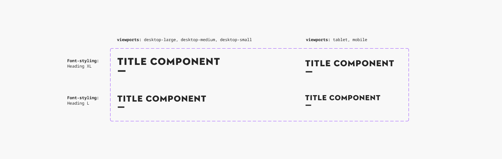
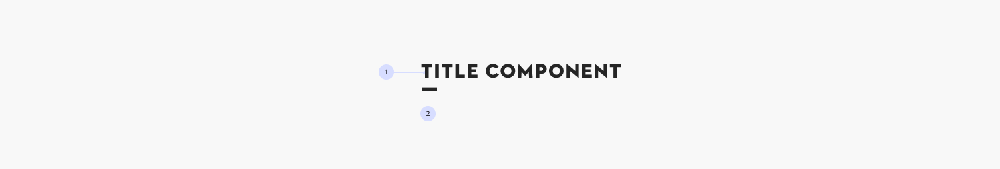
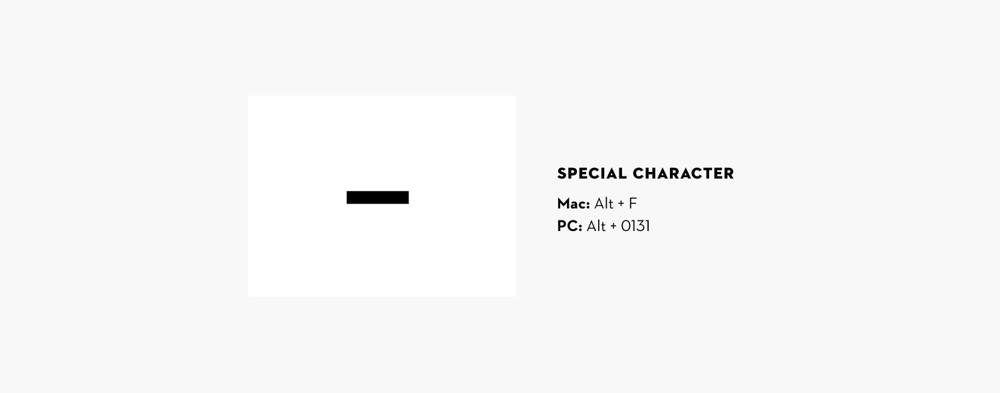
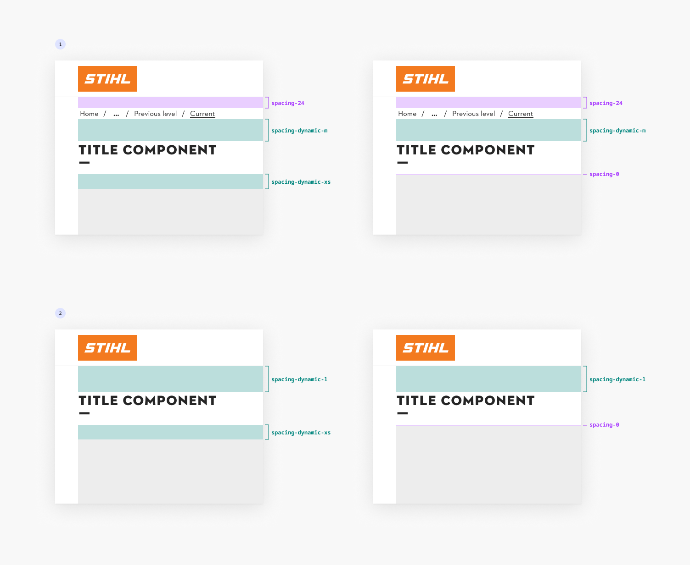

# Title

## Title

Overview:

- The brand's unique font and stand line are designed for impactful and emotional [headlines](https://www.figma.com/design/d9wrOp4aCplDsV9AVC87Xn/Typography-%F0%9F%85%B0%EF%B8%8F?node-id=0-1).
- The stand line is a special character implemented in the STIHL Contraface Digital Display Title font.

### Related elements

[Typography](https://www.figma.com/design/d9wrOp4aCplDsV9AVC87Xn/Typography-%F0%9F%85%B0%EF%B8%8F?node-id=0-1)

### Contribute

Contribute to improving this component by sharing your feedback, asking questions, or suggesting features [here](https://www.figma.com/design/lLmw7PfIdKjFG4uT3B2Hyj/Onboarding-%F0%9F%93%96?node-id=446-868&t=zKmRu4kAkxMeRDmK-4).

## Formatting and Construction

### Anatomy

1. **Title Text**
1. **Stand line**

In the component the two elements are separate to ensure proper function in Figma

### Stand Line

As the brand’s definitive typographical distinguishing feature, primary, emotional headlines are always presented in as large a format as possible in STIHL Contraface Digital Display Title.

The stand line emphasizes the statement and supports the headline. Please avoid using the stand line excessively. One of these particularly strongly emphasized headlines per view or section is completely sufficient.

The stand line is a special character implemented in the STIHL Contraface Digital Display Title font and can be accessed with these shortcuts:

Mac: Alt + F PC: Alt + 0131 More guidelines can be found in the [STIHL Brand Portal](https://brandportal.stihl.com/de/basiselemente/typografie)

### Spacing Guidelines

The Title component uses flexible spacing to adapt to different layouts. These are guidelines, not strict rules — adjust them as needed.

For more information, see our [general spacing guidelines](https://www.figma.com/design/JyyYtoCYbtJrzqHs38OXSQ/Grid---Spacing-%F0%9F%A7%AE?node-id=1-1253).

Spacing **above** the Title

1. **With Breadcrumbs** Two spacings apply:
   - Between the Header and Breadcrumbs
   - Between Breadcrumbs and the Title
1. **Without Breadcrumbs** One spacing applies:
   - Between the Header and the Title

Spacing **below** the Title

- **spacing-dynamic-xs**: Use when the following content is more structured (e.g., cards, tables, forms). This provides breathing room and clearer separation.
- **spacing-0**: Use when the Title should be visually grouped with the following content, such as introductory or descriptive text.

The exact spacing depends on context — always prioritize clarity and readability.

## Examples
